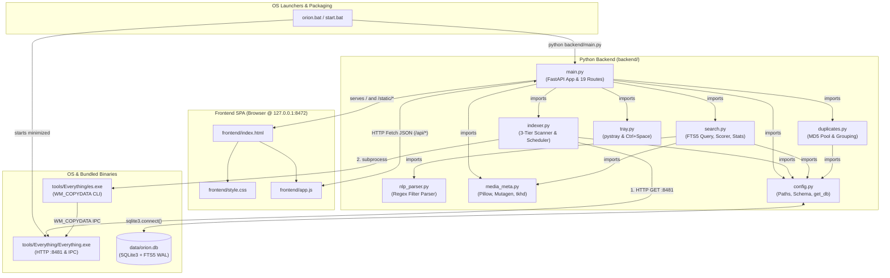
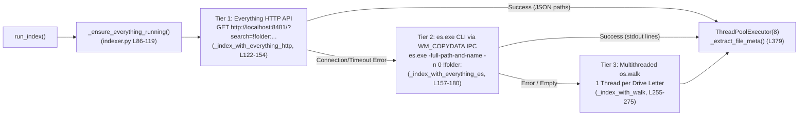

# Orion: Multithreaded Neural Semantic PC Search System
## Document 1 — Architecture & Technology Overview

**Project Title:** Orion: Multithreaded Neural Semantic PC Search System (Version 1.0)  
**Document:** 1 of 4 — Architecture & Technology Overview  
**Authors / Team:**  
- **Devansh Bhargav** (Enrollment No. BTCS24O1038)  
- **Divyansh S. Thakur** (Enrollment No. BTCS24O1044)  

**Institution:** Madhav Institute of Technology & Science (MITS), Gwalior  
**Project Mentor:** Ms. Manisha Pathak  

---

> **How to Read This Document**  
> This document is the first installment in a four-part technical documentation suite for **Orion (Version 1.0)**. It is designed to orient an engineer, reviewer, or academic examiner in roughly 20 minutes by establishing *what* Orion does, *how* its source tree is organized, *how* its modules communicate, and *why* each underlying technology was chosen. Once you have the architectural map from this document, proceed to **Doc 2: System Internals (database, indexing, search pipeline, API, UI flow)** for data structures, SQL schemas, and state machines; **Doc 3: Code Deep Dive (function by function)** for line-by-line algorithmic analysis of every file; and **Doc 4: Installer, Packaging, Assets & Appendix** for build distribution, UAC elevation mechanics, and bundled binary configurations.

---

## Table of Contents

1. [What Orion Is & The Problem It Solves](#1-what-orion-is--the-problem-it-solves)
   - 1.1 [The Desktop Search Bottleneck](#11-the-desktop-search-bottleneck)
   - 1.2 [The Orion Solution & Naming Note](#12-the-orion-solution--naming-note)
   - 1.3 [Complete Feature Inventory](#13-complete-feature-inventory)
2. [Source Tree & File Inventory](#2-source-tree--file-inventory)
   - 2.1 [Annotated Directory Tree](#21-annotated-directory-tree)
   - 2.2 [Master File Table](#22-master-file-table)
3. [Inter-Module Linkage & Communication Architecture](#3-inter-module-linkage--communication-architecture)
   - 3.1 [Backend Python Import Graph](#31-backend-python-import-graph)
   - 3.2 [Frontend-to-Backend HTTP JSON Bridge](#32-frontend-to-backend-http-json-bridge)
   - 3.3 [Launcher Scripts (`orion.bat`, `start.bat`, `setup.bat`)](#33-launcher-scripts-orionbat-startbat-setupbat)
   - 3.4 [Everything.exe Integration Tier](#34-everythingexe-integration-tier)
4. [Technology Stack Deep Dive](#4-technology-stack-deep-dive)
   - 4.1 [Core Runtime & Web Framework (Python, FastAPI, Uvicorn/ASGI, Pydantic)](#41-core-runtime--web-framework-python-fastapi-uvicornasgi-pydantic)
   - 4.2 [Persistence & Full-Text Search (SQLite3, WAL Mode, FTS5)](#42-persistence--full-text-search-sqlite3-wal-mode-fts5)
   - 4.3 [File Discovery Engines (Everything HTTP API, `es.exe` IPC, Multithreaded `os.walk`)](#43-file-discovery-engines-everything-http-api-esexe-ipc-multithreaded-oswalk)
   - 4.4 [Concurrency & OS Integration (`threading`, `ThreadPoolExecutor`, `ctypes`, `schtasks`)](#44-concurrency--os-integration-threading-threadpoolexecutor-ctypes-schtasks)
   - 4.5 [Media Inspection & Hashing (`Pillow`, `mutagen`, `struct`, `hashlib`)](#45-media-inspection--hashing-pillow-mutagen-struct-hashlib)
   - 4.6 [Desktop Presence (`pystray`, `keyboard`, `webbrowser`)](#46-desktop-presence-pystray-keyboard-webbrowser)
   - 4.7 [Frontend Stack (HTML5, CSS3 Custom Properties, Vanilla ES6+ JS, Fetch API)](#47-frontend-stack-html5-css3-custom-properties-vanilla-es6-js-fetch-api)
   - 4.8 [Windows Batch & PowerShell Automation](#48-windows-batch--powershell-automation)
   - 4.9 [Unused / Reserved Dependencies & Schema Fields](#49-unused--reserved-dependencies--schema-fields)
5. [Feature-to-Code Traceability Matrix](#5-feature-to-code-traceability-matrix)
6. [High-Level Runtime Lifecycle](#6-high-level-runtime-lifecycle)

---

## 1. What Orion Is & The Problem It Solves

### 1.1 The Desktop Search Bottleneck
Modern personal computers routinely store between 300,000 and 2,000,000 files across multiple NTFS partitions. Built-in operating system search utilities—specifically **Windows Search (`SearchIndexer.exe`)**—suffer from three well-known engineering trade-offs:
1. **Heavy Background Resource Consumption:** Windows Search continuously indexes file contents and properties in the background, frequently spiking disk I/O and CPU usage when the user is actively working.
2. **Opaque & Rigid Query Syntax:** Finding a file using natural human recall—such as *"videos from last month larger than 500MB"* or *"pdf files bigger than 10mb modified this week"*—requires memorizing arcane Advanced Query Syntax (`kind:video datemodified:last month size:>500mb`), which most users never do.
3. **Fragmented Utility Tooling:** Inspecting EXIF camera parameters on photos, ID3 bitrates on audio tracks, MP4 container dimensions, drive-wide storage distributions, or content-identical duplicate files requires launching three or four separate third-party applications.

### 1.2 The Orion Solution & Naming Note
**Orion** is a lightweight, self-hosted Windows desktop file-search engine that runs a local Python **FastAPI** server on `http://127.0.0.1:8472` paired with a responsive, zero-dependency Single-Page Application (SPA) frontend. By combining the raw NTFS Master File Table (MFT) speed of voidtools' **Everything** with **SQLite FTS5** inverted indexes, regex-driven natural-language filter parsing, and a multi-signal relevance scorer, Orion answers complex multi-constraint queries in single-digit milliseconds.

> [!NOTE]
> **A Note on Project Naming vs. Version 1.0 Scope:**  
> While the overarching academic project is titled *"Orion: Multithreaded Neural Semantic PC Search System"*, **Version 1.0 (the subject of this documentation series) contains zero artificial intelligence, machine learning, CLIP embeddings, or LLM runtime execution.** All query understanding in Version 1.0 is performed deterministically via regular-expression grammar rules (`backend/nlp_parser.py`) and weighted heuristic ranking (`backend/search.py`). A few forward-compatible placeholders exist in the codebase—specifically the `ai_description TEXT DEFAULT NULL` column in `files` (`config.py` L126), the `gemini_api_key` setting in `main.py` (L365) / `index.html` (L352–362), and meta description strings—which are reserved for future versions and remain inert in Version 1.0.

### 1.3 Complete Feature Inventory
Orion Version 1.0 provides 15 cohesive user-facing capabilities:

1. **Search Bar with Natural-Language Filters:** Parses conversational queries (e.g., *"pdf files bigger than 10mb modified this week"*, *"between 10mb and 500mb"*, *"2024"*, *"1080p"*) into structured SQL constraints for file type, extension, byte size ranges, relative/calendar dates, duration, and resolution (`nlp_parser.py` → `parse_filters()`, L121–225).
2. **Interactive Sidebar File-Type, Date, Size & Drive Filters:** One-click category chips (`All Files`, `Documents`, `Images`, `Videos`, `Audio`, `Archives`, `Code`) with live result badges, paired with dropdown selectors for modification date, size tiers (`tiny` to `huge`), and indexed drive letters (`index.html` L69–134, `app.js` L253–285).
3. **Instant Folder Discovery:** Dynamically extracts and ranks matching directory paths from indexed file paths without requiring a separate folders table or re-indexing, floating matching folders to the top of results with a fixed score of `90` (`search.py` → `_search_folders()`, L232–304).
4. **Rich Preview Panel with Thumbnails & Media Metadata:** Clicking any result opens a slide-out inspector (`340px` wide) that asynchronously fetches on-the-fly base64 JPEG thumbnails (auto-rotated via EXIF orientation), image dimensions/camera EXIF (`DateTimeOriginal`, `Make`, `Model`, `FocalLength`, `ISOSpeedRatings`, `GPSInfo`), audio tags (`title`, `artist`, `album`, `duration`, `bitrate`, album art presence), and MP4 binary `tkhd` video resolution (`media_meta.py` L11–209, `app.js` L370–468).
5. **Recently Modified Files Home Grid:** Displays the 12 most recently modified files as animated mini-cards on the home screen (`main.py` → `api_recent()`, L138–140; `app.js` → `loadRecentFiles()`, L531–552).
6. **Index Statistics Dashboard:** Visualizes total indexed files, cumulative byte size, number of drives, last indexed timestamp, proportional bar charts by file category, and per-drive file counts (`search.py` → `get_stats()`, L343–375; `app.js` → `loadStats()`, L631–687).
7. **Content-Based Duplicate Finder:** Runs a background 4-thread MD5 hashing pass over files up to 4 GB (`4,294,967,296` bytes) and groups files with identical content hashes and sizes (`>= 1024` bytes) regardless of filename or directory (`duplicates.py` L22–139, `app.js` L690–744).
8. **Persistent Search History & Autocomplete:** Logs up to 50 recent queries in SQLite, powering a 200ms-debounced prefix autocomplete dropdown on both the home and header search bars, plus a dedicated history clock menu (`search.py` L378–420, `app.js` L131–199).
9. **Excluded Paths Management:** Pre-seeds 11 noisy system/developer paths (`C:\Windows`, `node_modules`, `.git`, etc.) and lets users add or remove custom exclusion prefixes via the Settings UI (`config.py` L30–42, `main.py` L336–356).
10. **Theme & View Mode Persistence:** Toggles seamlessly between Dark (`#0a0a0f`) and Light (`#f0f0f8`) themes and List vs. Grid result layouts, persisting preferences in both browser `localStorage` and the backend SQLite `settings` table (`app.js` L41–55, L471–479).
11. **Multi-Tier Background Indexing & Live Scan Progress Page:** Automatically indexes via Everything's HTTP API (`port 8481`), Everything's `es.exe` CLI, or a per-drive multithreaded `os.walk` fallback, repeating every 4 hours (`indexer.py` L421–453). A dedicated **Scan Progress** page displays a 4-stage visual pipeline (`Idle` → `Scanning` → `Inserting` → `Complete`), 6 live telemetry cards (elapsed time, folders visited, files found, DB count, insert rate, ETA), a progress bar, and a reverse-chronological event timeline (`index.html` L225–312, `app.js` L836–960).
12. **System Tray Icon:** Places an interactive telescope/Orion icon in the Windows notification area with `"🔭 Open Orion"` and `"Quit Orion"` context menu actions (`tray.py` → `run_tray()`, L79–98).
13. **Global `Ctrl+Space` & In-App `Ctrl+K` Hotkeys:** Registers an OS-wide `Ctrl+Space` hook via the `keyboard` library to summon the Orion web UI from any application (`tray.py` L101–110), alongside an in-browser `Ctrl+K` shortcut to focus the active search input (`app.js` L969–978).
14. **Sandbox-Escaping File & Folder Actions:** Opens files in their default OS handler (`os.startfile`) or highlights items inside Windows Explorer using a 3-stage fallback cascade (`schtasks /create ... /it` interactive task → Win32 `SHOpenFolderAndSelectItems` PIDL call → `os.startfile` parent directory) plus PowerShell `Set-Clipboard` path copying (`main.py` L167–262).

---

## 2. Source Tree & File Inventory

### 2.1 Annotated Directory Tree
Every file in the Orion 1.0 source tree (`orion1_src`), along with the external packaging and installer scripts that wrap it, is cataloged below:

```text
orion1_src/                                  # Root application directory (extracted to %USERPROFILE%\Orion)
├── orion.bat                                # Primary production launcher: UAC elevation, starts Everything.exe & main.py
├── start.bat                                # Developer launcher: UAC elevation, dependency check, foreground main.py
├── setup.bat                                # Standalone dependency installer, Everything downloader & shortcut creator
├── requirements.txt                         # Pip dependency specification (8 packages)
├── assets/                                  # Static graphical branding assets
│   ├── orion_icon.ico                       # Windows icon file used for the Desktop .lnk shortcut
│   └── orion_icon.png                       # High-res PNG icon used by favicon and system tray (resized to 64x64)
├── backend/                                 # Python FastAPI server & core search/indexing modules
│   ├── config.py                            # Central constants, EXTENSION_MAP, SQLite connection & schema init
│   ├── duplicates.py                        # Multithreaded MD5 file hashing and duplicate group SQL queries
│   ├── indexer.py                           # 3-tier file discovery (Everything HTTP -> es.exe -> os.walk) & batch DB writer
│   ├── main.py                              # FastAPI lifespan, static file mounting, 19 HTTP route handlers, Uvicorn entry
│   ├── media_meta.py                        # Pillow EXIF/thumbnails, Mutagen audio tags/art, MP4 binary tkhd parser
│   ├── nlp_parser.py                        # Regex natural-language query parser for size, date, type, duration, resolution
│   ├── search.py                            # FTS5 query builder, multi-signal scorer, folder search, recent files & stats
│   └── tray.py                              # pystray Windows system tray icon and global Ctrl+Space keyboard hook
├── frontend/                                # Zero-dependency Single-Page Application (served at / and /static)
│   ├── index.html                           # SPA DOM shell: header, sidebar filters, and 6 switchable page views
│   ├── style.css                            # Dark/Light CSS variables, responsive flexbox/grid layouts, keyframe animations
│   └── app.js                               # Client state, Fetch API calls, DOM card rendering, polling loops, preview logic
└── tools/
    └── Everything/                          # Bundled voidtools Everything portable suite for raw NTFS MFT indexing
        ├── Everything.exe                   # Everything search engine binary (v1.4.x) with built-in HTTP & IPC servers
        ├── Everything.ini                   # Pre-configured settings (run_as_admin=1, http_server_port=8481, C: NTFS monitor)
        ├── Everything.lng                   # Localization pack for the Everything binary
        ├── es.exe                           # Everything command-line interface binary (queries Everything.exe via WM_COPYDATA)
        └── cli.c                            # Reference C source code (David Carpenter, v1.1.0.27) for es.exe

[External Build & Installer Scripts in Repository Root]
├── package_build.py                         # Compresses source tree into installer/orion.zip (DEFLATED, level 6)
└── installer/
    ├── Install Orion.bat                    # End-user installer: checks/installs Python 3.11, extracts zip, installs pip deps
    └── orion.zip                            # Distributable archive generated by package_build.py
```

### 2.2 Master File Table
Line counts and byte sizes below are exact measurements from the Orion 1.0 source tree.

| File Path | Language / Format | Primary Purpose | Lines / Size |
| :--- | :--- | :--- | :--- |
| [`orion.bat`](file:///C:/Users/devan/.gemini/antigravity/brain/deffb706-24d2-4162-affe-2fa1deb41668/scratch/orion1_src/orion.bat) | Windows Batch | Production launcher; self-elevates via UAC, starts `Everything.exe -startup` and `backend\main.py` minimized, auto-closes after 4s. | 68 lines (2,053 B) |
| [`start.bat`](file:///C:/Users/devan/.gemini/antigravity/brain/deffb706-24d2-4162-affe-2fa1deb41668/scratch/orion1_src/start.bat) | Windows Batch | Interactive launcher; verifies `import fastapi` (calls `setup.bat` if missing), starts `Everything.exe`, runs `main.py` in foreground console. | 53 lines (1,645 B) |
| [`setup.bat`](file:///C:/Users/devan/.gemini/antigravity/brain/deffb706-24d2-4162-affe-2fa1deb41668/scratch/orion1_src/setup.bat) | Windows Batch | Standalone environment setup; upgrades `pip`, installs `requirements.txt`, optionally downloads Everything 1.4.1.1024, creates Desktop shortcut. | 90 lines (2,768 B) |
| [`requirements.txt`](file:///C:/Users/devan/.gemini/antigravity/brain/deffb706-24d2-4162-affe-2fa1deb41668/scratch/orion1_src/requirements.txt) | Pip Requirements | Declares 8 third-party Python libraries (`fastapi`, `uvicorn[standard]`, `pystray`, `keyboard`, `Pillow`, `mutagen`, `python-multipart`, `aiofiles`). | 9 lines (148 B) |
| [`assets/orion_icon.ico`](file:///C:/Users/devan/.gemini/antigravity/brain/deffb706-24d2-4162-affe-2fa1deb41668/scratch/orion1_src/assets/orion_icon.ico) | ICO Binary | Windows icon resource assigned to `%USERPROFILE%\Desktop\Orion.lnk` by the installer. | Binary (822 B) |
| [`assets/orion_icon.png`](file:///C:/Users/devan/.gemini/antigravity/brain/deffb706-24d2-4162-affe-2fa1deb41668/scratch/orion1_src/assets/orion_icon.png) | PNG Image | High-resolution application icon loaded by `tray.py` (downscaled to 64×64) and referenced in `index.html`. | Binary (1,389,866 B) |
| [`backend/config.py`](file:///C:/Users/devan/.gemini/antigravity/brain/deffb706-24d2-4162-affe-2fa1deb41668/scratch/orion1_src/backend/config.py) | Python 3 | Defines paths, server host/port (`127.0.0.1:8472`), `DEFAULT_EXCLUDED`, `EXTENSION_MAP` (83 extensions), SQLite WAL connection factory, and `init_db()` schema/triggers. | 232 lines (8,202 B) |
| [`backend/main.py`](file:///C:/Users/devan/.gemini/antigravity/brain/deffb706-24d2-4162-affe-2fa1deb41668/scratch/orion1_src/backend/main.py) | Python 3 | FastAPI app initialization, `lifespan` startup manager, `/static` mount, 19 REST endpoints, Explorer sandbox bypass, and Uvicorn runner. | 386 lines (14,775 B) |
| [`backend/indexer.py`](file:///C:/Users/devan/.gemini/antigravity/brain/deffb706-24d2-4162-affe-2fa1deb41668/scratch/orion1_src/backend/indexer.py) | Python 3 | File discovery engine (Everything HTTP API → `es.exe` → multithreaded `os.walk`), `os.stat` pool, 5,000-row batch `UPSERT`, stale cleanup, 4-hour scheduler daemon. | 477 lines (16,633 B) |
| [`backend/search.py`](file:///C:/Users/devan/.gemini/antigravity/brain/deffb706-24d2-4162-affe-2fa1deb41668/scratch/orion1_src/backend/search.py) | Python 3 | FTS5 full-text search execution, `LIKE` fallback, `_score_result()` (0–100 scale), `_search_folders()`, `get_recent_files()`, `get_stats()`, and search history CRUD. | 420 lines (15,644 B) |
| [`backend/nlp_parser.py`](file:///C:/Users/devan/.gemini/antigravity/brain/deffb706-24d2-4162-affe-2fa1deb41668/scratch/orion1_src/backend/nlp_parser.py) | Python 3 | Natural-language constraint extractor using regexes and lookup dictionaries for file types, sizes, date ranges, years, durations, and video resolutions. | 255 lines (10,123 B) |
| [`backend/media_meta.py`](file:///C:/Users/devan/.gemini/antigravity/brain/deffb706-24d2-4162-affe-2fa1deb41668/scratch/orion1_src/backend/media_meta.py) | Python 3 | Extracts image dimensions/EXIF and base64 JPEG thumbnails via Pillow, audio tags/cover art via Mutagen, and MP4/MOV dimensions via binary `tkhd` atom unpacking. | 232 lines (8,061 B) |
| [`backend/duplicates.py`](file:///C:/Users/devan/.gemini/antigravity/brain/deffb706-24d2-4162-affe-2fa1deb41668/scratch/orion1_src/backend/duplicates.py) | Python 3 | Background 4-worker `ThreadPoolExecutor` computing 1 MB-chunked MD5 digests for up to 50,000 files (`< 4 GB`) and grouping duplicates via SQL `GROUP BY md5_hash`. | 139 lines (3,567 B) |
| [`backend/tray.py`](file:///C:/Users/devan/.gemini/antigravity/brain/deffb706-24d2-4162-affe-2fa1deb41668/scratch/orion1_src/backend/tray.py) | Python 3 | Spawns daemon threads for the `pystray` system tray icon and the `keyboard.add_hotkey("ctrl+space", ...)` global listener. | 124 lines (2,999 B) |
| [`frontend/index.html`](file:///C:/Users/devan/.gemini/antigravity/brain/deffb706-24d2-4162-affe-2fa1deb41668/scratch/orion1_src/frontend/index.html) | HTML5 | Single-page application markup containing the top header, collapsible sidebar filters, and 6 view containers (`home`, `results`, `scan`, `stats`, `dupes`, `settings`). | 396 lines (17,853 B) |
| [`frontend/style.css`](file:///C:/Users/devan/.gemini/antigravity/brain/deffb706-24d2-4162-affe-2fa1deb41668/scratch/orion1_src/frontend/style.css) | CSS3 | Design system built on CSS custom properties (`--bg`, `--primary`, etc.), `[data-theme="light"]` overrides, list/grid card rules, and animations (`shimmer`, `pulse-dot`). | 787 lines (30,979 B) |
| [`frontend/app.js`](file:///C:/Users/devan/.gemini/antigravity/brain/deffb706-24d2-4162-affe-2fa1deb41668/scratch/orion1_src/frontend/app.js) | JavaScript (ES6+) | Client-side state machine, `fetch()` API client, autocomplete debouncer, client-side sorting/filtering, preview panel enrichment, and scan telemetry polling. | 979 lines (39,952 B) |
| [`tools/Everything/Everything.exe`](file:///C:/Users/devan/.gemini/antigravity/brain/deffb706-24d2-4162-affe-2fa1deb41668/scratch/orion1_src/tools/Everything/Everything.exe) | Win64 PE Binary | Bundled voidtools Everything executable; reads NTFS USN Journal / MFT and serves queries over HTTP (`127.0.0.1:8481`) or Win32 IPC. | Binary (2,265,096 B) |
| [`tools/Everything/Everything.ini`](file:///C:/Users/devan/.gemini/antigravity/brain/deffb706-24d2-4162-affe-2fa1deb41668/scratch/orion1_src/tools/Everything/Everything.ini) | INI Config | Configuration file instructing `Everything.exe` to run as admin, enable its HTTP server on `127.0.0.1:8481`, and monitor `C:`. | 741 lines (20,717 B) |
| [`tools/Everything/Everything.lng`](file:///C:/Users/devan/.gemini/antigravity/brain/deffb706-24d2-4162-affe-2fa1deb41668/scratch/orion1_src/tools/Everything/Everything.lng) | Binary Resource | Multi-language string table bundled with `Everything.exe`. | Binary (934,469 B) |
| [`tools/Everything/es.exe`](file:///C:/Users/devan/.gemini/antigravity/brain/deffb706-24d2-4162-affe-2fa1deb41668/scratch/orion1_src/tools/Everything/es.exe) | Win32/64 PE Binary | Command-line client that queries a running `Everything.exe` instance via `WM_COPYDATA` IPC (`_index_with_everything_es()`). | Binary (154,128 B) |
| [`tools/Everything/cli.c`](file:///C:/Users/devan/.gemini/antigravity/brain/deffb706-24d2-4162-affe-2fa1deb41668/scratch/orion1_src/tools/Everything/cli.c) | C Source | Bundled source code for `es.exe` v1.1.0.27 (included in `tools/Everything/` as part of the voidtools CLI distribution; not compiled by Orion). | 6,284 lines (152,787 B) |
| [`package_build.py`](file:///C:/Users/devan/OneDrive/Desktop/Windows%20Google%20Project/package_build.py) | Python 3 | Build script in repository root; walks project tree, prunes `.git`/`data`/`__pycache__`, and writes `installer/orion.zip`. | 34 lines (1,302 B) |
| [`installer/Install Orion.bat`](file:///C:/Users/devan/OneDrive/Desktop/Windows%20Google%20Project/installer/Install%20Orion.bat) | Windows Batch | 5-step end-user installer: checks/installs Python 3.11 via `winget` or `python.org`, upgrades `pip`, extracts `orion.zip` to `%USERPROFILE%\Orion`, installs requirements, creates Desktop shortcut. | 263 lines (9,402 B) |

---

## 3. Inter-Module Linkage & Communication Architecture

### 3.1 Backend Python Import Graph
Orion's backend (`backend/`) is decomposed into **8 focused Python modules** totaling **2,265 lines of Python code**. When `python backend\main.py` is executed, `main.py` (L16) inserts `str(Path(__file__).parent)` into `sys.path`, enabling direct sibling imports across the `backend` package without requiring an `__init__.py` or package installation.

Every inter-module `import` statement has been verified directly against the source files:

1. **`main.py` imports from:**
   - `config` (L24–25): `import config as cfg` and `from config import init_db, get_db, get_excluded_paths, get_setting, set_setting` (plus lazy `from config import get_file_type` inside `api_meta()` at L284).
   - `indexer` (L26): `from indexer import get_status as indexer_status, trigger_reindex, start_background_indexer`.
   - `search` (L27–34): `from search import search as do_search, get_recent_files, get_stats, save_to_history, get_history, clear_history`.
   - `media_meta` (L35): `from media_meta import get_thumbnail_b64, get_image_meta, get_audio_meta, get_video_meta`.
   - `duplicates` (L36): `from duplicates import get_duplicates, start_duplicate_scan, duplicate_scan_status`.
   - `tray` (L37): `from tray import start_tray_and_hotkey`.
2. **`indexer.py` imports from:**
   - `config` (L21–24): `from config import get_db, get_file_type, get_excluded_paths, REINDEX_INTERVAL_HOURS, EXTENSION_MAP`.
3. **`search.py` imports from:**
   - `config` (L10): `from config import get_db, FILE_TYPE_ICONS, get_file_type`.
   - `nlp_parser` (L11): `from nlp_parser import parse_filters, date_filter_to_timestamps`.
   - `media_meta` (L12): `from media_meta import format_size, format_duration`.
4. **`duplicates.py` imports from:**
   - `config` (L13): `from config import get_db`.
5. **Leaf Modules (zero internal Orion imports):**
   - `config.py` (imports only standard library `os`, `sqlite3`, `json`, `pathlib.Path`).
   - `nlp_parser.py` (imports only standard library `re`, `datetime`, `timedelta`).
   - `media_meta.py` (imports only standard library `os`, `struct`, `pathlib.Path`, `io`, `base64` and third-party `PIL`, `mutagen`).
   - `tray.py` (imports only standard library modules and third-party `pystray`, `PIL.Image`, `keyboard`). Note that `tray.py` defines its own `ORION_URL = "http://127.0.0.1:8472"` and `ICON_PATH` constants (L33–34) rather than importing `config.py`.



### 3.2 Frontend-to-Backend HTTP JSON Bridge
Orion uses a strict client-server separation inside `127.0.0.1:8472`:
- **Static Delivery:** When the user navigates to `http://127.0.0.1:8472/`, `main.py` → `serve_index()` (L100–105) reads `frontend/index.html` from disk and returns it as an `HTMLResponse`. All supporting assets (`style.css`, `app.js`) are served by FastAPI's `StaticFiles` middleware mounted at `/static` (`main.py` L74).
- **RESTful JSON API:** `frontend/app.js` declares `const API = 'http://127.0.0.1:8472/api';` (L8). Every user interaction—typing a query, clicking a result card to open the preview pane, viewing statistics, triggering a duplicate scan, or modifying excluded folders—dispatches an asynchronous browser `fetch()` request to one of the 18 `/api/*` endpoints in `main.py`.
- **Exception (Direct `` Streaming):** There is one notable quirk in how thumbnails are loaded in the search results list vs. the preview panel:
  - In `app.js` → `buildResultCard()` (L344), image result cards render ``, expecting an image binary stream. However, `main.py` → `api_thumbnail()` (L266–274) returns a JSON object `{"thumbnail": b64}`, which causes the `` tag to fire its `onerror="this.parentElement.textContent='${r.icon}'"` fallback (L345) and gracefully display the `🖼️` emoji.
  - Conversely, when the user clicks a result to open the **Preview Panel**, `app.js` → `openPreview()` calls `GET /api/meta?path=...` (L416), extracts `meta.thumbnail` from the JSON response, and sets `src="data:image/jpeg;base64,${meta.thumbnail}"` (`enrichPreview()`, L426–433), which renders the high-resolution thumbnail properly.

### 3.3 Launcher Scripts (`orion.bat`, `start.bat`, `setup.bat`)
Orion provides three Windows batch scripts at the root of the project for different operational contexts:

1. **`orion.bat` (End-User Production Launcher, 68 lines):**  
   Targeted by the Desktop shortcut created by `Install Orion.bat`.
   - **Self-Elevation (L6–10):** Runs `net session >nul 2>&1`. If `errorlevel 1` (not administrator), it invokes PowerShell `Start-Process -FilePath '%~f0' -Verb RunAs -WorkingDirectory '%~dp0'` and exits the non-elevated shell. Elevating the parent batch script ensures that both `Everything.exe` (which requires raw NTFS volume read privileges) and `python backend\main.py` (which requires administrator privileges for the `keyboard` global hotkey hook and `schtasks` creation) inherit elevation from a single UAC prompt.
   - **Everything Daemon Startup (L41–48):** Checks `tasklist /FI "IMAGENAME eq Everything.exe"`. If not running, executes `start "" /min "%EVERYTHING_EXE%" -startup` and waits 2 seconds.
   - **Detached Backend Startup (L51–67):** Launches `start "" /min python backend\main.py` in a minimized window, prints the status banner (`http://127.0.0.1:8472`, `Ctrl+Space`), waits 6 seconds total, and closes the launcher console window.
2. **`start.bat` (Developer / Foreground Console Launcher, 53 lines):**  
   Also self-elevates via UAC (L5–9), checks if FastAPI is importable (`python -c "import fastapi"`, L14) and calls `setup.bat` if missing, starts `Everything.exe` from either `tools\Everything\` or `C:\Program Files\Everything\` (L21–33), ensures `data\` and `assets\` exist, and runs `python backend\main.py` synchronously in the foreground terminal (L52) so developers can inspect live Uvicorn logs and stop the server with `Ctrl+C`.
3. **`setup.bat` (Standalone Setup Utility, 90 lines):**  
   Used when setting up directly from source without `Install Orion.bat`. Verifies Python, upgrades `pip`, installs `requirements.txt` (L29), downloads `Everything-1.4.1.1024.x64-Setup.exe` from `voidtools.com` if `C:\Program Files\Everything\Everything.exe` is absent (L39–63), and creates a `Desktop\Orion Search.lnk` shortcut pointing to `start.bat` (L71–80).

### 3.4 Everything.exe Integration Tier
Scanning a 1 TB drive containing 1,000,000 files via standard POSIX/Win32 directory traversal (`os.walk`) requires hundreds of thousands of sequential `FindFirstFileW` / `FindNextFileW` system calls, taking 20 to 40 minutes. Voidtools' **Everything** bypasses directory traversal by reading the NTFS **Master File Table (MFT)** and subscribing to the **USN Change Journal**, enumerating all files on a volume in ~1–5 seconds.

Orion bundles a portable copy of `Everything.exe`, `Everything.ini`, and `es.exe` in `tools/Everything/` and interacts with it through a **3-tier cascading fallback** in `backend/indexer.py` (`_index_with_everything()`, L183–203):



1. **Tier 1 — Everything Built-in HTTP Server (`_index_with_everything_http()`, L122–154):**  
   `tools/Everything/Everything.ini` is pre-configured with `http_server_enabled=1` (L385), `http_server_bindings=127.0.0.1:8481` (L386), and `http_server_port=8481` (L388). If `Everything.exe` is not yet running when `_ensure_everything_running()` (L86–119) is called, Orion spawns it with `-startup -http-server -http-port 8481`. Orion then issues an HTTP GET request to:
   ```text
   http://localhost:8481/?search=!folder:&count=9999999&path_column=1&json=1&sort=path_ascending
   ```
   Using loopback HTTP completely avoids Windows User Interface Privilege Isolation (UIPI) issues where a non-elevated process cannot send Win32 window messages to an elevated `Everything.exe` window.
2. **Tier 2 — `es.exe` Command-Line IPC (`_index_with_everything_es()`, L157–180):**  
   If the HTTP server on port 8481 is unreachable (for instance, if the user already had a system-wide installation of `Everything.exe` running without the HTTP server plugin enabled), Orion locates `es.exe` (`_find_es_exe()`, L74–83) and runs:
   ```powershell
   es.exe -full-path-and-name -n 0 -sort path-ascending !folder:
   ```
   Internally (as shown in `tools/Everything/cli.c` L508–680), `es.exe` finds the hidden `EVERYTHING_TASKBAR_NOTIFICATION` window and sends a `WM_COPYDATA` message (`EVERYTHING_IPC_COPYDATA_QUERY2`) to retrieve all matching file paths over shared memory.
3. **Tier 3 — Per-Drive Multithreaded `os.walk` (`_index_with_walk()`, L255–275):**  
   If both Everything tiers return `None`, Orion enumerates all logical drives via `ctypes.windll.kernel32.GetLogicalDrives()` (`_get_all_drives()`, L207–218) and spawns a `ThreadPoolExecutor(max_workers=len(drives))` running `_walk_drive()` (L221–252) concurrently across every drive (`C:\`, `D:\`, etc.), pruning excluded folders in-place via `dirs[:] = [...]` so excluded subtrees are never entered.

---

## 4. Technology Stack Deep Dive

This section examines every technology, library, and protocol used in Orion 1.0—explaining what it is, how it works internally, why it was selected for this architecture, and exactly where it appears in the codebase.

### 4.1 Core Runtime & Web Framework (Python, FastAPI, Uvicorn/ASGI, Pydantic)

#### Python 3.9+ / 3.11
- **What it is & How it works:** Python is an interpreted, dynamically typed, high-level programming language managed by the CPython runtime. While CPython has a Global Interpreter Lock (GIL) that serializes pure Python bytecode execution within a single process, the GIL is **released** during OS-level I/O operations (`os.stat`, `os.walk`, file reads in `hashlib`, SQLite C-extension queries, and network sockets).
- **Why chosen for Orion:** Desktop file indexing and hashing are overwhelmingly I/O-bound and C-extension-bound workloads. Python allows rapid orchestration of Win32 APIs (`ctypes`), C-backed image/hash/database libraries (`Pillow`, `hashlib`, `sqlite3`), and an asynchronous HTTP server in just ~2,265 lines of code.
- **Where used:** All 8 files in `backend/*.py` and `package_build.py`. Checked and installed at version 3.11.9 by `installer/Install Orion.bat` (L47–105).

#### FastAPI (`>=0.104.0`)
- **What it is & How it works:** FastAPI is a modern, high-performance Python web framework built atop **Starlette** (for ASGI routing and static file serving) and **Pydantic** (for declarative data validation). It inspects Python type annotations at startup to automatically parse query parameters, validate JSON request bodies, serialize Python `dict` objects into JSON responses, and manage application startup/shutdown via an async context manager (`lifespan`).
- **Why chosen for Orion:** Rather than bundling a heavy desktop GUI framework like Electron (~150 MB RAM overhead) or wrestling with dated Tkinter/PyQt styling, FastAPI lets Orion expose its local search engine as a clean REST API on `127.0.0.1:8472` while leveraging the user's existing browser rendering engine for a 60fps CSS3/JS interface.
- **Where used:** `backend/main.py` — `lifespan()` context manager (L48–60), `FastAPI(...)` instantiation (L62), `CORSMiddleware` registration (L64–69), `StaticFiles` mount (L74), and 19 `@app.get` / `@app.post` / `@app.delete` route decorators (L100–373).

#### Uvicorn (`>=0.24.0`) & ASGI
- **What it is & How it works:** **ASGI** (Asynchronous Server Gateway Interface) is the spiritual successor to WSGI, defining an asynchronous, event-driven contract (`async def app(scope, receive, send)`) between Python web servers and frameworks. **Uvicorn** is a lightning-fast ASGI server implementation based on `uvloop` / `asyncio` and `httptools`. When `async def` endpoints are called in `main.py`, Uvicorn handles concurrent HTTP requests (such as simultaneous thumbnail requests, status polling, and search queries) on its event loop.
- **Why chosen for Orion:** When rendering a search result list containing 20+ images or polling `/api/index/status` every 2 seconds while running searches, the browser opens multiple parallel HTTP connections. Uvicorn serves these non-blocking requests with sub-millisecond framing overhead.
- **Where used:** `backend/main.py` (L377–385) — `uvicorn.run("main:app", host=cfg.HOST, port=cfg.PORT, reload=False, log_level="info")`.

#### Pydantic (`BaseModel`)
- **What it is & How it works:** Pydantic is a data validation library (v2 uses a Rust core, `pydantic-core`) that coerces and validates incoming JSON payloads against Python class definitions inheriting from `BaseModel`. If a required field is missing or of an incompatible type, Pydantic automatically returns an HTTP `422 Unprocessable Entity` response before the endpoint body executes.
- **Why chosen for Orion:** Provides type-safe parsing for POST/DELETE JSON bodies (`path` strings and `is_folder` booleans) without manual `isinstance()` boilerplate.
- **Where used:** `backend/main.py` — `PathRequest(BaseModel)` (L162–164, used by `/api/open-folder`, `/api/open-file`, `/api/copy-path`) and `ExcludePath(BaseModel)` (L332–333, used by `POST /api/exclude` and `DELETE /api/exclude`).

---

### 4.2 Persistence & Full-Text Search (SQLite3, WAL Mode, FTS5)

#### SQLite3 (`sqlite3` Standard Library) & WAL Mode
- **What it is & How it works:** SQLite is an in-process, serverless, transactional relational database engine written in C that stores the entire database—tables, indices, and triggers—inside a single cross-platform file (`data/orion.db`). By default, SQLite uses a rollback journal that locks the database file during writes. Orion explicitly enables **Write-Ahead Logging (`PRAGMA journal_mode=WAL`)** alongside `PRAGMA synchronous=NORMAL` and a 64 MB page cache (`PRAGMA cache_size=-64000`). In WAL mode, modifications are appended to a separate `orion.db-wal` file, allowing multiple reader threads (e.g., `/api/search` or `/api/stats`) to query the database concurrently while the background indexer (`indexer.py`) or duplicate hasher (`duplicates.py`) is writing batches.
- **Why chosen for Orion:** Zero external database server setup is required from the user; `orion.db` persists across reboots so subsequent startups skip the initial scan completely (`indexer.py` L436–447); and 6 B-Tree secondary indexes (`idx_files_type`, `idx_files_modified`, `idx_files_size`, `idx_files_drive`, `idx_files_ext`, `idx_files_md5` in `config.py` L190–195) make structured filtering instantaneous.
- **Where used:**
  - `backend/config.py`: `get_db()` (L98–105), `init_db()` (L108–202), `get_setting()` (L205–214), `set_setting()` (L217–224), `get_excluded_paths()` (L227–231).
  - `backend/indexer.py`: `_insert_batch()` (L307–327), `_remove_stale_files()` (L330–337), `_scheduler_loop()` (L427–432).
  - `backend/search.py`: `search()` (L131–175), `_fallback_like_search()` (L209–228), `_search_folders()` (L232–304), `get_recent_files()` (L308–340), `get_stats()` (L343–375), `save_to_history()` / `get_history()` / `clear_history()` (L378–420).
  - `backend/duplicates.py`: `compute_hashes()` (L51–79), `get_duplicates()` (L88–127).

#### SQLite FTS5 (Full-Text Search Version 5)
- **What it is & How it works:** **FTS5** is an SQLite virtual table module that builds an **inverted index** (mapping normalized word tokens to sorted lists of document `rowid`s and token positions). Instead of scanning every row in `files` with `LIKE '%token%'` ($O(N)$ complexity), an FTS5 `MATCH` query looks up each token in its B-Tree dictionary ($O(\log V)$) and intersects/unions the posting lists, scoring matches using the **BM25** probabilistic relevance algorithm (`fts.rank`).
- **How Orion configures FTS5:** In `backend/config.py` (L132–162), Orion creates `files_fts` as an **external content table** (`content='files', content_rowid='id'`) so FTS5 does not duplicate the raw text strings already stored in `files`. Furthermore, Orion configures a custom `unicode61` tokenizer with file-path-aware separator characters:
  ```sql
  CREATE VIRTUAL TABLE IF NOT EXISTS files_fts USING fts5(
      path,
      filename,
      tokenize = 'unicode61 separators ''_-. ()[]{}#@!''',
      content  = 'files',
      content_rowid = 'id'
  )
  ```
  Because filenames routinely concatenate words with underscores, hyphens, dots, or brackets (e.g., `final_project-report(v2).pdf`), treating `_-. ()[]{}#@!` as token separators splits `final_project-report(v2).pdf` into distinct searchable tokens `final`, `project`, `report`, `v2`, and `pdf`. Three SQL triggers (`files_ai`, `files_ad`, `files_au` at L143–162) automatically synchronize `files_fts` whenever rows in `files` are inserted, deleted, or updated.
- **Where used:** Defined in `config.py` → `init_db()` (L132–162); queried in `search.py` → `search()` (L138–154).

---

### 4.3 File Discovery Engines (Everything HTTP API, `es.exe` IPC, Multithreaded `os.walk`)

#### Everything (`Everything.exe` HTTP API & `es.exe` IPC)
- **What it is & How it works:** Developed by David Carpenter (voidtools), **Everything** is a native C/Win32 indexing engine for NTFS and ReFS volumes. Rather than asking the OS filesystem driver to open folders one by one, Everything opens a raw volume handle (`\\.\C:`) using administrator privileges and reads the NTFS **Master File Table (`$MFT`)** directly from disk, building an in-memory array of every file and folder record on a 1 TB drive in ~1–3 seconds. It then monitors the NTFS **USN Journal (`$UsnJrnl:$J`)** in real time (`usn_record_filter=0xffffffff` in `Everything.ini` L253) to keep its index continuously updated with zero CPU overhead.
- **Why chosen for Orion:** Reduces Phase 1 path discovery (`scanning` phase) from ~20–40 minutes down to ~5 seconds, while Orion still maintains its own SQLite + FTS5 database on top so it can store `os.stat` sizes/timestamps, MD5 duplicate hashes, file-type classifications, and run offline even if Everything is closed later.
- **Where used:** Launched in `orion.bat` (L41–48) and `start.bat` (L21–33); managed and queried in `backend/indexer.py` via `_find_es_exe()` (L74–83), `_ensure_everything_running()` (L86–119), `_index_with_everything_http()` (L122–154), `_index_with_everything_es()` (L157–180), and `_index_with_everything()` (L183–203).

#### Multithreaded `os.walk` Fallback
- **What it is & How it works:** Python's `os.walk(top, topdown=True)` recursively traverses directory trees using the OS's directory enumeration system calls (`scandir` / `FindFirstFileW` on Windows). When `topdown=True`, mutating the `dirs` list in-place (`dirs[:] = [...]` or `dirs.clear()`) instructs `os.walk` not to recurse into pruned subdirectories.
- **Why chosen for Orion:** Guarantees 100% self-contained portability. Even on FAT32/exFAT drives, network shares, or restricted environments where `Everything.exe` cannot read the NTFS MFT, Orion still indexes the entire PC reliably.
- **Where used:** `backend/indexer.py` — `_get_all_drives()` (L207–218), `_walk_drive()` (L221–252), and `_index_with_walk()` (L255–275).

---

### 4.4 Concurrency & OS Integration (`threading`, `ThreadPoolExecutor`, `ctypes`, `schtasks`)

#### `threading` & `concurrent.futures.ThreadPoolExecutor`
- **What it is & How it works:** Python's `threading` module creates native OS threads (`_beginthreadex` on Windows), while `ThreadPoolExecutor` manages a pool of reusable worker threads that consume tasks from a thread-safe queue.
- **Why chosen for Orion:** Keeping the FastAPI HTTP server responsive at all times requires offloading long-running work (drive scanning, `os.stat` metadata collection for ratusan-thousands of paths, MD5 hashing, system tray message loops, and global keyboard hooks) onto background daemon threads (`daemon=True`, which automatically terminate when the main process exits). Shared telemetry dicts and counters are protected by `threading.Lock()` instances (`_state_lock` in `indexer.py` L29; `_lock` in `duplicates.py` L19) to prevent race conditions when `/api/index/status` or `/api/duplicates/status` reads them.
- **Where used:**
  - `backend/main.py`: Spawns `start_tray_and_hotkey` daemon thread (L55), `threading.Timer(1.5, ...)` to open the browser after Uvicorn binds its socket (L56), and `_cleanup` daemon thread to delete temporary scheduled tasks (L213).
  - `backend/indexer.py`: `_scheduler_thread` running `_scheduler_loop()` (L455–465), `trigger_reindex()` spawning an on-demand `"orion-reindex"` thread (L473–476), `ThreadPoolExecutor(max_workers=len(drives))` in `_index_with_walk()` (L267), and `ThreadPoolExecutor(max_workers=8)` with `pool.map(_extract_file_meta, paths, chunksize=200)` in `run_index()` (L379–380).
  - `backend/duplicates.py`: `start_duplicate_scan()` spawning `"orion-dupes"` thread (L135–138), and `ThreadPoolExecutor(max_workers=4)` in `compute_hashes()` (L68).
  - `backend/tray.py`: `start_tray_and_hotkey()` spawning `"orion-hotkey"` and `"orion-tray"` daemon threads (L113–123).

#### `ctypes` (Win32 Foreign Function Interface) & `schtasks` Sandbox Escape
- **What it is & How it works:** `ctypes` is Python's built-in Foreign Function Interface (FFI) library that calls exported C functions directly from Windows dynamic-link libraries (`kernel32.dll`, `shell32.dll`, `ole32.dll`).
- **Why chosen & Where used in Orion:**
  1. **Logical Drive Bitmask (`indexer.py` L211–215):** `_get_all_drives()` calls `ctypes.windll.kernel32.GetLogicalDrives()`, which returns a 32-bit integer where bit 0 represents `A:\`, bit 2 represents `C:\`, etc.
  2. **Opening & Highlighting Files in Windows Explorer (`main.py` → `api_open_folder()`, L168–237):**  
     Opening an Explorer window in the foreground and selecting a specific file (`explorer.exe /select,"path"`) is surprisingly tricky when the Python server is launched from an elevated background script or inside a process Job Object sandbox:
     - **Attempt 1 (`schtasks /it`, L189–216):** Registers a one-time interactive Windows Scheduled Task (`OrionExplorer_<hex8>`) with `/it` (run interactively on the user's active desktop session), runs it immediately via `schtasks /run`, and deletes it 3 seconds later in a background thread.
     - **Attempt 2 (Win32 `SHOpenFolderAndSelectItems`, L219–230):** If `schtasks` fails, calls `ctypes.windll.ole32.CoInitialize(None)`, converts the path to an `ITEMIDLIST` pointer (`pidl`) via `shell32.ILCreateFromPathW(target)`, invokes `shell32.SHOpenFolderAndSelectItems(pidl, 0, None, 0)` to open Explorer with the item highlighted, and frees the PIDL (`shell32.ILFree(pidl)`).
     - **Attempt 3 (`os.startfile`, L233–235):** Calls `os.startfile(folder)` (which wraps Win32 `ShellExecuteW`) on the parent directory as a guaranteed fallback.

---

### 4.5 Media Inspection & Hashing (`Pillow`, `mutagen`, `struct`, `hashlib`)

#### Pillow (`PIL >=10.0.0`)
- **What it is & How it works:** Pillow is the actively maintained fork of the Python Imaging Library (PIL), wrapping C libraries (`libjpeg`, `libpng`, `libwebp`, `zlib`) to decode image headers, read EXIF metadata tags without decoding full pixel buffers unless requested, and perform high-quality Lanczos downsampling.
- **Why chosen for Orion:** Enables fast on-demand thumbnail generation (`400×300` JPEG at quality 85, auto-rotated according to camera orientation via `ImageOps.exif_transpose`), EXIF camera metadata extraction for the preview panel, and programmatic fallback icon drawing if `assets/orion_icon.png` is missing.
- **Where used:**
  - `backend/media_meta.py`: `get_image_meta()` (L11–55) and `get_thumbnail_b64()` (L58–73).
  - `backend/main.py`: `_copy_icon()` (L80–96) draws a purple magnifying glass (`(124, 58, 237)` on `(10, 10, 15)`) using `ImageDraw` if `assets/orion_icon.png` does not exist.
  - `backend/tray.py`: `_load_tray_icon()` (L51–64) loads and resizes `orion_icon.png` to `64×64` for the system tray.

#### Mutagen (`>=1.47.0`) & Binary `struct` MP4 Parsing
- **What it is & How it works:** **Mutagen** is a pure-Python multimedia metadata library that parses ID3v2 frames (`.mp3`), Vorbis comments and FLAC picture blocks (`.flac`, `.ogg`), and MP4/M4A atoms (`.m4a`, `.mp4`, `.mov`). Because Mutagen's generic `File(path).info` reports duration and bitrate for MP4 videos but does not always expose video track pixel dimensions uniformly across containers, Orion supplements Mutagen with a custom binary atom parser (`_mp4_dimensions()`, `media_meta.py` L190–208) using Python's `struct` module. It reads up to the first `1 MB` of an `.mp4`/`.m4v`/`.mov` file, locates the ISO Base Media **`tkhd` (Track Header)** box signature (`b"tkhd"`), and unpacks the 16.16 fixed-point big-endian width and height integers at byte offsets `76:80` and `80:84`:
  ```python
  w = struct.unpack(">I", tkhd[76:80])[0] >> 16
  h = struct.unpack(">I", tkhd[80:84])[0] >> 16
  ```
- **Why chosen for Orion:** Zero external binary dependencies (no 100 MB `ffmpeg`/`ffprobe` binary needed) while still extracting audio tags, album art, duration, bitrate, and video resolution labels (`4k`, `1080p`, `720p`, `sd`).
- **Where used:** `backend/media_meta.py` — `get_audio_meta()` (L77–120), `get_audio_albumart_b64()` (L123–151), `get_video_meta()` (L155–187), and `_mp4_dimensions()` (L190–208).

#### `hashlib` (MD5 Content Hashing)
- **What it is & How it works:** Python's standard `hashlib` module interfaces with OpenSSL's C implementation of cryptographic and checksum digest algorithms. `hashlib.md5()` computes a 128-bit (32-character hexadecimal) fingerprint of arbitrary byte streams.
- **Why chosen for Orion:** For non-adversarial local duplicate file detection, MD5 is ideal: OpenSSL's C implementation hashes data at 400–600 MB/s per core while releasing the Python GIL. Reading files in `1 MB` (`1 << 20` = 1,048,576 byte) chunks keeps memory usage flat even when hashing multi-gigabyte video files.
- **Where used:** `backend/duplicates.py` — `_md5_of_file()` (L22–34), called across 4 threads by `compute_hashes()` (L37–85). Note: `indexer.py` also imports `hashlib` at L13, though all hashing logic lives in `duplicates.py`.

---

### 4.6 Desktop Presence (`pystray`, `keyboard`, `webbrowser`)

#### `pystray` (`>=0.19.5`)
- **What it is & How it works:** `pystray` is a cross-platform Python library that creates system tray (notification area) icons. On Windows, its `win32` backend registers a hidden window class, converts a `PIL.Image` into a Windows `HICON` handle, and invokes `Shell_NotifyIconW` (`NIM_ADD`, `NIM_MODIFY`, `NIM_DELETE`) while pumping Win32 window messages to handle right-click context menus and default double-click actions.
- **Why chosen for Orion:** Because Orion runs as a headless background service after `orion.bat` closes its console window, the system tray icon gives the user a persistent visual indicator that Orion is running, a one-click way to re-open the UI, and a clean `"Quit Orion"` action (`os._exit(0)`).
- **Where used:** `backend/tray.py` — `_quit_orion()` (L67–72), `_open_from_tray()` (L75–76), and `run_tray()` (L79–98).

#### `keyboard` (`>=0.13.5`)
- **What it is & How it works:** The `keyboard` library installs a low-level global Windows keyboard hook (`SetWindowsHookEx` with `WH_KEYBOARD_LL`) in a dedicated listener thread, intercepting keystroke events system-wide before or alongside the active foreground application.
- **Why chosen for Orion:** Allows Orion to behave like macOS Spotlight or PowerToys Run—pressing `Ctrl+Space` from inside any IDE, game, or document immediately triggers `_on_hotkey()` to bring up the Orion search interface.
- **Where used:** `backend/tray.py` — `_on_hotkey()` (L45–48) and `register_hotkey()` (L101–110).

#### `webbrowser` (Standard Library)
- **What it is & How it works:** Dispatches URL open requests to the operating system's default registered browser handler (`os.startfile` / `ShellExecuteW` on Windows).
- **Where used:** `backend/main.py` (L56, opens `http://127.0.0.1:8472` 1.5 seconds after server startup) and `backend/tray.py` → `_open_browser()` (L39–42, called on `Ctrl+Space` or tray click).

---

### 4.7 Frontend Stack (HTML5, CSS3 Custom Properties, Vanilla ES6+ JS, Fetch API)

#### HTML5, CSS3 Custom Properties & Vanilla ES6+ JavaScript
- **What it is & How it works:** Instead of using React, Vue, or a Webpack/Vite build step, Orion's frontend is written in pure, unbundled HTML5 (`frontend/index.html`, 396 lines), CSS3 (`frontend/style.css`, 787 lines), and modern ES6+ JavaScript (`frontend/app.js`, 979 lines).
  - **Single-Page View Switching (`app.js` → `showPage()`, L58–92):** All 6 application screens (`#home-screen`, `#results-page`, `#scan-page`, `#stats-page`, `#dupes-page`, `#settings-page`) reside simultaneously in `index.html`. Navigation simply toggles `el.style.display = 'none'` vs. `'flex'` and `.visible` classes, avoiding page reloads and preserving client-side state (`state` object in `app.js` L11–28).
  - **CSS Custom Properties Theme Engine (`style.css` L9–48):** All colors, borders, shadows, and dimensions are defined on `:root` (Dark theme default) and overridden under `[data-theme="light"]`. Switching themes (`applyTheme()`, `app.js` L52–55) mutates `document.documentElement.dataset.theme`, triggering an instant 0.3s CSS transition across the entire UI.
  - **Batch DOM Rendering via `DocumentFragment` (`app.js` → `renderResults()`, L309–314):** When rendering up to 200 search result cards, `app.js` constructs all cards inside an off-screen `document.createDocumentFragment()` and appends them to `#results-container` in a single DOM reflow.
- **Why chosen for Orion:** Zero `node_modules` bloat, zero build-step failure modes during installation on student/evaluator machines, instant page load over loopback, and complete transparency when inspecting source code in browser DevTools.

---

### 4.8 Windows Batch & PowerShell Automation
- **What it is & How it works:** Windows Batch (`.bat` interpreted by `cmd.exe`) and inline `powershell -Command "..."` invocations handle OS bootstrap tasks that must occur *before* Python is even installed or elevated: UAC privilege escalation (`Start-Process -Verb RunAs`), `winget` / `curl` Python 3.11 installation, ZIP archive extraction (`Expand-Archive`), COM-based `.lnk` shortcut creation (`New-Object -ComObject WScript.Shell`), and clipboard interaction (`Set-Clipboard`).
- **Where used:** `orion.bat`, `start.bat`, `setup.bat`, `installer/Install Orion.bat`, and `backend/main.py` → `api_copy_path()` (L252–262).

---

### 4.9 Unused / Reserved Dependencies & Schema Fields
In accordance with strict engineering transparency, the following items exist in the Orion 1.0 source tree as reserved scaffolding or transitive FastAPI dependencies that are **not** directly invoked at runtime:
1. **`python-multipart>=0.0.6` & `aiofiles>=23.2.1` (`requirements.txt` L7–8):** Standard companions for FastAPI form-data uploads and async file streaming; neither is directly imported by `backend/*.py` (`StaticFiles` in Starlette 0.27+ uses synchronous threadpool file reads rather than `aiofiles`).
2. **`ai_description TEXT DEFAULT NULL` (`config.py` L126, `search.py` L144/163/196, `app.js` L404–407):** Stored in the `files` table and returned in search results, and conditionally rendered in the preview panel if truthy, but no code in Orion 1.0 ever writes a non-`NULL` value to `ai_description`.
3. **`gemini_api_key` Setting (`main.py` L365, `index.html` L352–362, `app.js` L785–794):** The Settings page allows saving a `gemini_api_key` into the SQLite `settings` table, and `GET /api/settings` masks it as `"***"`, but no backend module in Orion 1.0 reads or calls the Gemini API.
4. **`get_audio_albumart_b64()` (`media_meta.py` L123–151):** Fully implemented helper to extract base64 cover art from FLAC/MP3/M4A files, but never imported or called by `main.py`.
5. **Parsed NLP Duration & Resolution Filters (`nlp_parser.py` L182–204):** `parse_filters()` extracts `duration_min`, `duration_max`, and `resolution` from the natural-language query, and `main.py` → `api_search()` accepts `resolution` (L118), but `search.py` → `_build_sql_filters()` (L69–112) only translates `type`, `extension`, `size_min`, `size_max`, `date`, `year`, and `drive` into SQL `WHERE` clauses because audio/video duration and image/video resolution are extracted on-demand in `/api/meta` rather than stored as columns in the `files` table.

---

## 5. Feature-to-Code Traceability Matrix

The table below maps every user-facing feature in Orion 1.0 from the HTML/JS frontend through the FastAPI HTTP endpoint down to the exact backend Python functions and line numbers.

| # | Feature | Frontend Function(s) (`frontend/app.js` & `index.html`) | HTTP API Endpoint (`backend/main.py`) | Backend Function(s) (`backend/*.py`) |
| :- | :--- | :--- | :--- | :--- |
| **1** | **Search Bar & Natural-Language Query Execution** | `setupSearchListeners()` (L101–118), `doSearch()` (L203–236), `renderResults()` (L288–315), `buildResultCard()` (L332–367) | `GET /api/search` (`api_search()`, L109–134) | `search.py` → `search()` (L115–206), `_build_sql_filters()` (L69–112), `_score_result()` (L29–66), `_fallback_like_search()` (L209–228); `nlp_parser.py` → `parse_filters()` (L121–225), `date_filter_to_timestamps()` (L228–255) |
| **2** | **File-Type, Date, Size & Drive Sidebar Filters** | `setTypeFilter()` (L253–258), `applyTypeFilter()` (L260–267), `applyFilters()` (L269–274), `applySizeToParams()` (L238–250), `updateTypeCounts()` (L276–285), `loadDrives()` (L613–628) | `GET /api/search` (query params `date`, `drive`, `size_min`, `size_max`) & `GET /api/stats` (for drive list) | `search.py` → `_build_sql_filters()` (L69–112), `get_stats()` (L343–375) (Note: file-type chip filtering on current results is performed client-side in `applyTypeFilter()`) |
| **3** | **Client-Side Result Sorting & List/Grid View Toggle** | `getSortedResults()` (L317–328), `sortResults()` (L330), `setView()` (L471–479) | *None (Client-side DOM & `localStorage['orion-view']`)* | Initial server ranking by `score` in `search.py` → `search()` (L199) |
| **4** | **Folder Name Discovery in Search Results** | Rendered via `buildResultCard()` (L332–367); `openFolderDirect()` defined at L499–513 | `GET /api/search` (`api_search()`, L109–134) | `search.py` → `_search_folders()` (L232–304), invoked from `search()` (L171–173) |
| **5** | **Preview Panel, Thumbnails & Rich Media Metadata** | `openPreview()` (L370–420), `enrichPreview()` (L422–462), `closePreview()` (L464–468) | `GET /api/meta` (`api_meta()`, L278–299) & `GET /api/thumbnail` (`api_thumbnail()`, L266–274) | `media_meta.py` → `get_image_meta()` (L11–55), `get_thumbnail_b64()` (L58–73), `get_audio_meta()` (L77–120), `get_video_meta()` (L155–187), `_mp4_dimensions()` (L190–208) |
| **6** | **Recently Modified Files (Home Screen)** | `loadRecentFiles()` (L531–537), `renderRecentFiles()` (L539–552) | `GET /api/recent` (`api_recent()`, L138–140) | `search.py` → `get_recent_files()` (L308–340) |
| **7** | **Index Statistics Dashboard** | `showStats()` (L95), `loadStats()` (L631–687) | `GET /api/stats` (`api_stats()`, L144–146) | `search.py` → `get_stats()` (L343–375); `media_meta.py` → `format_size()` (L223–231) |
| **8** | **Duplicate File Finder (MD5 Content Hashing)** | `showDupes()` (L96), `scanDupes()` (L690–695), `pollDupeStatus()` (L697–711), `loadDupes()` (L713–744) | `POST /api/duplicates/scan` (L320–323), `GET /api/duplicates/status` (L326–328), `GET /api/duplicates` (L315–317) | `duplicates.py` → `start_duplicate_scan()` (L135–138), `compute_hashes()` (L37–85), `_md5_of_file()` (L22–34), `duplicate_scan_status()` (L130–132), `get_duplicates()` (L88–127) |
| **9** | **Search History, Autocomplete & Clear History** | `fetchAutocomplete()` (L148–163), `showAutocomplete()` (L165–175), `toggleHeaderHistory()` (L178–199), `clearHistory()` (L796–799) | `GET /api/history` (`api_history()`, L303–305), `DELETE /api/history` (`api_clear_history()`, L308–311) | `search.py` → `save_to_history()` (L378–397, called automatically on every `/api/search`), `get_history()` (L400–412), `clear_history()` (L415–419) |
| **10** | **Excluded Paths Management** | `loadSettings()` (L747–754), `renderExcluded()` (L756–762), `addExclude()` (L764–774), `removeExclude()` (L776–783) | `GET /api/exclude` (L336–338), `POST /api/exclude` (L341–347), `DELETE /api/exclude` (L350–356) | `config.py` → `DEFAULT_EXCLUDED` (L30–42), `init_db()` seeding (L198–199), `get_excluded_paths()` (L227–231); inline SQL `INSERT`/`DELETE` in `main.py` (L343–355) |
| **11** | **Settings & Dark/Light Theme Toggle** | `toggleTheme()` (L41–44), `setTheme()` (L45–51), `applyTheme()` (L52–55), `saveGeminiKey()` (L785–794) | `GET /api/settings` (`api_get_settings()`, L360–366), `POST /api/settings` (`api_save_settings()`, L369–373) | `config.py` → `get_setting()` (L205–214), `set_setting()` (L217–224) |
| **12** | **Background Indexing, Banner & Scan Progress Page** | `pollIndexStatus()` (L555–573), `updateIndexBanner()` (L575–602), `triggerReindex()` (L604–610), `showScan()` (L98), `startScanPolling()` (L839–843), `refreshScanPage()` (L845–853), `updateScanPage()` (L855–912) | `GET /api/index/status` (`api_index_status()`, L156–158), `POST /api/index/start` (`api_index_start()`, L150–153) | `indexer.py` → `start_background_indexer()` (L455–465), `_scheduler_loop()` (L421–453), `trigger_reindex()` (L473–476), `run_index()` (L341–414), `get_status()` (L40–63) |
| **13** | **System Tray Icon & Menu** | *N/A (OS System Tray)* | *N/A (In-process daemon thread)* | `tray.py` → `start_tray_and_hotkey()` (L113–123), `run_tray()` (L79–98), `_load_tray_icon()` (L51–64), `_open_from_tray()` (L75–76), `_quit_orion()` (L67–72) |
| **14** | **Global `Ctrl+Space` & In-App `Ctrl+K` Hotkeys** | `keydown` listener for `Ctrl+K` / `Cmd+K` in `app.js` (L969–978) | *N/A (Global OS hook opens `http://127.0.0.1:8472`)* | `tray.py` → `register_hotkey()` (L101–110), `_on_hotkey()` (L45–48), `_open_browser()` (L39–42) |
| **15** | **Open File, Open Folder in Explorer & Copy Path** | `openFolder()` (L482–496), `openFolderDirect()` (L499–513), `copyPath()` (L515–528) | `POST /api/open-folder` (L167–237), `POST /api/open-file` (L240–249), `POST /api/copy-path` (L252–262) | `main.py` → `api_open_folder()` (L168–237: `schtasks` → `SHOpenFolderAndSelectItems` → `os.startfile`), `api_open_file()` (L241–249), `api_copy_path()` (L253–262) |

---

## 6. High-Level Runtime Lifecycle

To synthesize how all components collaborate at runtime, the sequence diagram below traces the complete lifecycle from double-clicking `orion.bat` on the Windows Desktop to executing a search query and inspecting a file's preview panel. (For detailed internal state machines of the indexer, SQL schema triggers, and scoring math, refer to **Doc 2: System Internals**.)

```mermaid
sequenceDiagram
    autonumber
    actor User
    participant BAT as orion.bat
    participant EV as Everything.exe (:8481)
    participant MAIN as backend/main.py (FastAPI)
    participant IDX as backend/indexer.py
    participant TRAY as backend/tray.py
    participant DB as data/orion.db (SQLite+FTS5)
    participant SPA as Browser (index.html + app.js)
    participant SRCH as backend/search.py + nlp_parser.py

    User->>BAT: Double-clicks Desktop "Orion" shortcut
    BAT->>BAT: net session check -> UAC RunAs elevation (L6-10)
    BAT->>EV: start /min Everything.exe -startup (L45)
    EV->>EV: Reads NTFS MFT & listens on 127.0.0.1:8481
    BAT->>MAIN: start /min python backend\main.py (L52)

    Note over MAIN,DB: FastAPI Lifespan Startup (main.py L48-58)
    MAIN->>DB: init_db() -> creates tables, FTS5 & triggers (config.py L108)
    MAIN->>MAIN: _copy_icon() -> ensures assets/orion_icon.png exists (L80)
    MAIN->>IDX: start_background_indexer() -> spawns "orion-indexer" thread (L54)
    MAIN->>TRAY: Spawns daemon thread -> start_tray_and_hotkey() (L55)
    TRAY->>TRAY: Registers Ctrl+Space hook & shows pystray icon
    MAIN->>SPA: threading.Timer(1.5s) -> webbrowser.open("http://127.0.0.1:8472") (L56)

    par Background Indexing Check (indexer.py L421-448)
        IDX->>DB: SELECT MAX(indexed_at), COUNT(*) FROM files
        alt DB is empty or index >= 4 hours old
            IDX->>EV: GET http://localhost:8481/?search=!folder:... (or es.exe / os.walk)
            EV-->>IDX: JSON list of file paths
            IDX->>IDX: ThreadPoolExecutor(8) -> os.stat() metadata extraction
            IDX->>DB: Batch UPSERT (5,000 rows/batch) -> triggers update files_fts
            IDX->>DB: _remove_stale_files()
        else Index is < 4 hours old
            IDX->>IDX: Skips startup scan; sleeps until 4h interval
        end
    and Initial SPA Boot (app.js L31-38)
        SPA->>MAIN: GET / (serves index.html, style.css, app.js)
        SPA->>MAIN: GET /api/recent?limit=12, /api/index/status, /api/stats
        MAIN-->>SPA: JSON recent files, scan status banner, and drive list
    end

    Note over User,SRCH: User Executes a Search Query
    User->>SPA: Types "pdf files bigger than 10mb" & presses Enter
    SPA->>MAIN: GET /api/search?q=pdf+files+bigger+than+10mb
    MAIN->>SRCH: do_search(q, extra_filters) (main.py L132)
    SRCH->>SRCH: parse_filters(q) -> {type:"document", extension:"pdf", size_min:10485760, clean_query:"files"}
    SRCH->>DB: SELECT ... FROM files_fts INNER JOIN files WHERE files_fts MATCH '"files"' AND ...
    DB-->>SRCH: Matching file rows
    SRCH->>SRCH: _score_result() (0-100) & sort descending
    MAIN->>DB: save_to_history(q) (main.py L133)
    MAIN-->>SPA: JSON {query, count, results}
    SPA->>SPA: renderResults() -> builds DOM cards via DocumentFragment

    Note over User,MAIN: User Clicks a Result Card
    User->>SPA: Clicks result card to inspect
    SPA->>MAIN: GET /api/meta?path=... (app.js L416)
    MAIN-->>SPA: JSON {file_type, extension, width/height/EXIF/thumbnail or audio/video meta}
    SPA->>SPA: enrichPreview() updates slide-out Preview Panel
```

### Summary of the 5 Lifecycle Stages
1. **Privilege Elevation & Native Service Bootstrap (`orion.bat`):** A single UAC prompt elevates the batch session, starts `Everything.exe` in the background (so it begins reading the NTFS MFT immediately), and launches `python backend\main.py` minimized.
2. **Database & Thread Initialization (`main.py` → `lifespan()`):** Before accepting HTTP connections, FastAPI initializes `data/orion.db` in WAL mode, verifies the FTS5 virtual table and sync triggers, starts the `"orion-indexer"` scheduler daemon thread, starts the `"orion-hotkey"` (`Ctrl+Space`) and `"orion-tray"` (`pystray`) daemon threads, and schedules `webbrowser.open("http://127.0.0.1:8472")` 1.5 seconds later.
3. **Smart Startup Index Check (`indexer.py` → `_scheduler_loop()`):** The indexer queries `SELECT MAX(indexed_at), COUNT(*) FROM files`. If `data/orion.db` already contains files indexed within the last 4 hours (`REINDEX_INTERVAL_HOURS = 4`), startup scanning is skipped completely and search is available in `0ms`. Otherwise, `run_index()` collects paths (Everything HTTP → `es.exe` → `os.walk`), extracts `os.stat` metadata across 8 worker threads, writes batches of 5,000 rows (`ON CONFLICT(path) DO UPDATE`), and prunes deleted files.
4. **SPA Hydration & Status Polling (`app.js`):** On `DOMContentLoaded`, `app.js` applies the saved theme and view mode from `localStorage`, fetches the 12 most recent files (`/api/recent?limit=12`), populates the drive filter dropdown (`/api/stats`), and polls `/api/index/status` (every 2 seconds while indexing, or every 30 seconds when idle) to drive the home progress banner.
5. **Query Execution & Preview Enrichment (`search.py` & `media_meta.py`):** When the user searches, `nlp_parser.py` strips natural-language filter tokens from the query, `search.py` runs an FTS5 `MATCH` query combined with SQL `WHERE` clauses (plus `_search_folders()` when no type/extension filter is active), scores each candidate on a 0–100 scale, logs the query to `search_history`, and returns the ranked JSON array to `app.js` for instant rendering.

---

*Continue to **Document 2: System Internals (database, indexing, search pipeline, API, UI flow)** for an in-depth examination of Orion's SQLite schema, FTS5 trigger mechanics, multi-signal scoring equations, and complete REST API specification.*
