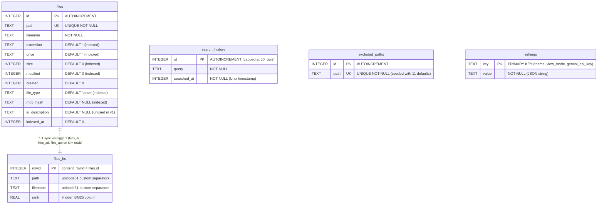
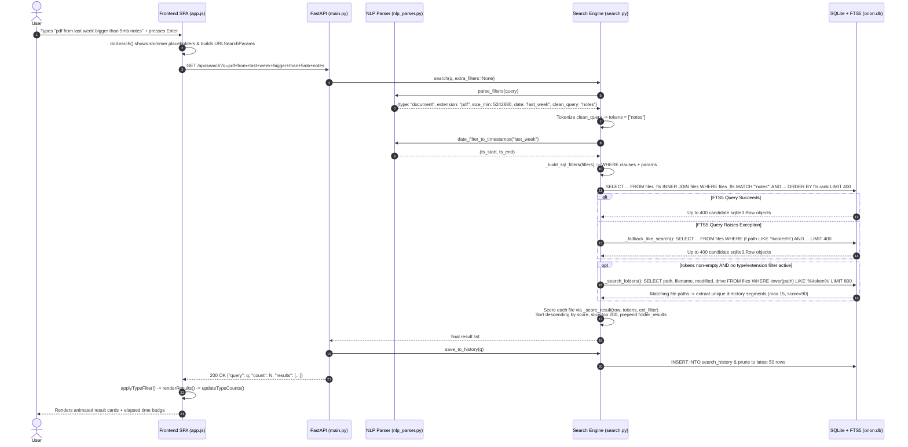
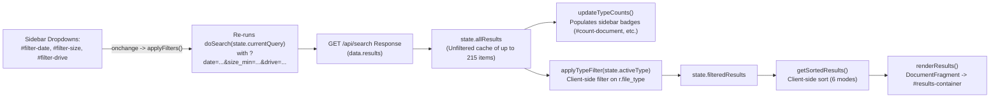

# Orion: Multithreaded Neural Semantic PC Search System (v1)
## Document 2 of 4 — System Internals: Database, Indexing, Search Pipeline, API & UI Flow

| Field | Details |
| :--- | :--- |
| **Project Title** | Orion: Multithreaded Neural Semantic PC Search System (Version 1 — Core Classical Engine) |
| **Document Number** | Document 2 of 4 (`Orion_Doc2_System_Internals.md`) |
| **Authors / Team** | **Devansh Bhargav** (Enrollment: `BTCS24O1038`) & **Divyansh S. Thakur** (Enrollment: `BTCS24O1044`) |
| **Institution** | Madhav Institute of Technology & Science (MITS), Gwalior |
| **Faculty Mentor** | **Ms. Manisha Pathak** |
| **Local Endpoint** | `http://127.0.0.1:8472` (FastAPI + Uvicorn Backend / Vanilla SPA Frontend) |

---

### How to Read This Document

This document is **Document 2** in the four-part engineering documentation series for **Orion (Version 1)**:
1. **Document 1 — Architecture & Technology Overview**: High-level system vision, problem statement, technology stack justifications, and architectural topology.
2. **Document 2 — System Internals (This Document)**: Surface-to-medium depth operational blueprint explaining *how* every subsystem works internally—the SQLite + FTS5 storage engine, the three-tier file indexing pipeline, the natural-language search and multi-signal ranking pipeline, the complete REST API contract, the single-page frontend state machine, auxiliary subsystems (MD5 duplicate detection, binary media metadata parsing, system tray, and Windows Explorer sandbox escape), and the multithreaded concurrency model.
3. **Document 3 — Code Deep Dive**: Line-by-line, function-by-function walkthrough of every Python, HTML, CSS, and JavaScript file.
4. **Document 4 — Installer, Packaging, Assets & Appendix**: Build automation (`package_build.py`), batch launchers (`orion.bat`, `start.bat`, `setup.bat`), bundled tools (`Everything.exe`, `es.exe`), and operational runbooks.

Where Document 1 explains *what* technologies were chosen and *why*, and Document 3 dissects individual lines of code, **Document 2** bridges the two: it traces data structures, SQL schemas, regular expressions, ranking formulas, HTTP payloads, and thread interactions end-to-end so that a reader can confidently explain—and defend—every design decision before a doctoral examination committee.

---

## Table of Contents

1. [Database Architecture & Storage Engine (`backend/config.py`)](#1-database-architecture--storage-engine-backendconfigpy)
   - 1.1 [Database File Location & Connection Factory (`get_db`)](#11-database-file-location--connection-factory-get_db)
   - 1.2 [SQLite PRAGMA Tuning (WAL, Synchronous Mode, Page Cache)](#12-sqlite-pragma-tuning-wal-synchronous-mode-page-cache)
   - 1.3 [Complete Schema Reference (Tables & Columns)](#13-complete-schema-reference-tables--columns)
   - 1.4 [Secondary B-Tree Indexes](#14-secondary-b-tree-indexes)
   - 1.5 [FTS5 Virtual Table Internals (`files_fts`)](#15-fts5-virtual-table-internals-files_fts)
   - 1.6 [Trigger-Driven FTS5 Synchronization](#16-trigger-driven-fts5-synchronization)
   - 1.7 [Entity-Relationship Diagram](#17-entity-relationship-diagram)
2. [The Indexing Pipeline (`backend/indexer.py`)](#2-the-indexing-pipeline-backendindexerpy)
   - 2.1 [Lifecycle & Scheduling (`_scheduler_loop`)](#21-lifecycle--scheduling-_scheduler_loop)
   - 2.2 [Phase 1: Three-Tier Path Discovery (Everything HTTP → `es.exe` IPC → Multithreaded `os.walk`)](#22-phase-1-three-tier-path-discovery-everything-http--esexe-ipc--multithreaded-oswalk)
   - 2.3 [Path Exclusion Mechanics (`excluded_paths`)](#23-path-exclusion-mechanics-excluded_paths)
   - 2.4 [Phase 2: Parallel Metadata Extraction & Batch Upsert](#24-phase-2-parallel-metadata-extraction--batch-upsert)
   - 2.5 [Phase 3: Stale Record Garbage Collection (`_remove_stale_files`)](#25-phase-3-stale-record-garbage-collection-_remove_stale_files)
   - 2.6 [Real-Time Progress & Telemetry State Machine (`get_status`)](#26-real-time-progress--telemetry-state-machine-get_status)
   - 2.7 [Indexing Pipeline Flowchart](#27-indexing-pipeline-flowchart)
3. [Search Pipeline End-to-End (`backend/nlp_parser.py` & `backend/search.py`)](#3-search-pipeline-end-to-end-backendnlp_parserpy--backendsearchpy)
   - 3.1 [Worked Query Trace: `"pdf from last week bigger than 5mb notes"`](#31-worked-query-trace-pdf-from-last-week-bigger-than-5mb-notes)
   - 3.2 [Stage 1: Natural-Language Filter Extraction (`parse_filters`)](#32-stage-1-natural-language-filter-extraction-parse_filters)
   - 3.3 [Stage 2: Query Cleaning & Tokenization](#33-stage-2-query-cleaning--tokenization)
   - 3.4 [Stage 3: FTS5 Query Execution, SQL Filter Injection & `LIKE` Fallback](#34-stage-3-fts5-query-execution-sql-filter-injection--like-fallback)
   - 3.5 [Stage 4: Zero-Schema Folder Discovery (`_search_folders`)](#35-stage-4-zero-schema-folder-discovery-_search_folders)
   - 3.6 [Stage 5: Multi-Signal Ranking Formula (`_score_result`) & Worked Numeric Examples](#36-stage-5-multi-signal-ranking-formula-_score_result--worked-numeric-examples)
   - 3.7 [Stage 6: Sorting, Merging & JSON Response Shape](#37-stage-6-sorting-merging--json-response-shape)
   - 3.8 [Search Pipeline Sequence Diagram](#38-search-pipeline-sequence-diagram)
4. [REST API Reference (`backend/main.py`)](#4-rest-api-reference-backendmainpy)
   - 4.1 [Server Configuration & Lifespan Startup Sequence](#41-server-configuration--lifespan-startup-sequence)
   - 4.2 [Complete Endpoint Matrix](#42-complete-endpoint-matrix)
   - 4.3 [Detailed Endpoint Specifications](#43-detailed-endpoint-specifications)
5. [Frontend Architecture (`frontend/index.html` & `frontend/app.js`)](#5-frontend-architecture-frontendindexhtml--frontendappjs)
   - 5.1 [Single-Page Application (SPA) View & State Model](#51-single-page-application-spa-view--state-model)
   - 5.2 [Dual Search Bars, Debounced Autocomplete & History Dropdown](#52-dual-search-bars-debounced-autocomplete--history-dropdown)
   - 5.3 [Hybrid Filtering & Client-Side Sorting Architecture](#53-hybrid-filtering--client-side-sorting-architecture)
   - 5.4 [Result Card Rendering & Lazy Thumbnail Hydration](#54-result-card-rendering--lazy-thumbnail-hydration)
   - 5.5 [Two-Stage File Preview Panel (`openPreview` & `enrichPreview`)](#55-two-stage-file-preview-panel-openpreview--enrichpreview)
   - 5.6 [Adaptive Index Polling & Scan Progress Telemetry UI](#56-adaptive-index-polling--scan-progress-telemetry-ui)
   - 5.7 [Theme Persistence, View Modes & Keyboard Shortcuts](#57-theme-persistence-view-modes--keyboard-shortcuts)
6. [Auxiliary Subsystems](#6-auxiliary-subsystems)
   - 6.1 [Content-Based Duplicate Detection (`backend/duplicates.py`)](#61-content-based-duplicate-detection-backendduplicatespy)
   - 6.2 [On-Demand Media Metadata & Binary Container Parsing (`backend/media_meta.py`)](#62-on-demand-media-metadata--binary-container-parsing-backendmedia_metapy)
   - 6.3 [System Tray & Global Hotkey Daemon (`backend/tray.py`)](#63-system-tray--global-hotkey-daemon-backendtraypy)
   - 6.4 [Windows Explorer Integration & The Task Scheduler Sandbox Escape (`main.py`)](#64-windows-explorer-integration--the-task-scheduler-sandbox-escape-mainpy)
7. [Concurrency Model, Performance Engineering & Known Limitations](#7-concurrency-model-performance-engineering--known-limitations)
   - 7.1 [Complete Thread & Executor Inventory](#71-complete-thread--executor-inventory)
   - 7.2 [Asynchronous vs. Synchronous Execution in FastAPI](#72-asynchronous-vs-synchronous-execution-in-fastapi)
   - 7.3 [Why Orion Achieves Sub-50ms Search Latency](#73-why-orion-achieves-sub-50ms-search-latency)
   - 7.4 [Known Architectural Limitations & V1 Edge Cases](#74-known-architectural-limitations--v1-edge-cases)
8. [Likely Professor Questions & Answers (Viva Voce Preparation)](#8-likely-professor-questions--answers-viva-voce-preparation)

---

## 1. Database Architecture & Storage Engine (`backend/config.py`)

Orion persists its entire file catalog, full-text inverted index, search history, path exclusions, and user preferences in a single embedded **SQLite 3** database managed by [`config.py`](file:///C:/Users/devan/.gemini/antigravity/brain/deffb706-24d2-4162-affe-2fa1deb41668/scratch/orion1_src/backend/config.py#L1-L232). Because SQLite is an in-process transactional relational engine, Orion incurs zero inter-process socket overhead when reading or writing index records.

### 1.1 Database File Location & Connection Factory (`get_db`)

In [`config.py`](file:///C:/Users/devan/.gemini/antigravity/brain/deffb706-24d2-4162-affe-2fa1deb41668/scratch/orion1_src/backend/config.py#L12-L18), all filesystem paths are anchored relative to the project root (`BASE_DIR`):

```python
BASE_DIR     = Path(__file__).parent.parent          # project root
DATA_DIR     = BASE_DIR / "data"
DB_PATH      = DATA_DIR / "orion.db"
ASSETS_DIR   = BASE_DIR / "assets"
FRONTEND_DIR = BASE_DIR / "frontend"

DATA_DIR.mkdir(exist_ok=True)
```

When Orion is installed to `C:\Users\<username>\Orion`, the database resides at `C:\Users\<username>\Orion\data\orion.db`. During active operation under Write-Ahead Logging (WAL) mode, SQLite also maintains two companion files in the `data/` directory:
- `orion.db-wal`: The write-ahead log containing uncommitted or uncheckpointed pages.
- `orion.db-shm`: A shared-memory index (`mmap` region) used by concurrent connections to coordinate WAL frame lookups.

Every database operation in Orion acquires a fresh connection via [`get_db()`](file:///C:/Users/devan/.gemini/antigravity/brain/deffb706-24d2-4162-affe-2fa1deb41668/scratch/orion1_src/backend/config.py#L98-L105) and closes it explicitly when the operation finishes:

```python
def get_db() -> sqlite3.Connection:
    """Return a SQLite connection with row_factory set."""
    conn = sqlite3.connect(str(DB_PATH), check_same_thread=False)
    conn.row_factory = sqlite3.Row
    conn.execute("PRAGMA journal_mode=WAL")
    conn.execute("PRAGMA synchronous=NORMAL")
    conn.execute("PRAGMA cache_size=-64000")   # 64 MB cache
    return conn
```

Two connection-level properties are critical here:
1. **`check_same_thread=False`**: Python's `sqlite3` module defaults to forbidding a connection created on Thread A from being used on Thread B. While Orion generally opens one connection per function call, FastAPI route handlers and background threads interact concurrently with SQLite; disabling this check prevents spurious `ProgrammingError` exceptions.
2. **`conn.row_factory = sqlite3.Row`**: Instead of returning plain positional tuples `(1, 'C:\\file.txt', ...)`, queries return `sqlite3.Row` objects that support both column-name subscripting (`row["filename"]`) and conversion to standard Python dictionaries (`dict(row)`).

### 1.2 SQLite PRAGMA Tuning (WAL, Synchronous Mode, Page Cache)

Every connection returned by [`get_db()`](file:///C:/Users/devan/.gemini/antigravity/brain/deffb706-24d2-4162-affe-2fa1deb41668/scratch/orion1_src/backend/config.py#L98-L105) executes three `PRAGMA` statements that transform SQLite from a conservative single-user store into a high-throughput concurrent indexing engine:

| PRAGMA Statement | Internal SQLite Mechanism | Why Orion Needs It |
| :--- | :--- | :--- |
| `PRAGMA journal_mode=WAL` | Switches rollback journaling from copy-before-write (`DELETE` mode) to **Write-Ahead Logging**. Modifications are appended sequentially to `orion.db-wal` rather than overwriting B-tree pages in `orion.db` directly. | In default `DELETE` mode, a writer locks the entire database file, blocking all readers. Under **WAL mode**, readers do not block writers and writers do not block readers: a user can execute `/api/search` queries in <20 ms *while* the background indexer is actively inserting 5,000-row batches. |
| `PRAGMA synchronous=NORMAL` | Controls how often the OS VFS layer calls `FlushFileBuffers()` (`fsync`) to flush disk controller caches. In `FULL` mode, SQLite syncs on every transaction commit; in `NORMAL` mode with WAL, it only syncs on WAL checkpoints (every 1,000 pages by default). | Reduces disk I/O wait time during batch indexing (`_insert_batch`) and MD5 hashing (`compute_hashes`) by 5×–10× while preserving transaction durability against application crashes (only a sudden hardware power loss during a write could roll back the latest uncheckpointed commit). |
| `PRAGMA cache_size=-64000` | A negative value specifies the page cache size in **kibibytes (KiB)** rather than page count. `-64000` allocates $64,000 \text{ KiB} \approx 62.5 \text{ MiB}$ of RAM per active connection for caching B-tree and FTS5 inverted-index pages. | Prevents repeated disk reads when traversing FTS5 postings lists and joining against the `files` B-tree table on systems with 300,000+ indexed files. |

---

### 1.3 Complete Schema Reference (Tables & Columns)

The schema is initialized idempotently at server startup by [`init_db()`](file:///C:/Users/devan/.gemini/antigravity/brain/deffb706-24d2-4162-affe-2fa1deb41668/scratch/orion1_src/backend/config.py#L108-L202) using `CREATE TABLE IF NOT EXISTS`. The database contains **4 regular B-tree tables** (`files`, `search_history`, `excluded_paths`, `settings`) and **1 FTS5 virtual table** (`files_fts`, which internally spawns 4 shadow tables: `files_fts_data`, `files_fts_idx`, `files_fts_docsize`, and `files_fts_config`).

#### Table 1: `files` (`config.py` L114–129)
The primary catalog table holding one row per indexed file on the PC (directories are not stored as rows; see Section 3.5 for how folders are discovered dynamically).

| Column Name | SQLite Type & Constraints | Default | Populated By | Semantic Meaning & Usage |
| :--- | :--- | :--- | :--- | :--- |
| `id` | `INTEGER PRIMARY KEY AUTOINCREMENT` | Auto | SQLite Engine | 64-bit signed integer rowid (`rowid` alias). Serves as the join key (`content_rowid = 'id'`) linking `files_fts` to `files`. |
| `path` | `TEXT UNIQUE NOT NULL` | — | `indexer._extract_file_meta()` | Full absolute Windows path (e.g., `C:\Users\devan\Documents\notes.pdf`). Enforces uniqueness via an implicit B-tree index and serves as the conflict target for `ON CONFLICT(path) DO UPDATE`. |
| `filename` | `TEXT NOT NULL` | — | `indexer._extract_file_meta()` | Base name with extension (`Path(path).name`, e.g., `notes.pdf`). Indexed by FTS5 and scored by `_score_result()`. |
| `extension` | `TEXT` | `''` | `indexer._extract_file_meta()` | Lowercase file extension stripped of its leading dot (`p.suffix.lower().lstrip(".")`, e.g., `pdf`). Empty string for extensionless files. |
| `drive` | `TEXT` | `''` | `indexer._extract_file_meta()` | Uppercase drive letter and colon without trailing slashes (`Path(path).anchor.rstrip("\\/").upper()`, e.g., `C:`). |
| `size` | `INTEGER` | `0` | `indexer._extract_file_meta()` | File size in bytes (`os.stat(path).st_size`). Used for size filtering (`size_min`, `size_max`), duplicate grouping, and dashboard statistics. |
| `modified` | `INTEGER` | `0` | `indexer._extract_file_meta()` | Last-modified Unix epoch timestamp in whole seconds (`int(stat.st_mtime)`). Used for date filters, recency ranking boost, and `/api/recent`. |
| `created` | `INTEGER` | `0` | `indexer._extract_file_meta()` | Creation/metadata-change Unix epoch timestamp in seconds (`int(stat.st_ctime)`). Note: Updated on initial `INSERT`, but preserved unchanged on `ON CONFLICT(path) DO UPDATE`. |
| `file_type` | `TEXT` | `'other'` | `config.get_file_type()` | Broad semantic category derived from `EXTENSION_MAP` (`config.py` L45–80): one of `'document'`, `'image'`, `'video'`, `'audio'`, `'archive'`, `'code'`, or `'other'`. |
| `md5_hash` | `TEXT` | `NULL` | `duplicates.compute_hashes()` | 32-character lowercase hexadecimal MD5 digest of file contents. Remains `NULL` during normal indexing; populated lazily when the user triggers a duplicate scan. |
| `ai_description` | `TEXT` | `NULL` | *Unused in Orion v1* | **Reserved / leftover schema column**. In Orion v1 (which has no AI/LLM modules), this column is never written to and always holds `NULL`, though `search.py` selects it and `app.js` conditionally checks `r.ai_description`. |
| `indexed_at` | `INTEGER` | `0` | `indexer._extract_file_meta()` | Unix epoch timestamp (`int(time.time())`) recording when the row was last inserted or updated by `run_index()`. Used by `_scheduler_loop()` to compute index staleness (`SELECT MAX(indexed_at)`). |

#### Table 2: `files_fts` (`config.py` L132–140)
An external-content FTS5 virtual table indexing `path` and `filename` (detailed in Section 1.5).

| Virtual Column | Source in `files` | Purpose |
| :--- | :--- | :--- |
| `rowid` | `files.id` | Implicit 64-bit integer key linking each FTS5 document entry to its corresponding row in `files`. |
| `path` | `files.path` | Tokenized full file path, enabling queries to match directory names as well as filenames. |
| `filename` | `files.filename` | Tokenized base filename. |
| `rank` | Computed at query time | Hidden FTS5 column returning the BM25 relevance score (negative float where smaller/more negative values indicate higher statistical relevance). |

#### Table 3: `search_history` (`config.py` L165–171)
Stores up to the 50 most recent search strings submitted to `/api/search` for autocomplete and the recent-searches dropdown.

| Column Name | SQLite Type & Constraints | Meaning & Usage |
| :--- | :--- | :--- |
| `id` | `INTEGER PRIMARY KEY AUTOINCREMENT` | Unique row identifier; used in the pruning subquery `WHERE id NOT IN (SELECT id ... LIMIT 50)` (`search.py` L386–395). |
| `query` | `TEXT NOT NULL` | Whitespace-stripped search string (`query.strip()`). |
| `searched_at` | `INTEGER NOT NULL` | Unix epoch timestamp (`int(time.time())`) when the search was executed. |

#### Table 4: `excluded_paths` (`config.py` L174–179)
Stores directory paths and folder-name prefixes that the indexer must skip. Seeded on every `init_db()` call via `INSERT OR IGNORE` with the 11 `DEFAULT_EXCLUDED` entries (`config.py` L30–42, L198–199).

| Column Name | SQLite Type & Constraints | Meaning & Usage |
| :--- | :--- | :--- |
| `id` | `INTEGER PRIMARY KEY AUTOINCREMENT` | Surrogate primary key. |
| `path` | `TEXT UNIQUE NOT NULL` | Excluded path or substring (e.g., `C:\Windows`, `node_modules`, `.git`). Managed via `/api/exclude`. |

#### Table 5: `settings` (`config.py` L182–187)
A generic JSON-serialized key-value store accessed through [`get_setting(key, default)`](file:///C:/Users/devan/.gemini/antigravity/brain/deffb706-24d2-4162-affe-2fa1deb41668/scratch/orion1_src/backend/config.py#L205-L214) and [`set_setting(key, value)`](file:///C:/Users/devan/.gemini/antigravity/brain/deffb706-24d2-4162-affe-2fa1deb41668/scratch/orion1_src/backend/config.py#L217-L224).

| Column Name | SQLite Type & Constraints | Meaning & Usage |
| :--- | :--- | :--- |
| `key` | `TEXT PRIMARY KEY` | Configuration key name. Active keys in v1: `'theme'` (`"dark"` or `"light"`), `'view_mode'` (`"list"` or `"grid"`), and `'gemini_api_key'` (a reserved/leftover setting exposed in Settings UI and masked as `"***"` by `GET /api/settings`, but not consumed by any backend module in Orion v1). |
| `value` | `TEXT NOT NULL` | JSON-encoded value produced by `json.dumps(value)` and decoded via `json.loads(row["value"])`. |

---

### 1.4 Secondary B-Tree Indexes

In addition to the implicit `UNIQUE` B-tree indexes created by SQLite for `files.path`, `excluded_paths.path`, and `settings.key`, [`init_db()`](file:///C:/Users/devan/.gemini/antigravity/brain/deffb706-24d2-4162-affe-2fa1deb41668/scratch/orion1_src/backend/config.py#L190-L195) explicitly creates **6 secondary B-tree indexes** on the `files` table:

| Index Name | Target Column | Queries Accelerated |
| :--- | :--- | :--- |
| `idx_files_type` | `files(file_type)` | `WHERE f.file_type = ?` in `_build_sql_filters()` (`search.py` L75) and `GROUP BY file_type` in `get_stats()` (`search.py` L351). |
| `idx_files_modified` | `files(modified)` | `WHERE f.modified >= ?` / `BETWEEN ? AND ?` in `_build_sql_filters()`, `ORDER BY f.modified DESC` in filter-only search (`search.py` L165), and `get_recent_files()` (`search.py` L315–317). |
| `idx_files_size` | `files(size)` | `WHERE f.size >= ?` / `f.size <= ?` in `_build_sql_filters()` (`search.py` L83–87) and `size > 0 AND size < 4294967296` in `compute_hashes()` (`duplicates.py` L53–55). |
| `idx_files_drive` | `files(drive)` | `WHERE f.drive = ?` in `_build_sql_filters()` (`search.py` L108) and `GROUP BY drive` in `get_stats()` (`search.py` L355). |
| `idx_files_ext` | `files(extension)` | `WHERE f.extension = ?` in `_build_sql_filters()` (`search.py` L79). |
| `idx_files_md5` | `files(md5_hash)` | `WHERE md5_hash IS NULL` in `compute_hashes()`, `GROUP BY md5_hash HAVING cnt > 1` and `WHERE md5_hash = ?` in `get_duplicates()` (`duplicates.py` L98–114). |

---

### 1.5 FTS5 Virtual Table Internals (`files_fts`)

Full-Text Search 5 (**FTS5**) is an extension compiled into standard SQLite that implements an **inverted index** (specifically, a collection of B-tree segments mapping normalized *terms* to sorted *postings lists* of `(rowid, column_index, token_offset)`).

In [`config.py`](file:///C:/Users/devan/.gemini/antigravity/brain/deffb706-24d2-4162-affe-2fa1deb41668/scratch/orion1_src/backend/config.py#L132-L140), `files_fts` is declared as:

```sql
CREATE VIRTUAL TABLE IF NOT EXISTS files_fts USING fts5(
    path,
    filename,
    tokenize = 'unicode61 separators ''_-. ()[]{}#@!''',
    content  = 'files',
    content_rowid = 'id'
)
```

#### Why External-Content (`content='files', content_rowid='id'`)?
By default, an FTS5 table stores a full copy of every indexed column inside an internal shadow table named `files_fts_content`. For 500,000 file paths averaging 100 bytes each, that would duplicate ~50 MB of raw string data already stored in the `files` table. By specifying `content = 'files'` and `content_rowid = 'id'`, Orion configures `files_fts` as an **external-content virtual table**:
- `files_fts` stores **only** the compressed inverted index (`files_fts_data`, `files_fts_idx`, `files_fts_docsize`), omitting `files_fts_content` entirely.
- Whenever FTS5 needs original column values or document sizes, or when a query joins `files_fts` to `files` via `INNER JOIN files f ON fts.rowid = f.id`, SQLite reads the actual text from the `files` table using the primary key `id`.
- This cuts disk footprint and page-cache pressure by roughly **45–50%**.

#### How the `unicode61` Tokenizer & Custom Separators Work
Standard prose tokenizers split text only on whitespace and basic punctuation, often treating underscores (`_`) or dots (`.`) as word characters or decimal points. In a file search engine, however, filenames and paths rarely contain spaces; instead, they use snake_case, kebab-case, version dots, and bracketed tags:
- Example path: `D:\Projects\ML_2025\final-report_v2.1(draft)[rev3]#1.pdf`

Orion configures `tokenize = 'unicode61 separators ''_-. ()[]{}#@!'''`:
1. **`unicode61` Base**: Performs Unicode 6.1 case-folding (converting uppercase to lowercase) and diacritic stripping (e.g., `é` → `e`).
2. **Custom `separators` String (`_-. ()[]{}#@!`)**: Instructs the lexer to treat underscore `_`, hyphen `-`, period `.`, space ` `, parentheses `()`, square brackets `[]`, curly braces `{}`, hash `#`, at-sign `@`, and exclamation mark `!` (in addition to standard path slashes `\`) as token boundaries.
3. **Resulting Token Stream**: The example path above is split into discrete, independently searchable tokens:
   `["d", "projects", "ml", "2025", "final", "report", "v2", "1", "draft", "rev3", "1", "pdf"]`.

#### How FTS5 `MATCH` and `fts.rank` (BM25) Work Internally
- **Inverted Index Lookup (`MATCH`)**: When `search.py` runs `WHERE files_fts MATCH '"notes" OR "pdf"'`, FTS5 hashes/binary-searches the B-tree index (`files_fts_idx`) for `"notes"` and `"pdf"` in $O(\log V)$ time (where $V$ is the vocabulary size), retrieves their compressed delta-encoded postings lists from `files_fts_data`, and performs a sorted set union of matching `rowid`s—avoiding a full table scan of hundreds of thousands of rows.
- **`fts.rank` (Okapi BM25)**: When `ORDER BY fts.rank` is specified (`search.py` L150), FTS5 invokes its built-in **BM25** ranking function across the two columns (`path` and `filename`). BM25 scores each document $D$ for query tokens $q_1, \dots, q_n$ using Inverse Document Frequency ($\text{IDF}$, rewarding rare tokens) and length-normalized Term Frequency ($\text{TF}$, rewarding matches in shorter fields like `filename` over longer fields like `path` using `files_fts_docsize`):
  $$\text{BM25}(D, Q) = -\sum_{i=1}^{n} \text{IDF}(q_i) \cdot \frac{f(q_i, D) \cdot (k_1 + 1)}{f(q_i, D) + k_1 \cdot \left(1 - b + b \cdot \frac{|D|}{\text{avgdl}}\right)}$$
  *(SQLite multiplies the standard positive BM25 sum by $-1$ so that a standard ascending `ORDER BY fts.rank` returns the highest-scoring matches first).*
- In Orion, FTS5's BM25 selects the **top 400 candidate rows** (`LIMIT MAX_RESULTS * 2`, `search.py` L151), which are then re-scored in Python by Orion's domain-specific multi-signal ranker `_score_result()` (Section 3.6).

---

### 1.6 Trigger-Driven FTS5 Synchronization

Because `files_fts` is an external-content table (`content='files'`), SQLite does **not** automatically update `files_fts` when rows in `files` are inserted, updated, or deleted. Instead, [`init_db()`](file:///C:/Users/devan/.gemini/antigravity/brain/deffb706-24d2-4162-affe-2fa1deb41668/scratch/orion1_src/backend/config.py#L143-L162) installs three SQLite triggers on `files`:

```sql
-- 1. After INSERT: index the new row's path and filename
CREATE TRIGGER IF NOT EXISTS files_ai AFTER INSERT ON files BEGIN
    INSERT INTO files_fts(rowid, path, filename)
    VALUES (new.id, new.path, new.filename);
END;

-- 2. After DELETE: issue special FTS5 'delete' command with old values
CREATE TRIGGER IF NOT EXISTS files_ad AFTER DELETE ON files BEGIN
    INSERT INTO files_fts(files_fts, rowid, path, filename)
    VALUES ('delete', old.id, old.path, old.filename);
END;

-- 3. After UPDATE: tombstone old tokens, then insert new tokens
CREATE TRIGGER IF NOT EXISTS files_au AFTER UPDATE ON files BEGIN
    INSERT INTO files_fts(files_fts, rowid, path, filename)
    VALUES ('delete', old.id, old.path, old.filename);
    INSERT INTO files_fts(rowid, path, filename)
    VALUES (new.id, new.path, new.filename);
END;
```

**Why does `files_ad` and `files_au` insert the string `'delete'` into the table-name column `files_fts`?**
Because an external-content FTS5 table does not store the original text of row `old.id`, a normal `DELETE FROM files_fts WHERE rowid = old.id` wouldn't know which tokens to remove from the inverted index! Passing `'delete'` into the special command column `files_fts` along with `old.id, old.path, old.filename` instructs FTS5 to re-tokenize `old.path` and `old.filename` on the fly and write tombstone markers for those exact `(token, rowid)` pairs in `files_fts_data`. Note that this trigger fires automatically during batch upserts (`ON CONFLICT(path) DO UPDATE` in `indexer.py` L317) as well as during MD5 hash updates (`UPDATE files SET md5_hash=?` in `duplicates.py` L71).

---

### 1.7 Entity-Relationship Diagram

Although Orion's tables do not use foreign-key constraints between independent entities (such as users or permissions), `files` and `files_fts` share a strict 1:1 `rowid` relationship enforced by database triggers, while `search_history`, `excluded_paths`, and `settings` operate as standalone system tables within `orion.db`:



---

## 2. The Indexing Pipeline (`backend/indexer.py`)

The indexing subsystem in [`backend/indexer.py`](file:///C:/Users/devan/.gemini/antigravity/brain/deffb706-24d2-4162-affe-2fa1deb41668/scratch/orion1_src/backend/indexer.py#L1-L477) is responsible for discovering every file across all mounted Windows drives, filtering out excluded system/developer directories, extracting filesystem metadata via `os.stat()`, upserting records into `orion.db` in 5,000-row transactions, and pruning deleted files.

### 2.1 Lifecycle & Scheduling (`_scheduler_loop`)

Indexing can be triggered at three points in Orion's lifecycle:

1. **Application Startup (`start_background_indexer()`, L455–465)**:
   Called during FastAPI's `lifespan` startup hook (`main.py` L54). It spawns a daemon thread named `"orion-indexer"` running [`_scheduler_loop()`](file:///C:/Users/devan/.gemini/antigravity/brain/deffb706-24d2-4162-affe-2fa1deb41668/scratch/orion1_src/backend/indexer.py#L421-L453).
2. **Startup Staleness Decision (`_scheduler_loop()`, L426–447)**:
   Immediately upon starting, `_scheduler_loop()` queries `orion.db` to inspect the current index state:
   ```python
   row = conn.execute("SELECT MAX(indexed_at), COUNT(*) FROM files").fetchone()
   last_indexed  = row[0] or 0
   indexed_count = row[1] or 0
   age_hours     = (time.time() - last_indexed) / 3600
   ```
   - **Condition A (`indexed_count == 0`)**: The database is empty (first launch). `run_index()` executes immediately.
   - **Condition B (`age_hours >= REINDEX_INTERVAL_HOURS`)**: Where `REINDEX_INTERVAL_HOURS = 4` (`config.py` L25). If the newest record in `files` is 4 or more hours old, `run_index()` executes immediately.
   - **Condition C (`age_hours < 4` and `indexed_count > 0`)**: The index is considered **fresh**. Startup scanning is skipped completely, giving the user instant zero-overhead startup.
3. **Periodic 4-Hour Background Re-index (L450–452)**:
   After the startup check, `_scheduler_loop()` enters a `while not _stop_event.wait(timeout=REINDEX_INTERVAL_HOURS * 3600):` loop, waking up every $4 \times 3600 = 14,400\text{ seconds}$ (4 hours) to call `run_index()`.
4. **Manual User Re-index (`trigger_reindex()`, L473–476)**:
   When the user clicks **🔄 Re-index** in the UI (`POST /api/index/start`), `trigger_reindex()` spawns a short-lived daemon thread named `"orion-reindex"` targeting `run_index()`. Inside `run_index()` (L349–352), a mutex guard checks `if _indexing and not force: return`, ensuring two indexing runs can never execute concurrently.

---

### 2.2 Phase 1: Three-Tier Path Discovery (Everything HTTP → `es.exe` IPC → Multithreaded `os.walk`)

Once `run_index()` sets `_index_phase = "scanning"`, it attempts to collect all file paths on the PC using a **three-tier cascading fallback architecture** implemented in [`_index_with_everything()`](file:///C:/Users/devan/.gemini/antigravity/brain/deffb706-24d2-4162-affe-2fa1deb41668/scratch/orion1_src/backend/indexer.py#L183-L203) and [`_index_with_walk()`](file:///C:/Users/devan/.gemini/antigravity/brain/deffb706-24d2-4162-affe-2fa1deb41668/scratch/orion1_src/backend/indexer.py#L255-L275).

#### Pre-Step: Ensuring `Everything.exe` is Running (`_ensure_everything_running`, L86–119)
Orion bundles **voidtools Everything** inside `tools/Everything/Everything.exe` alongside a pre-tuned [`Everything.ini`](file:///C:/Users/devan/.gemini/antigravity/brain/deffb706-24d2-4162-affe-2fa1deb41668/scratch/orion1_src/tools/Everything/Everything.ini#L1-L5) (`run_as_admin=1`, `allow_http_server=1`, `http_server_enabled=1`, `http_server_bindings=127.0.0.1:8481`, `http_server_port=8481`). Unlike `os.walk`—which must issue hundreds of thousands of Win32 `FindFirstFileW` / `FindNextFileW` directory traversal syscalls—`Everything.exe` reads the raw **NTFS Master File Table (`$MFT`)** directly from the volume device driver, enumerating 1,000,000 files in ~1–3 seconds.

`_ensure_everything_running()` locates `Everything.exe` (checking `tools/Everything/Everything.exe` first, then `C:\Program Files\Everything\Everything.exe` and `C:\Program Files (x86)\Everything\Everything.exe`). It checks if `Everything.exe` is already in memory via `tasklist /fi "imagename eq Everything.exe"`. If not running, it launches:
```python
subprocess.Popen(
    [exe, "-startup", "-http-server", "-http-port", "8481"],
    creationflags=0x00000008,  # DETACHED_PROCESS
)
time.sleep(5)
```
And `_index_with_everything()` waits an additional `time.sleep(2)` before querying.

#### Tier 1: Everything Built-in HTTP API (`_index_with_everything_http`, L122–154)
Orion first queries Everything's local HTTP server on port `8481` (`EVERYTHING_HTTP_PORT = 8481`):
```
http://localhost:8481/?search=!folder:&count=9999999&path_column=1&json=1&sort=path_ascending
```
- **Query parameters explained**:
  - `search=!folder:`: Uses Everything's `!` (NOT) modifier with the `folder:` macro to return **only files** (excluding directory entries).
  - `count=9999999`: Overrides Everything's default pagination (`http_server_items_per_page=32` in `Everything.ini`) to stream up to ~10 million file entries in a single response.
  - `path_column=1`: Instructs Everything to include the parent directory `"path"` field alongside `"name"` in each JSON object.
  - `json=1`: Returns structured JSON (`{"totalResults": N, "results": [{"type": "file", "name": "...", "path": "..."}]}`) instead of HTML.
  - `sort=path_ascending`: Returns paths pre-sorted by directory for sequential disk locality during Phase 2 `os.stat()` calls.
- **Why HTTP API is Tier 1 over IPC**: On Windows Vista/10/11, User Account Control (UAC) and User Interface Privilege Isolation (UIPI) block standard Win32 `WM_COPYDATA` Inter-Process Communication (IPC) messages between processes running at different integrity levels (e.g., if `Everything.exe` runs elevated at High Integrity to read `$MFT`, an un-elevated `es.exe` at Medium Integrity can fail to communicate with it via window messages). Localhost TCP loopback (`http://localhost:8481`) completely bypasses UIPI window-message restrictions.

#### Tier 2: `es.exe` Command-Line IPC (`_index_with_everything_es`, L157–180)
If the HTTP server is disabled or unreachable (e.g., the user already had a custom installation of `Everything.exe` running without `-http-server`), Orion falls back to Everything's command-line client `es.exe` (located via `_find_es_exe()` in `tools/Everything/es.exe`, `Program Files`, or system `PATH`):
```python
subprocess.run(
    [es, "-full-path-and-name", "-n", "0", "-sort", "path-ascending", "!folder:"],
    capture_output=True, text=True, encoding="utf-8", errors="replace", timeout=120,
)
```
Here `-full-path-and-name` outputs one complete path per line, `-n 0` removes any result count limit, and `!folder:` restricts output to files.

#### Tier 3: Multithreaded `os.walk` Fallback (`_index_with_walk`, L207–275)
If neither Everything HTTP nor `es.exe` returns paths (e.g., FAT32/exFAT drives or Everything is blocked), Orion falls back to pure-Python multithreaded directory traversal:
1. **Drive Enumeration (`_get_all_drives()`, L207–218)**: Calls the Win32 kernel API `ctypes.windll.kernel32.GetLogicalDrives()`, which returns a 32-bit integer bitmask where bit $0 = \text{A:\}$, bit $1 = \text{B:\}$, bit $2 = \text{C:\}$, etc. Every set bit $i \in [0, 25]$ is converted via `chr(65 + i) + ":\\"`. If `ctypes` fails, it defaults to `["C:\\"]`.
2. **One Worker Thread per Drive (`_index_with_walk()`, L267–274)**: Spawns a `ThreadPoolExecutor(max_workers=len(drives))` so that `C:\`, `D:\`, `E:\`, etc. are walked in parallel.
3. **Top-Down Subtree Pruning (`_walk_drive()`, L221–252)**: Iterates `os.walk(drive, topdown=True, onerror=None)`. Because `topdown=True` is set, modifying the `dirs` list in-place (`dirs.clear()` or `dirs[:] = [...]`) prevents `os.walk` from ever descending into excluded directory trees (such as `C:\Windows`), saving hundreds of thousands of wasted syscalls. Every 500 directories visited, `_walk_drive()` acquires `_state_lock` to increment `_dirs_visited += 500`, update `_files_found`, and record `_current_drive`.

---

### 2.3 Path Exclusion Mechanics (`excluded_paths`)

On database initialization (`config.py` L30–42, L198–199), `excluded_paths` is seeded with 11 default exclusions:
- **Absolute System Paths**: `C:\Windows`, `C:\ProgramData`, `C:\$Recycle.Bin`, `C:\System Volume Information`, `C:\Recovery`, `C:\bootmgr`
- **Relative Folder / Subpath Patterns**: `node_modules`, `.git`, `__pycache__`, `.vs`, `AppData\Local\Temp`

During Phase 1, `excluded = get_excluded_paths()` is lowercased into `excluded_lower = [e.lower() for e in excluded]`, and paths are checked via prefix matching:
- **In Everything HTTP / `es.exe` (`indexer.py` L146, L175)**:
  `not any(p.lower().startswith(ex) for ex in excluded_lower)`
- **In `_walk_drive()` (`indexer.py` L228–237)**:
  `any(root_lower.startswith(ex) for ex in excluded_lower)` and `os.path.join(root, d).lower().startswith(ex)`

> [!NOTE]
> **Implementation Nuance on Prefix Matching (`.startswith`)**: Because all three discovery tiers use `.startswith(ex)` against full paths starting with a drive letter (e.g., `c:\users\devan\project\node_modules\index.js`), absolute prefix exclusions like `C:\Windows` or `D:\Private` match and prune as intended, whereas relative substring entries like `node_modules` or `.git` do not lie at index 0 of a full path and therefore are not matched by `.startswith()`. (See Section 7.4 and Section 8 Q14 for a thorough discussion of this v1 behavior.)

---

### 2.4 Phase 2: Parallel Metadata Extraction & Batch Upsert

Once Phase 1 returns the list of `paths`, `run_index()` transitions `_index_phase` to `"inserting"` and sets `_total_files_estimate = len(paths)` (`indexer.py` L368–370).

#### Parallel `os.stat()` Pool (`indexer.py` L379–380)
Even when Everything provides 500,000 file paths in 3 seconds, Orion still needs each file's byte size, modification time, and creation time. Calling `os.stat()` sequentially on 500,000 paths would block on disk/filesystem latency. Orion therefore uses an 8-worker thread pool with a chunk size of 200:
```python
with ThreadPoolExecutor(max_workers=8) as pool:
    for meta in pool.map(_extract_file_meta, paths, chunksize=200):
```
Why does `ThreadPoolExecutor` speed up `os.stat()` in CPython despite the Global Interpreter Lock (GIL)? Because `os.stat()` releases the GIL around the underlying Win32 `GetFileAttributesExW` / `CreateFileW` C system call, allowing 8 threads to overlap kernel I/O wait times simultaneously.

For each path, [`_extract_file_meta(path)`](file:///C:/Users/devan/.gemini/antigravity/brain/deffb706-24d2-4162-affe-2fa1deb41668/scratch/orion1_src/backend/indexer.py#L280-L301) catches `(OSError, PermissionError)` (returning `None` for locked or vanished files, such as `pagefile.sys` or ephemeral temp files) and constructs a 9-key dictionary:
- `path`: Full path string
- `filename`: `Path(path).name`
- `extension`: `Path(path).suffix.lower().lstrip(".")`
- `drive`: `Path(path).anchor.rstrip("\\/").upper()` (e.g., `"C:"`)
- `size`: `stat.st_size`
- `modified`: `int(stat.st_mtime)`
- `created`: `int(stat.st_ctime)`
- `file_type`: Mapped via `get_file_type(extension)` (`config.py` L45–94) across **83 extensions** into 7 categories (`document` [14 exts], `image` [15 exts], `video` [11 exts], `audio` [10 exts], `archive` [7 exts], `code` [26 exts], or fallback `'other'`).
- `indexed_at`: `int(time.time())`

#### Batch Upsert (`_insert_batch`, L305–327)
In the main indexer thread consuming `pool.map()`, valid `meta` dicts are accumulated into a `batch` list and recorded in `fresh_paths: set[str]`. Every time `len(batch) >= BATCH_SIZE` (`5,000`), [`_insert_batch(batch, conn)`](file:///C:/Users/devan/.gemini/antigravity/brain/deffb706-24d2-4162-affe-2fa1deb41668/scratch/orion1_src/backend/indexer.py#L307-L327) executes a single transactional upsert:

```sql
INSERT INTO files
    (path, filename, extension, drive, size, modified, created,
     file_type, indexed_at)
VALUES
    (:path, :filename, :extension, :drive, :size, :modified, :created,
     :file_type, :indexed_at)
ON CONFLICT(path) DO UPDATE SET
    filename   = excluded.filename,
    extension  = excluded.extension,
    size       = excluded.size,
    modified   = excluded.modified,
    file_type  = excluded.file_type,
    indexed_at = excluded.indexed_at
```

**Why `ON CONFLICT(path) DO UPDATE` instead of `INSERT OR REPLACE`?**
This is a crucial architectural distinction:
- If Orion used `INSERT OR REPLACE`, SQLite would **delete** the existing row and **insert** a brand-new row with a new `id` (`AUTOINCREMENT`), wiping out the expensive `md5_hash` computed by `duplicates.py` and `ai_description`!
- By using `ON CONFLICT(path) DO UPDATE SET ...`, the row's primary key `id`, `created` timestamp, `md5_hash`, and `ai_description` are **preserved** in-place, while `size`, `modified`, and `indexed_at` are refreshed.

---

### 2.5 Phase 3: Stale Record Garbage Collection (`_remove_stale_files`)

After all batches are committed, files that were deleted, renamed, or moved since the previous index run would otherwise remain as "ghost" entries in `orion.db`. [`_remove_stale_files(conn, fresh_paths)`](file:///C:/Users/devan/.gemini/antigravity/brain/deffb706-24d2-4162-affe-2fa1deb41668/scratch/orion1_src/backend/indexer.py#L330-L337) cleans them up in $O(N)$ time using Python hash-set membership (`fresh_paths` contains every path that succeeded in Phase 2):

```python
def _remove_stale_files(conn, fresh_paths: set[str]):
    """Remove DB entries for files that no longer exist on disk."""
    cursor = conn.execute("SELECT id, path FROM files")
    stale  = [row["id"] for row in cursor if row["path"] not in fresh_paths]
    if stale:
        conn.executemany("DELETE FROM files WHERE id=?", [(i,) for i in stale])
        conn.commit()
        log.info("Removed %d stale file records", len(stale))
```

When `DELETE FROM files WHERE id=?` executes for each stale ID, the `files_ad` trigger (`config.py` L150–154) automatically fires and removes the deleted file's tokens from `files_fts`.

---

### 2.6 Real-Time Progress & Telemetry State Machine (`get_status`)

Throughout indexing, module-level state variables protected by `_state_lock = threading.Lock()` (`indexer.py` L29–37) track live progress. When the frontend polls `GET /api/index/status`, [`get_status()`](file:///C:/Users/devan/.gemini/antigravity/brain/deffb706-24d2-4162-affe-2fa1deb41668/scratch/orion1_src/backend/indexer.py#L40-L63) acquires `_state_lock` and computes real-time throughput and ETA:

$$\text{elapsed} = t_{\text{now}} - t_{\text{start}}, \quad \text{rate} = \frac{\text{\_indexed\_files}}{\text{elapsed}}, \quad \text{eta\_seconds} = \left\lfloor \frac{\text{\_total\_files\_estimate} - \text{\_indexed\_files}}{\text{rate}} \right\rfloor$$

*(Note: `rate` and `eta` are computed only when `_index_phase == "inserting"` and `elapsed > 0`).*

| State Variable | Type | Initial Value | Meaning |
| :--- | :--- | :--- | :--- |
| `_indexing` | `bool` | `False` | `True` while `run_index()` is actively running; reset to `False` in the `finally:` block. |
| `_index_phase` | `str` | `"idle"` | State machine phase: `"idle"` → `"scanning"` → `"inserting"` → `"done"` (or `"error"` on unhandled exception). |
| `_indexed_files` | `int` | `0` | Number of file rows upserted into SQLite so far (incremented by `len(batch)` after every 5,000-row commit). |
| `_total_files_estimate` | `int` | `0` | Total paths discovered at the end of Phase 1 (`len(paths)`). |
| `_index_start_time` | `float \| None` | `None` | `time.time()` when `run_index()` began. |
| `_dirs_visited` | `int` | `0` | Directories walked during Tier 3 `os.walk` fallback (updated in steps of 500). Remains `0` when Everything is used. |
| `_files_found` | `int` | `0` | Files discovered so far during Tier 3 `os.walk` fallback. |
| `_current_drive` | `str` | `""` | Drive currently being walked during Tier 3 `os.walk` fallback (e.g., `"C:\\"`). |

---

### 2.7 Indexing Pipeline Flowchart

```mermaid
flowchart TD
    Start(["Orion Startup / Scheduler Thread (_scheduler_loop)"]) --> CheckDB["Query SQLite: SELECT MAX(indexed_at), COUNT(*) FROM files"]
    CheckDB --> IsStale{"indexed_count == 0 OR<br/>age_hours >= 4.0?"}
    IsStale -- "No (Index is fresh)" --> WaitLoop["Wait on _stop_event (timeout = 4 hours)"]
    WaitLoop --> RunIndex
    Manual(["POST /api/index/start (trigger_reindex)"]) --> RunIndex

    IsStale -- "Yes" --> RunIndex["run_index(): Acquire _state_lock<br/>Set _indexing=True, _index_phase='scanning'"]
    RunIndex --> LoadEx["Load excluded_paths from SQLite"]
    LoadEx --> EnsureEv["_ensure_everything_running()<br/>Check tasklist; spawn Everything.exe -http-port 8481 if needed"]

    EnsureEv --> Tier1["Tier 1: _index_with_everything_http()<br/>GET http://localhost:8481/?search=!folder:&json=1"]
    Tier1 --> T1Ok{"HTTP returned<br/>non-empty paths?"}
    T1Ok -- "Yes" --> Phase2Init

    T1Ok -- "No" --> Tier2["Tier 2: _index_with_everything_es()<br/>Run es.exe -full-path-and-name -n 0 !folder:"]
    Tier2 --> T2Ok{"es.exe returned<br/>non-empty paths?"}
    T2Ok -- "Yes" --> Phase2Init

    T2Ok -- "No" --> Tier3["Tier 3: _index_with_walk()<br/>GetLogicalDrives() -> ThreadPoolExecutor (1 thread/drive)<br/>os.walk with topdown dir pruning & 500-dir progress updates"]
    Tier3 --> Phase2Init

    Phase2Init["Set _total_files_estimate = len(paths)<br/>Set _index_phase = 'inserting'"]
    Phase2Init --> PoolStat["ThreadPoolExecutor (8 workers, chunksize=200)<br/>pool.map(_extract_file_meta, paths)"]
    PoolStat --> BatchCheck["Collect valid metadata dicts into batch<br/>Add path to fresh_paths set"]
    BatchCheck --> Is5000{"len(batch) >= 5,000?"}
    Is5000 -- "Yes" --> Upsert["_insert_batch(batch, conn)<br/>INSERT ... ON CONFLICT(path) DO UPDATE<br/>Triggers files_ai / files_au update files_fts<br/>Increment _indexed_files"]
    Upsert --> MorePaths{"More paths<br/>in pool.map?"}
    Is5000 -- "No" --> MorePaths
    MorePaths -- "Yes" --> PoolStat
    MorePaths -- "No" --> FlushRem["Flush remaining partial batch (<5,000 rows)"]

    FlushRem --> Phase3["Phase 3: _remove_stale_files(conn, fresh_paths)<br/>DELETE FROM files WHERE path NOT IN fresh_paths<br/>Trigger files_ad cleans files_fts"]
    Phase3 --> Done["Set _index_phase = 'done', _indexing = False"]
    Done --> WaitLoop
```




---

## 3. Search Pipeline End-to-End (`backend/nlp_parser.py` & `backend/search.py`)

When a user types a query into Orion and presses `Enter`, the request flows through a deterministic 6-stage pipeline across [`backend/nlp_parser.py`](file:///C:/Users/devan/.gemini/antigravity/brain/deffb706-24d2-4162-affe-2fa1deb41668/scratch/orion1_src/backend/nlp_parser.py#L1-L255) and [`backend/search.py`](file:///C:/Users/devan/.gemini/antigravity/brain/deffb706-24d2-4162-affe-2fa1deb41668/scratch/orion1_src/backend/search.py#L1-L420).

### 3.1 Worked Query Trace: `"pdf from last week bigger than 5mb notes"`

To make the abstract pipeline concrete, we trace the exact query **`"pdf from last week bigger than 5mb notes"`** through every stage of execution:

| Pipeline Stage | Function & File | Input | Output for `"pdf from last week bigger than 5mb notes"` |
| :--- | :--- | :--- | :--- |
| **1. HTTP Route** | `api_search()` (`main.py` L109–134) | `GET /api/search?q=pdf+from+last+week+bigger+than+5mb+notes` | Calls `do_search(q, extra_filters=None)` and `save_to_history(q)` |
| **2. NLP Filter Extraction** | `parse_filters()` (`nlp_parser.py` L121–225) | `"pdf from last week bigger than 5mb notes"` | `{"type": "document", "extension": "pdf", "size_min": 5242880, "size_max": None, "date": "last_week", "year": None, "duration_min": None, "duration_max": None, "resolution": None, "clean_query": "notes"}` |
| **3. Tokenization** | `search()` (`search.py` L128–129) | `clean_query = "notes"` | `tokens = ["notes"]` |
| **4. SQL Filter Compilation** | `_build_sql_filters()` (`search.py` L69–112) | `filters` dict | `WHERE f.file_type = ? AND f.extension = ? AND f.size >= ? AND f.modified >= ? AND f.modified <= ?` with `params = ['document', 'pdf', 5242880, ts_start, ts_end]` |
| **5. FTS5 Retrieval** | `search()` (`search.py` L135–155) | `fts_query = '"notes"'` + SQL filters | Up to 400 candidate rows from `files_fts INNER JOIN files` ordered by `fts.rank` (BM25) |
| **6. Folder Discovery** | `_search_folders()` (`search.py` L171–174) | `tokens = ["notes"]`, `filters["type"] = "document"` | **Skipped** (`folder_results = []`) because `filters.get("type")` and `filters.get("extension")` are non-null |
| **7. Multi-Signal Scoring** | `_score_result()` (`search.py` L29–66) | Each candidate row, `tokens = ["notes"]`, `ext_filter = "pdf"` | Integer score $\in [0, 100]$ (e.g., `notes.pdf` modified 6 days ago scores **100%**) |
| **8. Sort & Truncate** | `search()` (`search.py` L199–206) | Scored file dicts + `folder_results` | Top 200 results sorted by `score` descending |

---

### 3.2 Stage 1: Natural-Language Filter Extraction (`parse_filters`)

[`parse_filters(query: str) -> dict`](file:///C:/Users/devan/.gemini/antigravity/brain/deffb706-24d2-4162-affe-2fa1deb41668/scratch/orion1_src/backend/nlp_parser.py#L121-L225) is a rule-based, zero-latency regex and keyword parser that extracts 9 structured filter dimensions from free-form English queries before full-text search runs.

#### 1. File Type & Extension Detection (`_TYPE_KEYWORDS`, L59–118, L142–148)
`_TYPE_KEYWORDS` maps **50 natural-language words** to `(file_type, extension)` tuples. `parse_filters()` iterates over the dictionary and checks for whole-word matches using `re.search(r'\b' + re.escape(keyword) + r'\b', q)`. The first match sets `filters["type"]` (if still `None`) and `filters["extension"]` (if the tuple specifies a concrete extension and `filters["extension"]` is still `None`):

| Category (`file_type`) | Keywords Mapping to Specific Extension `(type, ext)` | Keywords Mapping to Broad Category Only `(type, None)` |
| :--- | :--- | :--- |
| **`"document"`** | `"pdf"` → `pdf`, `"word"` → `docx`, `"excel"` / `"spreadsheet"` → `xlsx`, `"powerpoint"` / `"presentation"` → `pptx`, `"text"` → `txt`, `"ebook"` → `epub` | `"book"`, `"document"`, `"doc"` |
| **`"image"`** | `"jpg"` / `"jpeg"` → `jpg`, `"png"` → `png`, `"gif"` → `gif` | `"photo"`, `"photos"`, `"picture"`, `"pictures"`, `"image"`, `"images"`, `"screenshot"` |
| **`"video"`** | `"mp4"` → `mp4`, `"mkv"` → `mkv` | `"video"`, `"videos"`, `"movie"`, `"movies"`, `"clip"`, `"footage"` |
| **`"audio"`** | `"mp3"` → `mp3`, `"flac"` → `flac` | `"music"`, `"audio"`, `"song"`, `"songs"`, `"track"`, `"podcast"` |
| **`"archive"`** | `"zip"` → `zip`, `"rar"` → `rar` | `"archive"`, `"compressed"` |
| **`"code"`** | `"python"` → `py`, `"javascript"` → `js`, `"html"` → `html` | `"code"`, `"script"` |

*In our trace*: `\bpdf\b` matches `"pdf"` in `"pdf from last week bigger than 5mb notes"`, setting `filters["type"] = "document"` and `filters["extension"] = "pdf"`.

#### 2. File Size Constraints (`_SIZE_RANGE_PATTERN` & `_SIZE_PATTERN`, L17–28, L150–169)
Size units are converted to exact binary bytes via `SIZE_UNITS = {"b": 1, "kb": 1024, "mb": 1024**2, "gb": 1024**3, "tb": 1024**4}`.
- **Range Pattern (`between X and Y`)**:
  ```python
  _SIZE_RANGE_PATTERN = re.compile(
      r"between\s*([\d.]+)\s*(tb|gb|mb|kb|b)\s*and\s*([\d.]+)\s*(tb|gb|mb|kb|b)",
      re.IGNORECASE
  )
  ```
  If matched, sets `size_min = int(min(v1, v2))` and `size_max = int(max(v1, v2))` and records the match span in `consumed_spans`.
- **Single-Bound Pattern**:
  If no range matched (`if not consumed_spans:`), Orion checks:
  ```python
  _SIZE_PATTERN = re.compile(
      r"(larger|bigger|more|greater|over|above|smaller|less|under|below)?\s*"
      r"than\s*([\d.]+)\s*(tb|gb|mb|kb|b)\b",
      re.IGNORECASE
  )
  ```
  - If `direction` (defaulting to `"larger"` if omitted, e.g., `"than 5mb"`) is in `("larger", "bigger", "more", "greater", "over", "above")`, it sets `filters["size_min"] = int(value)`.
  - If `direction` is in `("smaller", "less", "under", "below")`, it sets `filters["size_max"] = int(value)`.

*In our trace*: `"bigger than 5mb"` matches `_SIZE_PATTERN` with group(1)=`"bigger"`, group(2)=`"5"`, group(3)=`"mb"`. This computes $5.0 \times 1024^2 = 5,242,880\text{ bytes}$ and sets `filters["size_min"] = 5242880`.

#### 3. Relative Date Phrases & Timestamp Conversion (`_DATE_KEYWORDS`, L31–40, L171–175, L228–254)
`parse_filters()` checks for substring membership of 8 relative date phrases in `_DATE_KEYWORDS`, breaking on the first match. Later, `_build_sql_filters()` passes `filters["date"]` to [`date_filter_to_timestamps(date_key)`](file:///C:/Users/devan/.gemini/antigravity/brain/deffb706-24d2-4162-affe-2fa1deb41668/scratch/orion1_src/backend/nlp_parser.py#L228-L254), where `now = datetime.now()` and `today = datetime(now.year, now.month, now.day)` (midnight 00:00:00 of the current day):

| Phrase in Query | `filters["date"]` Key | Start Timestamp (`ts_start`) | End Timestamp (`ts_end`) |
| :--- | :--- | :--- | :--- |
| `"today"` | `"today"` | `today` (00:00 today) | `today + timedelta(days=1)` (00:00 tomorrow) |
| `"yesterday"` | `"yesterday"` | `today - timedelta(days=1)` (00:00 yesterday) | `today` (00:00 today) |
| `"this week"` | `"week"` | `today - timedelta(days=today.weekday())` (00:00 this Monday) | `now` (current second) |
| `"last week"` | `"last_week"` | `today - timedelta(days=today.weekday() + 7)` (00:00 previous Monday) | `today - timedelta(days=today.weekday())` (00:00 this Monday) |
| `"this month"` | `"month"` | `today.replace(day=1)` (00:00 1st of current month) | `now` (current second) |
| `"last month"` | `"last_month"` | `(today.replace(day=1) - timedelta(days=1)).replace(day=1)` (1st of last month) | `today.replace(day=1)` (00:00 1st of current month) |
| `"this year"` | `"year"` | `today.replace(month=1, day=1)` (Jan 1 00:00 this year) | `now` (current second) |
| `"last year"` | `"last_year"` | `today.replace(year=today.year - 1, month=1, day=1)` (Jan 1 00:00 last year) | `today.replace(month=1, day=1)` (Jan 1 00:00 this year) |

*In our trace*: `"last week"` sets `filters["date"] = "last_week"`, which resolves to the `[ts_start, ts_end]` window covering Monday 00:00 of the previous week to Monday 00:00 of the current week.

#### 4. Explicit Year Detection (`_YEAR_PATTERN`, L42, L177–180)
Matches any 4-digit year from `2000`–`2099` via `re.compile(r"\b(20\d{2})\b")`. In `_build_sql_filters()` (`search.py` L99–105), `year = y` compiles to `f.modified BETWEEN ? AND ?` spanning `datetime(y, 1, 1, 0, 0, 0)` to `datetime(y, 12, 31, 23, 59, 59)`.

#### 5. Duration & Resolution Extraction (`_DURATION_PATTERN` & `_RESOLUTION_MAP`, L44–56, L182–203)
- **Duration**: Matches `(longer|shorter|more|less)?\s*than\s*([\d.]+)\s*(hour|hr|minute|min|second|sec)s?`, converting to seconds and setting `duration_min` or `duration_max`.
- **Resolution**: Maps `"4k"`, `"2160p"`, `"uhd"` → `"4k"`; `"1080p"`, `"fhd"`, `"full hd"` → `"1080p"`; `"720p"`, `"hd"` → `"720p"`; `"480p"` → `"480p"`; `"360p"` → `"360p"`.
- **Architectural Note**: While `nlp_parser.py` extracts `duration_min`, `duration_max`, and `resolution` and strips their keywords from `clean_query`, the `files` table does not have `duration` or `resolution` columns (those are extracted on-demand by `media_meta.py` for the preview panel), so `_build_sql_filters()` in `search.py` does not include SQL `WHERE` clauses for duration or resolution.

---

### 3.3 Stage 2: Query Cleaning & Tokenization

Once filter metadata is extracted, `parse_filters()` (`nlp_parser.py` L205–223) strips all filter-related syntax and English filler words from `query` so that FTS5 only searches for true content keywords (like `"notes"` instead of `"bigger"`, `"than"`, `"5mb"`, `"last"`, `"week"`):

1. **Strip Date & Resolution Phrases**: Removes all keys of `_DATE_KEYWORDS` and `_RESOLUTION_MAP` via case-insensitive `\b...\b` regex substitution.
   - `"pdf from last week bigger than 5mb notes"` → `"pdf from  bigger than 5mb notes"`
2. **Strip Size & Duration Clauses**: Applies `.sub('', clean)` for `_SIZE_RANGE_PATTERN`, `_SIZE_PATTERN`, and `_DURATION_PATTERN`.
   - `"pdf from  bigger than 5mb notes"` → `"pdf from   notes"`
3. **Strip File Type Keywords**: Removes all 50 keys of `_TYPE_KEYWORDS` via `\b...\b`.
   - `"pdf from   notes"` → `" from   notes"`
4. **Strip 18 Stop/Filler Words**: Removes `["of", "the", "a", "an", "from", "in", "on", "at", "with", "than", "and", "or", "is", "are", "my", "all", "some"]`.
   - `" from   notes"` → `"    notes"`
5. **Collapse Whitespace & Fallback**: `re.sub(r'\s{2,}', ' ', clean).strip()` produces `"notes"`. If `clean` becomes completely empty (for example, if the user searched purely `"pdf from last week"` with no content words), line 223 falls back to `filters["clean_query"] = query.strip()`.

Next, in [`search()`](file:///C:/Users/devan/.gemini/antigravity/brain/deffb706-24d2-4162-affe-2fa1deb41668/scratch/orion1_src/backend/search.py#L123-L129):
1. Any explicit UI dropdown filters (`extra_filters` passed from `/api/search` query parameters) override the NLP-extracted keys in `filters`.
2. `clean_query` is split into lowercase tokens of length $\ge 2$:
   ```python
   tokens = [t.lower() for t in clean_query.split() if len(t) > 1]
   ```
   For `clean_query = "notes"`, `tokens = ["notes"]`. (Single-character tokens like `"a"` or `"c"` are excluded by `len(t) > 1`).

---

### 3.4 Stage 3: FTS5 Query Execution, SQL Filter Injection & `LIKE` Fallback

[`_build_sql_filters(filters)`](file:///C:/Users/devan/.gemini/antigravity/brain/deffb706-24d2-4162-affe-2fa1deb41668/scratch/orion1_src/backend/search.py#L69-L112) translates the active `filters` dictionary into parameterized SQLite `WHERE` predicates against table alias `f` (`files`):

| Filter Key | SQL Predicate Appended | Parameter Value(s) | B-Tree Index Used |
| :--- | :--- | :--- | :--- |
| `type` | `f.file_type = ?` | `filters["type"]` (e.g., `'document'`) | `idx_files_type` |
| `extension` | `f.extension = ?` | `filters["extension"].lstrip(".")` (e.g., `'pdf'`) | `idx_files_ext` |
| `size_min` | `f.size >= ?` | `int` bytes (e.g., `5242880`) | `idx_files_size` |
| `size_max` | `f.size <= ?` | `int` bytes | `idx_files_size` |
| `date` | `f.modified >= ? AND f.modified <= ?` | `ts_start`, `ts_end` from `date_filter_to_timestamps()` | `idx_files_modified` |
| `year` | `f.modified BETWEEN ? AND ?` | Jan 1 00:00:00 and Dec 31 23:59:59 timestamps | `idx_files_modified` |
| `drive` | `f.drive = ?` | `filters["drive"].upper().rstrip("\\")` (e.g., `'C:'`) | `idx_files_drive` |

`search()` then executes one of three retrieval paths (`search.py` L135–167):

#### Path A: Primary FTS5 Search (`if tokens:`, L135–154)
Each token is double-quoted (to prevent FTS5 syntax errors if a token matches a reserved keyword like `AND`, `OR`, `NOT`, or contains punctuation) and joined with ` OR `:
```python
fts_query = " OR ".join(f'"{t}"' for t in tokens)
```
Why `OR` instead of `AND` in the FTS5 `MATCH` clause? Using `OR` provides high **recall** at the candidate retrieval layer (returning up to `MAX_RESULTS * 2 = 400` rows ordered by BM25 `fts.rank`), while `_score_result()` in Stage 5 enforces **precision** by awarding `W_FILENAME_ALL = 45` points when *all* tokens match versus `W_FILENAME_SOME = 20 * (matches / len(tokens))` for partial matches.

For `"pdf from last week bigger than 5mb notes"`, the exact executed SQL is:
```sql
SELECT
    f.id, f.path, f.filename, f.extension, f.drive,
    f.size, f.modified, f.created, f.file_type,
    f.md5_hash, f.ai_description,
    fts.rank AS fts_rank
FROM files_fts fts
INNER JOIN files f ON fts.rowid = f.id
WHERE files_fts MATCH ?
AND f.file_type = ? AND f.extension = ? AND f.size >= ? AND f.modified >= ? AND f.modified <= ?
ORDER BY fts.rank
LIMIT 400
```
with parameter list `['"notes"', 'document', 'pdf', 5242880, ts_start, ts_end]`.

#### Path B: `LIKE` Substring Fallback (`_fallback_like_search`, L155–157, L209–228)
If the FTS5 query raises an exception (for instance, if a token contains an embedded double quote `"` that breaks `f'"{t}"'` syntax, or if the FTS5 shadow index is corrupt), `search()` catches the exception and invokes [`_fallback_like_search(conn, tokens, filters)`](file:///C:/Users/devan/.gemini/antigravity/brain/deffb706-24d2-4162-affe-2fa1deb41668/scratch/orion1_src/backend/search.py#L209-L228):
```sql
SELECT f.id, f.path, f.filename, f.extension, f.drive,
       f.size, f.modified, f.created, f.file_type,
       f.md5_hash, f.ai_description, 0 AS fts_rank
FROM files f
WHERE (f.path LIKE ?) AND (f.path LIKE ?) ...
AND <filter_clauses>
ORDER BY f.modified DESC
LIMIT 400
```
where each parameter is `f"%{t}%"`. Note that unlike FTS5 (`OR`), the `LIKE` fallback joins token clauses with `AND` and orders by `f.modified DESC`.

#### Path C: Zero-Token Filter Browse (`else:`, L158–167)
If `tokens` is empty (e.g., a single-character search `"c"` where `len(t) > 1` filters out the token), `search()` queries the `files` table directly using `_build_sql_filters(filters)` ordered by `f.modified DESC LIMIT 200`.

---

### 3.5 Stage 4: Zero-Schema Folder Discovery (`_search_folders`)

Orion's `files` table stores only files (`!folder:`), not directory rows. Yet users frequently search for project folders (e.g., `"cpp"`, `"tax 2024"`). Rather than bloating the database with directory entries, [`_search_folders(conn, tokens, max_results=15)`](file:///C:/Users/devan/.gemini/antigravity/brain/deffb706-24d2-4162-affe-2fa1deb41668/scratch/orion1_src/backend/search.py#L232-L304) reconstructs matching directories dynamically from existing file paths!

1. **Guard Condition (`search.py` L172)**:
   ```python
   if tokens and not filters.get("type") and not filters.get("extension"):
       folder_results = _search_folders(conn, tokens, max_results=15)
   ```
   Because folders do not have file extensions or media types, folder search only runs when no `type` or `extension` filter is active. (Thus, for `"pdf from last week bigger than 5mb notes"`, folder search is skipped).
2. **Path Segment Extraction (`search.py` L241–295)**:
   For each `token` in `tokens`, `_search_folders` runs:
   ```sql
   SELECT path, filename, modified, drive FROM files
   WHERE lower(path) LIKE lower(?) LIMIT 800
   ```
   with pattern `f"%\\{token}%"` (matching any path containing `\<token>...` after a backslash).
   - For each matching file row, it strips `filename` from the end of `path` to isolate the directory portion `dir_part`.
   - It splits `dir_part` on `\` into `segments` (skipping bare drive roots like `"C:"`).
   - Walking `segments` from shallowest to deepest (`for i, seg in enumerate(segments):`), as soon as `token.lower() in seg.lower()`, it reconstructs `folder_path = "\\".join(segments[: i + 1])`, adds a synthetic folder result dict with `"file_type": "folder"`, `"icon": "📁"`, `"size_label": "Folder"`, and **`"score": 90`**, and `break`s out of the segment loop (taking the shallowest matching ancestor directory per file path).
3. **Sorting & Cap (`search.py` L300–304)**:
   Stops once `len(found) >= 15` and sorts discovered folders so exact folder-name matches (`x["filename"].lower() in token_set`) appear first, followed by alphabetical order. Because `folder_results` is concatenated *before* `results[:MAX_RESULTS]` (`final = folder_results + results[:MAX_RESULTS]`, L202), folders always float to the top of the initial search response.

---

### 3.6 Stage 5: Multi-Signal Ranking Formula (`_score_result`) & Worked Numeric Examples

Every candidate file row returned by Stage 3 is scored by [`_score_result(row: dict, tokens: list[str], ext_filter: str | None) -> int`](file:///C:/Users/devan/.gemini/antigravity/brain/deffb706-24d2-4162-affe-2fa1deb41668/scratch/orion1_src/backend/search.py#L29-L66).

#### Scoring Constants (`search.py` L20–26)

| Constant Name | Weight | Trigger Condition in `_score_result()` |
| :--- | :---: | :--- |
| `W_FILENAME_ALL` | **45** | Every query token in `tokens` appears as a substring of `row["filename"].lower()` (`matches == len(tokens) and tokens`). |
| `W_FILENAME_SOME` | **20** | At least one (but not all) query token appears in `filename.lower()`. Scaled proportionally: $20 \times \frac{\text{matches}}{\text{len(tokens)}}$. *(Mutually exclusive with `W_FILENAME_ALL`)*. |
| `W_EXACT_NAME` | **25** | The filename stem without extension (`fname_low.rsplit(".", 1)[0]`) equals `" ".join(tokens)` exactly. |
| `W_PATH_MATCH` | **15** | One or more query tokens appear in the parent directory path `folder_low = path_low[:len(path_low) - len(fname_low)].lower()`. Scaled proportionally: $15 \times \frac{\text{path\_matches}}{\max(\text{len(tokens)}, 1)}$. |
| `W_EXT_MATCH` | **20** | `ext_filter` is active (non-`None`) and `row["extension"] == ext_filter`. |
| `W_RECENT_7D` | **10** | File was modified within the last 7 days: `now - row["modified"] < 7 * 86400` ($604,800\text{ s}$). |
| `W_RECENT_30D` | **5** | File was modified between 7 and 30 days ago: `7 * 86400 <= age < 30 * 86400` ($2,592,000\text{ s}$). *(Mutually exclusive with `W_RECENT_7D`)*. |

#### Complete Mathematical Formulation
Let $T = [t_1, t_2, \dots, t_k]$ be the list of $k = |T|$ lowercase query tokens, $F$ be the lowercase filename, $S = \text{stem}(F)$ be the filename before its last dot, and $P$ be the lowercase directory prefix of the path. Define the token match counts:

$$m_{\text{file}} = \sum_{i=1}^{k} \mathbb{I}(t_i \text{ in } F), \qquad m_{\text{path}} = \sum_{i=1}^{k} \mathbb{I}(t_i \text{ in } P)$$

Then the raw score $S_{\text{raw}}$ is the sum of five additive components:

$$S_{\text{raw}} = S_{\text{filename}} + S_{\text{exact}} + S_{\text{path}} + S_{\text{ext}} + S_{\text{recency}}$$

where:
1. $S_{\text{filename}} = \begin{cases} 45 & \text{if } k > 0 \text{ and } m_{\text{file}} = k \\ 20 \cdot \frac{m_{\text{file}}}{k} & \text{if } 0 < m_{\text{file}} < k \\ 0 & \text{if } m_{\text{file}} = 0 \end{cases}$
2. $S_{\text{exact}} = \begin{cases} 25 & \text{if } k > 0 \text{ and } \text{" "}.\text{join}(T) == S \\ 0 & \text{otherwise} \end{cases}$
3. $S_{\text{path}} = \begin{cases} 15 \cdot \frac{m_{\text{path}}}{\max(k, 1)} & \text{if } m_{\text{path}} > 0 \\ 0 & \text{otherwise} \end{cases}$
4. $S_{\text{ext}} = \begin{cases} 20 & \text{if } \text{ext\_filter} \neq \text{None and row["extension"]} == \text{ext\_filter} \\ 0 & \text{otherwise} \end{cases}$
5. $S_{\text{recency}} = \begin{cases} 10 & \text{if } t_{\text{now}} - t_{\text{modified}} < 604,800\text{ s (7 days)} \\ 5 & \text{if } 604,800 \le t_{\text{now}} - t_{\text{modified}} < 2,592,000\text{ s (30 days)} \\ 0 & \text{otherwise} \end{cases}$

Finally, the returned integer score is truncated and clamped to $100$:

$$\text{Score} = \min\left(\lfloor S_{\text{raw}} \rfloor, \; 100\right)$$

#### Worked Numeric Examples

**Example 1: Single-Token Filtered Query (`"pdf from last week bigger than 5mb notes"`)**
Here `tokens = ["notes"]` ($k = 1$) and `ext_filter = "pdf"`. Suppose 3 candidate PDF files (>5 MB, modified last week) matched FTS5:

| Candidate File | `S_filename` | `S_exact` | `S_path` | `S_ext` | `S_recency` | Raw Sum | Final `min(int(score), 100)` |
| :--- | :--- | :--- | :--- | :--- | :--- | :---: | :---: |
| **File A**: `C:\Users\devan\Lecture_Notes\notes.pdf`<br/>*(Modified 5 days ago)* | `"notes"` in `"notes.pdf"` ($1/1$)<br/>**+45** | `stem == "notes"`<br/>**+25** | `"notes"` in `"...lecture_notes\"` ($1/1$)<br/>**+15** | `ext == "pdf"`<br/>**+20** | Age 5d (<7d)<br/>**+10** | $45+25+15+20+10 = 115$ | **`100`** (capped at 100) |
| **File B**: `C:\Users\devan\Desktop\operating_system_notes.pdf`<br/>*(Modified 10 days ago)* | `"notes"` in filename ($1/1$)<br/>**+45** | `stem == "operating_system_notes"` $\neq$ `"notes"`<br/>**+0** | `"notes"` not in folder<br/>**+0** | `ext == "pdf"`<br/>**+20** | Age 10d (<30d)<br/>**+5** | $45+0+0+20+5 = 70$ | **`70`** |
| **File C**: `C:\Users\devan\Notes_Archive\chapter1.pdf`<br/>*(Modified 12 days ago; matched FTS5 via folder path)* | `"notes"` not in `"chapter1.pdf"`<br/>**+0** | `stem == "chapter1"`<br/>**+0** | `"notes"` in `"...notes_archive\"` ($1/1$)<br/>**+15** | `ext == "pdf"`<br/>**+20** | Age 12d (<30d)<br/>**+5** | $0+0+15+20+5 = 40$ | **`40`** |

**Example 2: Multi-Token Fractional Scoring (`"machine learning syllabus"`, no extension filter)**
Here `tokens = ["machine", "learning", "syllabus"]` ($k = 3$) and `ext_filter = None`.
- Consider `D:\Courses\Machine_Learning\syllabus_2026.docx` (modified 45 days ago):
  - **Filename match (`m_file`)**: `"syllabus"` is in `"syllabus_2026.docx"`, while `"machine"` and `"learning"` are not ($m_{\text{file}} = 1$ out of $3$).
    $$S_{\text{filename}} = 20 \times \frac{1}{3} = 6.666\dots$$
  - **Exact stem match**: `stem = "syllabus_2026"` $\neq$ `"machine learning syllabus"` $\implies S_{\text{exact}} = 0$.
  - **Folder path match (`m_path`)**: Both `"machine"` and `"learning"` appear in `"d:\\courses\\machine_learning\\"` ($m_{\text{path}} = 2$ out of $3$).
    $$S_{\text{path}} = 15 \times \frac{2}{3} = 10.0$$
  - **Extension & Recency**: $S_{\text{ext}} = 0$, $S_{\text{recency}} = 0$ (age 45d $\ge 30$d).
  - **Final Score**: $\min(\lfloor 6.666\dots + 10.0 \rfloor, 100) = \mathbf{16}$.

---

### 3.7 Stage 6: Sorting, Merging & JSON Response Shape

After scoring all candidate file rows (`search.py` L178–206):
1. `results.sort(key=lambda x: x["score"], reverse=True)` orders file results from highest to lowest score (Python's Timsort is stable, so ties preserve FTS5 BM25 rank order).
2. `final = folder_results + results[:MAX_RESULTS]` prepends up to 15 matching folders ahead of the top 200 files (maximum possible total items returned = $15 + 200 = 215$).
3. `api_search()` saves the raw query string `q` into `search_history` via `save_to_history(q)` and returns `{"query": q, "count": len(results), "results": results}`.

Each element in the `results` array has the following 14-field JSON structure:

| Field Name | JSON Type | Value for File Result | Value for Folder Result (`_search_folders`) |
| :--- | :--- | :--- | :--- |
| `id` | `number \| null` | `files.id` (integer primary key) | `null` |
| `path` | `string` | Full file path (`C:\...\notes.pdf`) | Full directory path (`C:\...\Lecture_Notes`) |
| `filename` | `string` | Base filename (`notes.pdf`) | Directory's own name (`Lecture_Notes`) |
| `extension` | `string` | Lowercase extension (`"pdf"`) | `""` (empty string) |
| `drive` | `string` | Drive anchor (`"C:"`) | Drive anchor (`"C:"`) |
| `file_type` | `string` | Category (`"document"`, `"image"`, etc.) | `"folder"` |
| `icon` | `string` | Emoji from `FILE_TYPE_ICONS` (`"📄"`) | `"📁"` |
| `size` | `number` | Size in bytes (`5242880`) | `0` |
| `size_label` | `string` | Formatted via `format_size()` (`"5.0 MB"`) | `"Folder"` |
| `modified` | `number` | Unix epoch seconds (`1730000000`) | Unix epoch seconds of the representative file |
| `modified_label` | `string` | `"%d %b %Y, %H:%M"` (`"27 Oct 2026, 14:13"`) | `"%d %b %Y, %H:%M"` |
| `score` | `number` | Computed by `_score_result()` (`0`–`100`) | Hardcoded `90` |
| `folder` | `string` | Parent directory path (`path.rsplit("\\", 1)[0]`) | Parent directory of the folder |
| `ai_description` | `string \| null` | `null` (reserved in v1) | `null` |

---

### 3.8 Search Pipeline Sequence Diagram



---

## 4. REST API Reference (`backend/main.py`)

[`backend/main.py`](file:///C:/Users/devan/.gemini/antigravity/brain/deffb706-24d2-4162-affe-2fa1deb41668/scratch/orion1_src/backend/main.py#L1-L386) exposes the HTTP server using **FastAPI** and **Uvicorn** bound to `127.0.0.1:8472` (`cfg.HOST`, `cfg.PORT`).

### 4.1 Server Configuration & Lifespan Startup Sequence

- **FastAPI App Instance (`main.py` L62)**: Initialized with `docs_url=None, redoc_url=None` (disabling Swagger/ReDoc UI in production) and an async context manager `lifespan`.
- **CORS Middleware (`main.py` L64–69)**: Configured with `allow_origins=["*"]`, `allow_methods=["*"]`, `allow_headers=["*"]` so the frontend can communicate with `http://127.0.0.1:8472/api` regardless of whether the page is opened via `127.0.0.1`, `localhost`, or a local file origin.
- **Static File Mounting (`main.py` L72–74)**: Mounts `frontend/` at `/static` (`app.mount("/static", StaticFiles(directory=str(FRONTEND_DIR)), name="static")`), serving `/static/style.css` and `/static/app.js`.
- **Lifespan Startup Sequence (`main.py` L48–60)**:
  1. Calls `init_db()` to create tables, indexes, triggers, and default exclusions.
  2. Calls `_copy_icon()` (`main.py` L80–96): ensures `assets/orion_icon.png` exists; if missing, dynamically synthesizes a $256 \times 256$ dark-background PNG (`#0A0A0F`) with a purple magnifying glass (`#7C3AED`) using Pillow's `ImageDraw`.
  3. Calls `start_background_indexer()` to start the `"orion-indexer"` daemon thread.
  4. Spawns a daemon thread running `start_tray_and_hotkey()`, which in turn launches the `"orion-hotkey"` and `"orion-tray"` threads.
  5. Starts a 1.5-second `threading.Timer` that opens `http://127.0.0.1:8472` in the user's default web browser.

---

### 4.2 Complete Endpoint Matrix

Orion defines **21 HTTP route handlers** (plus the `/static` mount) in [`main.py`](file:///C:/Users/devan/.gemini/antigravity/brain/deffb706-24d2-4162-affe-2fa1deb41668/scratch/orion1_src/backend/main.py#L100-L374):

| # | Method | Path | Handler Function (`main.py`) | Query / Body Parameters | Underlying Backend Call(s) |
| :-: | :---: | :--- | :--- | :--- | :--- |
| 1 | `GET` | `/` | `serve_index` (L100) | None | Reads `frontend/index.html` |
| 2 | `GET` | `/api/search` | `api_search` (L109) | Query: `q` (req, min_length=1), `type`, `extension`, `size_min`, `size_max`, `date`, `drive`, `resolution` | `search.search()`, `search.save_to_history()` |
| 3 | `GET` | `/api/recent` | `api_recent` (L138) | Query: `limit` (int, default=30, le=100) | `search.get_recent_files(limit)` |
| 4 | `GET` | `/api/stats` | `api_stats` (L144) | None | `search.get_stats()` |
| 5 | `POST` | `/api/index/start` | `api_index_start` (L150) | None | `indexer.trigger_reindex()` |
| 6 | `GET` | `/api/index/status` | `api_index_status` (L156) | None | `indexer.get_status()` |
| 7 | `POST` | `/api/open-folder` | `api_open_folder` (L167) | JSON `PathRequest`: `{path: str, is_folder: bool = False}` | `schtasks` → `shell32.SHOpenFolderAndSelectItems` → `os.startfile` |
| 8 | `POST` | `/api/open-file` | `api_open_file` (L240) | JSON `PathRequest`: `{path: str, is_folder: bool = False}` | `os.startfile(req.path)` |
| 9 | `POST` | `/api/copy-path` | `api_copy_path` (L252) | JSON `PathRequest`: `{path: str, is_folder: bool = False}` | `powershell -command "Set-Clipboard -Value '...'"` |
| 10 | `GET` | `/api/thumbnail` | `api_thumbnail` (L266) | Query: `path` (str, req) | `media_meta.get_thumbnail_b64(path)` |
| 11 | `GET` | `/api/meta` | `api_meta` (L278) | Query: `path` (str, req) | `config.get_file_type()`, `media_meta.get_image_meta()` / `get_thumbnail_b64()` / `get_audio_meta()` / `get_video_meta()` |
| 12 | `GET` | `/api/history` | `api_history` (L303) | None | `search.get_history()` |
| 13 | `DELETE` | `/api/history` | `api_clear_history` (L308) | None | `search.clear_history()` |
| 14 | `GET` | `/api/duplicates` | `api_duplicates` (L315) | None | `duplicates.get_duplicates()` |
| 15 | `POST` | `/api/duplicates/scan` | `api_duplicate_scan` (L320) | None | `duplicates.start_duplicate_scan()` |
| 16 | `GET` | `/api/duplicates/status` | `api_duplicate_status` (L326) | None | `duplicates.duplicate_scan_status()` |
| 17 | `GET` | `/api/exclude` | `api_get_excluded` (L336) | None | `config.get_excluded_paths()` |
| 18 | `POST` | `/api/exclude` | `api_add_excluded` (L341) | JSON `ExcludePath`: `{path: str}` | `INSERT OR IGNORE INTO excluded_paths(path)` |
| 19 | `DELETE` | `/api/exclude` | `api_remove_excluded` (L350) | JSON `ExcludePath`: `{path: str}` | `DELETE FROM excluded_paths WHERE path=?` |
| 20 | `GET` | `/api/settings` | `api_get_settings` (L360) | None | `config.get_setting()` for `theme`, `view_mode`, `gemini_api_key` |
| 21 | `POST` | `/api/settings` | `api_save_settings` (L369) | JSON `dict = Body(...)` | `config.set_setting(k, v)` for each key-value pair |

---

### 4.3 Detailed Endpoint Specifications

#### 1. `GET /` — Serve Single-Page Application HTML (`main.py` L100–105)
- **Response (`200 OK`, `text/html`)**: Reads and returns `frontend/index.html` as UTF-8 HTML, or fallback `<h1>Orion</h1><p>Frontend not found.</p>` if missing.

#### 2. `GET /api/search` — Execute Search Query (`main.py` L109–134)
- **Query Parameters**:
  - `q` (`str`, **required**, `min_length=1`): Raw user search query. Returns `422 Unprocessable Entity` if empty or omitted.
  - `type` (`str | None`): Optional category override (`document`, `image`, `video`, `audio`, `archive`, `code`).
  - `extension` (`str | None`): Optional extension filter (e.g., `pdf`).
  - `size_min` (`int | None`), `size_max` (`int | None`): Optional byte bounds.
  - `date` (`str | None`): Optional date key (`today`, `yesterday`, `week`, `last_week`, `month`, `last_month`, `year`, `last_year`).
  - `drive` (`str | None`): Optional drive filter (e.g., `C:`).
  - `resolution` (`str | None`): Optional resolution string.
- **Behavior**: Strips `None` entries from optional parameters to build `extra`, calls `do_search(q, extra_filters=extra)`, records `q` via `save_to_history(q)`, and returns:
  ```json
  {
    "query": "linear algebra pdf",
    "count": 14,
    "results": [ /* up to 215 result dicts (15 folders + 200 files); see Section 3.7 */ ]
  }
  ```

#### 3. `GET /api/recent` — Recently Modified Files (`main.py` L138–140)
- **Query Parameters**: `limit` (`int`, default `30`, max `100`; frontend Home screen passes `limit=12`).
- **Backend Call**: `get_recent_files(limit)` (`search.py` L308–340), executing `SELECT ... FROM files WHERE modified > 0 ORDER BY modified DESC LIMIT ?`.
- **Response (`200 OK`)**: `{"files": [{id, path, filename, extension, drive, file_type, icon, size, size_label, modified, modified_label, folder}, ...]}`.

#### 4. `GET /api/stats` — Index Statistics Dashboard (`main.py` L144–146)
- **Backend Call**: `get_stats()` (`search.py` L343–375), which executes 5 aggregate SQL queries (`COUNT(*)`, `SUM(size)`, `GROUP BY file_type`, `GROUP BY drive`, `MAX(indexed_at)`).
- **Response (`200 OK`)**:
  ```json
  {
    "total_files": 248510,
    "total_size": 412895104000,
    "total_size_label": "384.5 GB",
    "by_type": [{"file_type": "code", "cnt": 95120, "total_size": 1240000000}, ...],
    "by_drive": [{"drive": "C:", "cnt": 248510, "total_size": 412895104000}],
    "last_indexed": 1730370000,
    "last_indexed_label": "31 Oct 2026, 16:00",
    "icons": {"document": "📄", "image": "🖼️", "video": "🎬", "audio": "🎵", "archive": "🗜️", "code": "💻", "other": "📁"}
  }
  ```

#### 5. `POST /api/index/start` & 6. `GET /api/index/status` — Indexer Control (`main.py` L150–158)
- `POST /api/index/start` calls `trigger_reindex()` (`indexer.py` L473) to spawn daemon thread `"orion-reindex"` and returns `{"message": "Re-indexing started"}`.
- `GET /api/index/status` calls `indexer.get_status()` (`indexer.py` L40) and returns:
  ```json
  {
    "indexing": true,
    "indexed_files": 125000,
    "total_estimate": 250000,
    "phase": "inserting",
    "elapsed_seconds": 14.2,
    "dirs_visited": 0,
    "files_found": 0,
    "current_drive": "",
    "files_per_second": 8802.8,
    "eta_seconds": 14
  }
  ```

#### 7. `POST /api/open-folder`, 8. `POST /api/open-file`, 9. `POST /api/copy-path` — OS File Actions (`main.py` L162–262)
All three endpoints accept Pydantic model `PathRequest`:
```python
class PathRequest(BaseModel):
    path: str
    is_folder: bool = False
```
- `POST /api/open-folder`: Opens Windows Explorer with the file highlighted (`/select,"<target>"`) or opens the directory directly using a 3-stage fallback (Task Scheduler `/it` → `SHOpenFolderAndSelectItems` → `os.startfile`). Returns `404` if neither the file nor its parent directory exists, or `200 OK` `{"message": "Opened", "path": target}`.
- `POST /api/open-file`: Opens the file in its default Windows application via `os.startfile(req.path)`. Returns `404` if missing, `500` on OS error, or `200 OK` `{"message": "Opened"}`. *(Note: Provided by the backend API, though the v1 frontend UI cards only wire buttons to `openFolder` and `copyPath`)*.
- `POST /api/copy-path`: Runs `powershell -command "Set-Clipboard -Value '{req.path}'"` and returns `{"message": "Copied to clipboard"}`.

#### 10. `GET /api/thumbnail` & 11. `GET /api/meta` — Media Preview & Metadata (`main.py` L266–299)
- `GET /api/thumbnail?path=...`: Validates `os.path.isfile(path)` (`404` if not found), generates a JPEG thumbnail via `get_thumbnail_b64(path)` (`422` if Pillow fails), and returns `{"thumbnail": "<base64_jpeg_string>"}`.
  > **Important Frontend Interaction Note**: In `app.js` L344, result cards set ``. Because `GET /api/thumbnail` returns a JSON object `{"thumbnail": "..."}` with `application/json` content-type rather than raw binary `image/jpeg`, the browser's `` tag fires its `onerror` handler (`this.parentElement.textContent = r.icon`), gracefully displaying the emoji icon on result cards, whereas the Preview Panel (`openPreview` → `GET /api/meta`) properly reads `meta.thumbnail` and renders ``! (See Section 7.4).
- `GET /api/meta?path=...`: Validates `os.path.isfile(path)` (`404` if not found), classifies `file_type`, and enriches the dictionary:
  - If `"image"`: merges `get_image_meta(path)` (`width`, `height`, `mode`, `format`, `resolution_label`, EXIF `date_taken`, `camera_make`, `camera_model`, `has_gps`, `focal_length`, `iso`) + `"thumbnail": get_thumbnail_b64(path)`.
  - If `"audio"`: merges `get_audio_meta(path)` (`duration`, `bitrate`, `title`, `artist`, `album`, `year`, `genre`, `track`, `has_album_art`).
  - If `"video"`: merges `get_video_meta(path)` (`duration`, `bitrate`, MP4 `width`, `height`, `resolution_label`).

#### 12. `GET /api/history` & 13. `DELETE /api/history` — Search History (`main.py` L303–311)
- `GET /api/history`: Calls `get_history()` (`search.py` L400–412), returning `{"history": ["query1", "query2", ...]}` (up to 50 unique queries, most recent first).
- `DELETE /api/history`: Calls `clear_history()` (`DELETE FROM search_history`) and returns `{"message": "History cleared"}`.

#### 14. `GET /api/duplicates`, 15. `POST /api/duplicates/scan`, 16. `GET /api/duplicates/status` (`main.py` L315–328)
- `POST /api/duplicates/scan`: Starts background MD5 hashing thread `"orion-dupes"` via `start_duplicate_scan()` and returns `{"message": "Duplicate scan started"}`.
- `GET /api/duplicates/status`: Returns `{"done": int, "total": int, "phase": "idle" | "hashing" | "done"}`.
- `GET /api/duplicates`: Calls `get_duplicates()` and returns `{"groups": [{"hash": "...", "size": 1048576, "count": 3, "files": [{id, path, filename, size, modified}, ...]}, ...]}`.

#### 17–19. `GET`, `POST`, `DELETE /api/exclude` — Excluded Paths Management (`main.py` L332–356)
- `GET /api/exclude`: Returns `{"paths": ["C:\\Windows", ...]}`.
- `POST /api/exclude`: Accepts `ExcludePath` (`{"path": "..."}`), executes `INSERT OR IGNORE INTO excluded_paths(path) VALUES (?)`, returns `{"message": "Added"}`.
- `DELETE /api/exclude`: Accepts `ExcludePath` (`{"path": "..."}`), executes `DELETE FROM excluded_paths WHERE path=?`, returns `{"message": "Removed"}`.

#### 20–21. `GET`, `POST /api/settings` — Persistent User Settings (`main.py` L360–373)
- `GET /api/settings`: Returns `{"theme": "dark"|"light", "view_mode": "list"|"grid", "gemini_api_key": "***" | null}`.
- `POST /api/settings`: Accepts arbitrary JSON dictionary `body` and persists every key-value pair via `set_setting(k, v)`.


---

## 5. Frontend Architecture (`frontend/index.html` & `frontend/app.js`)

Orion's user interface is a zero-dependency **Vanilla HTML5 / CSS3 / ES2022 Single-Page Application (SPA)** served from [`frontend/index.html`](file:///C:/Users/devan/.gemini/antigravity/brain/deffb706-24d2-4162-affe-2fa1deb41668/scratch/orion1_src/frontend/index.html#L1-L396) and driven by [`frontend/app.js`](file:///C:/Users/devan/.gemini/antigravity/brain/deffb706-24d2-4162-affe-2fa1deb41668/scratch/orion1_src/frontend/app.js#L1-L979). Avoiding heavy frontend frameworks (React, Vue, Angular) eliminates virtual-DOM diffing overhead and Node.js build steps, allowing `DocumentFragment` batch rendering of 200+ result cards in under 4 milliseconds.

### 5.1 Single-Page Application (SPA) View & State Model

All client state is centralized in a single mutable `state` singleton (`app.js` L11–28):

```javascript
const state = {
  currentQuery:    '',
  allResults:      [],
  filteredResults: [],
  activeType:      null,
  activeDate:      '',
  activeSize:      '',
  activeDrive:     '',
  viewMode:        localStorage.getItem('orion-view') || 'list',
  theme:           localStorage.getItem('orion-theme') || 'dark',
  searchStart:     0,
  selectedResult:  null,
  indexPollTimer:  null,
  // Scan page
  scanPolling:     false,
  scanTimeline:    [],   // [{time, phase, msg, isUpdate}]
  lastPhase:       null,
};
```

The DOM inside `<main id="main">` (`index.html` L138–387) contains **6 top-level page containers**, switched exclusively via [`showPage(name)`](file:///C:/Users/devan/.gemini/antigravity/brain/deffb706-24d2-4162-affe-2fa1deb41668/scratch/orion1_src/frontend/app.js#L58-L92):

| Page DOM ID | Navigation Trigger | Header Search Bar (`#header-search-wrap`) | Data Fetch Triggered on Entry |
| :--- | :--- | :---: | :--- |
| `#home-screen` | `showHome()` (Logo click, Sidebar `🔍 Search`) | **Hidden** (`display: none`) — uses large hero `#home-search` | `loadRecentFiles()` (`GET /api/recent?limit=12`) on `DOMContentLoaded` |
| `#results-page` | `doSearch()` | **Visible** (`display: flex`) | `GET /api/search?q=...` |
| `#scan-page` | `showScan()` (Header `⚡`, Sidebar `⚡ Scan Progress`) | **Visible** (`display: flex`) | `startScanPolling()` (`GET /api/index/status` every 3s) |
| `#stats-page` | `showStats()` (Header `📊`, Sidebar `📊 Statistics`) | **Visible** (`display: flex`) | `loadStats()` (`GET /api/stats`) |
| `#dupes-page` | `showDupes()` (Header `🔁`, Sidebar `🔁 Duplicates`) | **Visible** (`display: flex`) | Waits for user click on `Scan for Duplicates` (`scanDupes()`) |
| `#settings-page` | `showSettings()` (Header `⚙️`, Sidebar `⚙️ Settings`) | **Visible** (`display: flex`) | `loadSettings()` (`GET /api/exclude`) |

When `showPage(name)` runs, it iterates through all 6 IDs, sets `style.display = 'none'` and removes `.visible` on inactive pages, sets `style.display = 'flex'` and adds `.visible` on the target page, toggles `#header-search-wrap` visibility (`none` on `home-screen`, `flex` everywhere else), and synchronizes the `.active` highlight class on both the left sidebar buttons (`.nav-btn`) and top-right header action icons (`.icon-btn`).

---

### 5.2 Dual Search Bars, Debounced Autocomplete & History Dropdown

Because Orion features a central hero search input on the Home screen (`#home-search`) and a persistent compact search input in the top navigation bar (`#header-search`) for all other views, [`setupSearchListeners()`](file:///C:/Users/devan/.gemini/antigravity/brain/deffb706-24d2-4162-affe-2fa1deb41668/scratch/orion1_src/frontend/app.js#L101-L118) binds identical `keydown` and `input` listeners to both elements:

1. **Two-Way Input Synchronization (`syncSearchBars`, L120–123)**:
   On every `input` event in either box, `syncSearchBars(input.value)` copies the current string to both `#home-search` and `#header-search` and toggles the clear (`✕`) button (`#header-search-clear`).
2. **200ms Debounced Prefix Autocomplete (`fetchAutocomplete`, L148–163)**:
   - Does **not** trigger a full file search on every keystroke (avoiding unnecessary server load while typing).
   - Instead, on every `input` event, it clears the previous `acTimer` timeout, closes any open dropdown, and checks `if (!val || val.length < 2) return;`.
   - After a **200 ms debounce**, it fetches `GET /api/history`, filters history entries client-side via `.filter(h => h.toLowerCase().startsWith(val.toLowerCase())).slice(0, 6)`, and renders up to 6 matching past queries into whichever autocomplete container is currently active (`#autocomplete` on Home, `#header-autocomplete` on other pages, determined by `getActiveAutocompleteEl()`, L134–140).
3. **Header Clock History Button (`toggleHeaderHistory`, L178–199)**:
   Clicking the `🕒` button (`#header-history-btn`) inside the header search bar fetches `GET /api/history` and displays the 10 most recent searches inside `#header-autocomplete` under a `RECENT SEARCHES` header (or `🕒 No recent searches` if empty), allowing one-click re-execution without typing.
4. **Search Execution (`doSearch`, L203–236)**:
   Triggered only when the user presses **`Enter`**, clicks the **`🔍 Search My PC`** button, clicks an autocomplete/history item, or changes a server-side filter dropdown.

---

### 5.3 Hybrid Filtering & Client-Side Sorting Architecture

Orion splits filtering into **Client-Side Instant Filters** and **Server-Side SQL Filters** to maximize responsiveness:



#### 1. Client-Side File Type Filtering (`setTypeFilter` & `applyTypeFilter`, L253–267)
When `doSearch()` receives `data.results` from `/api/search`, it stores the full list in `state.allResults` and calls `updateTypeCounts()` (L276–285) to populate the sidebar badge counts (`#count-all`, `#count-document`, `#count-image`, `#count-video`, `#count-audio`, `#count-archive`, `#count-code`).
- Clicking any sidebar File Type chip (`All Files`, `Documents`, `Images`, `Videos`, `Audio`, `Archives`, `Code`) calls `setTypeFilter(type)`.
- `applyTypeFilter(type)` filters `state.allResults` **in browser memory** (`state.allResults.filter(r => r.file_type === type)`) into `state.filteredResults` and calls `renderResults()` immediately—**zero HTTP round-trips**.
- *(Note: When a specific type chip like `Documents` is clicked, any folder items in `state.allResults` have `file_type === "folder"`, so they are filtered out until `All Files` (`type = null`) is re-selected).*

#### 2. Server-Side Date, Size & Drive Filtering (`applyFilters` & `applySizeToParams`, L238–250, L269–274)
Changing the **Date Modified** (`#filter-date`), **File Size** (`#filter-size`), or **Drive** (`#filter-drive`, populated dynamically on startup by `loadDrives()` from `GET /api/stats` `by_drive`) dropdowns invokes `applyFilters()`, which updates `state.activeDate`, `state.activeSize`, and `state.activeDrive` and re-triggers `doSearch(state.currentQuery)`.
`applySizeToParams(params)` (L238–250) translates the 5 named size presets into exact byte query parameters for `/api/search`:

| Dropdown Value (`state.activeSize`) | UI Label | `size_min` (Bytes) | `size_max` (Bytes) |
| :--- | :--- | :---: | :---: |
| `""` | Any size | *omitted* | *omitted* |
| `"tiny"` | Under 100 KB | *omitted* (`null`) | `102400` ($100\text{ KiB}$) |
| `"small"` | 100 KB – 10 MB | `102400` ($100\text{ KiB}$) | `10485760` ($10\text{ MiB}$) |
| `"medium"` | 10 MB – 500 MB | `10485760` ($10\text{ MiB}$) | `524288000` ($500\text{ MiB}$) |
| `"large"` | 500 MB – 2 GB | `524288000` ($500\text{ MiB}$) | `2147483648` ($2\text{ GiB}$) |
| `"huge"` | Over 2 GB | `2147483648` ($2\text{ GiB}$) | *omitted* (`null`) |

#### 3. Client-Side Sorting (`getSortedResults`, L317–330)
Changing `#sort-select` calls `sortResults()` → `renderResults()`, which shallow-copies `state.filteredResults` and sorts it in memory across 6 comparator modes:
- `score` (*Best match*, default): `b.score - a.score`
- `modified-desc` (*Newest first*): `b.modified - a.modified`
- `modified-asc` (*Oldest first*): `a.modified - b.modified`
- `size-desc` (*Largest first*): `b.size - a.size`
- `size-asc` (*Smallest first*): `a.size - b.size`
- `name-asc` (*Name A→Z*): `a.filename.localeCompare(b.filename)`

---

### 5.4 Result Card Rendering & Lazy Thumbnail Hydration

In [`renderResults()`](file:///C:/Users/devan/.gemini/antigravity/brain/deffb706-24d2-4162-affe-2fa1deb41668/scratch/orion1_src/frontend/app.js#L288-L315), Orion computes client-side round-trip + render latency via `((performance.now() - state.searchStart) / 1000).toFixed(2)` and builds all cards inside an off-screen `document.createDocumentFragment()` before appending to `#results-container` in a single DOM reflow.

For each result `r` at index `i`, [`buildResultCard(r, index)`](file:///C:/Users/devan/.gemini/antigravity/brain/deffb706-24d2-4162-affe-2fa1deb41668/scratch/orion1_src/frontend/app.js#L332-L367) constructs a `<div class="result-card">`:
- **Staggered Entrance Animation**: Sets `card.style.animationDelay = "${Math.min(index * 40, 400)}ms"` so the first 10 cards cascade smoothly into view over 400 ms while cards $11\dots 200$ appear without additional lag.
- **XSS Sanitization**: All filenames, paths, and extensions injected into `.innerHTML` pass through `escHtml(s)` (L815–819, escaping `&`, `<`, `>`, `"`, `'`) and inline JS string arguments pass through `escJs(s)` (L820, escaping `\` and `'`).
- **Action Isolation**: The right-side `.result-actions` container (`📂 Folder` and `📋` buttons) has `onclick="event.stopPropagation()"` so clicking an action button triggers `openFolder()` or `copyPath()` without opening the Preview Panel (`card.onclick = () => openPreview(r)`).

---

### 5.5 Two-Stage File Preview Panel (`openPreview` & `enrichPreview`)

Clicking any result card opens the right-hand slide-out `#preview-panel` using a **two-stage progressive rendering pattern** (`app.js` L370–462):

1. **Stage 1 — Instant Synchronous Render (`openPreview(r)`, L370–413)**:
   Immediately highlights the clicked `.result-card` (via `CSS.escape(r.path)`), adds `.visible` to `#preview-panel`, and populates `#preview-content` using the metadata already present in the search result object `r`: large emoji icon (`r.icon`), `r.filename`, `Type`, `Size` (`r.size_label`), `Modified` (`r.modified_label`), `Location` (`r.folder`), `Match score` (`r.score%`), and action buttons (`📂 Open Folder`, `📋 Copy Path`). This guarantees **0 ms perceived UI latency**.
2. **Stage 2 — Asynchronous Rich Metadata & Thumbnail Hydration (`enrichPreview(meta, r)`, L414–462)**:
   In the background, `openPreview` fetches `GET /api/meta?path=${encodeURIComponent(r.path)}`. When the response arrives, `enrichPreview(meta, r)`:
   - **Image Thumbnail Swap**: If `meta.thumbnail` is present (base64 JPEG from Pillow), replaces `<div class="preview-icon-large">` with ``.
   - **Dynamic Metadata Rows**: Appends `.preview-meta-row` elements to `.preview-body` for any available media fields:
     - `Resolution`: `${meta.width} × ${meta.height} (${meta.resolution_label.toUpperCase()})` (for images and MP4/MOV videos)
     - `Camera`: `${meta.camera_make} ${meta.camera_model}` (EXIF)
     - `Date Taken`: `meta.date_taken` (EXIF `DateTimeOriginal`)
     - `Duration`: `formatDuration(meta.duration)` (`H:MM:SS` or `M:SS` for audio and video)
     - `Artist`: `meta.artist` (ID3 / Vorbis / MP4 tag)
     - `Album`: `meta.album`
     - `Bitrate`: `${Math.round(meta.bitrate / 1000)} kbps`

---

### 5.6 Adaptive Index Polling & Scan Progress Telemetry UI

Orion has two separate polling loops in `app.js` that monitor `GET /api/index/status`:

#### 1. Home Screen Banner Poller (`pollIndexStatus`, L555–602)
Started automatically on `DOMContentLoaded` (`app.js` L35). It updates `#index-banner` on the Home screen and adjusts its polling interval dynamically based on the indexer's phase:
- **Active Indexing (`phase === 'scanning'` or `'inserting'`)**: Polls every **2,000 ms (2 seconds)**. During `'scanning'`, sets progress bar width to `30%`; during `'inserting'`, computes `Math.round((data.indexed_files / data.total_estimate) * 100)%`.
- **Completion Transition (`phase === 'done'`)**: Displays `✅ Index complete — N files` at `100%`, hides `#index-banner` after 2,000 ms, refreshes `loadRecentFiles()` and `loadDrives()`, and drops polling frequency to every **30,000 ms (30 seconds)**.
- **Idle State (`phase === 'idle'`)**: Immediately hides `#index-banner` and polls every **30,000 ms** to detect scheduled 4-hour background re-indexes.
- **Network / Server Error (`catch` block)**: Retries every **10,000 ms (10 seconds)**.

#### 2. Scan Progress Page Poller (`startScanPolling` & `updateScanPage`, L837–945)
When the user navigates to the **⚡ Scan Progress** page (`showScan()`), `startScanPolling()` starts a `setInterval(refreshScanPage, 3000)` loop (every **3 seconds**) that drives 4 visual components:
1. **4-Step Phase Pipeline (`#scan-pipeline`, L863–879)**: Updates `.active` and `.done` classes across `#phase-idle` (⏸), `#phase-scanning` (🔍), `#phase-inserting` (💾), and `#phase-done` (✅) and their connecting `.phase-line` bars.
2. **6 Live Telemetry Cards (`#scan-stats-grid`, L881–887)**: Updates `#ss-elapsed` (`formatElapsed`), `#ss-dirs` (`dirs_visited`), `#ss-found` (`files_found`), `#ss-indexed` (`indexed_files`), `#ss-rate` (`files_per_second/s`), and `#ss-eta` (`eta_seconds`).
3. **Inserting Progress Bar (`#scan-progress-wrap`, L889–898)**: Displayed while `phase === 'inserting'`.
4. **Live Scan Timeline Log (`#scan-timeline`, L900–945)**: Maintains `state.scanTimeline`. Whenever `phase !== state.lastPhase`, appends a timestamped phase transition message (`getPhaseMessage(phase, d)`). During `os.walk` scanning (`phase === 'scanning' && d.dirs_visited > 0`), updates a live entry in-place (`isUpdate = true`, using `state.scanTimeline.findLast(e => e.isUpdate)`) so the log doesn't flood with hundreds of duplicate scanning lines.

---

### 5.7 Theme Persistence, View Modes & Keyboard Shortcuts

- **Dual-Layer Theme Persistence (`setTheme`, L45–55)**: Toggling between Dark (`data-theme="dark"`) and Light (`data-theme="light"`) modes writes `'orion-theme'` to `localStorage` (for instant zero-flash application on `DOMContentLoaded`) *and* sends `POST /api/settings` with `{"theme": t}` to persist in SQLite `settings`.
- **List vs. Grid View (`setView`, L471–479)**: Toggles `.list-view` and `.grid-view` classes on `#results-container` and persists `'orion-view'` in `localStorage`.
- **Global & Local Keyboard Shortcuts**:
  - **`Ctrl + Space` (OS-wide Global Hotkey)**: Registered in `backend/tray.py` via the `keyboard` library; opens `http://127.0.0.1:8472` from any Windows application.
  - **`Ctrl + K` / `Cmd + K` (In-Browser Shortcut, `app.js` L970–978)**: Intercepts the browser's default address-bar shortcut (`e.preventDefault()`) and focuses `#home-search` (if `#home-screen` is visible) or `#header-search` (on all other pages).
  - **`Enter` (`app.js` L108)**: Executes `doSearch(input.value)`.
  - **`Escape` (`app.js` L109)**: Closes the autocomplete / recent history dropdown (`closeAutocomplete()`).

---

## 6. Auxiliary Subsystems

### 6.1 Content-Based Duplicate Detection (`backend/duplicates.py`)

Unlike naive duplicate finders that compare filenames, [`backend/duplicates.py`](file:///C:/Users/devan/.gemini/antigravity/brain/deffb706-24d2-4162-affe-2fa1deb41668/scratch/orion1_src/backend/duplicates.py#L1-L139) identifies **true content duplicates** using **128-bit MD5 cryptographic digests** stored in `files.md5_hash`.

#### Why Lazy On-Demand Hashing Instead of Hashing During Indexing?
Indexing 300,000 files via `os.stat()` reads only 1 KB of NTFS MFT metadata per file. Computing MD5 hashes requires reading the *entire byte stream* of every file from disk. Therefore, Orion decouples metadata indexing from content hashing: `files.md5_hash` defaults to `NULL` during `run_index()`, and hashing runs only when the user clicks **Scan for Duplicates** (`POST /api/duplicates/scan` → `start_duplicate_scan()`).

#### Phase A: Parallel Chunked MD5 Computation (`compute_hashes`, L37–86)
1. **Candidate Selection Query (`duplicates.py` L52–57)**:
   ```sql
   SELECT id, path, size FROM files
   WHERE md5_hash IS NULL
     AND size > 0 AND size < 4294967296
   LIMIT 50000
   ```
   - `md5_hash IS NULL`: Incremental caching! Files already hashed in a previous scan are skipped.
   - `size > 0`: Skips 0-byte empty files (which would all trivially share the empty-string MD5 `d41d8cd98f00b204e9800998ecf8427e`).
   - `size < 4294967296`: Skips files $\ge 4\text{ GiB}$ ($2^{32}\text{ bytes}$) so a single multi-gigabyte VM image or 4K movie does not stall the scan.
   - `LIMIT 50000`: Caps each scan pass at 50,000 unhashed files.
2. **1 MiB Streaming Digest (`_md5_of_file`, L22–34)**:
   Reads each file in chunks of `chunk = 1 << 20` ($1,048,576\text{ bytes} = 1\text{ MiB}$) into `hashlib.md5()`, keeping memory allocation constant ($\le 1\text{ MiB}$ per worker thread) even when hashing 3.9 GB files.
3. **4-Worker Thread Pool (`duplicates.py` L68–78)**:
   Uses `ThreadPoolExecutor(max_workers=4)` (`pool.map(hash_row, rows)`). Because Python's `file.read()` and OpenSSL-backed `hashlib.md5().update()` both release the GIL in C, 4 threads saturate SSD read bandwidth. As results yield, the parent thread executes `UPDATE files SET md5_hash=? WHERE id=?` and increments `_progress["done"]` under `_lock`, followed by a single `conn.commit()` at the end.

#### Phase B: SQL Duplicate Grouping (`get_duplicates`, L88–127)
When `GET /api/duplicates` is called after hashing finishes, `get_duplicates(min_size=1024)` queries `files` using the `idx_files_md5` B-tree index:
```sql
SELECT md5_hash, size, COUNT(*) as cnt
FROM files
WHERE md5_hash IS NOT NULL AND size >= 1024
GROUP BY md5_hash
HAVING cnt > 1
ORDER BY size DESC
LIMIT 500
```
- `size >= 1024`: Ignores tiny files under $1\text{ KiB}$ (such as boilerplate `__init__.py` files) where duplicates waste negligible disk space.
- `ORDER BY size DESC LIMIT 500`: Surfaces the largest space-wasting duplicate groups first.
- For each group, a secondary query fetches all member rows (`SELECT id, path, filename, size, modified FROM files WHERE md5_hash = ? ORDER BY modified DESC`).

---

### 6.2 On-Demand Media Metadata & Binary Container Parsing (`backend/media_meta.py`)

[`backend/media_meta.py`](file:///C:/Users/devan/.gemini/antigravity/brain/deffb706-24d2-4162-affe-2fa1deb41668/scratch/orion1_src/backend/media_meta.py#L1-L232) extracts rich format-specific metadata on demand for `/api/meta` and `/api/thumbnail`:

1. **Image Dimensions, Resolution Tier & EXIF (`get_image_meta`, L11–55)**:
   Opens the image lazily with Pillow (`Image.open(path)` reads only the file header, not the pixel payload). Extracts `width`, `height`, color `mode`, and `format`. Classifies total pixel count `px = img.width * img.height` into a resolution tier:
   - `px >= 3840 * 2160` ($8,294,400\text{ px}$) → `"4k"`
   - `px >= 1920 * 1080` ($2,073,600\text{ px}$) → `"1080p"`
   - `px >= 1280 * 720` ($921,600\text{ px}$) → `"720p"`
   - Otherwise → `"sd"`
   It then calls `img._getexif()` and maps numeric EXIF tag IDs via `PIL.ExifTags.TAGS` to extract `DateTimeOriginal` (`date_taken`), `Make` (`camera_make`), `Model` (`camera_model`), `GPSInfo` (`has_gps = True`), `FocalLength` (`focal_length`), and `ISOSpeedRatings` (`iso`).
2. **EXIF-Aware Base64 Thumbnail Generation (`get_thumbnail_b64`, L58–73)**:
   Opens the image, applies `ImageOps.exif_transpose(img)` (so smartphone photos with EXIF Orientation flags aren't rendered sideways or upside-down), downscales in-place with high-quality `Image.LANCZOS` resampling to fit within `(400, 300)` while preserving aspect ratio, converts `RGBA` or palette `P` images to `RGB`, encodes to an in-memory `io.BytesIO()` buffer as `JPEG` (`quality=85`), and returns the ASCII base64 string.
3. **Audio Tag & Embedded Cover Art Extraction (`get_audio_meta` & `get_audio_albumart_b64`, L77–151)**:
   Uses **Mutagen** (`mutagen.File(path, easy=True)`) to read container-agnostic `duration` (`int(audio.info.length)`), `bitrate` (`audio.info.bitrate`), and normalized tags (`title`, `artist`, `album`, `date` → `year`, `genre`, `tracknumber` → `track`). For `.mp3`, `.flac`, `.m4a`, and `.ogg`, opens raw `mutagen.File(path)` to inspect FLAC `pictures`, ID3 `APIC:` frames, or MP4 `covr` atoms (`has_album_art = True`). *(Note: `get_audio_albumart_b64()` at L123–151 is also implemented in `media_meta.py` as a helper capable of extracting base64 cover art from FLAC `pictures`, MP3 `APIC`, and M4A `covr`, though `api_meta()` in `main.py` does not currently call it).*
4. **Video Metadata & Binary MP4 `tkhd` Box Parser (`get_video_meta` & `_mp4_dimensions`, L155–208)**:
   Uses `mutagen.File(path)` for `duration` and `bitrate`. Because Mutagen does not expose video pixel dimensions for MP4/MOV containers, Orion implements a custom zero-dependency binary ISO Base Media File Format (ISOBMFF) parser in [`_mp4_dimensions(path)`](file:///C:/Users/devan/.gemini/antigravity/brain/deffb706-24d2-4162-affe-2fa1deb41668/scratch/orion1_src/backend/media_meta.py#L190-L208):
   ```python
   with open(path, "rb") as f:
       data = f.read(min(1024 * 1024, os.path.getsize(path)))   # first 1 MB
   idx = data.find(b"tkhd")
   ...
   tkhd = data[idx:]
   w = struct.unpack(">I", tkhd[76:80])[0] >> 16
   h = struct.unpack(">I", tkhd[80:84])[0] >> 16
   ```
   - **How the Binary Offset Math Works**: In an ISO-BMFF / QuickTime `.mp4` or `.mov` file, each track has a **Track Header Box (`tkhd`)**. Finding the 4-byte ASCII signature `b"tkhd"` locates offset `4` of the box (immediately after the 4-byte box size). In a Version 0 `tkhd` box (total 84 bytes starting from `tkhd` type signature, or 92 bytes including size/trailing bytes), the fields after `tkhd` (`0..4`) are: Version+Flags (`4..8`), Creation-Time (`8..12`), Modification-Time (`12..16`), Track-ID (`16..20`), Reserved (`20..24`), Duration (`24..28`), Reserved (`28..36`), Layer+Alternate-Group+Volume+Reserved (`36..44`), and the 36-byte Transformation Matrix (`44..80` relative to box start, i.e., `40..76` relative to `tkhd`). Immediately at byte offset `76..80` and `80..84` relative to `tkhd` are the big-endian 32-bit unsigned **16.16 fixed-point** `width` and `height` fields! Unpacking `">I"` and right-shifting by 16 bits (`>> 16`) extracts the integer pixel width and height in microseconds without needing `ffprobe` or `ffmpeg` installed.

---

### 6.3 System Tray & Global Hotkey Daemon (`backend/tray.py`)

[`backend/tray.py`](file:///C:/Users/devan/.gemini/antigravity/brain/deffb706-24d2-4162-affe-2fa1deb41668/scratch/orion1_src/backend/tray.py#L1-L124) integrates Orion into the Windows shell so the user can summon or terminate the background server without keeping a console window open:

1. **Graceful Optional Imports (L17–32)**: Wraps `import pystray` and `import keyboard` in `try...except ImportError` blocks (`PYSTRAY_OK`, `KEYBOARD_OK`) so the backend server still boots cleanly even in headless or minimal Python environments.
2. **Global Hotkey (`register_hotkey`, L101–110)**: Runs in daemon thread `"orion-hotkey"`. Calls `keyboard.add_hotkey("ctrl+space", _on_hotkey)`, which hooks the Windows low-level keyboard input chain (`WH_KEYBOARD_LL`) and calls `webbrowser.open("http://127.0.0.1:8472")` whenever `Ctrl + Space` is pressed in any application.
3. **System Tray Icon (`run_tray`, L79–99)**: Runs in daemon thread `"orion-tray"`. Loads `assets/orion_icon.png` resized to $64 \times 64$ via `_load_tray_icon()` (or generates a solid $64 \times 64$ `#7C3AED` purple square fallback) and creates a `pystray.Icon("Orion", img, "Orion Search", menu)` with two menu items:
   - **`🔭 Open Orion`** (`default=True`, triggered on left double-click or right-click menu selection) → `_open_from_tray` → `webbrowser.open("http://127.0.0.1:8472")`.
   - **`Quit Orion`** → `_quit_orion` → stops the tray icon (`icon.stop()`) and terminates the entire Python process immediately via `os._exit(0)`.

---

### 6.4 Windows Explorer Integration & The Task Scheduler Sandbox Escape (`main.py`)

When a user clicks **📂 Folder** on a search result card, `POST /api/open-folder` ([`main.py` L167–237](file:///C:/Users/devan/.gemini/antigravity/brain/deffb706-24d2-4162-affe-2fa1deb41668/scratch/orion1_src/backend/main.py#L167-L237)) opens Windows Explorer and highlights the target file.

#### Why is a 3-Tier Strategy Necessary to Open `explorer.exe`?
When a Python backend is launched from certain parent environments (such as an IDE terminal, a background service wrapper, or an elevated/sandboxed Windows Job Object with `JOB_OBJECT_LIMIT_BREAKAWAY_OK` disabled), directly spawning `subprocess.Popen(['explorer.exe', '/select,...'])` often causes `explorer.exe` to inherit the parent's restricted Job Object or integrity token—resulting in Explorer silently exiting or opening behind all windows without highlighting the item.

Orion solves this with a **3-tier cascading execution strategy** in `api_open_folder()`:

1. **Attempt 1 — Windows Task Scheduler Interactive Escape (`schtasks /it`, L185–216)**:
   - Generates a unique ephemeral task name `f"OrionExplorer_{uuid.uuid4().hex[:8]}"`.
   - Constructs the task command `tr`:
     - If `target` is a file: `explorer.exe /select,"<target>"`
     - If `target` is a directory: `explorer.exe "<target>"`
   - Registers a one-time interactive task with the Windows Task Scheduler Service (`Schedule`):
     ```python
     schtasks /create /f /tn OrionExplorer_a1b2c3d4 /tr "explorer.exe /select,\"...\"" /sc once /st 00:00 /it
     ```
     The `/it` (**Interactive Only**) flag instructs the Windows `svchost.exe (Schedule)` service to spawn `explorer.exe` directly inside the logged-on user's interactive desktop session (`WinSta0\Default`), **completely outside** the Python process's Job Object tree!
   - Immediately triggers the task via `schtasks /run /tn <task_name>`.
   - Spawns a daemon cleanup thread (`_cleanup`) that waits `time.sleep(3)` and deletes the temporary task (`schtasks /delete /tn <task_name> /f`) so no clutter remains in Task Scheduler.
2. **Attempt 2 — Win32 Shell COM API (`SHOpenFolderAndSelectItems`, L218–230)**:
   If `schtasks` fails (e.g., restricted group policy), Orion initializes COM (`ctypes.windll.ole32.CoInitialize(None)`), converts the UTF-16 path into an Item ID List pointer (`PIDL`) via `shell32.ILCreateFromPathW(target)`, invokes `shell32.SHOpenFolderAndSelectItems(pidl, 0, None, 0)` (which talks directly to the running desktop shell via RPC), frees the PIDL (`shell32.ILFree(pidl)`), and uninitializes COM.
3. **Attempt 3 — `os.startfile` Fallback (L232–235)**:
   If both Attempt 1 and Attempt 2 fail, calls Python's built-in `os.startfile(folder)` (which wraps Win32 `ShellExecuteW("open", folder)` on the parent directory).


---

## 7. Concurrency Model, Performance Engineering & Known Limitations

Despite running inside a single CPython process (`python backend\main.py`), Orion orchestrates multiple background daemon threads, two `ThreadPoolExecutor` worker pools, an `asyncio` HTTP event loop, and external OS child processes (`Everything.exe`, `es.exe`, `schtasks.exe`, `powershell.exe`).

### 7.1 Complete Thread & Executor Inventory

Every thread created by Orion (outside the main Uvicorn event-loop thread) is configured with **`daemon=True`** so that when the user quits via `Ctrl+C` or the system tray (`os._exit(0)`), no orphaned threads keep the Python interpreter alive:

| Thread / Pool Name | Spawned Where | Target Function | Worker Count | Lifecycle & Synchronization Primitive |
| :--- | :--- | :--- | :---: | :--- |
| **Main Thread** | `main.py` L379 (`uvicorn.run`) | Uvicorn `asyncio` event loop | 1 | Runs for the lifetime of the server; executes `async def` FastAPI routes. |
| **`orion-indexer`** | `indexer.py` L461 (`start_background_indexer`) | `_scheduler_loop()` | 1 (`daemon=True`) | Long-lived background scheduler; sleeps on `_stop_event.wait(14400)` and coordinates `run_index()` via `_state_lock`. |
| **`orion-reindex`** | `indexer.py` L475 (`trigger_reindex`) | `run_index()` | 1 (`daemon=True`) | Ephemeral thread spawned on `POST /api/index/start`; exits immediately if `_indexing` is already `True` under `_state_lock`. |
| **Drive Walk Pool** | `indexer.py` L267 (`_index_with_walk`) | `_walk_drive(d, excluded_lower)` | `len(drives)` (1 per drive) | Ephemeral `ThreadPoolExecutor` created only during Tier 3 `os.walk` fallback; updates `_dirs_visited` and `_files_found` under `_state_lock` every 500 dirs. |
| **Stat Extraction Pool** | `indexer.py` L379 (`run_index`) | `_extract_file_meta(path)` | 8 (`chunksize=200`) | Ephemeral `ThreadPoolExecutor` during Phase 2 (`"inserting"`). Workers only run `os.stat(path)`; the single parent indexer thread performs all SQLite `_insert_batch()` writes. |
| **`orion-dupes`** | `duplicates.py` L137 (`start_duplicate_scan`) | `compute_hashes()` | 1 (`daemon=True`) | Ephemeral coordinator thread spawned on `POST /api/duplicates/scan`; guarded by `_lock` and `_running` flag. |
| **MD5 Hashing Pool** | `duplicates.py` L68 (`compute_hashes`) | `hash_row(row)` → `_md5_of_file()` | 4 | Ephemeral `ThreadPoolExecutor` inside `compute_hashes()`; workers stream 1 MiB file chunks into `hashlib.md5()`, while parent thread executes `UPDATE files SET md5_hash=?`. |
| **Tray Launcher Thread** | `main.py` L55 (`lifespan`) | `start_tray_and_hotkey()` | 1 (`daemon=True`) | Short-lived launcher thread that immediately spawns `orion-hotkey` and `orion-tray`. |
| **`orion-hotkey`** | `tray.py` L115 (`start_tray_and_hotkey`) | `register_hotkey()` | 1 (`daemon=True`) | Registers `keyboard.add_hotkey("ctrl+space", _on_hotkey)` (which internally spawns the `keyboard` library's Win32 hook listener thread). |
| **`orion-tray`** | `tray.py` L120 (`start_tray_and_hotkey`) | `run_tray()` → `_icon_obj.run()` | 1 (`daemon=True`) | Blocks on `pystray`'s Win32 message pump for the system tray icon. |
| **Browser Launch Timer** | `main.py` L56 (`lifespan`) | `webbrowser.open(...)` | 1 (`threading.Timer`) | Fires once 1.5 seconds after server startup to open `http://127.0.0.1:8472`. |
| **Schtasks Cleanup Thread** | `main.py` L213 (`api_open_folder`) | `_cleanup()` | 1 (`daemon=True`) | Sleeps 3 seconds after `schtasks /run` and runs `schtasks /delete /tn <task_name> /f`. |

---

### 7.2 Asynchronous vs. Synchronous Execution in FastAPI

In [`backend/main.py`](file:///C:/Users/devan/.gemini/antigravity/brain/deffb706-24d2-4162-affe-2fa1deb41668/scratch/orion1_src/backend/main.py#L100-L373), all 21 route handlers are declared as **`async def`** functions (`async def api_search(...)`, `async def api_stats()`, etc.), while the underlying database and filesystem functions (`do_search`, `get_stats`, `get_thumbnail_b64`) are synchronous functions using `sqlite3`, `Pillow`, and `subprocess`.

How does this behave at runtime?
1. **In FastAPI / Starlette**: Declaring a route handler `async def` executes the handler directly on Uvicorn's main `asyncio` event loop thread (whereas a plain `def` handler is dispatched to Starlette's external AnyIO thread pool).
2. **Why Long-Running Tasks Never Block the Event Loop**: Every heavy operation in Orion—full drive indexing (`trigger_reindex()`), startup indexing (`start_background_indexer()`), and MD5 duplicate scanning (`start_duplicate_scan()`)—is immediately handed off to an explicit `threading.Thread(..., daemon=True)`, returning an HTTP response in `< 1 ms`.
3. **Why Synchronous SQLite Reads Inside `async def` Remain Responsive**: Because `orion.db` uses `PRAGMA journal_mode=WAL` and a 64 MiB page cache (`cache_size=-64000`), read queries (`do_search`, `get_recent_files`, `get_status`) complete in **2–25 ms** entirely in memory without waiting on background indexer write locks.

---

### 7.3 Why Orion Achieves Sub-50ms Search Latency

When demonstrating Orion to an academic review panel, its speed comes down to **four compounding systems-engineering choices**:

1. **NTFS `$MFT` Direct Reading via Everything (Phase 1 Indexing: ~40 min → ~3 sec)**:
   Standard hierarchical directory traversal (`os.walk`) is $O(D)$ in round-trip kernel directory handles and suffers from random disk seeks across directory B-trees. `Everything.exe` reads the contiguous NTFS Master File Table (`$MFT`) linear file records directly from the volume, streaming all file paths over localhost HTTP (`port 8481`) in seconds.
2. **GIL-Releasing Parallel `os.stat` + 5,000-Row Transactional Batching (Phase 2 Indexing)**:
    overlapping 8 threads of `os.stat()` hides filesystem metadata latency, while grouping 5,000 `INSERT ... ON CONFLICT(path) DO UPDATE` statements into a single `conn.executemany()` + `conn.commit()` amortizes SQLite WAL transaction overhead by $5,000\times$ compared to autocommit per file.
3. **External-Content FTS5 Inverted Index with Custom Filename Separators (Query Time: $O(\log V)$)**:
   Instead of scanning 500,000 rows with `WHERE path LIKE '%notes%'` ($O(N)$ full table scan), FTS5 resolves `WHERE files_fts MATCH '"notes"'` via B-tree postings lists in $O(\log V + K)$ time, and `content='files'` keeps the FTS5 index small enough to fit inside SQLite's 64 MiB RAM cache (`PRAGMA cache_size=-64000`).
4. **Two-Tier Candidate Pruning (`LIMIT 400` BM25 → Python Multi-Signal Top 200)**:
   Executing complex Python string scoring (`_score_result`) on 500,000 rows would take ~1.5 seconds in CPython. By letting compiled C code in SQLite FTS5 (`ORDER BY fts.rank LIMIT 400`) filter the corpus down to the best 400 candidates first, `_score_result()` only ever runs at most 400 times per search (< 2 ms in Python).

---

### 7.4 Known Architectural Limitations & V1 Edge Cases

A rigorous engineering audit of the Orion v1 source tree reveals several subtle behaviors and limitations that are important to understand and acknowledge honestly:

1. **Relative Excluded Paths vs. `.startswith()` Prefix Check (`indexer.py` L146, L175, L228–236)**:
   `DEFAULT_EXCLUDED` (`config.py` L30–42) includes both full-path prefixes (`r"C:\Windows"`, `r"C:\ProgramData"`, etc.) and bare directory names (`"node_modules"`, `".git"`, `"__pycache__"`, `".vs"`, `"AppData\\Local\\Temp"`). However, all three discovery functions (`_index_with_everything_http`, `_index_with_everything_es`, and `_walk_drive`) check exclusions using `p.lower().startswith(ex)`. Because `p` is always a full path starting with a drive letter (e.g., `c:\projects\app\node_modules\pkg\index.js`), `.startswith("node_modules")` evaluates to `False`. Thus, in v1, full-path exclusions (`C:\Windows`, `D:\Secret`) are excluded as expected, whereas relative folder names in `excluded_paths` are not filtered out unless specified as full path prefixes (or changed from `.startswith(ex)` to substring/segment matching `ex in p.lower()`).
2. **Result Card Inline Thumbnail `` Format Mismatch (`app.js` L344 vs. `main.py` L274)**:
   In `buildResultCard()` (`app.js` L344), image result cards render ``. However, `GET /api/thumbnail` (`main.py` L274) returns a JSON response `{"thumbnail": "<base64>"}` (`application/json`) rather than raw image bytes (`Response(content=jpeg_bytes, media_type="image/jpeg")`). Consequently, the browser `` element cannot decode JSON as an image and immediately triggers its `onerror` fallback to display the `🖼️` icon on the result card list. When the user clicks the card to open the **Preview Panel**, `openPreview()` fetches `GET /api/meta` and `enrichPreview()` (`app.js` L429–431) properly sets ``, displaying the full JPEG thumbnail in the preview pane.
3. **NLP Duration and Resolution Filters Are Parsed but Not Enforced in SQL (`nlp_parser.py` L182–203 vs. `search.py` L69–112)**:
   `parse_filters()` extracts `duration_min`, `duration_max` (e.g., `"longer than 10 minutes"`), and `resolution` (e.g., `"4k"`, `"1080p"`) and strips those words from `clean_query`. However, because `files` only stores `os.stat()` metadata (and not media duration or pixel dimensions, which are extracted on-demand by `media_meta.py` when previewing a single file), `_build_sql_filters()` in `search.py` has no SQL columns to filter on for `duration_min`, `duration_max`, or `resolution`.
4. **FTS5 Trigger Firing on Unchanged Rows During Re-Index (`indexer.py` L317)**:
   During a full re-index, `_insert_batch()` executes `INSERT INTO files ... ON CONFLICT(path) DO UPDATE SET ...` for every existing file on disk. Even if a file's `filename` and `path` have not changed, the `DO UPDATE` clause updates `indexed_at`, which causes the `AFTER UPDATE ON files` trigger (`files_au`) to delete and re-insert the row's tokens in `files_fts`. Restricting the trigger to `AFTER UPDATE OF path, filename ON files` would avoid redundant FTS5 churn during periodic re-indexes.
5. **Single-Quotes in File Paths with `/api/copy-path` (`main.py` L257)**:
   `api_copy_path` invokes `powershell -command "Set-Clipboard -Value '{req.path}'"`. If a file path contains an apostrophe (`'`), e.g., `C:\Users\Devansh's PC\notes.pdf`, the unescaped single quote breaks the PowerShell string literal, causing the backend call to return HTTP `500`—at which point the frontend (`app.js` L523–527) gracefully catches the error and falls back to the browser's native `navigator.clipboard.writeText(path)` API!
6. **Leftover / Reserved AI Fields (`files.ai_description`, `settings.gemini_api_key`)**:
   As noted in Sections 1.3 and 4.3, `files.ai_description` (`config.py` L126) and the `gemini_api_key` field in Settings (`main.py` L365, `index.html` L353–362, `app.js` L785–794) are schema/UI placeholders reserved for future versions; Orion v1 operates as a 100% classical, local-first algorithmic engine with zero external API calls.

---

## 8. Likely Professor Questions & Answers (Viva Voce Preparation)

Below are **14 deep technical questions** a PhD professor or external examiner is likely to ask during a project defense, paired with authoritative answers grounded directly in Orion's source code.

---

#### Q1: *"Why did you use an SQLite FTS5 external-content virtual table (`content='files'`) instead of a normal FTS5 table or standard SQL `LIKE '%query%'` queries?"*
**Answer**:
There are two parts to this design decision (`backend/config.py` L132–140):
1. **Why FTS5 over `LIKE '%query%'`**: Standard B-tree indexes in SQLite (`CREATE INDEX ON files(filename)`) can only accelerate left-anchored prefix queries (`LIKE 'query%'`). A substring search (`LIKE '%query%'`) cannot use a B-tree index and forces a full sequential scan ($O(N)$) of all rows in `files`. FTS5 builds an **inverted index** mapping tokenized terms to sorted postings lists of document `rowid`s, reducing lookup complexity to $O(\log V + K)$ where $V$ is the vocabulary size and $K$ is the number of matching files. We retain `LIKE` only as an exception-handling fallback in `_fallback_like_search()` (`search.py` L209–228).
2. **Why `content='files', content_rowid='id'`**: A default FTS5 table duplicates all indexed text inside an internal `files_fts_content` shadow table. Since `files` already stores `path` and `filename`, duplicating them for 500,000 files would nearly double the database size and waste half of our 64 MiB SQLite page cache (`PRAGMA cache_size=-64000`). Using `content='files'` tells FTS5 to store *only* the inverted index postings lists and look up actual column strings from `files` via `files.id = files_fts.rowid`, maintained in sync by three database triggers (`files_ai`, `files_ad`, `files_au`).

---

#### Q2: *"How does your tokenizer handle developer filenames like `my_project-v2.1(final).pdf`?"*
**Answer**:
In `config.py` L136, we configure the FTS5 virtual table with:
`tokenize = 'unicode61 separators ''_-. ()[]{}#@!'''`
The `unicode61` tokenizer folds case to lowercase and strips diacritics, while our custom `separators` argument overrides the lexer to split tokens not just on whitespace, but on every common filename delimiter: `_`, `-`, `.`, space, `()`, `[]`, `{}`, `#`, `@`, and `!`. Thus `my_project-v2.1(final).pdf` is indexed as the individual tokens `["my", "project", "v2", "1", "final", "pdf"]`, allowing a query for `"project final"` or `"v2"` to hit the inverted index directly.

---

#### Q3: *"Why does your FTS5 query join tokens with `OR` (`"token1" OR "token2"`) instead of `AND`, and doesn't that hurt precision?"*
**Answer**:
In `search.py` L138, we construct `fts_query = " OR ".join(f'"{t}"' for t in tokens)` intentionally to separate **candidate recall** (Stage 3) from **multi-signal precision ranking** (Stage 5). Consider a user searching `"machine learning syllabus"` where the folder is named `C:\Machine_Learning\` and the file inside it is `syllabus.pdf`. Or consider a query where one word is slightly mistyped or only two of three words appear in the filename. If we used `AND` at the FTS5 layer or restricted matching to a single column, partial matches would be discarded completely. Instead, FTS5 retrieves the top 400 (`MAX_RESULTS * 2`) candidates ordered by BM25 (`fts.rank`), and our Python scorer `_score_result()` (`search.py` L29–66) strongly rewards full filename coverage (`W_FILENAME_ALL = 45` plus `W_EXACT_NAME = 25`) over partial coverage (`W_FILENAME_SOME = 20 * (matches / len(tokens))`), ensuring full matches always rank at the top while preserving partial matches below them.

---

#### Q4: *"How does Orion index 500,000+ files in seconds when Python's `os.walk` takes 20–40 minutes on a 1 TB drive?"*
**Answer**:
Orion uses a three-tier discovery pipeline in `backend/indexer.py` (L183–203):
1. **Tier 1 (`_index_with_everything_http`, L122–154)**: Queries the bundled `Everything.exe` daemon's built-in HTTP server on `http://localhost:8481/?search=!folder:&count=9999999&path_column=1&json=1&sort=path_ascending`. Everything bypasses the Win32 directory traversal APIs and reads the raw NTFS Master File Table (`$MFT`) directly from the volume, returning hundreds of thousands of file paths in 1–3 seconds.
2. **Tier 2 (`_index_with_everything_es`, L157–180)**: If the HTTP port is unreachable, Orion invokes `es.exe -full-path-and-name -n 0 -sort path-ascending !folder:` over Everything's Win32 IPC channel.
3. **Tier 3 (`_index_with_walk`, L255–275)**: Only if Everything is unavailable (e.g., non-NTFS volumes or restricted permissions) does Orion fall back to `os.walk`, parallelized with one thread per logical drive (`GetLogicalDrives()`).
Then, in Phase 2 (`run_index`, L379–396), Orion uses an 8-worker `ThreadPoolExecutor` (`chunksize=200`) to overlap `os.stat()` syscalls and writes records to SQLite in 5,000-row batches (`BATCH_SIZE = 5_000`) under `PRAGMA journal_mode=WAL` and `PRAGMA synchronous=NORMAL`.

---

#### Q5: *"Why did you choose Everything's HTTP API (`localhost:8481`) as Tier 1 instead of just calling `es.exe` CLI first?"*
**Answer**:
As noted in the docstring of `_index_with_everything_http()` (`indexer.py` L123–125), `es.exe` communicates with `Everything.exe` using Win32 window messages (`WM_COPYDATA` IPC). On Windows, if `Everything.exe` is running with Administrator privileges (High Integrity Level, as configured by `run_as_admin=1` in `tools/Everything/Everything.ini` so it can read the raw NTFS `$MFT`), Windows User Interface Privilege Isolation (UIPI) can block IPC messages from a non-elevated `es.exe` process or across session boundaries. Querying loopback TCP (`http://localhost:8481`) completely avoids Windows IPC/UIPI elevation barriers.

---

#### Q6: *"What happens if a user searches while the background indexer is actively writing 5,000-row batches into SQLite? Won't they get `sqlite3.OperationalError: database is locked`?"*
**Answer**:
No, because every connection opened via `get_db()` (`config.py` L102) enables **Write-Ahead Logging (`PRAGMA journal_mode=WAL`)**. In SQLite's default rollback journal mode, an active writer locks out all readers. In WAL mode, the indexer thread (`orion-indexer`) appends new 5,000-row batches to `orion.db-wal`, while concurrent `/api/search` connections read a consistent snapshot from `orion.db` + the last committed WAL frame in `orion.db-shm`. Readers never block the indexer, and the indexer never blocks search readers.

---

#### Q7: *"Walk me through the exact mathematical formula used to compute the `score%` badge on each search result."*
**Answer**:
In `search.py` (`_score_result`, L29–66), the score is an integer clamped to $[0, 100]$ computed from five signals against the $k$ lowercase tokens of `clean_query`:
1. **Filename Token Coverage**: If all $k$ tokens appear as substrings in `filename.lower()`, add **`45`** (`W_FILENAME_ALL`). If $0 < m < k$ tokens match, add $20 \times \frac{m}{k}$ (`W_FILENAME_SOME`).
2. **Exact Stem Bonus**: If the filename without its extension (`fname_low.rsplit(".", 1)[0]`) equals `" ".join(tokens)` exactly, add **`25`** (`W_EXACT_NAME`).
3. **Parent Folder Path Match**: If $p > 0$ tokens appear in the directory portion of `path`, add $15 \times \frac{p}{\max(k, 1)}$ (`W_PATH_MATCH`).
4. **Extension Intent Match**: If the query or filter specified an extension (`ext_filter`) and `row["extension"] == ext_filter`, add **`20`** (`W_EXT_MATCH`).
5. **Recency Boost**: If the file was modified within the last 7 days (`age < 7 * 86400`), add **`10`** (`W_RECENT_7D`); else if modified within the last 30 days (`age < 30 * 86400`), add **`5`** (`W_RECENT_30D`).
Finally, `return min(int(score), 100)`.

---

#### Q8: *"Your `files` table only stores files (`!folder:`), not directories. How is Orion able to return folder results with `📁` icons at the top of search results?"*
**Answer**:
In `search.py` (`_search_folders`, L232–304), Orion synthesizes folder matches on the fly from the `path` column of indexed files without requiring a separate `folders` table or schema change. Whenever `tokens` is non-empty and no file-type/extension filter is active (L172), `_search_folders` queries `SELECT path, filename, modified, drive FROM files WHERE lower(path) LIKE lower('%\\' || token || '%') LIMIT 800`. For each matching file path, it strips the filename, splits the directory path on `\`, walks the segments from root downward, and extracts the shallowest path segment containing `token`. It deduplicates these folder paths in a dictionary (`max_results=15`), assigns them `"file_type": "folder"` and a fixed `"score": 90`, sorts exact folder-name matches first, and prepends `folder_results` ahead of `results[:200]` (L202).

---

#### Q9: *"How does the duplicate file finder work, and why doesn't it hash files during the main indexing pass?"*
**Answer**:
In `backend/duplicates.py`, duplicate detection is based on **MD5 content hashing** (`hashlib.md5()`), not filenames. We intentionally do not compute MD5 during `run_index()` because `run_index()` only needs `os.stat()` metadata (which takes milliseconds for thousands of files), whereas hashing requires reading every byte of file content from disk. Instead:
1. When the user clicks **Scan for Duplicates** (`POST /api/duplicates/scan`), `compute_hashes()` (L37–86) selects up to `50,000` files where `md5_hash IS NULL AND size > 0 AND size < 4294967296` (skipping empty 0-byte files and huge files $\ge 4\text{ GiB}$).
2. A 4-worker `ThreadPoolExecutor` streams each file in `1 MiB` (`1 << 20`) chunks into `hashlib.md5()` and caches the 32-char hex digest in `files.md5_hash`. Because `run_index()` uses `ON CONFLICT(path) DO UPDATE` rather than `INSERT OR REPLACE`, cached `md5_hash` values survive across future re-indexes!
3. `get_duplicates()` (L88–127) then runs `SELECT md5_hash, size, COUNT(*) as cnt FROM files WHERE md5_hash IS NOT NULL AND size >= 1024 GROUP BY md5_hash HAVING cnt > 1 ORDER BY size DESC LIMIT 500`, returning groups of identical files $\ge 1\text{ KiB}$ sorted by largest wasted space first.

---

#### Q10: *"In `media_meta.py`, how do you get the width and height of `.mp4` videos without installing FFmpeg or OpenCV?"*
**Answer**:
In `media_meta.py` (`_mp4_dimensions`, L190–208), we implemented a lightweight binary parser for the ISO Base Media File Format (ISOBMFF / QuickTime container). We read up to the first `1 MiB` of the `.mp4` or `.mov` file and search for the 4-byte ASCII box type signature `b"tkhd"` (Track Header Box). In a Version 0 `tkhd` atom, the video track's width and height are stored as big-endian 32-bit unsigned **16.16 fixed-point numbers** at byte offsets `76..80` and `80..84` relative to the start of `tkhd`. Using Python's `struct.unpack(">I", tkhd[76:80])[0] >> 16` and `struct.unpack(">I", tkhd[80:84])[0] >> 16`, we extract the integer pixel resolution in microseconds with zero native video dependencies.

---

#### Q11: *"Why does `/api/open-folder` in `main.py` create and delete a Windows Scheduled Task (`schtasks`) just to open Explorer?"*
**Answer**:
In `main.py` (`api_open_folder`, L185–216), when a background server process is launched inside a Windows Job Object or non-interactive/sandboxed terminal session, child processes spawned directly via `subprocess.Popen(['explorer.exe', ...])` inherit the parent's Job Object restrictions and often fail to surface on the user's desktop. By running `schtasks /create /f /tn OrionExplorer_<uuid> /tr "explorer.exe /select,\"<path>\"" /sc once /st 00:00 /it` followed by `schtasks /run`, we ask the Windows Task Scheduler service (`Schedule`) to launch `explorer.exe` with the `/it` (**Interactive**) flag. That causes `explorer.exe` to be parented by the Windows service host directly onto the active interactive desktop session (`WinSta0\Default`), escaping any process sandbox. A background daemon thread deletes the temporary task 3 seconds later, and if `schtasks` fails, the endpoint falls back to `shell32.SHOpenFolderAndSelectItems` (COM PIDL) and finally `os.startfile()`.

---

#### Q12: *"When the user clicks 'Documents' or 'Images' in the left sidebar after searching, does the frontend send a new `/api/search` request to the backend?"*
**Answer**:
No! As implemented in `frontend/app.js` (`setTypeFilter` and `applyTypeFilter`, L253–267), file-type chip filtering is performed **100% client-side in memory**. When `doSearch()` completes, it stores the full response in `state.allResults` and computes the badge counts (`#count-document`, `#count-image`, etc.) via `updateTypeCounts()`. Clicking a type chip simply filters `state.allResults.filter(r => r.file_type === type)` into `state.filteredResults` and re-renders the DOM via `DocumentFragment` in under 4 ms. By contrast, changing the **Date Modified**, **File Size**, or **Drive** dropdowns (`applyFilters()`, L269–274) *does* issue a new `GET /api/search` request to the backend so SQLite can apply those constraints before the `LIMIT 200` cutoff.

---

#### Q13: *"I noticed an `ai_description` column in the `files` table and a 'Gemini API Key' input in Settings. Does Orion v1 use AI or call Google Gemini?"*
**Answer**:
No. Orion Version 1 is a **purely classical, offline algorithmic search engine**—all query parsing (`nlp_parser.py` regexes), full-text indexing (SQLite FTS5 `unicode61`), ranking (`_score_result`), and duplicate detection (MD5) run 100% locally without any neural models or external API calls. The `ai_description TEXT DEFAULT NULL` column in `files` (`config.py` L126) and the `gemini_api_key` key in `settings` (`main.py` L365, `index.html` L353) are forward-compatible schema and UI placeholders left in place for a future Version 2 extension. In Version 1, `ai_description` is always `NULL` and `gemini_api_key` is stored in the `settings` table if entered, but never read or transmitted anywhere.

---

#### Q14: *"If you had another month to optimize Orion v1, what three concrete bugs or bottlenecks in the current code would you fix first?"*
**Answer**:
Based on our code audit (Section 7.4):
1. **Fix Relative Exclusion Matching (`indexer.py` L146, L175, L228)**: Change `.startswith(ex)` to check path-segment containment for relative entries like `node_modules` and `.git` (e.g., separating absolute prefixes with `:` from directory basename exclusions) so developer build folders are properly pruned.
2. **Optimize FTS5 Update Trigger (`config.py` L156)**: Change `CREATE TRIGGER files_au AFTER UPDATE ON files` to `AFTER UPDATE OF path, filename ON files` and add a `WHERE` guard on `ON CONFLICT(path) DO UPDATE` so unchanged files don't trigger unnecessary FTS5 token delete+insert cycles during 4-hour re-indexes.
3. **Fix Inline Image Card Thumbnails (`main.py` L266 / `app.js` L344)**: Update `GET /api/thumbnail` to return a binary `Response(content=jpeg_bytes, media_type="image/jpeg")` (or add a `?raw=1` parameter) so `` on search result cards renders thumbnails directly without hitting the `onerror` emoji fallback.

---

*End of Document 2 (`Orion_Doc2_System_Internals.md`). Proceed to **Document 3 — Code Deep Dive** for a line-by-line walkthrough of every source file, or **Document 4 — Installer, Packaging, Assets & Appendix** for build and deployment internals.*
