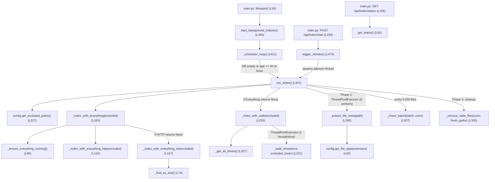
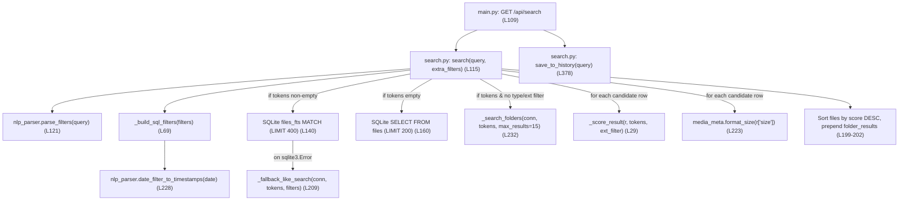
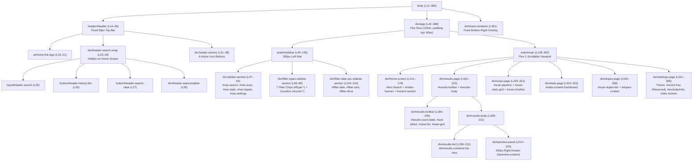
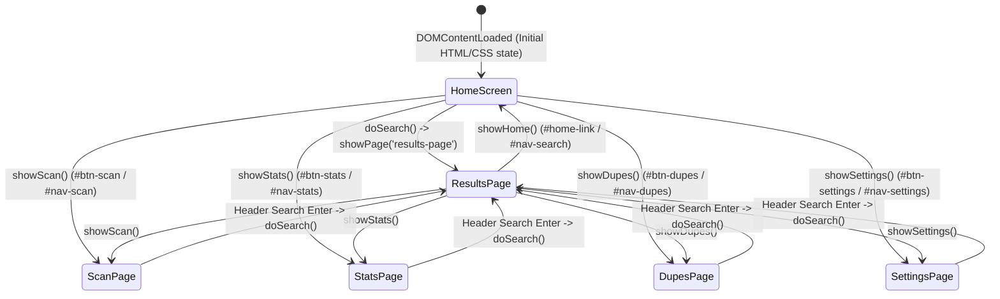
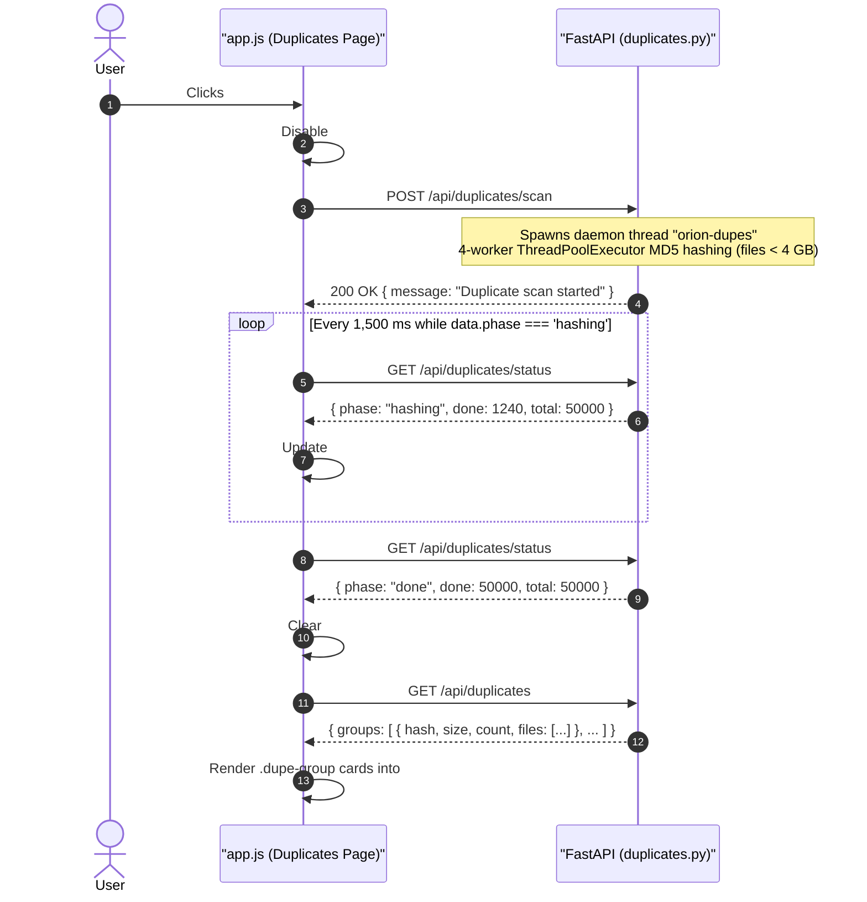

# Orion: Multithreaded Neural Semantic PC Search System
## Document 3: Code Deep Dive (Function-by-Function Reference)

| Field | Details |
| :--- | :--- |
| **Project Title** | Orion: Multithreaded Neural Semantic PC Search System (Version 1 — Core Engine) |
| **Document Number** | Document 3 of 4 |
| **Document Title** | Code Deep Dive (Function-by-Function Reference) |
| **Team Members** | Devansh Bhargav (BTCS24O1038) & Divyansh S. Thakur (BTCS24O1044) |
| **Institution** | Madhav Institute of Technology & Science (MITS), Gwalior |
| **Project Mentor** | Ms. Manisha Pathak |
| **Server Address** | `http://127.0.0.1:8472` |

---

### How to Read This Document

This document is **Document 3** in the four-part technical documentation series for the **Orion** desktop file-search system:
1. **Document 1: Architecture & Technology Overview** — Explains the high-level system architecture, technology stack (FastAPI, SQLite FTS5, Everything SDK/IPC, Pillow, Mutagen, pystray), and theoretical foundations.
2. **Document 2: System Internals** — Covers the database schema, FTS5 virtual table triggers, indexing state machine, multi-signal ranking math, REST API contracts, and UI data flows.
3. **Document 3: Code Deep Dive (This Document)** — A line-by-line, function-by-function anatomy of every Python backend module (**Part A**) and vanilla HTML/CSS/JS frontend file (**Part B**).
4. **Document 4: Installer, Packaging, Assets & Appendix** — Details the batch launchers (`orion.bat`, `setup.bat`, `start.bat`), `package_build.py`, the self-contained Windows installer (`Install Orion.bat`), bundled tools (`Everything.exe`, `es.exe`), and troubleshooting guides.

Whereas Documents 1 and 2 focus on architectural concepts and end-to-end data pipelines, **Document 3** is designed as an exhaustive source-code reference manual. Every module in `backend/` and `frontend/` is dissected in execution order: its purpose, imports, module-level constants and state variables, and every single function (exact signature, line numbers, step-by-step execution trace, real code snippets, input/output contracts, edge cases, and caller/callee relationships). Worked numerical and string traces are included so that you can point to any line of code during a viva or code review and explain *why* it exists and *what* happens if it is modified.

---

## Table of Contents

### Part A: Backend (`backend/*.py`)
- [Section A1: `backend/config.py` — Configuration, Constants & Database Layer](#section-a1-backendconfigpy--configuration-constants--database-layer)
  - [A1.1 Module Purpose & Imports](#a11-module-purpose--imports)
  - [A1.2 Module-Level Constants & Globals](#a12-module-level-constants--globals)
  - [A1.3 `get_file_type(extension: str) -> str` (L92–94)](#a13-get_file_typeextension-str---str-l9294)
  - [A1.4 `get_db() -> sqlite3.Connection` (L98–105)](#a14-get_db---sqlite3connection-l98105)
  - [A1.5 `init_db()` (L108–202)](#a15-init_db-l108202)
  - [A1.6 `get_setting(key: str, default=None)` (L205–214) & `set_setting(key: str, value)` (L217–224)](#a16-get_settingkey-str-defaultnone-l205214--set_settingkey-str-value-l217224)
  - [A1.7 `get_excluded_paths() -> list[str]` (L227–231)](#a17-get_excluded_paths---liststr-l227231)
- [Section A2: `backend/main.py` — FastAPI Server, Lifecycle & HTTP Endpoints](#section-a2-backendmainpy--fastapi-server-lifecycle--http-endpoints)
  - [A2.1 Module Purpose, Imports & Path Bootstrapping](#a21-module-purpose-imports--path-bootstrapping)
  - [A2.2 App Initialization, Logging, CORS & Static Mounting](#a22-app-initialization-logging-cors--static-mounting)
  - [A2.3 `lifespan(app_)` (L48–60) & `_copy_icon()` (L80–96)](#a23-lifespanapp_-l4860--_copy_icon-l8096)
  - [A2.4 Frontend & Search Routes: `serve_index()` (L100–105), `api_search()` (L109–134), `api_recent()` (L138–140), `api_stats()` (L144–146)](#a24-frontend--search-routes-serve_index-l100105-api_search-l109134-api_recent-l138140-api_stats-l144146)
  - [A2.5 Indexer Routes: `api_index_start()` (L150–153) & `api_index_status()` (L156–158)](#a25-indexer-routes-api_index_start-l150153--api_index_status-l156158)
  - [A2.6 OS File Action Routes: `PathRequest` (L162–164), `api_open_folder()` (L167–237), `api_open_file()` (L240–249), `api_copy_path()` (L252–262)](#a26-os-file-action-routes-pathrequest-l162164-api_open_folder-l167237-api_open_file-l240249-api_copy_path-l252262)
  - [A2.7 Media & Preview Routes: `api_thumbnail()` (L266–274) & `api_meta()` (L278–299)](#a27-media--preview-routes-api_thumbnail-l266274--api_meta-l278299)
  - [A2.8 History, Duplicates, Exclusions & Settings Routes (L303–373)](#a28-history-duplicates-exclusions--settings-routes-l303373)
  - [A2.9 Uvicorn Entry Point (`__main__`, L377–385)](#a29-uvicorn-entry-point-__main__-l377385)
- [Section A3: `backend/indexer.py` — Multi-Strategy File System Indexing Engine](#section-a3-backendindexerpy--multi-strategy-file-system-indexing-engine)
  - [A3.1 Module Purpose, Imports & Global State Machine](#a31-module-purpose-imports--global-state-machine)
  - [A3.2 Indexer Call Graph (Mermaid)](#a32-indexer-call-graph-mermaid)
  - [A3.3 `get_status() -> dict` (L40–63)](#a33-get_status---dict-l4063)
  - [A3.4 Everything Integration: `_find_es_exe()` (L74–83) & `_ensure_everything_running()` (L86–119)](#a34-everything-integration-_find_es_exe-l7483--_ensure_everything_running-l86119)
  - [A3.5 Everything Querying: `_index_with_everything_http()` (L122–154), `_index_with_everything_es()` (L157–180), `_index_with_everything()` (L183–203)](#a35-everything-querying-_index_with_everything_http-l122154-_index_with_everything_es-l157180-_index_with_everything-l183203)
  - [A3.6 Multithreaded Fallback Walker: `_get_all_drives()` (L207–218), `_walk_drive()` (L221–252), `_index_with_walk()` (L255–275)](#a36-multithreaded-fallback-walker-_get_all_drives-l207218-_walk_drive-l221252-_index_with_walk-l255275)
  - [A3.7 Metadata & Batch Persistence: `_extract_file_meta()` (L280–301), `_insert_batch()` (L307–327), `_remove_stale_files()` (L330–337)](#a37-metadata--batch-persistence-_extract_file_meta-l280301-_insert_batch-l307327-_remove_stale_files-l330337)
  - [A3.8 Core Orchestrator & Scheduler: `run_index()` (L341–413), `_scheduler_loop()` (L421–452), `start_background_indexer()` (L455–465), `stop_background_indexer()` (L468–470), `trigger_reindex()` (L473–476)](#a38-core-orchestrator--scheduler-run_index-l341413-_scheduler_loop-l421452-start_background_indexer-l455465-stop_background_indexer-l468470-trigger_reindex-l473476)
  - [A3.9 Worked Trace: End-to-End Indexing Run](#a39-worked-trace-end-to-end-indexing-run)
- [Section A4: `backend/nlp_parser.py` — Natural-Language Query Filter Parser](#section-a4-backendnlp_parserpy--natural-language-query-filter-parser)
  - [A4.1 Module Purpose, Imports & Regex/Keyword Dictionaries](#a41-module-purpose-imports--regexkeyword-dictionaries)
  - [A4.2 `parse_filters(query: str) -> dict` (L121–225)](#a42-parse_filtersquery-str---dict-l121225)
  - [A4.3 `date_filter_to_timestamps(date_key: str) -> tuple[int | None, int | None]` (L228–254)](#a43-date_filter_to_timestampsdate_key-str---tupleint--none-int--none-l228254)
  - [A4.4 Worked Traces: Step-by-Step Query Parsing on 3 Real Queries](#a44-worked-traces-step-by-step-query-parsing-on-3-real-queries)
- [Section A5: `backend/search.py` — FTS5 Search Engine, Folder Discovery & Multi-Signal Ranking](#section-a5-backendsearchpy--fts5-search-engine-folder-discovery--multi-signal-ranking)
  - [A5.1 Module Purpose, Imports & Scoring Weights](#a51-module-purpose-imports--scoring-weights)
  - [A5.2 Search Pipeline Call Graph (Mermaid)](#a52-search-pipeline-call-graph-mermaid)
  - [A5.3 `_score_result(row: dict, tokens: list[str], ext_filter: str | None) -> int` (L29–66)](#a53-_score_resultrow-dict-tokens-liststr-ext_filter-str--none---int-l2966)
  - [A5.4 Worked Numerical Traces of `_score_result()`](#a54-worked-numerical-traces-of-_score_result)
  - [A5.5 `_build_sql_filters(filters: dict) -> tuple[str, list]` (L69–112)](#a55-_build_sql_filtersfilters-dict---tuplestr-list-l69112)
  - [A5.6 `search(query: str, extra_filters: dict | None = None) -> list[dict]` (L115–206)](#a56-searchquery-str-extra_filters-dict--none--none---listdict-l115206)
  - [A5.7 `_fallback_like_search(conn, tokens: list[str], filters: dict) -> list` (L209–228)](#a57-_fallback_like_searchconn-tokens-liststr-filters-dict---list-l209228)
  - [A5.8 `_search_folders(conn, tokens: list[str], max_results: int = 15) -> list[dict]` (L232–304)](#a58-_search_foldersconn-tokens-liststr-max_results-int--15---listdict-l232304)
  - [A5.9 Dashboard & History Functions: `get_recent_files()` (L308–340), `get_stats()` (L343–375), `save_to_history()` (L378–397), `get_history()` (L400–412), `clear_history()` (L415–419)](#a59-dashboard--history-functions-get_recent_files-l308340-get_stats-l343375-save_to_history-l378397-get_history-l400412-clear_history-l415419)
- [Section A6: `backend/duplicates.py` — Content-Based MD5 Duplicate Detector](#section-a6-backendduplicatespy--content-based-md5-duplicate-detector)
  - [A6.1 Module Purpose, Imports & Concurrency State](#a61-module-purpose-imports--concurrency-state)
  - [A6.2 `_md5_of_file(path: str, chunk: int = 1 << 20) -> str | None` (L22–34)](#a62-_md5_of_filepath-str-chunk-int--1--20---str--none-l2234)
  - [A6.3 `compute_hashes(limit: int = 50_000)` (L37–85)](#a63-compute_hasheslimit-int--50_000-l3785)
  - [A6.4 `get_duplicates(min_size: int = 1024) -> list[dict]` (L88–127)](#a64-get_duplicatesmin_size-int--1024---listdict-l88127)
  - [A6.5 `duplicate_scan_status() -> dict` (L130–132) & `start_duplicate_scan()` (L135–138)](#a65-duplicate_scan_status---dict-l130132--start_duplicate_scan-l135138)
- [Section A7: `backend/media_meta.py` — Rich Media Metadata & Binary Container Parser](#section-a7-backendmedia_metapy--rich-media-metadata--binary-container-parser)
  - [A7.1 Module Purpose & Lazy Import Strategy](#a71-module-purpose--lazy-import-strategy)
  - [A7.2 `get_image_meta(path: str) -> dict` (L11–55) & `get_thumbnail_b64(path: str, size: tuple = (400, 300)) -> str | None` (L58–73)](#a72-get_image_metapath-str---dict-l1155--get_thumbnail_b64path-str-size-tuple--400-300---str--none-l5873)
  - [A7.3 `get_audio_meta(path: str) -> dict` (L77–120) & `get_audio_albumart_b64(path: str) -> str | None` (L123–151)](#a73-get_audio_metapath-str---dict-l77120--get_audio_albumart_b64path-str---str--none-l123151)
  - [A7.4 `get_video_meta(path: str) -> dict` (L155–187) & `_mp4_dimensions(path: str) -> tuple[int, int]` (L190–208)](#a74-get_video_metapath-str---dict-l155187--_mp4_dimensionspath-str---tupleint-int-l190208)
  - [A7.5 Formatting Helpers: `format_duration(seconds: int) -> str` (L211–220) & `format_size(bytes_: int) -> str` (L223–231)](#a75-formatting-helpers-format_durationseconds-int---str-l211220--format_sizebytes_-int---str-l223231)
- [Section A8: `backend/tray.py` — System Tray Icon & Global Hotkey Daemon](#section-a8-backendtraypy--system-tray-icon--global-hotkey-daemon)
  - [A8.1 Module Purpose, Defensive Imports & Constants](#a81-module-purpose-defensive-imports--constants)
  - [A8.2 Browser & Hotkey Callbacks: `_open_browser()` (L39–42), `_on_hotkey()` (L45–48), `_open_from_tray()` (L75–76), `_quit_orion()` (L67–72)](#a82-browser--hotkey-callbacks-_open_browser-l3942-_on_hotkey-l4548-_open_from_tray-l7576-_quit_orion-l6772)
  - [A8.3 Icon & Thread Starters: `_load_tray_icon()` (L51–64), `run_tray()` (L79–98), `register_hotkey()` (L101–110), `start_tray_and_hotkey()` (L113–123)](#a83-icon--thread-starters-_load_tray_icon-l5164-run_tray-l7998-register_hotkey-l101110-start_tray_and_hotkey-l113123)
- [Section A9: "Where to Look For..." — Backend Quick Lookup Table](#section-a9-where-to-look-for--backend-quick-lookup-table)

### Part B: Frontend (`frontend/index.html`, `frontend/app.js`, `frontend/style.css`)
- **Section B1: `frontend/index.html` — DOM Structure & Page Containers**
- **Section B2: `frontend/app.js` — Global State, Initialization & Page Navigation**
- **Section B3: `frontend/app.js` — Search Execution, Client-Side Filtering & Result Rendering**
- **Section B4: `frontend/app.js` — Interactive Preview Panel & Rich Metadata Enrichment**
- **Section B5: `frontend/app.js` — Secondary Views (Stats Dashboard, Duplicate Finder, Settings, Live Scan Progress)**
- **Section B6: `frontend/app.js` — Utilities, Escaping, Formatting & Global Event Wiring**
- **Section B7: `frontend/style.css` — CSS Custom Properties, Layout Grid & Component Design System**

---

# PART A: Backend Code Deep Dive (`backend/*.py`)

## Section A1: `backend/config.py` — Configuration, Constants & Database Layer

**Source File**: [config.py](file:///C:/Users/devan/.gemini/antigravity/brain/deffb706-24d2-4162-affe-2fa1deb41668/scratch/orion1_src/backend/config.py) (232 lines)

### A1.1 Module Purpose & Imports

`config.py` is the foundational layer of the Orion backend. It has zero internal dependencies on other Orion modules and is imported by almost every other backend file (`main.py`, `indexer.py`, `search.py`, `duplicates.py`). Its responsibilities are:
1. Resolving filesystem paths relative to the project root so Orion remains portable across installation directories.
2. Defining global constants for network binding, indexing cadence, result limits, excluded system paths, and file extension categorization.
3. Providing SQLite connection factory functions with performance-tuned PRAGMAs (`WAL` mode, 64 MB page cache).
4. Defining and initializing the entire relational and FTS5 full-text database schema (`init_db()`), including automatic synchronization triggers and B-tree indexes.
5. Providing helper CRUD functions for the `settings` key-value store and `excluded_paths` table.

#### Imports (L6–9)
| Line | Import Statement | Why It Is Needed |
| :--- | :--- | :--- |
| L6 | `import os` | Imported as a standard utility (though path manipulation in `config.py` primarily uses `pathlib.Path`). |
| L7 | `import sqlite3` | Python's built-in C-extension interface to the SQLite 3 embedded relational database engine. Used in `get_db()`, `init_db()`, `get_setting()`, `set_setting()`, and `get_excluded_paths()`. |
| L8 | `import json` | Used in `get_setting()` and `set_setting()` to serialize/deserialize arbitrary Python values (booleans, strings, lists, dicts) into the `TEXT` column of the `settings` table. |
| L9 | `from pathlib import Path` | Object-oriented filesystem path library used to resolve `BASE_DIR` from `__file__` and construct OS-agnostic child paths (`DATA_DIR`, `DB_PATH`, `ASSETS_DIR`, `FRONTEND_DIR`). |

---

### A1.2 Module-Level Constants & Globals

When `config.py` is first imported, lines 12–90 execute at module load time, establishing all constants and ensuring the `data/` directory exists on disk (`DATA_DIR.mkdir(exist_ok=True)` on L18).

| Constant | Lines | Value / Type | Purpose in Orion |
| :--- | :--- | :--- | :--- |
| `BASE_DIR` | L12 | `Path(__file__).parent.parent` | Resolves to the root directory of the project (one level above `backend/`). |
| `DATA_DIR` | L13 | `BASE_DIR / "data"` | Directory housing persistent application data. Created immediately at import time via `DATA_DIR.mkdir(exist_ok=True)` (L18). |
| `DB_PATH` | L14 | `DATA_DIR / "orion.db"` | Full path to the SQLite database file (`data/orion.db`). Note that in WAL mode, SQLite also creates `orion.db-wal` and `orion.db-shm` alongside this file. |
| `ASSETS_DIR` | L15 | `BASE_DIR / "assets"` | Directory holding `orion_icon.png` and `orion_icon.ico`. |
| `FRONTEND_DIR` | L16 | `BASE_DIR / "frontend"` | Directory containing `index.html`, `app.js`, and `style.css`. Mounted by `main.py` at `/static`. |
| `HOST` | L21 | `"127.0.0.1"` | IPv4 loopback address. Ensures the FastAPI server is only accessible locally on the user's machine and never exposed to the local network. |
| `PORT` | L22 | `8472` | TCP port for the FastAPI HTTP server (`http://127.0.0.1:8472`). Chosen in the high unprivileged port range to avoid conflicts with common developer ports (`3000`, `5000`, `8000`, `8080`). |
| `REINDEX_INTERVAL_HOURS` | L25 | `4` | Interval (in hours) used by `indexer._scheduler_loop()` to decide whether an existing index is stale on startup and how long to sleep between periodic background re-indexes. |
| `MAX_SEARCH_RESULTS` | L26 | `200` | Defined here as a configuration constant for maximum search results (note: `search.py` also defines its own `MAX_RESULTS = 200` on L16). |
| `THUMBNAIL_SIZE` | L27 | `(320, 240)` | Tuple `(width, height)` for thumbnails (note: `media_meta.get_thumbnail_b64()` defaults to `(400, 300)` in its own signature). |
| `DEFAULT_EXCLUDED` | L30–42 | `list[str]` (11 entries) | Seeded into the `excluded_paths` table on every `init_db()` call (`INSERT OR IGNORE`). Contains 6 full Windows system prefixes (`C:\Windows`, `C:\ProgramData`, `C:\$Recycle.Bin`, `C:\System Volume Information`, `C:\Recovery`, `C:\bootmgr`) and 5 relative/developer folder names (`node_modules`, `.git`, `__pycache__`, `.vs`, `AppData\Local\Temp`). |
| `EXTENSION_MAP` | L45–80 | `dict[str, str]` (81 extensions) | Maps lowercase file extensions (without leading dot) to one of 6 broad categories:<ul><li>`"document"` (14): `pdf, doc, docx, xls, xlsx, ppt, pptx, txt, md, odt, ods, csv, rtf, epub`</li><li>`"image"` (15): `jpg, jpeg, png, gif, bmp, webp, tiff, tif, svg, raw, cr2, nef, heic, heif, ico`</li><li>`"video"` (11): `mp4, mkv, avi, mov, wmv, flv, webm, m4v, 3gp, ts, mts`</li><li>`"audio"` (10): `mp3, flac, wav, aac, ogg, wma, m4a, opus, aiff, ape`</li><li>`"archive"` (7): `zip, rar, 7z, tar, gz, bz2, xz`</li><li>`"code"` (24): `py, js, ts, html, css, java, cpp, c, h, cs, go, rs, php, rb, sh, bat, sql, json, xml, yaml, yml, toml, ini, cfg`</li></ul> |
| `FILE_TYPE_ICONS` | L82–90 | `dict[str, str]` (7 categories) | Maps each `file_type` category to a Unicode emoji icon for UI rendering: `"document": "📄"`, `"image": "🖼️"`, `"video": "🎬"`, `"audio": "🎵"`, `"archive": "🗜️"`, `"code": "💻"`, `"other": "📁"`. |

---

### A1.3 `get_file_type(extension: str) -> str` (L92–94)

- **Signature**: [`def get_file_type(extension: str) -> str:`](file:///C:/Users/devan/.gemini/antigravity/brain/deffb706-24d2-4162-affe-2fa1deb41668/scratch/orion1_src/backend/config.py#L92-L94)
- **Location**: `backend/config.py`, lines 92–94.
- **Step-by-Step Behavior**:
  1. Converts the input `extension` string to lowercase (`.lower()`).
  2. Strips any leading period characters (`.lstrip(".")`), so both `".PDF"` and `"pdf"` normalize to `"pdf"`.
  3. Looks up the normalized string in `EXTENSION_MAP`, returning the mapped category string (`"document"`, `"image"`, `"video"`, `"audio"`, `"archive"`, or `"code"`), or `"other"` if the extension is unknown or empty.
- **Code**:
  ```python
  def get_file_type(extension: str) -> str:
      """Return the broad file type category for an extension."""
      return EXTENSION_MAP.get(extension.lower().lstrip("."), "other")
  ```
- **Inputs / Outputs**:
  - **Input**: `extension: str` (e.g., `"mp4"`, `".JPG"`, `""`, `"dll"`).
  - **Output**: `str` — one of the 7 category strings.
- **Edge Cases**: If `extension` is `""` (a file with no extension like `Makefile`), `.lower().lstrip(".")` yields `""`, which is not in `EXTENSION_MAP` and safely returns `"other"`.
- **Callers**:
  - `indexer.py` → `_extract_file_meta()` (L299) during indexing of every file.
  - `main.py` → `api_meta()` (L288) when building preview metadata.
  - Imported in `search.py` (L10), though `search.py` reads the pre-computed `file_type` column directly from the database.

---

### A1.4 `get_db() -> sqlite3.Connection` (L98–105)

- **Signature**: [`def get_db() -> sqlite3.Connection:`](file:///C:/Users/devan/.gemini/antigravity/brain/deffb706-24d2-4162-affe-2fa1deb41668/scratch/orion1_src/backend/config.py#L98-L105)
- **Location**: `backend/config.py`, lines 98–105.
- **Step-by-Step Behavior**:
  1. Opens a new SQLite connection to `str(DB_PATH)` (`data/orion.db`) with `check_same_thread=False` (L100). Disabling the thread check allows connections or cursors to be used inside FastAPI's threadpool and background worker threads without raising `sqlite3.ProgrammingError`.
  2. Sets `conn.row_factory = sqlite3.Row` (L101). `sqlite3.Row` is a highly optimized C struct that supports both integer index access (`row[0]`) and case-insensitive column-name access (`row["filename"]`), and can be converted directly to a Python `dict` via `dict(row)`.
  3. Executes `PRAGMA journal_mode=WAL` (L102). Write-Ahead Logging is critical for Orion: it allows background indexing (`indexer.py`) or MD5 hashing (`duplicates.py`) to write batches to `orion.db-wal` concurrently while user search queries (`search.py`) read from the database without blocking or raising `database is locked` errors.
  4. Executes `PRAGMA synchronous=NORMAL` (L103). In WAL mode, `NORMAL` synchronization only issues an OS `fsync` at WAL checkpoints rather than after every single transaction commit, increasing batch `INSERT` throughput by 5–10x while maintaining crash consistency.
  5. Executes `PRAGMA cache_size=-64000` (L104). A negative value tells SQLite to allocate `64,000 KiB` (~64 MB) of RAM for its page cache per connection, keeping B-tree interior nodes and FTS5 inverted index segments in memory for sub-10ms searches.
  6. Returns the configured `conn` object.
- **Code**:
  ```python
  def get_db() -> sqlite3.Connection:
      """Return a SQLite connection with row_factory set."""
      conn = sqlite3.connect(str(DB_PATH), check_same_thread=False)
      conn.row_factory = sqlite3.Row
      conn.execute("PRAGMA journal_mode=WAL")
      conn.execute("PRAGMA synchronous=NORMAL")
      conn.execute("PRAGMA cache_size=-64000")   # 64 MB cache
      return conn
  ```
- **Callers**: Called by every database-interacting function across `config.py`, `main.py`, `indexer.py`, `search.py`, and `duplicates.py`. Each caller opens a connection via `get_db()` and explicitly calls `conn.close()` when finished.

---

### A1.5 `init_db()` (L108–202)

- **Signature**: [`def init_db():`](file:///C:/Users/devan/.gemini/antigravity/brain/deffb706-24d2-4162-affe-2fa1deb41668/scratch/orion1_src/backend/config.py#L108-L202)
- **Location**: `backend/config.py`, lines 108–202.
- **Step-by-Step Behavior**:
  1. Acquires a database connection via `get_db()` and creates a cursor `cur = conn.cursor()` (L110–111).
  2. **Creates `files` Table (L114–129)**: The core metadata table holding one row per indexed file on the PC:
     - `id INTEGER PRIMARY KEY AUTOINCREMENT`
     - `path TEXT UNIQUE NOT NULL` (Creates an implicit unique B-tree index on `path`, enabling `ON CONFLICT(path) DO UPDATE` upserts during indexing).
     - `filename TEXT NOT NULL`
     - `extension TEXT DEFAULT ''`
     - `drive TEXT DEFAULT ''`
     - `size INTEGER DEFAULT 0` (File size in bytes).
     - `modified INTEGER DEFAULT 0` (Last modified Unix timestamp in seconds).
     - `created INTEGER DEFAULT 0` (Creation time Unix timestamp in seconds).
     - `file_type TEXT DEFAULT 'other'`
     - `md5_hash TEXT DEFAULT NULL` (Populated lazily when the user triggers a duplicate scan in `duplicates.py`).
     - `ai_description TEXT DEFAULT NULL` (**Note on Leftover Column**: In Orion Version 1, this column is a reserved/unused schema field. It is never written to by the indexer, and remains `NULL` for all rows, though `search.py` selects it and `app.js` checks `if (r.ai_description)` in the preview panel).
     - `indexed_at INTEGER DEFAULT 0` (Unix timestamp of when the row was last inserted/updated).
  3. **Creates `files_fts` Virtual Table (L133–140)**:
     ```sql
     CREATE VIRTUAL TABLE IF NOT EXISTS files_fts USING fts5(
         path,
         filename,
         tokenize = 'unicode61 separators ''_-. ()[]{}#@!''',
         content  = 'files',
         content_rowid = 'id'
     )
     ```
     - Uses SQLite's **FTS5** extension in **external content mode** (`content = 'files'`, `content_rowid = 'id'`). Instead of duplicating the `path` and `filename` strings inside FTS5 shadow tables, `files_fts` stores only the inverted token index and looks up column values from `files` by `id`, cutting database disk usage roughly in half.
     - Configures the `unicode61` tokenizer with custom separator characters: `_`, `-`, `.`, space, `(`, `)`, `[`, `]`, `{`, `}`, `#`, `@`, `!`. This means a filename like `Project_Report-2025.final(v2).pdf` is tokenized into `["project", "report", "2025", "final", "v2", "pdf"]`, making every sub-token instantly searchable via FTS5 `MATCH`.
  4. **Creates 3 Synchronization Triggers (L143–162)**: Because `files_fts` is an external-content FTS5 table, SQLite requires explicit triggers on the `files` table to keep the inverted index synchronized:
     - `files_ai` (`AFTER INSERT ON files`, L144–147): Inserts `(new.id, new.path, new.filename)` into `files_fts`.
     - `files_ad` (`AFTER DELETE ON files`, L150–153): Inserts the special FTS5 `'delete'` command into `files_fts` with `(old.id, old.path, old.filename)`.
     - `files_au` (`AFTER UPDATE ON files`, L156–161): Issues the `'delete'` command for `old.*` followed by an `INSERT` for `new.*`.
  5. **Creates Auxiliary Tables (L165–187)**:
     - `search_history(id INTEGER PRIMARY KEY AUTOINCREMENT, query TEXT NOT NULL, searched_at INTEGER NOT NULL)` (L165–171).
     - `excluded_paths(id INTEGER PRIMARY KEY AUTOINCREMENT, path TEXT UNIQUE NOT NULL)` (L174–179).
     - `settings(key TEXT PRIMARY KEY, value TEXT NOT NULL)` (L182–187).
  6. **Creates 6 Secondary B-Tree Indexes on `files` (L190–195)**:
     - `idx_files_type ON files(file_type)`
     - `idx_files_modified ON files(modified)`
     - `idx_files_size ON files(size)`
     - `idx_files_drive ON files(drive)`
     - `idx_files_ext ON files(extension)`
     - `idx_files_md5 ON files(md5_hash)`
  7. **Seeds Default Exclusions (L198–199)**: Loops over the 11 strings in `DEFAULT_EXCLUDED` and executes `INSERT OR IGNORE INTO excluded_paths(path) VALUES (?)`. Because `path` is `UNIQUE`, existing rows are untouched on subsequent startups.
  8. Commits the transaction and closes the connection (L201–202).
- **Idempotency**: Every DDL statement uses `IF NOT EXISTS` and seeding uses `INSERT OR IGNORE`, so calling `init_db()` on every server boot is completely safe and non-destructive.
- **Callers**: `main.py` → `lifespan()` (L52) on FastAPI startup.

---

### A1.6 `get_setting(key: str, default=None)` (L205–214) & `set_setting(key: str, value)` (L217–224)

- **Signatures**:
  - [`def get_setting(key: str, default=None):`](file:///C:/Users/devan/.gemini/antigravity/brain/deffb706-24d2-4162-affe-2fa1deb41668/scratch/orion1_src/backend/config.py#L205-L214)
  - [`def set_setting(key: str, value):`](file:///C:/Users/devan/.gemini/antigravity/brain/deffb706-24d2-4162-affe-2fa1deb41668/scratch/orion1_src/backend/config.py#L217-L224)
- **Location**: `backend/config.py`, lines 205–224.
- **Step-by-Step Behavior**:
  - **`get_setting`**: Opens DB, executes `SELECT value FROM settings WHERE key=?`, closes DB. If a row exists, attempts `json.loads(row["value"])` inside a `try...except Exception` block; if JSON decoding fails (e.g., raw unquoted string), returns the raw `row["value"]`. If no row exists, returns `default`.
  - **`set_setting`**: Opens DB, executes `INSERT OR REPLACE INTO settings(key, value) VALUES (?, ?)` with `(key, json.dumps(value))`, commits, and closes DB.
- **Code**:
  ```python
  def get_setting(key: str, default=None):
      conn = get_db()
      row  = conn.execute("SELECT value FROM settings WHERE key=?", (key,)).fetchone()
      conn.close()
      if row:
          try:
              return json.loads(row["value"])
          except Exception:
              return row["value"]
      return default

  def set_setting(key: str, value):
      conn = get_db()
      conn.execute(
          "INSERT OR REPLACE INTO settings(key, value) VALUES (?, ?)",
          (key, json.dumps(value))
      )
      conn.commit()
      conn.close()
  ```
- **Callers**: `main.py` → `api_get_settings()` (L361–366) and `api_save_settings()` (L370–373).

---

### A1.7 `get_excluded_paths() -> list[str]` (L227–231)

- **Signature**: [`def get_excluded_paths() -> list[str]:`](file:///C:/Users/devan/.gemini/antigravity/brain/deffb706-24d2-4162-affe-2fa1deb41668/scratch/orion1_src/backend/config.py#L227-L231)
- **Location**: `backend/config.py`, lines 227–231.
- **Behavior**: Queries `SELECT path FROM excluded_paths`, closes the connection, and returns a list of path strings `[r["path"] for r in rows]`.
- **Callers**:
  - `indexer.py` → `run_index()` (L358) to obtain the exclusion list at the start of every index run.
  - `main.py` → `api_get_excluded()` (L338) for the Settings UI.

---

## Section A2: `backend/main.py` — FastAPI Server, Lifecycle & HTTP Endpoints

**Source File**: [main.py](file:///C:/Users/devan/.gemini/antigravity/brain/deffb706-24d2-4162-affe-2fa1deb41668/scratch/orion1_src/backend/main.py) (386 lines)

### A2.1 Module Purpose, Imports & Path Bootstrapping

`main.py` is the HTTP gateway and process entry point of Orion. It creates the FastAPI ASGI application, manages startup/shutdown tasks via an async lifespan context manager, mounts the static frontend directory, and exposes 18 HTTP endpoints (plus the root `/` HTML handler) that bridge the browser UI with the Python backend modules.

#### Path Bootstrapping (L16)
Before importing any sibling backend modules, line 16 executes:
```python
sys.path.insert(0, str(Path(__file__).parent))
```
This guarantees that regardless of the current working directory (`Cwd`) from which Python or Uvicorn is launched (e.g., whether launched from the project root via `python backend\main.py` or from inside `backend/`), top-level imports like `import config as cfg` and `from indexer import ...` always resolve to the `backend/` folder.

#### Imports (L6–37)
- **Standard Library (L6–13)**: `os`, `sys`, `logging`, `subprocess` (for Task Scheduler `schtasks` and PowerShell clipboard commands), `webbrowser` (for auto-opening the UI on startup), `threading` (for background tray/hotkey and delayed browser launch), `Path`, and `asynccontextmanager`.
- **Third-Party (L18–22)**:
  - `from fastapi import FastAPI, Query, HTTPException, Body`
  - `from fastapi.staticfiles import StaticFiles`
  - `from fastapi.responses import JSONResponse, FileResponse, HTMLResponse`
  - `from fastapi.middleware.cors import CORSMiddleware`
  - `from pydantic import BaseModel` (for validating JSON request bodies in `PathRequest` and `ExcludePath`).
- **Internal Orion Modules (L24–37)**:
  - `config` (`cfg`, `init_db`, `get_db`, `get_excluded_paths`, `get_setting`, `set_setting`)
  - `indexer` (`get_status as indexer_status`, `trigger_reindex`, `start_background_indexer`)
  - `search` (`search as do_search`, `get_recent_files`, `get_stats`, `save_to_history`, `get_history`, `clear_history`)
  - `media_meta` (`get_thumbnail_b64`, `get_image_meta`, `get_audio_meta`, `get_video_meta`)
  - `duplicates` (`get_duplicates`, `start_duplicate_scan`, `duplicate_scan_status`)
  - `tray` (`start_tray_and_hotkey`)

---

### A2.2 App Initialization, Logging, CORS & Static Mounting

- **Logging Setup (L40–45)**: Configures Python's root logger at `logging.INFO` with format `"%(asctime)s [%(name)s] %(levelname)s: %(message)s"` and `datefmt="%H:%M:%S"`, and creates `log = logging.getLogger("orion")`.
- **FastAPI Instance (L62)**:
  ```python
  app = FastAPI(title="Orion Search", version="1.0.0", docs_url=None, redoc_url=None, lifespan=lifespan)
  ```
  Notice `docs_url=None` and `redoc_url=None`—Swagger UI (`/docs`) and ReDoc (`/redoc`) are disabled in production to keep the local desktop app lightweight.
- **CORS Middleware (L64–69)**: Adds `CORSMiddleware` with `allow_origins=["*"]`, `allow_methods=["*"]`, `allow_headers=["*"]`. Even though the frontend is served from `http://127.0.0.1:8472/`, allowing all origins ensures that if a user opens `index.html` via `http://localhost:8472` or directly from `file://`, requests to `http://127.0.0.1:8472/api/*` are never blocked by browser CORS policies.
- **Static File Mounting (L72–74)**:
  ```python
  FRONTEND_DIR = cfg.FRONTEND_DIR
  if FRONTEND_DIR.exists():
      app.mount("/static", StaticFiles(directory=str(FRONTEND_DIR)), name="static")
  ```
  This serves `frontend/style.css` at `/static/style.css` and `frontend/app.js` at `/static/app.js`.

---

### A2.3 `lifespan(app_)` (L48–60) & `_copy_icon()` (L80–96)

#### `lifespan(app_)` (L48–60)
- **Signature**: [`@asynccontextmanager async def lifespan(app_):`](file:///C:/Users/devan/.gemini/antigravity/brain/deffb706-24d2-4162-affe-2fa1deb41668/scratch/orion1_src/backend/main.py#L48-L60)
- **Behavior**:
  1. Logs `"Orion starting up…"`.
  2. Calls `init_db()` (L52) to ensure `data/orion.db`, all tables, FTS5 triggers, B-tree indexes, and default excluded paths exist.
  3. Calls `_copy_icon()` (L53) to verify `assets/orion_icon.png` exists.
  4. Calls `start_background_indexer()` (L54), which spawns the `"orion-indexer"` daemon thread.
  5. Spawns a daemon thread running `start_tray_and_hotkey` (L55) to initialize the Windows system tray icon and `Ctrl+Space` hotkey.
  6. Starts a `threading.Timer(1.5, lambda: webbrowser.open(f"http://{cfg.HOST}:{cfg.PORT}")).start()` (L56). Waiting 1.5 seconds gives Uvicorn time to finish binding socket `127.0.0.1:8472` before the default browser requests `/`.
  7. Logs readiness and `yield`s control to FastAPI while the server runs (L57–58).
  8. On shutdown, logs `"Orion shutting down"` (L60).

#### `_copy_icon()` (L80–96)
- **Signature**: [`def _copy_icon():`](file:///C:/Users/devan/.gemini/antigravity/brain/deffb706-24d2-4162-affe-2fa1deb41668/scratch/orion1_src/backend/main.py#L80-L96)
- **Behavior**: Ensures `cfg.ASSETS_DIR` (`assets/`) exists. Checks if `assets/orion_icon.png` exists (L86–87). If missing, it dynamically draws a 256×256 dark-background (`#0A0A0F`, RGB `10, 10, 15`) PNG with a purple magnifying glass (`#7C3AED`, RGB `124, 58, 237` ellipse from `(30,30)` to `(180,180)` and handle line from `(160,160)` to `(220,220)`) using Pillow's `ImageDraw` and saves it to `assets/orion_icon.png`.

---

### A2.4 Frontend & Search Routes: `serve_index()` (L100–105), `api_search()` (L109–134), `api_recent()` (L138–140), `api_stats()` (L144–146)

#### `serve_index()` — `GET /` (L100–105)
- **Signature**: [`@app.get("/", response_class=HTMLResponse) async def serve_index():`](file:///C:/Users/devan/.gemini/antigravity/brain/deffb706-24d2-4162-affe-2fa1deb41668/scratch/orion1_src/backend/main.py#L100-L105)
- **Behavior**: Reads `frontend/index.html` as a UTF-8 string and returns it as `text/html`. If `index.html` is missing, returns fallback HTML `<h1>Orion</h1><p>Frontend not found.</p>`.

#### `api_search()` — `GET /api/search` (L109–134)
- **Signature**:
  ```python
  @app.get("/api/search")
  async def api_search(
      q:          str            = Query(..., min_length=1),
      type:       str | None     = Query(None),
      extension:  str | None     = Query(None),
      size_min:   int | None     = Query(None),
      size_max:   int | None     = Query(None),
      date:       str | None     = Query(None),
      drive:      str | None     = Query(None),
      resolution: str | None     = Query(None),
  ):
  ```
- **Step-by-Step Behavior**:
  1. Validates that query parameter `q` is present and at least 1 character long (`min_length=1`; otherwise FastAPI automatically returns HTTP `422 Unprocessable Entity`).
  2. Packages the 7 optional query parameters (`type`, `extension`, `size_min`, `size_max`, `date`, `drive`, `resolution`) into a dictionary `extra` and strips out any key whose value is `None` (L120–130).
  3. Calls `do_search(q, extra_filters=extra if extra else None)` (`search.py` → `search()`, L115) (L132).
  4. Calls `save_to_history(q)` (`search.py`, L378) to record the search query in SQLite (L133).
  5. Returns `{"query": q, "count": len(results), "results": results}` (L134).
- **Note on `resolution`**: Even though `resolution` is accepted in `extra` and extracted in `nlp_parser.py`, `search.py` → `_build_sql_filters()` does not filter SQL rows by resolution because image/video dimensions are extracted on-demand in `media_meta.py` rather than stored in the `files` table.

#### `api_recent()` — `GET /api/recent` (L138–140)
- **Signature**: [`@app.get("/api/recent") async def api_recent(limit: int = Query(default=30, le=100)):`](file:///C:/Users/devan/.gemini/antigravity/brain/deffb706-24d2-4162-affe-2fa1deb41668/scratch/orion1_src/backend/main.py#L138-L140)
- **Behavior**: Enforces `limit <= 100` via FastAPI `Query(default=30, le=100)`, calls `get_recent_files(limit)` (`search.py`, L308), and returns `{"files": ...}`. Called by `app.js` → `loadRecentFiles()` with `limit=12`.

#### `api_stats()` — `GET /api/stats` (L144–146)
- **Signature**: [`@app.get("/api/stats") async def api_stats():`](file:///C:/Users/devan/.gemini/antigravity/brain/deffb706-24d2-4162-affe-2fa1deb41668/scratch/orion1_src/backend/main.py#L144-L146)
- **Behavior**: Delegates directly to `get_stats()` (`search.py`, L343). Called by `app.js` → `loadStats()` and `loadDrives()`.

---

### A2.5 Indexer Routes: `api_index_start()` (L150–153) & `api_index_status()` (L156–158)

- **`api_index_start()` — `POST /api/index/start` (L150–153)**: Calls `trigger_reindex()` (`indexer.py`, L473) to spawn a non-blocking daemon thread running `run_index()`, and immediately returns `{"message": "Re-indexing started"}`.
- **`api_index_status()` — `GET /api/index/status` (L156–158)**: Calls `indexer_status()` (`indexer.py` → `get_status()`, L40) and returns the live progress dictionary (`indexing`, `indexed_files`, `total_estimate`, `phase`, `elapsed_seconds`, `dirs_visited`, `files_found`, `current_drive`, `files_per_second`, `eta_seconds`). Polled by `app.js` → `pollIndexStatus()` and `refreshScanPage()`.

---

### A2.6 OS File Action Routes: `PathRequest` (L162–164), `api_open_folder()` (L167–237), `api_open_file()` (L240–249), `api_copy_path()` (L252–262)

#### `PathRequest` Model (L162–164)
```python
class PathRequest(BaseModel):
    path: str
    is_folder: bool = False  # True when path is itself a folder (not a file inside one)
```

#### `api_open_folder(req: PathRequest)` — `POST /api/open-folder` (L167–237)
- **Signature**: [`@app.post("/api/open-folder") async def api_open_folder(req: PathRequest):`](file:///C:/Users/devan/.gemini/antigravity/brain/deffb706-24d2-4162-affe-2fa1deb41668/scratch/orion1_src/backend/main.py#L167-L237)
- **Location**: `backend/main.py`, lines 167–237.
- **Why Three Fallback Attempts Exist**: When a background Python process (launched via `pythonw.exe` or a batch script) tries to spawn `explorer.exe`, Windows often places child processes in a Job Object sandbox or opens Explorer behind the active browser window. To guarantee that Windows Explorer pops up in the foreground on the user's active desktop with the target file highlighted, `api_open_folder()` implements a 3-tier fallback cascade:
  1. **Target Resolution (L172–181)**:
     - If `req.is_folder` is `True`, sets `target = path`.
     - Otherwise, sets `target = path`; if `not os.path.exists(target)` (e.g., file was moved/deleted since indexing), falls back to `target = os.path.dirname(path)`.
     - If `target` still does not exist on disk, raises `HTTPException(404, f"Path not found: {path}")`.
  2. **Attempt 1: Windows Task Scheduler Interactive Task (`schtasks /it`, L189–216)**:
     - Generates a unique transient task name `f"OrionExplorer_{uuid.uuid4().hex[:8]}"`.
     - If `os.path.isfile(target)`, sets command `tr = f'explorer.exe /select,"{target}"'` (which opens the parent folder and highlights the file); otherwise `tr = f'explorer.exe "{target}"'`.
     - Runs `schtasks /create /f /tn <task_name> /tr <tr> /sc once /st 00:00 /it` with an 8-second timeout. The `/it` flag tells the Windows Task Scheduler service (`svchost.exe`) to spawn `explorer.exe` directly inside the interactive desktop session, escaping any process job sandbox and granting foreground activation rights.
     - If `create.returncode == 0`, runs `schtasks /run /tn <task_name>`, spawns a daemon thread (`_cleanup`) that sleeps 3 seconds and deletes the temporary task (`schtasks /delete /tn <task_name> /f`), and marks `opened = True`.
  3. **Attempt 2: Win32 Shell COM API (`SHOpenFolderAndSelectItems`, L219–230)**:
     - If Attempt 1 failed (`not opened`), uses `ctypes.windll.shell32` and `ole32`:
     ```python
     shell32 = ctypes.windll.shell32
     ctypes.windll.ole32.CoInitialize(None)
     pidl = shell32.ILCreateFromPathW(target)
     if pidl:
         shell32.SHOpenFolderAndSelectItems(pidl, 0, None, 0)
         shell32.ILFree(pidl)
         opened = True
     ctypes.windll.ole32.CoUninitialize()
     ```
     - Converts the Unicode file path to an Item ID List pointer (`PIDL`) via `ILCreateFromPathW` and invokes the native Windows Shell function `SHOpenFolderAndSelectItems` before freeing the PIDL memory.
  4. **Attempt 3: `os.startfile()` Fallback (L233–235)**:
     - If both Attempts 1 and 2 failed, computes `folder = os.path.dirname(target) if os.path.isfile(target) else target` and calls `os.startfile(folder)`.
  5. Returns `{"message": "Opened", "path": target}`.

#### `api_open_file(req: PathRequest)` — `POST /api/open-file` (L240–249)
- **Behavior**: Verifies `os.path.exists(req.path)` (raising HTTP 404 if missing), then calls `os.startfile(req.path)` to launch the file in its default Windows application. Raises HTTP 500 if `os.startfile` throws an exception.

#### `api_copy_path(req: PathRequest)` — `POST /api/copy-path` (L252–262)
- **Behavior**: Runs `subprocess.run(["powershell", "-command", f"Set-Clipboard -Value '{req.path}'"], check=True, capture_output=True)` to copy the path directly into the Windows system clipboard. Returns `{"message": "Copied to clipboard"}` or raises HTTP 500 on error.

---

### A2.7 Media & Preview Routes: `api_thumbnail()` (L266–274) & `api_meta()` (L278–299)

#### `api_thumbnail(path: str = Query(...))` — `GET /api/thumbnail` (L266–274)
- **Behavior**: Checks `os.path.isfile(path)` (HTTP 404 if missing). Calls `get_thumbnail_b64(path)` (`media_meta.py`, L58). If `b64 is None`, raises `HTTPException(422, "Cannot generate thumbnail")`. Otherwise returns `{"thumbnail": b64}`.
- ** Bug / Contract Mismatch Note**: In `frontend/app.js` (L344), `buildResultCard()` sets ``. An HTML `` tag expects raw binary image bytes (`image/jpeg`) or a `data:image/jpeg;base64,...` URI, whereas `/api/thumbnail` returns a JSON object `{"thumbnail": "<base64>"}`. Consequently, the inline `` on result cards fires its `onerror` handler (`this.parentElement.textContent='${r.icon}'`), gracefully falling back to the emoji icon `🖼️`, while the **Preview Panel** (`openPreview()` → `/api/meta` → `enrichPreview()`, `app.js` L426–433) properly reads `meta.thumbnail` from JSON and constructs `src="data:image/jpeg;base64,${meta.thumbnail}"`, which renders the image thumbnail cleanly.

#### `api_meta(path: str = Query(...))` — `GET /api/meta` (L278–299)
- **Behavior**:
  1. Checks `os.path.isfile(path)` (raises HTTP 404 if missing; note this also returns 404 when a user clicks a folder result card because a folder is a directory, not a file, which `app.js` catches silently on L419).
  2. Extracts `ext = Pth(path).suffix.lower().lstrip(".")` and `file_type = get_file_type(ext)` (L287–288).
  3. Initializes `meta = {"path": path, "file_type": file_type, "extension": ext}` (L289).
  4. Dispatches by `file_type`:
     - If `"image"`: merges `get_image_meta(path)` and sets `meta["thumbnail"] = get_thumbnail_b64(path)` (L291–293).
     - If `"audio"`: merges `get_audio_meta(path)` (L294–295).
     - If `"video"`: merges `get_video_meta(path)` (L296–297).
  5. Returns `meta`.

---

### A2.8 History, Duplicates, Exclusions & Settings Routes (L303–373)

| Endpoint | Function & Lines | Action & Backend Delegation |
| :--- | :--- | :--- |
| `GET /api/history` | `api_history()` (L303–305) | Calls `get_history()` (`search.py`, L400) and returns `{"history": [...]}`. |
| `DELETE /api/history` | `api_clear_history()` (L308–311) | Calls `clear_history()` (`search.py`, L415) and returns `{"message": "History cleared"}`. |
| `GET /api/duplicates` | `api_duplicates()` (L315–317) | Calls `get_duplicates()` (`duplicates.py`, L88) and returns `{"groups": [...]}`. |
| `POST /api/duplicates/scan` | `api_duplicate_scan()` (L320–323) | Calls `start_duplicate_scan()` (`duplicates.py`, L135) and returns `{"message": "Duplicate scan started"}`. |
| `GET /api/duplicates/status` | `api_duplicate_status()` (L326–328) | Calls `duplicate_scan_status()` (`duplicates.py`, L130) and returns `{"done": ..., "total": ..., "phase": ...}`. |
| `GET /api/exclude` | `api_get_excluded()` (L336–338) | Calls `get_excluded_paths()` (`config.py`, L227) and returns `{"paths": [...]}`. |
| `POST /api/exclude` | `api_add_excluded(req: ExcludePath)` (L341–347) | Opens DB, runs `INSERT OR IGNORE INTO excluded_paths(path) VALUES (?)`, commits, closes, and returns `{"message": "Added"}`. |
| `DELETE /api/exclude` | `api_remove_excluded(req: ExcludePath)` (L350–356) | Opens DB, runs `DELETE FROM excluded_paths WHERE path=?`, commits, closes, and returns `{"message": "Removed"}`. |
| `GET /api/settings` | `api_get_settings()` (L360–366) | Returns `{"theme": get_setting("theme", "dark"), "view_mode": get_setting("view_mode", "list"), "gemini_api_key": "***" if get_setting("gemini_api_key") else None}`. (**Note**: `gemini_api_key` is a reserved leftover setting; Orion v1 has no AI module that consumes it). |
| `POST /api/settings` | `api_save_settings(body: dict = Body(...))` (L369–373) | Iterates `for k, v in body.items(): set_setting(k, v)` and returns `{"message": "Settings saved"}`. |

---

### A2.9 Uvicorn Entry Point (`__main__`, L377–385)

```python
if __name__ == "__main__":
    import uvicorn
    uvicorn.run(
        "main:app",
        host=cfg.HOST,
        port=cfg.PORT,
        reload=False,
        log_level="info",
    )
```
When `backend/main.py` is executed directly by Python (`start.bat` or `orion.bat`), Uvicorn starts an ASGI event loop bound to `127.0.0.1:8472` with `reload=False`.

---

## Section A3: `backend/indexer.py` — Multi-Strategy File System Indexing Engine

**Source File**: [indexer.py](file:///C:/Users/devan/.gemini/antigravity/brain/deffb706-24d2-4162-affe-2fa1deb41668/scratch/orion1_src/backend/indexer.py) (477 lines)

### A3.1 Module Purpose, Imports & Global State Machine

`indexer.py` is responsible for discovering every non-excluded file across all mounted Windows drives, extracting filesystem metadata (`os.stat`), upserting records into SQLite in 5,000-row transactions, pruning deleted files, and scheduling automatic periodic re-scans every 4 hours.

To achieve maximum speed, `indexer.py` implements a **three-tier discovery cascade**:
1. **Tier 1: Everything HTTP Server (`localhost:8481`)** — Queries voidtools `Everything.exe`'s built-in HTTP server for all file paths in JSON format. Because `Everything.exe` reads the NTFS Master File Table (MFT) directly, it can return hundreds of thousands of paths in a few seconds, and using HTTP avoids Windows UAC/IPC privilege mismatches.
2. **Tier 2: Everything Command-Line IPC (`es.exe`)** — Invokes `es.exe` via `subprocess.run()` to query `Everything.exe` over Windows IPC (`WM_COPYDATA`).
3. **Tier 3: Multithreaded `os.walk` Fallback** — Detects all logical drive bitmasks via Win32 `GetLogicalDrives()` and spawns one thread per drive using `ThreadPoolExecutor`, pruning excluded directories in-place (`dirs[:] = ...`) before descending.

#### Imports (L10–24)
- **Standard Library**: `os`, `time`, `shutil` (for `shutil.which("es")`), `hashlib` (imported on L13, though MD5 hashing is actually performed in `duplicates.py`), `logging`, `threading`, `subprocess`, `Path`, `ThreadPoolExecutor`, `as_completed`, `datetime`.
- **Internal (`config.py`)**: `get_db`, `get_file_type`, `get_excluded_paths`, `REINDEX_INTERVAL_HOURS`, `EXTENSION_MAP`.

#### Global State Variables & Constants (L29–38, L68–71, L305, L417–418)
All shared progress variables are guarded by `_state_lock = threading.Lock()` (L29) so FastAPI's `/api/index/status` route can read them safely from any HTTP request thread while the indexer thread mutates them:

| Variable / Constant | Line | Initial Value | Role |
| :--- | :--- | :--- | :--- |
| `_state_lock` | L29 | `threading.Lock()` | Mutex protecting all `_index*`, `_dirs_visited`, `_files_found`, and `_current_drive` globals. |
| `_indexing` | L30 | `False` | Boolean flag indicating whether `run_index()` is actively executing. |
| `_indexed_files` | L31 | `0` | Running count of file records inserted into SQLite during the `"inserting"` phase. |
| `_total_files_estimate` | L32 | `0` | Total number of file paths collected in Phase 1 (`len(paths)`), used as the denominator for percentage and ETA calculations. |
| `_index_start_time` | L33 | `None` | Unix float timestamp (`time.time()`) when `run_index()` started. |
| `_index_phase` | L34 | `"idle"` | State machine string: `"idle"` → `"scanning"` → `"inserting"` → `"done"` (or `"error"`). |
| `_dirs_visited` | L35 | `0` | Count of directories traversed during `os.walk` (updated every 500 directories). |
| `_files_found` | L36 | `0` | Count of file paths discovered so far during `os.walk`. |
| `_current_drive` | L37 | `""` | Drive string (e.g., `"C:\\"`) currently being walked. |
| `EVERYTHING_EXE` | L68–70 | `str(Path(__file__).parent.parent / "tools" / "Everything" / "Everything.exe")` | Path to the bundled voidtools Everything binary. |
| `EVERYTHING_HTTP_PORT` | L71 | `8481` | Local TCP port passed to `Everything.exe -http-port 8481`. |
| `BATCH_SIZE` | L305 | `5_000` | Number of file metadata dicts buffered in memory before calling `_insert_batch(batch, conn)`. |
| `_scheduler_thread` | L417 | `None` | Reference to the background `orion-indexer` daemon `threading.Thread`. |
| `_stop_event` | L418 | `threading.Event()` | Event used by `_scheduler_loop()` to sleep for `REINDEX_INTERVAL_HOURS * 3600` seconds and wake up immediately if `stop_background_indexer()` is called. |

---

### A3.2 Indexer Call Graph (Mermaid)



---

### A3.3 `get_status() -> dict` (L40–63)

- **Signature**: [`def get_status() -> dict:`](file:///C:/Users/devan/.gemini/antigravity/brain/deffb706-24d2-4162-affe-2fa1deb41668/scratch/orion1_src/backend/indexer.py#L40-L63)
- **Location**: `backend/indexer.py`, lines 40–63.
- **Step-by-Step Behavior**:
  1. Acquires `_state_lock` (L41).
  2. Computes `elapsed = time.time() - _index_start_time if _index_start_time else 0` (L42).
  3. Initializes `rate = 0` and `eta = None` (L43–44).
  4. If `_index_phase == "inserting"` and `elapsed > 0`:
     - Computes throughput `rate = _indexed_files / elapsed` (L47). Note that `elapsed` is measured from `_index_start_time` (the start of Phase 1 scanning), so `rate` is the effective overall throughput since indexing began.
     - If `_total_files_estimate > 0` and `rate > 0`, computes `remaining = _total_files_estimate - _indexed_files` and `eta = int(remaining / rate)` in seconds (L48–50).
  5. Returns a 10-key dictionary with `elapsed_seconds` and `files_per_second` rounded to 1 decimal place (L52–63).
- **Code**:
  ```python
  if _index_phase == "inserting" and elapsed > 0:
      rate = _indexed_files / elapsed if elapsed else 0
      if _total_files_estimate > 0 and rate > 0:
          remaining = _total_files_estimate - _indexed_files
          eta = int(remaining / rate)
  ```
- **Callers**: `main.py` → `api_index_status()` (L158).

---

### A3.4 Everything Integration: `_find_es_exe()` (L74–83) & `_ensure_everything_running()` (L86–119)

#### `_find_es_exe() -> str | None` (L74–83)
- **Signature**: [`def _find_es_exe() -> str | None:`](file:///C:/Users/devan/.gemini/antigravity/brain/deffb706-24d2-4162-affe-2fa1deb41668/scratch/orion1_src/backend/indexer.py#L74-L83)
- **Behavior**: Checks 4 candidate locations in priority order for voidtools' command-line tool `es.exe`:
  1. Bundled tool path: `<project_root>/tools/Everything/es.exe`
  2. `C:\Program Files\Everything\es.exe`
  3. `C:\Program Files (x86)\Everything\es.exe`
  4. System `PATH` via `shutil.which("es")`
  Returns the first path where `os.path.isfile(c)` is `True`, or `None`.

#### `_ensure_everything_running()` (L86–119)
- **Signature**: [`def _ensure_everything_running():`](file:///C:/Users/devan/.gemini/antigravity/brain/deffb706-24d2-4162-affe-2fa1deb41668/scratch/orion1_src/backend/indexer.py#L86-L119)
- **Step-by-Step Behavior**:
  1. Locates `Everything.exe`: checks `EVERYTHING_EXE` (`tools/Everything/Everything.exe`) first, then `C:\Program Files\Everything\Everything.exe` and `C:\Program Files (x86)\Everything\Everything.exe`. Returns `False` if not found (L89–97).
  2. Checks if `Everything.exe` is already running on the system by executing `tasklist /fi "imagename eq Everything.exe"` (L101–107). If `"Everything.exe"` appears in `result.stdout`, logs `"Everything.exe already running"` and returns `True`.
  3. Otherwise, launches `Everything.exe` in the background using `subprocess.Popen` (L112–117):
     ```python
     subprocess.Popen(
         [exe, "-startup",
          "-http-server",
          f"-http-port", str(EVERYTHING_HTTP_PORT)],
         creationflags=0x00000008,  # DETACHED_PROCESS
     )
     time.sleep(5)   # give it time to build index
     return True
     ```
     - `-startup`: Runs Everything silently in the background without opening its main GUI window.
     - `-http-server -http-port 8481`: Starts Everything's embedded HTTP server on port 8481.
     - `creationflags=0x00000008` (`DETACHED_PROCESS`): Detaches the child process from Orion's console.
     - Sleeps 5 seconds so Everything can finish reading the NTFS USN Journal / MFT before Orion queries it.
- **Subtle Edge Case**: If the user already had their own instance of `Everything.exe` running *without* the `-http-server` flag on port 8481, step 2 (`tasklist`) sees `"Everything.exe"` and returns `True` without starting the HTTP server. However, `_index_with_everything()` handles this gracefully: when `_index_with_everything_http()` fails to connect to port 8481, it automatically falls back to `_index_with_everything_es()` (IPC) and then `_index_with_walk()`.

---

### A3.5 Everything Querying: `_index_with_everything_http()` (L122–154), `_index_with_everything_es()` (L157–180), `_index_with_everything()` (L183–203)

#### `_index_with_everything_http(excluded: list[str]) -> list[str] | None` (L122–154)
- **Signature**: [`def _index_with_everything_http(excluded: list[str]) -> list[str] | None:`](file:///C:/Users/devan/.gemini/antigravity/brain/deffb706-24d2-4162-affe-2fa1deb41668/scratch/orion1_src/backend/indexer.py#L122-L154)
- **Step-by-Step Behavior**:
  1. Constructs the Everything HTTP API query URL (L130–134):
     `http://localhost:8481/?search=!folder:&count=9999999&path_column=1&json=1&sort=path_ascending`
     - `search=!folder:`: Excludes directories so only files are returned.
     - `count=9999999`: Requests up to ~10 million files in a single response.
     - `path_column=1&json=1`: Instructs Everything to include the parent directory `"path"` field alongside `"name"` in JSON format.
  2. Opens the URL via `urllib.request.urlopen(url, timeout=30)` and parses the UTF-8 JSON body (L136–138).
  3. Lowercases all exclusion patterns: `excluded_lower = [e.lower() for e in excluded]` (L141).
  4. Iterates over `data.get("results", [])`, joining `p = item.get("path", "") + "\\" + item.get("name", "")`, and filters out any path where `any(p.lower().startswith(ex) for ex in excluded_lower)` (L144–147).
  5. Returns `paths` if non-empty, or `None` if empty or if any exception occurs (L150–154).

#### `_index_with_everything_es(excluded: list[str]) -> list[str] | None` (L157–180)
- **Signature**: [`def _index_with_everything_es(excluded: list[str]) -> list[str] | None:`](file:///C:/Users/devan/.gemini/antigravity/brain/deffb706-24d2-4162-affe-2fa1deb41668/scratch/orion1_src/backend/indexer.py#L157-L180)
- **Step-by-Step Behavior**:
  1. Calls `_find_es_exe()`; returns `None` if not found (L159–161).
  2. Runs `[es, "-full-path-and-name", "-n", "0", "-sort", "path-ascending", "!folder:"]` with a 120-second timeout (L163–168). Note that `-n 0` removes the result count limit in `es.exe`.
  3. If `result.returncode != 0`, logs the first 200 chars of `stderr` and returns `None` (L169–171).
  4. Splits `stdout` into lines, strips whitespace, filters out paths starting with any prefix in `excluded_lower`, and returns `paths or None` (L172–177).

#### `_index_with_everything(excluded: list[str]) -> list[str] | None` (L183–203)
- **Signature**: [`def _index_with_everything(excluded: list[str]) -> list[str] | None:`](file:///C:/Users/devan/.gemini/antigravity/brain/deffb706-24d2-4162-affe-2fa1deb41668/scratch/orion1_src/backend/indexer.py#L183-L203)
- **Behavior**: Orchestrates the Everything tier: calls `_ensure_everything_running()`, sleeps 2 seconds, tries `_index_with_everything_http(excluded)`, then tries `_index_with_everything_es(excluded)`, and returns `None` if both fail.

> [!NOTE]
> **Subtle Difference in Exclusion Matching (`startswith` vs. Substring)**:
> In `_index_with_everything_http()` (L146) and `_index_with_everything_es()` (L175), exclusions are checked via `p.lower().startswith(ex)`, and in `_walk_drive()` (L228, L234) via `os.path.join(root, d).lower().startswith(ex)`. Full path exclusions in `DEFAULT_EXCLUDED` like `C:\Windows` or `C:\$Recycle.Bin` match `startswith()` immediately. However, relative folder names in `DEFAULT_EXCLUDED` like `"node_modules"` or `".git"` do *not* start with `"c:\\..."`, so `startswith("node_modules")` evaluates to `False` for `"c:\\projects\\app\\node_modules"`. To exclude a specific `node_modules` tree in Orion v1, a full drive-prefixed path (e.g., `C:\Users\devan\project\node_modules`) must be added in Settings.

---

### A3.6 Multithreaded Fallback Walker: `_get_all_drives()` (L207–218), `_walk_drive()` (L221–252), `_index_with_walk()` (L255–275)

#### `_get_all_drives() -> list[str]` (L207–218)
- **Signature**: [`def _get_all_drives() -> list[str]:`](file:///C:/Users/devan/.gemini/antigravity/brain/deffb706-24d2-4162-affe-2fa1deb41668/scratch/orion1_src/backend/indexer.py#L207-L218)
- **Behavior**: Calls Win32 API `ctypes.windll.kernel32.GetLogicalDrives()`, which returns a 32-bit integer bitmask where bit `0` is drive `A:\`, bit `1` is `B:\`, bit `2` is `C:\`, etc. Loops `for i in range(26)` testing `if bitmask & (1 << i):` and appends `chr(65 + i) + ":\\"`. Falls back to `["C:\\"]` on error.

#### `_walk_drive(drive: str, excluded_lower: list[str]) -> list[str]` (L221–252)
- **Signature**: [`def _walk_drive(drive: str, excluded_lower: list[str]) -> list[str]:`](file:///C:/Users/devan/.gemini/antigravity/brain/deffb706-24d2-4162-affe-2fa1deb41668/scratch/orion1_src/backend/indexer.py#L221-L252)
- **Step-by-Step Behavior**:
  1. Walks `drive` top-down via `os.walk(drive, topdown=True, onerror=None)` (L226).
  2. Checks if `root.lower()` starts with any excluded prefix; if so, clears `dirs.clear()` (preventing `os.walk` from recursing into subdirectories) and `continue`s (L227–230).
  3. Prunes `dirs[:]` in-place (L231–237) by removing any child directory `d` where `os.path.join(root, d).lower().startswith(ex)`. Modifying `dirs[:]` in-place when `topdown=True` is critical: it prevents `os.walk` from ever issuing `scandir` system calls inside huge system trees like `C:\Windows` (which contains >200,000 files).
  4. Increments `local_dirs += 1` and appends `os.path.join(root, fname)` for every file in `files` (L238–240).
  5. Every 500 directories (`if local_dirs % 500 == 0`), acquires `_state_lock` and updates `_dirs_visited += 500`, `_files_found = len(results)`, and `_current_drive = drive` (L243–247). Batching lock acquisitions every 500 directories prevents lock contention across drive threads.
  6. When the walk finishes, adds the remainder `local_dirs % 500` to `_dirs_visited` and returns `results` (L249–252).

#### `_index_with_walk(excluded: list[str]) -> list[str]` (L255–275)
- **Signature**: [`def _index_with_walk(excluded: list[str]) -> list[str]:`](file:///C:/Users/devan/.gemini/antigravity/brain/deffb706-24d2-4162-affe-2fa1deb41668/scratch/orion1_src/backend/indexer.py#L255-L275)
- **Behavior**: Resets `_dirs_visited = 0` and `_files_found = 0`, fetches `drives = _get_all_drives()`, and launches a `ThreadPoolExecutor(max_workers=len(drives))` submitting `_walk_drive(d, excluded_lower)` for each drive in parallel. Collects results via `as_completed(futures)` and returns `all_paths`.

---

### A3.7 Metadata & Batch Persistence: `_extract_file_meta()` (L280–301), `_insert_batch()` (L307–327), `_remove_stale_files()` (L330–337)

#### `_extract_file_meta(path: str) -> dict | None` (L280–301)
- **Signature**: [`def _extract_file_meta(path: str) -> dict | None:`](file:///C:/Users/devan/.gemini/antigravity/brain/deffb706-24d2-4162-affe-2fa1deb41668/scratch/orion1_src/backend/indexer.py#L280-L301)
- **Behavior**:
  1. Calls `os.stat(path)` inside `try...except (OSError, PermissionError): return None` (L282–285). Locked system files, broken symlinks, or files deleted mid-scan safely return `None`.
  2. Parses `p = Path(path)`, `extension = p.suffix.lower().lstrip(".")`, and `drive = Path(path).anchor.rstrip("\\/").upper()` (e.g., `"C:"`) (L287–289).
  3. Returns a 9-key dictionary: `path`, `filename` (`p.name`), `extension`, `drive`, `size` (`stat.st_size`), `modified` (`int(stat.st_mtime)`), `created` (`int(stat.st_ctime)`), `file_type` (`get_file_type(extension)`), and `indexed_at` (`int(time.time())`).

#### `_insert_batch(batch: list[dict], conn)` (L307–327)
- **Signature**: [`def _insert_batch(batch: list[dict], conn):`](file:///C:/Users/devan/.gemini/antigravity/brain/deffb706-24d2-4162-affe-2fa1deb41668/scratch/orion1_src/backend/indexer.py#L307-L327)
- **Code**:
  ```python
  def _insert_batch(batch: list[dict], conn):
      """Insert or update a batch of file records."""
      conn.executemany(
          """
          INSERT INTO files
              (path, filename, extension, drive, size, modified, created,
               file_type, indexed_at)
          VALUES
              (:path, :filename, :extension, :drive, :size, :modified, :created,
               :file_type, :indexed_at)
          ON CONFLICT(path) DO UPDATE SET
              filename   = excluded.filename,
              extension  = excluded.extension,
              size       = excluded.size,
              modified   = excluded.modified,
              file_type  = excluded.file_type,
              indexed_at = excluded.indexed_at
          """,
          batch,
      )
      conn.commit()
  ```
- **Why `ON CONFLICT(path) DO UPDATE` Is Used instead of `INSERT OR REPLACE`**:
  If `INSERT OR REPLACE` were used, SQLite would delete the existing row and assign a new `id`, wiping out the `md5_hash` column (computed by `duplicates.py`) and `ai_description` column! By using an `ON CONFLICT(path) DO UPDATE` upsert, existing rows keep their primary key `id` and preserve their `md5_hash` while updating `size`, `modified`, and `indexed_at`, and firing the `files_au` FTS5 trigger.

#### `_remove_stale_files(conn, fresh_paths: set[str])` (L330–337)
- **Signature**: [`def _remove_stale_files(conn, fresh_paths: set[str]):`](file:///C:/Users/devan/.gemini/antigravity/brain/deffb706-24d2-4162-affe-2fa1deb41668/scratch/orion1_src/backend/indexer.py#L330-L337)
- **Behavior**: Queries `SELECT id, path FROM files`. Builds a list `stale = [row["id"] for row in cursor if row["path"] not in fresh_paths]` using O(1) hash-set lookups against `fresh_paths`. If `stale` is non-empty, executes `conn.executemany("DELETE FROM files WHERE id=?", [(i,) for i in stale])` and commits. Deleting from `files` automatically fires the `files_ad` trigger (`config.py`, L150), purging those entries from the `files_fts` inverted index as well.

---

### A3.8 Core Orchestrator & Scheduler: `run_index()` (L341–413), `_scheduler_loop()` (L421–452), `start_background_indexer()` (L455–465), `stop_background_indexer()` (L468–470), `trigger_reindex()` (L473–476)

#### `run_index(force: bool = False)` (L341–413)
- **Signature**: [`def run_index(force: bool = False):`](file:///C:/Users/devan/.gemini/antigravity/brain/deffb706-24d2-4162-affe-2fa1deb41668/scratch/orion1_src/backend/indexer.py#L341-L413)
- **Step-by-Step Execution**:
  1. **Concurrency Guard & State Initialization (L349–356)**: Under `_state_lock`, if `_indexing` is already `True` and `not force`, logs and returns immediately. Otherwise sets `_indexing = True`, `_indexed_files = 0`, `_index_start_time = time.time()`, and `_index_phase = "scanning"`.
  2. **Phase 1 — Path Collection (L358–372)**: Loads `excluded = get_excluded_paths()`. Calls `_index_with_everything(excluded)`; if it returns `None`, falls back to `_index_with_walk(excluded)`. Updates `_total_files_estimate = len(paths)` and transitions `_index_phase = "inserting"`.
  3. **Phase 2 — Parallel `os.stat` & Batched SQLite Upserts (L375–395)**: Opens `conn = get_db()`. Creates an 8-worker thread pool (`ThreadPoolExecutor(max_workers=8)`) and maps `_extract_file_meta` across `paths` with `chunksize=200` (L379–380). As metadata dicts stream back in the single coordinator thread:
     - Adds `meta["path"]` to `fresh_paths` set and appends `meta` to `batch`.
     - Whenever `len(batch) >= 5_000` (`BATCH_SIZE`), calls `_insert_batch(batch, conn)` on the single SQLite connection, increments `_indexed_files += len(batch)`, and clears `batch`.
     - Flushes any remaining `< 5,000` items in `batch` after the loop (L392–395).
  4. **Phase 3 — Stale Record Cleanup (L398–405)**: Calls `_remove_stale_files(conn, fresh_paths)`, closes `conn`, logs total elapsed time, and sets `_index_phase = "done"`.
  5. **Exception & Cleanup Guarantees (L407–413)**: If any unhandled exception occurs, logs the stack trace and sets `_index_phase = "error"`. The `finally` block guarantees `_indexing = False` is always restored.

#### `_scheduler_loop()` (L421–452)
- **Signature**: [`def _scheduler_loop():`](file:///C:/Users/devan/.gemini/antigravity/brain/deffb706-24d2-4162-affe-2fa1deb41668/scratch/orion1_src/backend/indexer.py#L421-L452)
- **Behavior**:
  1. Queries `SELECT MAX(indexed_at), COUNT(*) FROM files` (L428) to inspect the existing database on startup.
  2. Computes `age_hours = (time.time() - last_indexed) / 3600` (L432).
  3. Smart Startup Decision (L436–447):
     - If `indexed_count == 0` (first launch), logs `"Database empty — running first-time index"` and calls `run_index()`.
     - Else if `age_hours >= REINDEX_INTERVAL_HOURS` (`4` hours), logs that the index is stale and calls `run_index()`.
     - Else (index has files and is `< 4` hours old), skips the startup scan so Orion starts with zero disk/CPU overhead!
  4. Enters the periodic loop `while not _stop_event.wait(timeout=REINDEX_INTERVAL_HOURS * 3600):` (sleeping 14,400 seconds / 4 hours per cycle) and calls `run_index()` each time the timer expires (L450–452).

#### `start_background_indexer()`, `stop_background_indexer()`, `trigger_reindex()` (L455–476)
- `start_background_indexer()` (L455–465): Checks if `_scheduler_thread` is already alive; if not, clears `_stop_event` and starts a daemon thread named `"orion-indexer"` running `_scheduler_loop`.
- `stop_background_indexer()` (L468–470): Calls `_stop_event.set()`.
- `trigger_reindex()` (L473–476): Spawns a one-off daemon thread named `"orion-reindex"` targeting `run_index` so manual re-index requests (`POST /api/index/start`) return immediately.

---

### A3.9 Worked Trace: End-to-End Indexing Run

Suppose a user installs Orion on a PC with `C:\` and `D:\` drives containing 12,300 non-excluded files, and launches Orion for the first time:
1. `main.py:lifespan()` calls `init_db()` (seeding the 11 `DEFAULT_EXCLUDED` paths) and `start_background_indexer()`.
2. `_scheduler_loop()` queries `SELECT MAX(indexed_at), COUNT(*) FROM files` → `(None, 0)`. Because `indexed_count == 0`, it calls `run_index()`.
3. `run_index()` sets `_indexing = True`, `_index_phase = "scanning"`, `_index_start_time = 1730000000.0`.
4. `run_index()` calls `_index_with_everything(excluded)`:
   - `_ensure_everything_running()` finds `tools/Everything/Everything.exe`, launches it on port `8481`, and waits 5s (+ 2s in `_index_with_everything`).
   - `_index_with_everything_http(excluded)` requests `http://localhost:8481/?search=!folder:...`, receives 145,000 raw NTFS paths, filters out `C:\Windows`, `C:\ProgramData`, etc., and returns `12,300` clean paths in ~1.2 seconds.
5. `run_index()` sets `_total_files_estimate = 12300` and `_index_phase = "inserting"`.
6. The 8-thread `ThreadPoolExecutor` runs `_extract_file_meta()` on chunks of 200 paths:
   - After 5,000 valid `os.stat` dicts, `_insert_batch()` commits batch #1 (`_indexed_files = 5000`). If the frontend polls `/api/index/status` at `elapsed = 8.5s`, `get_status()` returns `{"phase": "inserting", "indexed_files": 5000, "total_estimate": 12300, "files_per_second": 588.2, "eta_seconds": 12}`.
   - After 10,000 dicts, `_insert_batch()` commits batch #2 (`_indexed_files = 10000`).
   - After the loop finishes, the remaining 2,300 dicts are flushed (`_indexed_files = 12300`).
   - During each `INSERT`, the SQLite `files_ai` trigger automatically populates `files_fts` with tokenized `path` and `filename` entries.
7. `_remove_stale_files(conn, fresh_paths)` sees all 12,300 DB rows are in `fresh_paths` (`stale = []`).
8. `run_index()` sets `_index_phase = "done"` and `_indexing = False`.

---
<!-- End of Chunk 1 -->

## Section A4: `backend/nlp_parser.py` — Natural-Language Query Filter Parser

**Source File**: [nlp_parser.py](file:///C:/Users/devan/.gemini/antigravity/brain/deffb706-24d2-4162-affe-2fa1deb41668/scratch/orion1_src/backend/nlp_parser.py) (255 lines)

### A4.1 Module Purpose, Imports & Regex/Keyword Dictionaries

`nlp_parser.py` is a deterministic, zero-latency natural-language rule and regular-expression parser. Instead of requiring an LLM or cloud API call (which would add hundreds of milliseconds of latency and require an internet connection), `nlp_parser.py` runs in **< 0.2 milliseconds** using compiled regular expressions and keyword lookup tables. It takes a raw user search query such as `"pdf files bigger than 10mb modified this week"` and decomposes it into:
1. **Structured SQLite filter constraints** (`type`, `extension`, `size_min`, `size_max`, `date`, `year`, `duration_min`, `duration_max`, `resolution`).
2. **A stripped `clean_query` string** containing only the remaining content keywords (`"files modified"`) to be passed to the FTS5 full-text search index.

#### Imports (L13–14)
- `import re` (L13): Python's regular expression engine, used to compile pattern matchers at import time and strip matched filter tokens when constructing `clean_query`.
- `from datetime import datetime, timedelta` (L14): Used by `date_filter_to_timestamps()` to compute exact start/end Unix timestamps relative to the current wall-clock time (`datetime.now()`).

#### Module-Level Constants & Compiled Patterns (L17–118)

| Constant | Lines | Value / Definition | Purpose |
| :--- | :--- | :--- | :--- |
| `SIZE_UNITS` | L17 | `{"b": 1, "kb": 1024, "mb": 1024**2, "gb": 1024**3, "tb": 1024**4}` | Binary byte multipliers (`1 KB = 1,024 B`, `1 MB = 1,048,576 B`, `1 GB = 1,073,741,824 B`, `1 TB = 1,099,511,627,776 B`). |
| `_SIZE_PATTERN` | L19–23 | `re.compile(r"(larger\|bigger\|more\|greater\|over\|above\|smaller\|less\|under\|below)?\s*than\s*([\d.]+)\s*(tb\|gb\|mb\|kb\|b)\b", re.IGNORECASE)` | Captures single-bound size phrases like `"larger than 500MB"`, `"under 50kb"`, or `"than 2.5gb"`. Group 1 is the direction word (optional, defaults to `"larger"`), Group 2 is the float number, Group 3 is the unit. |
| `_SIZE_RANGE_PATTERN` | L25–28 | `re.compile(r"between\s*([\d.]+)\s*(tb\|gb\|mb\|kb\|b)\s*and\s*([\d.]+)\s*(tb\|gb\|mb\|kb\|b)", re.IGNORECASE)` | Captures two-bound size ranges like `"between 10mb and 100mb"`. Groups 1 & 2 are the first value/unit; Groups 3 & 4 are the second value/unit. |
| `_DATE_KEYWORDS` | L31–40 | `dict[str, str]` (8 phrases) | Maps natural-language date phrases to internal date keys: `"today": "today"`, `"yesterday": "yesterday"`, `"this week": "week"`, `"last week": "last_week"`, `"this month": "month"`, `"last month": "last_month"`, `"this year": "year"`, `"last year": "last_year"`. |
| `_YEAR_PATTERN` | L42 | `re.compile(r"\b(20\d{2})\b")` | Matches any 4-digit year from `2000` to `2099` as a whole word (e.g., `"2024"`). |
| `_DURATION_PATTERN` | L45–48 | `re.compile(r"(longer\|shorter\|more\|less)?\s*than\s*([\d.]+)\s*(hour\|hr\|minute\|min\|second\|sec)s?", re.IGNORECASE)` | Captures media duration constraints like `"longer than 10 minutes"` or `"shorter than 2 hrs"`. |
| `_RESOLUTION_MAP` | L51–56 | `dict[str, str]` (10 keywords) | Maps resolution terms to canonical labels: `"4k": "4k"`, `"2160p": "4k"`, `"uhd": "4k"`, `"1080p": "1080p"`, `"fhd": "1080p"`, `"full hd": "1080p"`, `"720p": "720p"`, `"hd": "720p"`, `"480p": "480p"`, `"360p": "360p"`. |
| `_TYPE_KEYWORDS` | L59–118 | `dict[str, tuple[str, str \| None]]` (47 keywords) | Maps natural-language type words to a `(file_type, extension)` tuple:<ul><li>**Documents (12)**: `"pdf": ("document", "pdf")`, `"word": ("document", "docx")`, `"excel": ("document", "xlsx")`, `"spreadsheet": ("document", "xlsx")`, `"powerpoint": ("document", "pptx")`, `"presentation": ("document", "pptx")`, `"text": ("document", "txt")`, `"ebook": ("document", "epub")`, plus `"book"`, `"document"`, `"doc"` → `("document", None)`.</li><li>**Images (11)**: `"photo"`, `"photos"`, `"picture"`, `"pictures"`, `"image"`, `"images"`, `"screenshot"` → `("image", None)`; `"jpg"`, `"jpeg"` → `("image", "jpg")`; `"png"` → `("image", "png")`; `"gif"` → `("image", "gif")`.</li><li>**Videos (8)**: `"video"`, `"videos"`, `"movie"`, `"movies"`, `"clip"`, `"footage"` → `("video", None)`; `"mp4"` → `("video", "mp4")`; `"mkv"` → `("video", "mkv")`.</li><li>**Audio (8)**: `"music"`, `"audio"`, `"song"`, `"songs"`, `"track"`, `"podcast"` → `("audio", None)`; `"mp3"` → `("audio", "mp3")`; `"flac"` → `("audio", "flac")`.</li><li>**Archives (4)**: `"zip"` → `("archive", "zip")`; `"archive"`, `"compressed"` → `("archive", None)`; `"rar"` → `("archive", "rar")`.</li><li>**Code (5)**: `"code"`, `"script"` → `("code", None)`; `"python"` → `("code", "py")`; `"javascript"` → `("code", "js")`; `"html"` → `("code", "html")`.</li></ul> |

---

### A4.2 `parse_filters(query: str) -> dict` (L121–225)

- **Signature**: [`def parse_filters(query: str) -> dict:`](file:///C:/Users/devan/.gemini/antigravity/brain/deffb706-24d2-4162-affe-2fa1deb41668/scratch/orion1_src/backend/nlp_parser.py#L121-L225)
- **Location**: `backend/nlp_parser.py`, lines 121–225.
- **Step-by-Step Execution**:
  1. **Initialization (L127–140)**: Creates `filters` dict with 9 keys initialized to `None` (`type`, `extension`, `size_min`, `size_max`, `date`, `year`, `duration_min`, `duration_max`, `resolution`), lowercases the input into `q = query.lower()`, and initializes `consumed_spans = []`.
  2. **Stage 1 — File Type & Extension Detection (L143–148)**:
     ```python
     for keyword, (ftype, ext) in _TYPE_KEYWORDS.items():
         if re.search(r'\b' + re.escape(keyword) + r'\b', q):
             if filters["type"] is None:
                 filters["type"] = ftype
             if ext and filters["extension"] is None:
                 filters["extension"] = ext
     ```
     Uses word-boundary regex `\b...\b` so `"doc"` does not falsely match inside `"docker"`. Also notice that if a query contains both a generic type word (`"document"`) and a specific extension word (`"pdf"`), whichever appears earlier in `_TYPE_KEYWORDS` sets `filters["type"]`, while `filters["extension"]` can still be populated by a specific keyword because `if ext and filters["extension"] is None:` is checked independently.
  3. **Stage 2 — Size Range (`between X and Y`, L151–157)**:
     Tests `_SIZE_RANGE_PATTERN.search(q)`. If matched, multiplies `float(m.group(1))` by `SIZE_UNITS[m.group(2).lower()]` (`v1`) and `float(m.group(3))` by `SIZE_UNITS[m.group(4).lower()]` (`v2`), sets `filters["size_min"] = int(min(v1, v2))` and `filters["size_max"] = int(max(v1, v2))`, and appends `m.span()` to `consumed_spans`. Using `min()` and `max()` handles reversed user inputs like `"between 500MB and 100MB"`.
  4. **Stage 3 — Single Size Constraint (`larger/smaller than X`, L160–169)**:
     Only runs `if not consumed_spans:` (so a range match prevents single-size matching). If `_SIZE_PATTERN.search(q)` matches:
     - Extracts `direction = (m.group(1) or "larger").lower()` and byte `value = float(m.group(2)) * SIZE_UNITS.get(m.group(3).lower(), 1)`.
     - If `direction in ("larger", "bigger", "more", "greater", "over", "above")`, sets `filters["size_min"] = int(value)`; otherwise (`"smaller"`, `"less"`, `"under"`, `"below"`), sets `filters["size_max"] = int(value)`.
  5. **Stage 4 — Date Phrase Detection (L172–175)**:
     Iterates through `_DATE_KEYWORDS.items()`. On the first `phrase in q` substring match, sets `filters["date"] = key` and `break`s.
  6. **Stage 5 — Year Detection (L178–180)**:
     Tests `_YEAR_PATTERN.search(q)`. If matched, sets `filters["year"] = int(m.group(1))`.
  7. **Stage 6 — Duration Detection (L183–197)**:
     Tests `_DURATION_PATTERN.search(q)`. Converts hours (`* 3600`), minutes (`* 60`), or seconds (`* 1`) to integer seconds and sets `duration_min` (for `"longer"`, `"more"`) or `duration_max` (for `"shorter"`, `"less"`). (**Note**: `duration_min` and `duration_max` are parsed into `filters` here, though `search.py` does not currently include duration in `_build_sql_filters()` because audio/video duration is extracted on demand in `media_meta.py` rather than stored in the `files` table).
  8. **Stage 7 — Resolution Detection (L200–203)**:
     Iterates through `_RESOLUTION_MAP.items()`. On the first `keyword in q`, sets `filters["resolution"] = res` and `break`s.
  9. **Stage 8 — Clean Query Construction (L206–223)**:
     Starts with `clean = query` and strips out all filter-related syntax so only true content keywords remain:
     - Removes all `_DATE_KEYWORDS` keys and `_RESOLUTION_MAP` keys via case-insensitive `\b...\b` regex (L207–209).
     - Removes `_SIZE_RANGE_PATTERN`, `_SIZE_PATTERN`, and `_DURATION_PATTERN` matches (L211–213).
     - Removes all 47 `_TYPE_KEYWORDS` keys via `\b...\b` regex (L215–216).
     - Removes 18 English stop/filler words (`"of"`, `"the"`, `"a"`, `"an"`, `"from"`, `"in"`, `"on"`, `"at"`, `"with"`, `"than"`, `"and"`, `"or"`, `"is"`, `"are"`, `"my"`, `"all"`, `"some"`) via `\b...\b` regex (L218–220).
     - Collapses multiple spaces (`re.sub(r'\s{2,}', ' ', clean).strip()`, L222).
     - **Crucial Fallback (L223)**: `filters["clean_query"] = clean if clean else query.strip()`. If the user's entire query consisted solely of filter words (e.g., `"mp4"` or `"videos from last month"`), `clean` becomes `""`! Line 223 falls back to `query.strip()`, ensuring `clean_query` is never empty. (We examine the exact effect of this fallback in Section A4.4 Trace 2 below).

> [!WARNING]
> **Known Regex Quirk in `_SIZE_PATTERN` (L19–23)**:
> Look closely at `_SIZE_PATTERN`:
> ```python
> _SIZE_PATTERN = re.compile(
>     r"(larger|bigger|more|greater|over|above|smaller|less|under|below)?\s*"
>     r"than\s*([\d.]+)\s*(tb|gb|mb|kb|b)\b",
>     re.IGNORECASE
> )
> ```
> Because the word `than` is **mandatory** in `_SIZE_PATTERN`, queries phrased with `"than"`—such as `"larger than 500MB"`, `"bigger than 10mb"`, `"smaller than 50kb"`, or `"less than 1gb"`—match as expected. However, if a user types `"over 500MB"` or `"under 10MB"` without `"than"`, `_SIZE_PATTERN` will *not* match (unless written `"over than 500MB"`). Furthermore, if someone writes `"files smaller than 10mb"`, `"smaller than 10mb"` is matched and stripped by `_SIZE_PATTERN.sub('', clean)`, leaving `"files"` as the clean query.

---

### A4.3 `date_filter_to_timestamps(date_key: str) -> tuple[int | None, int | None]` (L228–254)

- **Signature**: [`def date_filter_to_timestamps(date_key: str) -> tuple[int | None, int | None]:`](file:///C:/Users/devan/.gemini/antigravity/brain/deffb706-24d2-4162-affe-2fa1deb41668/scratch/orion1_src/backend/nlp_parser.py#L228-L254)
- **Location**: `backend/nlp_parser.py`, lines 228–254.
- **Step-by-Step Behavior**:
  Computes `now = datetime.now()` and midnight of the current day `today = datetime(now.year, now.month, now.day)` (00:00:00 local time), then looks up `date_key` in `mapping`:

| `date_key` | Start `datetime` (`pair[0]`) | End `datetime` (`pair[1]`) | Meaning |
| :--- | :--- | :--- | :--- |
| `"today"` | `today` (00:00 today) | `today + timedelta(days=1)` (00:00 tomorrow) | All of today |
| `"yesterday"` | `today - timedelta(days=1)` (00:00 yesterday) | `today` (00:00 today) | All of yesterday |
| `"week"` | `today - timedelta(days=today.weekday())` (Monday 00:00 of current week) | `now` | Start of current ISO week up to right now |
| `"last_week"` | `today - timedelta(days=today.weekday()+7)` (Monday 00:00 of previous week) | `today - timedelta(days=today.weekday())` (Monday 00:00 of current week) | Entire previous Monday–Sunday week |
| `"month"` | `today.replace(day=1)` (1st of current month, 00:00) | `now` | Start of current month up to right now |
| `"last_month"` | `(today.replace(day=1) - timedelta(days=1)).replace(day=1)` (1st of previous month, 00:00) | `today.replace(day=1)` (1st of current month, 00:00) | Entire previous calendar month |
| `"year"` | `today.replace(month=1, day=1)` (Jan 1 of current year, 00:00) | `now` | Start of current year up to right now |
| `"last_year"` | `today.replace(year=today.year-1, month=1, day=1)` (Jan 1 of previous year) | `today.replace(month=1, day=1)` (Jan 1 of current year) | Entire previous calendar year |

  If `date_key` is not in `mapping`, returns `(None, None)`. Otherwise converts both `datetime` objects to integer Unix epoch timestamps: `return int(pair[0].timestamp()), int(pair[1].timestamp())`.
- **Callers**: `search.py` → `_build_sql_filters()` (L91).

---

### A4.4 Worked Traces: Step-by-Step Query Parsing on 3 Real Queries

#### Worked Trace 1: Query With Content Keywords + Multiple NLP Filters
**Input**: `query = "budget report pdf larger than 5mb from this month"`

1. **Lowercasing (L139)**: `q = "budget report pdf larger than 5mb from this month"`
2. **Type & Extension Detection (L143–148)**:
   - Loops through `_TYPE_KEYWORDS`. First match is `"pdf": ("document", "pdf")`.
   - Sets `filters["type"] = "document"` and `filters["extension"] = "pdf"`.
3. **Size Range (L151)**: `_SIZE_RANGE_PATTERN.search(q)` → `None`.
4. **Single Size Constraint (L161–169)**:
   - `_SIZE_PATTERN.search(q)` matches `"larger than 5mb"` at span `(18, 33)`:
     - `m.group(1)` = `"larger"`, `m.group(2)` = `"5"`, `m.group(3)` = `"mb"`.
     - `value = 5.0 * (1024**2) = 5242880.0`.
     - Since `direction == "larger"`, sets `filters["size_min"] = 5242880`.
     - `consumed_spans = [(18, 33)]`.
5. **Date Detection (L172–175)**:
   - Finds `"this month"` in `q` → sets `filters["date"] = "month"`.
6. **Year, Duration, Resolution (L178–203)**: All `None`.
7. **Building `clean_query` (L206–223)**:
   - Initial `clean`: `"budget report pdf larger than 5mb from this month"`
   - After removing `_DATE_KEYWORDS` (`"this month"`): `"budget report pdf larger than 5mb from "`
   - After `_SIZE_PATTERN.sub('', clean)` (`"larger than 5mb"`): `"budget report pdf  from "`
   - After removing `_TYPE_KEYWORDS` (`"pdf"`): `"budget report   from "`
   - After removing filler words (`"from"`): `"budget report    "`
   - After collapsing whitespace (`re.sub(r'\s{2,}', ' ', clean).strip()`): `"budget report"`
   - Since `"budget report"` is non-empty, `filters["clean_query"] = "budget report"`.
8. **Final Output of `parse_filters()`**:
   ```python
   {
       "type": "document",
       "extension": "pdf",
       "size_min": 5242880,
       "size_max": None,
       "date": "month",
       "year": None,
       "duration_min": None,
       "duration_max": None,
       "resolution": None,
       "clean_query": "budget report"
   }
   ```

#### Worked Trace 2: Pure Filter Query (Demonstrating the `clean_query` Fallback)
**Input**: `query = "videos from last month larger than 500MB"`

1. **Type Detection (L143–148)**: Matches `"videos": ("video", None)` → `filters["type"] = "video"`, `filters["extension"] = None`.
2. **Single Size Constraint (L161–169)**: Matches `"larger than 500MB"` → `value = 500.0 * 1048576 = 524288000` → `filters["size_min"] = 524288000`.
3. **Date Detection (L172–175)**: Matches `"last month"` → `filters["date"] = "last_month"`.
4. **Building `clean_query` (L206–223)**:
   - `"last month"` removed → `"videos from  larger than 500MB"`
   - `"larger than 500MB"` removed → `"videos from  "`
   - `"videos"` removed → `" from  "`
   - `"from"` removed → `""`
   - **Line 223 Fallback Triggers**: Because `clean` is `""`, `clean if clean else query.strip()` evaluates to `"videos from last month larger than 500MB"`.
   - **Important Consequence in `search.py` (L128–138)**: Because `clean_query` falls back to `"videos from last month larger than 500MB"`, `search.py` splits it into `tokens = ["videos", "from", "last", "month", "larger", "than", "500mb"]` and constructs the FTS5 `OR` query `"videos" OR "from" OR "last" OR "month" OR "larger" OR "than" OR "500mb"` combined with `AND f.file_type = 'video' AND f.size >= 524288000 AND f.modified >= ...`. Thus, files matching those SQL filters whose path or filename also contains any of those tokens (e.g. a folder named `Videos`) will match in FTS5!

#### Worked Trace 3: Size Range + Year + Code Keyword Query
**Input**: `query = "pythonlogin script between 10kb and 2mb in 2025"`

1. **Type Detection (L143–148)**: `"pythonlogin"` does not match `"python"` (because of `\b`), but `"script"` matches `"script": ("code", None)` → `filters["type"] = "code"`.
2. **Size Range (L151–157)**: `_SIZE_RANGE_PATTERN` matches `"between 10kb and 2mb"` → `v1 = 10 * 1024 = 10240`, `v2 = 2 * 1048576 = 2097152` → `filters["size_min"] = 10240`, `filters["size_max"] = 2097152`.
3. **Year Detection (L178–180)**: `_YEAR_PATTERN` matches `"2025"` → `filters["year"] = 2025`.
4. **Building `clean_query` (L206–223)**:
   - Strips `"between 10kb and 2mb"`, `"script"`, and `"in"`.
   - Note that `_YEAR_PATTERN` (`"2025"`) is **not** stripped from `clean` in L206–221!
   - Resulting `filters["clean_query"] = "pythonlogin 2025"`.

---

## Section A5: `backend/search.py` — FTS5 Search Engine, Folder Discovery & Multi-Signal Ranking

**Source File**: [search.py](file:///C:/Users/devan/.gemini/antigravity/brain/deffb706-24d2-4162-affe-2fa1deb41668/scratch/orion1_src/backend/search.py) (420 lines)

### A5.1 Module Purpose, Imports & Scoring Weights

`search.py` is the brain of Orion's retrieval pipeline. When a user presses `Enter` in the search bar, `search.py`:
1. Calls `nlp_parser.parse_filters()` and merges any explicit UI dropdown filters (`extra_filters`).
2. Tokenizes the clean query and executes a two-stage retrieval:
   - **Stage 1 (Candidate Retrieval)**: Queries the SQLite `files_fts` FTS5 inverted index (or falls back to `LIKE` if FTS5 syntax fails) to retrieve up to `MAX_RESULTS * 2` (`400`) candidate file rows, plus up to `15` matching folder paths via `_search_folders()`.
   - **Stage 2 (Multi-Signal Re-Ranking)**: Scores every candidate file from `0` to `100` using `_score_result()` across 5 signals (filename token coverage, exact stem match, folder path match, extension intent match, and modification recency), sorts descending by score, and prepends folder matches (which carry a fixed score of `90`) at the top of the result list.
3. Also provides dashboard/home-screen queries (`get_recent_files()`, `get_stats()`) and search history persistence (`save_to_history()`, `get_history()`, `clear_history()`).

#### Imports (L6–12)
- `import time`, `import logging`, `from datetime import datetime` (L6–8).
- `from config import get_db, FILE_TYPE_ICONS, get_file_type` (L10).
- `from nlp_parser import parse_filters, date_filter_to_timestamps` (L11).
- `from media_meta import format_size, format_duration` (L12).

#### Module-Level Constants & Scoring Weights (L16–27)

| Constant | Line | Value | Meaning in `_score_result()` |
| :--- | :--- | :--- | :--- |
| `MAX_RESULTS` | L16 | `200` | Maximum number of file results returned to the caller (FTS5 fetches `MAX_RESULTS * 2 = 400` candidates before Python re-scoring). |
| `W_FILENAME_ALL` | L20 | `45` | Points awarded when **every** query token is a substring of `filename.lower()`. |
| `W_FILENAME_SOME` | L21 | `20` | Maximum points scaled proportionally (`20 * matches / len(tokens)`) when **some** (but not all) query tokens appear in `filename.lower()`. |
| `W_EXT_MATCH` | L22 | `20` | Points awarded when `ext_filter` is active and `row["extension"] == ext_filter`. |
| `W_PATH_MATCH` | L23 | `15` | Maximum points scaled proportionally (`15 * path_matches / len(tokens)`) when query tokens appear in the parent directory path. |
| `W_RECENT_7D` | L24 | `10` | Points awarded if the file was modified within the last 7 days (`< 604,800` seconds ago). |
| `W_RECENT_30D` | L25 | `5` | Points awarded if the file was modified within the last 30 days (`< 2,592,000` seconds ago, and `>= 7` days ago). |
| `W_EXACT_NAME` | L26 | `25` | Bonus points awarded when `" ".join(tokens)` exactly equals the filename stem (filename without its final `.ext`). |

---

### A5.2 Search Pipeline Call Graph (Mermaid)



---

### A5.3 `_score_result(row: dict, tokens: list[str], ext_filter: str | None) -> int` (L29–66)

- **Signature**: [`def _score_result(row: dict, tokens: list[str], ext_filter: str | None) -> int:`](file:///C:/Users/devan/.gemini/antigravity/brain/deffb706-24d2-4162-affe-2fa1deb41668/scratch/orion1_src/backend/search.py#L29-L66)
- **Location**: `backend/search.py`, lines 29–66.
- **Complete Code**:
  ```python
  def _score_result(row: dict, tokens: list[str], ext_filter: str | None) -> int:
      score      = 0
      fname_low  = row["filename"].lower()
      path_low   = row["path"].lower()
      folder_low = path_low[: len(path_low) - len(fname_low)].lower()

      # Count how many tokens appear in the filename
      matches = sum(1 for t in tokens if t in fname_low)
      if matches == len(tokens) and tokens:
          score += W_FILENAME_ALL
      elif matches > 0:
          score += W_FILENAME_SOME * (matches / len(tokens))

      # Exact filename match (without extension)
      stem = fname_low.rsplit(".", 1)[0]
      if tokens and " ".join(tokens) == stem:
          score += W_EXACT_NAME

      # Folder path match
      path_matches = sum(1 for t in tokens if t in folder_low)
      if path_matches:
          score += W_PATH_MATCH * (path_matches / max(len(tokens), 1))

      # Extension / type match
      if ext_filter and row["extension"] == ext_filter:
          score += W_EXT_MATCH
      elif ext_filter is None:
          score += 0   # neutral

      # Recency boost
      now = time.time()
      age = now - (row["modified"] or 0)
      if age < 7 * 86400:
          score += W_RECENT_7D
      elif age < 30 * 86400:
          score += W_RECENT_30D

      return min(int(score), 100)
  ```
- **Step-by-Step Mathematical Formula**:
  Given query tokens $T = [t_1, t_2, \dots, t_k]$ ($k = |T|$), lowercase filename $F$, lowercase parent directory path $P$, filename stem $S$, file extension $E$, and modification age $\Delta t = t_{\text{now}} - t_{\text{mod}}$:
  1. **Signal 1 — Filename Token Coverage (L36–40)**:
     Let $m_F = |\{t \in T : t \text{ is a substring of } F\}|$.
     $$\text{Score}_1 = \begin{cases} 45 & \text{if } k > 0 \text{ and } m_F = k \\ 20 \times \frac{m_F}{k} & \text{if } 0 < m_F < k \\ 0 & \text{if } m_F = 0 \end{cases}$$
  2. **Signal 2 — Exact Stem Bonus (L43–45)**:
     $$\text{Score}_2 = \begin{cases} 25 & \text{if } k > 0 \text{ and } \text{" ".join}(T) == S \\ 0 & \text{otherwise} \end{cases}$$
  3. **Signal 3 — Folder Path Token Coverage (L48–50)**:
     Let $m_P = |\{t \in T : t \text{ is a substring of } P\}|$.
     $$\text{Score}_3 = 15 \times \frac{m_P}{\max(k, 1)}$$
  4. **Signal 4 — Extension Filter Intent Match (L53–56)**:
     $$\text{Score}_4 = \begin{cases} 20 & \text{if } \text{ext\_filter} \neq \text{None and } E == \text{ext\_filter} \\ 0 & \text{otherwise} \end{cases}$$
  5. **Signal 5 — Recency Boost (L59–64)**:
     $$\text{Score}_5 = \begin{cases} 10 & \text{if } \Delta t < 604,800\text{ s (7 days)} \\ 5 & \text{if } 604,800\text{ s} \le \Delta t < 2,592,000\text{ s (30 days)} \\ 0 & \text{if } \Delta t \ge 2,592,000\text{ s} \end{cases}$$
  6. **Final Clamping (L66)**:
     $$\text{Final Score} = \min\left(\lfloor \text{Score}_1 + \text{Score}_2 + \text{Score}_3 + \text{Score}_4 + \text{Score}_5 \rfloor, 100\right)$$
     Notice that the theoretical maximum raw sum is $45 + 25 + 15 + 20 + 10 = 115$, which `min(int(score), 100)` clamps cleanly to `100%`.

---

### A5.4 Worked Numerical Traces of `_score_result()`

Suppose the user searches: **`"project report pdf"`**
- `nlp_parser.parse_filters()` extracts `ext_filter = "pdf"`, `type = "document"`, and `clean_query = "project report"`.
- `search()` splits `clean_query` into `tokens = ["project", "report"]` ($k = 2$).
- Suppose `now = 1730000000`. Let us trace how `_score_result()` ranks three candidate files returned by FTS5:

| Signal / Variable | **Candidate A**<br>`C:\Users\devan\Project\project report.pdf`<br>(Modified 2 days ago) | **Candidate B**<br>`C:\Users\devan\Docs\project_report_v2.pdf`<br>(Modified 20 days ago) | **Candidate C**<br>`D:\Archive\Project_Alpha\annual_summary.pdf`<br>(Modified 90 days ago) |
| :--- | :--- | :--- | :--- |
| `fname_low` ($F$) | `"project report.pdf"` | `"project_report_v2.pdf"` | `"annual_summary.pdf"` |
| `folder_low` ($P$) | `"c:\\users\\devan\\project\\"` | `"c:\\users\\devan\\docs\\"` | `"d:\\archive\\project_alpha\\"` |
| `stem` ($S$) | `"project report"` | `"project_report_v2"` | `"annual_summary"` |
| **1. Filename Match** | Both `"project"` and `"report"` in $F$ ($m_F = 2/2$) → **`+45`** | Both `"project"` and `"report"` in $F$ ($m_F = 2/2$) → **`+45`** | Neither token in $F$ ($m_F = 0/2$) → **`+0`** |
| **2. Exact Stem** | `" ".join(tokens)` (`"project report"`) `==` `"project report"` → **`+25`** | `"project report"` `!=` `"project_report_v2"` → **`+0`** | `"project report"` `!=` `"annual_summary"` → **`+0`** |
| **3. Folder Path** | `"project"` in $P$ ($m_P = 1/2$) → $15 \times 0.5 =$ **`+7.5`** | Neither token in $P$ ($m_P = 0/2$) → **`+0`** | `"project"` in $P$ ($m_P = 1/2$) → $15 \times 0.5 =$ **`+7.5`** |
| **4. Extension Match** | `row["extension"] == "pdf"` → **`+20`** | `row["extension"] == "pdf"` → **`+20`** | `row["extension"] == "pdf"` → **`+20`** |
| **5. Recency Boost** | Age = $2\text{d} < 7\text{d}$ → **`+10`** | Age = $20\text{d} < 30\text{d}$ → **`+5`** | Age = $90\text{d} \ge 30\text{d}$ → **`+0`** |
| **Raw Sum** | $45 + 25 + 7.5 + 20 + 10 = 107.5$ | $45 + 0 + 0 + 20 + 5 = 70$ | $0 + 0 + 7.5 + 20 + 0 = 27.5$ |
| **Final Score (`min(int(score), 100)`)** | **`100`** (`100%`) | **`70`** (`70%`) | **`27`** (`27%`) |

This numerical trace shows why Orion's ranking feels intuitive:
- **Candidate A** has the exact name `"project report.pdf"`, lives inside a `"Project"` folder, and was edited 2 days ago → **`100%`**.
- **Candidate B** has both keywords in `"project_report_v2.pdf"` (with underscores) and was edited 20 days ago → **`70%`**.
- **Candidate C** only matched because its parent folder is `"Project_Alpha"` → **`27%`**.

---

### A5.5 `_build_sql_filters(filters: dict) -> tuple[str, list]` (L69–112)

- **Signature**: [`def _build_sql_filters(filters: dict) -> tuple[str, list]:`](file:///C:/Users/devan/.gemini/antigravity/brain/deffb706-24d2-4162-affe-2fa1deb41668/scratch/orion1_src/backend/search.py#L69-L112)
- **Location**: `backend/search.py`, lines 69–112.
- **Step-by-Step Behavior**:
  Translates the `filters` dictionary into parameterized SQLite `WHERE` predicates on table alias `f` (`files f`). Using `?` placeholders and a separate `params` list prevents SQL injection:
  1. `filters.get("type")` → `f.file_type = ?` (indexed by `idx_files_type`).
  2. `filters.get("extension")` → `f.extension = ?` with `.lstrip(".")` (indexed by `idx_files_ext`).
  3. `filters.get("size_min") is not None` → `f.size >= ?` (indexed by `idx_files_size`).
  4. `filters.get("size_max") is not None` → `f.size <= ?` (indexed by `idx_files_size`).
  5. `filters.get("date")` → calls `date_filter_to_timestamps(filters["date"])` and adds `f.modified >= ?` and `f.modified <= ?` (indexed by `idx_files_modified`).
  6. `filters.get("year")` → computes `ts_start = int(datetime(y, 1, 1).timestamp())` and `ts_end = int(datetime(y, 12, 31, 23, 59, 59).timestamp())` and adds `f.modified BETWEEN ? AND ?`.
  7. `filters.get("drive")` → `f.drive = ?` with `filters["drive"].upper().rstrip("\\")` (e.g., `"C:"`, indexed by `idx_files_drive`).
  8. Returns `("WHERE " + " AND ".join(clauses), params)` if `clauses` is non-empty, else `("", [])`.

---

### A5.6 `search(query: str, extra_filters: dict | None = None) -> list[dict]` (L115–206)

- **Signature**: [`def search(query: str, extra_filters: dict | None = None) -> list[dict]:`](file:///C:/Users/devan/.gemini/antigravity/brain/deffb706-24d2-4162-affe-2fa1deb41668/scratch/orion1_src/backend/search.py#L115-L206)
- **Location**: `backend/search.py`, lines 115–206.
- **Step-by-Step Execution**:
  1. **Filter Parsing & Override Merging (L120–126)**:
     Calls `filters = parse_filters(query)`. If `extra_filters` were passed from `/api/search` query params (e.g. the user selected Drive `D:` or Date `This Week` in the UI dropdowns), any non-`None` key in `extra_filters` overwrites the NLP-parsed value in `filters`.
  2. **Tokenization (L128–129)**:
     ```python
     clean_query = filters.get("clean_query") or query
     tokens      = [t.lower() for t in clean_query.split() if len(t) > 1]
     ```
     Note the filter `if len(t) > 1`: single-character tokens (like `"a"`, `"c"`, `"1"`) are discarded from `tokens`.
     - **Edge Case**: If a user searches for a single character (e.g. `"c"`), `tokens` is `[]`, so execution takes the `else:` branch (L158–167), which returns the 200 most recently modified files matching `filters`.
  3. **Branch A — FTS5 Full-Text Search (`if tokens:`, L135–157)**:
     - Calls `_build_sql_filters(filters)` and replaces the leading `"WHERE "` with `"AND "` so it can be appended after `WHERE files_fts MATCH ?`.
     - Constructs `fts_query = " OR ".join(f'"{t}"' for t in tokens)` (L138). Wrapping each token in double quotes (`"token"`) tells FTS5 to treat each token as a literal phrase rather than an FTS5 operator (so a token like `"not"` or `"and"` doesn't cause an FTS5 syntax error), while `OR` retrieves any file matching at least one token so `_score_result()` can rank full matches (`+45`) above partial matches (`+20 * m/k`).
     - Executes the join query between `files_fts` and `files` ordered by `fts.rank` (BM25 score) with `LIMIT 400` (`MAX_RESULTS * 2`, L140–154).
     - If `conn.execute()` raises an exception (for example, if a token itself contains a double-quote character `"` that breaks `f'"{t}"'`), logs a warning and calls `_fallback_like_search(conn, tokens, filters)` (L155–157).
  4. **Branch B — Filter-Only Search (`else:`, L158–167)**:
     - If `tokens` is empty, queries `files` directly with `filter_where` ordered by `f.modified DESC LIMIT 200`.
  5. **Folder Discovery (L171–173)**:
     - If `tokens` is non-empty and neither `filters.get("type")` nor `filters.get("extension")` is active, calls `folder_results = _search_folders(conn, tokens, max_results=15)` before closing `conn`.
  6. **Result Formatting & Scoring Loop (L178–199)**:
     - Converts each `sqlite3.Row` to a `dict`, computes `score = _score_result(r, tokens, filters.get("extension"))`, formats `size_label` via `format_size(r["size"])` and `modified_label` as `"%d %b %Y, %H:%M"` (e.g., `"31 Oct 2026, 17:15"`), extracts parent `folder` via `str(r["path"]).rsplit("\\", 1)[0]`, and sorts `results` in-place by `score` descending.
  7. **Folder Prepending & Return (L201–206)**:
     - Combines `final = folder_results + results[:MAX_RESULTS]`, logs the query latency in milliseconds, and returns `final`.

---

### A5.7 `_fallback_like_search(conn, tokens: list[str], filters: dict) -> list` (L209–228)

- **Signature**: [`def _fallback_like_search(conn, tokens: list[str], filters: dict) -> list:`](file:///C:/Users/devan/.gemini/antigravity/brain/deffb706-24d2-4162-affe-2fa1deb41668/scratch/orion1_src/backend/search.py#L209-L228)
- **Behavior**: Constructs `(f.path LIKE ?) AND (f.path LIKE ?)...` with parameters `["%token1%", "%token2%", ...]`, appends any `_build_sql_filters(filters)` predicates, and queries `files` ordered by `f.modified DESC LIMIT 400`. Used only if the FTS5 `MATCH` query raises an exception.

---

### A5.8 `_search_folders(conn, tokens: list[str], max_results: int = 15) -> list[dict]` (L232–304)

- **Signature**: [`def _search_folders(conn, tokens: list[str], max_results: int = 15) -> list[dict]:`](file:///C:/Users/devan/.gemini/antigravity/brain/deffb706-24d2-4162-affe-2fa1deb41668/scratch/orion1_src/backend/search.py#L232-L304)
- **Location**: `backend/search.py`, lines 232–304.
- **Why This Function Is Clever**: Orion's `files` table only stores *files* (`!folder:` in Everything), not directories. Yet users frequently search for folder names (e.g., `"cpp"`, `"tax 2024"`). Rather than altering the database schema or re-indexing directories, `_search_folders()` synthesizes folder results dynamically from the `path` column of existing indexed files!
- **Step-by-Step Execution**:
  1. Initializes `found: dict[str, dict] = {}` mapping unique `folder_path` strings to result dicts (L239).
  2. For each `token` in `tokens` (L241–251):
     - Queries `SELECT path, filename, modified, drive FROM files WHERE lower(path) LIKE lower(?) LIMIT 800` with `pattern = f"%\\{token}%"`. The leading backslash `\` ensures `token` matches at the start of a path segment (or file) rather than only at the very end.
  3. For each matching file `row` (L253–295):
     - Strips `filename` from the end of `path` to isolate the directory portion `dir_part` (L258–261).
     - Skips bare drive roots (`len(dir_part) <= 3`, e.g. `"C:"`, L263–264).
     - Splits `dir_part` on `"\\"` into `segments` and walks from shallowest to deepest (`for i, seg in enumerate(segments):`, L267–272).
     - On the **first (shallowest)** segment where `token.lower() in seg.lower()`, reconstructs `folder_path = "\\".join(segments[: i + 1])`.
     - If `folder_path` is not yet in `found`, adds a synthetic result dict with `"id": None`, `"path": folder_path`, `"filename": seg`, `"file_type": "folder"`, `"icon": "📁"`, `"size": 0`, `"size_label": "Folder"`, and **`"score": 90`**, then `break`s out of the segment loop (L278–294).
  4. Sorts the discovered folders so exact segment matches (`x["filename"].lower() in token_set`) come first, followed by alphabetical order, and returns at most `max_results` (`15`) folders (L300–304).

---

### A5.9 Dashboard & History Functions: `get_recent_files()` (L308–340), `get_stats()` (L343–375), `save_to_history()` (L378–397), `get_history()` (L400–412), `clear_history()` (L415–419)

- **`get_recent_files(limit: int = 30) -> list[dict]` (L308–340)**:
  Queries `SELECT id, path, filename, extension, drive, size, modified, file_type FROM files WHERE modified > 0 ORDER BY modified DESC LIMIT ?` (utilizing `idx_files_modified`) and formats each row with `FILE_TYPE_ICONS`, `format_size()`, and `modified_label`.
- **`get_stats() -> dict` (L343–375)**:
  Runs 5 aggregate SQL queries on `files`:
  1. `SELECT COUNT(*) FROM files` → `total_files`
  2. `SELECT SUM(size) FROM files` → `total_size` (and `format_size(total_size)`)
  3. `SELECT file_type, COUNT(*) as cnt, SUM(size) as total_size FROM files GROUP BY file_type ORDER BY cnt DESC` → `by_type`
  4. `SELECT drive, COUNT(*) as cnt, SUM(size) as total_size FROM files GROUP BY drive ORDER BY cnt DESC` → `by_drive`
  5. `SELECT MAX(indexed_at) FROM files` → `last_indexed` (and formatted `last_indexed_label`)
  Also attaches `"icons": FILE_TYPE_ICONS` so the frontend stats page can render category icons.
- **`save_to_history(query: str)` (L378–397)**:
  Inserts `(query.strip(), int(time.time()))` into `search_history`, then runs a retention cleanup query that deletes any row not in the 50 most recent rows (`WHERE id NOT IN (SELECT id FROM search_history ORDER BY searched_at DESC LIMIT 50)`).
- **`get_history() -> list[str]` (L400–412)**:
  Executes `SELECT DISTINCT query FROM search_history ORDER BY searched_at DESC LIMIT 50` and returns `[r["query"] for r in rows]`.
- **`clear_history()` (L415–419)**:
  Executes `DELETE FROM search_history` and commits.

---

## Section A6: `backend/duplicates.py` — Content-Based MD5 Duplicate Detector

**Source File**: [duplicates.py](file:///C:/Users/devan/.gemini/antigravity/brain/deffb706-24d2-4162-affe-2fa1deb41668/scratch/orion1_src/backend/duplicates.py) (139 lines)

### A6.1 Module Purpose, Imports & Concurrency State

`duplicates.py` identifies identical files across the user's drives regardless of their filenames or directory locations by computing 128-bit MD5 content hashes (`hashlib.md5()`) and grouping rows in the `files` table by `md5_hash`. Because hashing every file during initial indexing would turn a 10-second index into a 20-minute disk-read marathon, Orion decouples hashing from indexing: `md5_hash` starts as `NULL` in `files` and is computed lazily in a background thread only when the user clicks **"Scan for Duplicates"** in the UI.

#### Imports (L7–13)
- `os`, `hashlib`, `logging`, `threading`, `from concurrent.futures import ThreadPoolExecutor`, and `from config import get_db`.

#### Module-Level State (L17–19)
- `_running = False` (L17): Boolean guard preventing overlapping duplicate scans.
- `_progress = {"done": 0, "total": 0, "phase": "idle"}` (L18): Dictionary exposed via `/api/duplicates/status`. `phase` transitions from `"idle"` → `"hashing"` → `"done"`.
- `_lock = threading.Lock()` (L19): Mutex protecting `_running` and `_progress`.

---

### A6.2 `_md5_of_file(path: str, chunk: int = 1 << 20) -> str | None` (L22–34)

- **Signature**: [`def _md5_of_file(path: str, chunk: int = 1 << 20) -> str | None:`](file:///C:/Users/devan/.gemini/antigravity/brain/deffb706-24d2-4162-affe-2fa1deb41668/scratch/orion1_src/backend/duplicates.py#L22-L34)
- **Location**: `backend/duplicates.py`, lines 22–34.
- **Step-by-Step Behavior**:
  1. Instantiates `h = hashlib.md5()` (OpenSSL-backed C implementation in Python's standard library, capable of hashing at >500 MB/s per core).
  2. Opens `path` in binary read mode (`"rb"`) and reads in chunks of `1 << 20` bytes (`1,048,576` bytes = **1 MiB**) until EOF (`if not buf: break`), feeding each buffer into `h.update(buf)` (L26–31). Streaming in 1 MiB chunks guarantees constant ~1 MB RAM usage per worker thread even when hashing multi-gigabyte video ISOs.
  3. Returns the 32-character lowercase hexadecimal digest `h.hexdigest()` (L32), or `None` if `OSError` or `PermissionError` is raised (L33–34).
- **Code**:
  ```python
  def _md5_of_file(path: str, chunk: int = 1 << 20) -> str | None:
      """Compute MD5 hash of a file. Returns hex string or None on error."""
      h = hashlib.md5()
      try:
          with open(path, "rb") as f:
              while True:
                  buf = f.read(chunk)
                  if not buf:
                      break
                  h.update(buf)
          return h.hexdigest()
      except (OSError, PermissionError):
          return None
  ```

---

### A6.3 `compute_hashes(limit: int = 50_000)` (L37–85)

- **Signature**: [`def compute_hashes(limit: int = 50_000):`](file:///C:/Users/devan/.gemini/antigravity/brain/deffb706-24d2-4162-affe-2fa1deb41668/scratch/orion1_src/backend/duplicates.py#L37-L85)
- **Location**: `backend/duplicates.py`, lines 37–85.
- **Step-by-Step Execution**:
  1. **Concurrency Guard (L45–49)**: Acquires `_lock`; if `_running` is `True`, returns immediately. Otherwise sets `_running = True` and `_progress = {"done": 0, "total": 0, "phase": "hashing"}`.
  2. **Candidate Selection (L51–57)**: Queries SQLite for up to `limit` (`50,000`) unhashed files:
     ```sql
     SELECT id, path, size FROM files WHERE md5_hash IS NULL
     AND size > 0 AND size < 4294967296
     LIMIT ?
     ```
     - Skips empty 0-byte files (`size > 0`, since every 0-byte file on a PC has the identical MD5 `d41d8cd98f00b204e9800998ecf8427e` and is not a meaningful duplicate).
     - Skips files $\ge 4\text{ GiB}$ (`4,294,967,296` bytes) so the scan does not stall on massive virtual machine disks or raw Blu-ray rips.
     - Because `md5_hash IS NULL` is checked and `_insert_batch()` in `indexer.py` preserves `md5_hash` across re-indexes, previously hashed files are cached in the database and never re-hashed!
  3. **Parallel Hashing & Sequential DB Update (L64–79)**:
     - Sets `_progress["total"] = len(rows)`.
     - Uses `ThreadPoolExecutor(max_workers=4)` to run `hash_row(row)` (`_md5_of_file(row["path"])`) across 4 concurrent I/O threads (since Python's `hashlib` and file `read()` release the GIL).
     - As results yield in the coordinator thread, executes `UPDATE files SET md5_hash=? WHERE id=?` and increments `_progress["done"] = i + 1`.
     - Commits all updates in a single transaction (`conn.commit()`, L78) at the end of the loop and closes `conn`.
  4. **Completion (L81–85)**: Under `_lock`, sets `_running = False` and `_progress["phase"] = "done"`.

---

### A6.4 `get_duplicates(min_size: int = 1024) -> list[dict]` (L88–127)

- **Signature**: [`def get_duplicates(min_size: int = 1024) -> list[dict]:`](file:///C:/Users/devan/.gemini/antigravity/brain/deffb706-24d2-4162-affe-2fa1deb41668/scratch/orion1_src/backend/duplicates.py#L88-L127)
- **Location**: `backend/duplicates.py`, lines 88–127.
- **Step-by-Step Behavior**:
  1. Queries the top 500 duplicate groups (ordered by largest file size first, ignoring tiny files `< 1,024` bytes by default) using index `idx_files_md5`:
     ```sql
     SELECT md5_hash, size, COUNT(*) as cnt
     FROM files
     WHERE md5_hash IS NOT NULL AND size >= ?
     GROUP BY md5_hash
     HAVING cnt > 1
     ORDER BY size DESC
     LIMIT 500
     ```
  2. For each duplicate group `grp`, queries all member files (`SELECT id, path, filename, size, modified FROM files WHERE md5_hash = ? ORDER BY modified DESC`, L109–117).
  3. Appends `{"hash": grp["md5_hash"], "size": grp["size"], "count": grp["cnt"], "files": [dict(f) for f in files]}` to `result` and returns it.

---

### A6.5 `duplicate_scan_status() -> dict` (L130–132) & `start_duplicate_scan()` (L135–138)

- **`duplicate_scan_status() -> dict` (L130–132)**: Acquires `_lock` and returns a shallow copy `dict(_progress)` (`{"done": ..., "total": ..., "phase": ...}`). Called by `GET /api/duplicates/status`.
- **`start_duplicate_scan()` (L135–138)**: Spawns a daemon thread named `"orion-dupes"` targeting `compute_hashes`. Called by `POST /api/duplicates/scan`.

---

## Section A7: `backend/media_meta.py` — Rich Media Metadata & Binary Container Parser

**Source File**: [media_meta.py](file:///C:/Users/devan/.gemini/antigravity/brain/deffb706-24d2-4162-affe-2fa1deb41668/scratch/orion1_src/backend/media_meta.py) (232 lines)

### A7.1 Module Purpose & Lazy Import Strategy

`media_meta.py` extracts deep format-specific metadata on demand when the user clicks a search result to open the right-hand Preview Panel (`/api/meta` and `/api/thumbnail`), and also provides human-readable byte size and duration formatters (`format_size()`, `format_duration()`) used across `search.py`.

#### Why Third-Party Libraries Are Imported Lazily Inside Functions
At the top of `media_meta.py` (L6–8), only standard-library modules (`os`, `struct`, `Path`) are imported. Third-party media libraries (`PIL.Image`, `PIL.ExifTags`, `PIL.ImageOps`, `mutagen`) are imported **inside** `get_image_meta()`, `get_thumbnail_b64()`, `get_audio_meta()`, `get_audio_albumart_b64()`, and `get_video_meta()` within `try...except Exception` blocks. This design has two benefits:
1. Fast startup: `search.py` imports `format_size` and `format_duration` from `media_meta.py` at boot time without paying the import cost of Pillow or Mutagen until a media preview is actually requested.
2. Fault tolerance: If Pillow or Mutagen is missing or fails on a corrupted media header, the function catches the exception and returns whatever partial metadata dictionary was collected (`{}` or `None`) without crashing the server.

---

### A7.2 `get_image_meta(path: str) -> dict` (L11–55) & `get_thumbnail_b64(path: str, size: tuple = (400, 300)) -> str | None` (L58–73)

#### `get_image_meta(path: str) -> dict` (L11–55)
- **Signature**: [`def get_image_meta(path: str) -> dict:`](file:///C:/Users/devan/.gemini/antigravity/brain/deffb706-24d2-4162-affe-2fa1deb41668/scratch/orion1_src/backend/media_meta.py#L11-L55)
- **Step-by-Step Behavior**:
  1. Opens the image lazily with `with Image.open(path) as img:` (Pillow reads only the file header, not the full pixel raster, to get dimensions and EXIF tags).
  2. Records `width`, `height`, `mode` (e.g., `"RGB"`, `"RGBA"`), and `format` (e.g., `"JPEG"`, `"PNG"`) (L19–22).
  3. **Resolution Tier Classification (L25–33)**: Computes total pixel count `px = img.width * img.height`:
     - `px >= 3840 * 2160` (`8,294,400` px) → `"4k"`
     - `px >= 1920 * 1080` (`2,073,600` px) → `"1080p"`
     - `px >= 1280 * 720` (`921,600` px) → `"720p"`
     - Otherwise → `"sd"`
  4. **EXIF Tag Extraction (L36–51)**: Calls `img._getexif()` and maps numeric EXIF tag IDs to human names via `PIL.ExifTags.TAGS`:
     - `"DateTimeOriginal"` → `meta["date_taken"]`
     - `"Make"` → `meta["camera_make"]`
     - `"Model"` → `meta["camera_model"]`
     - `"GPSInfo"` → `meta["has_gps"] = True`
     - `"FocalLength"` → `meta["focal_length"]`
     - `"ISOSpeedRatings"` → `meta["iso"]`

#### `get_thumbnail_b64(path: str, size: tuple = (400, 300)) -> str | None` (L58–73)
- **Signature**: [`def get_thumbnail_b64(path: str, size: tuple = (400, 300)) -> str | None:`](file:///C:/Users/devan/.gemini/antigravity/brain/deffb706-24d2-4162-affe-2fa1deb41668/scratch/orion1_src/backend/media_meta.py#L58-L73)
- **Step-by-Step Behavior**:
  1. Opens `path` with Pillow `Image.open(path)` (L64).
  2. Applies `img = ImageOps.exif_transpose(img)` (L65) so smartphone photos shot in portrait orientation (which store rotation in an EXIF Orientation tag rather than rotating the pixel matrix) are upright in the preview panel.
  3. Downscales in-place preserving aspect ratio via `img.thumbnail(size, Image.LANCZOS)` (`400x300` bounding box using high-quality Lanczos resampling, L66).
  4. Converts `"RGBA"` (transparent PNGs) or `"P"` (palette GIFs/PNGs) to `"RGB"` because the JPEG encoder does not support an alpha channel (L67–68).
  5. Encodes to an in-memory `io.BytesIO()` buffer as `JPEG` at `quality=85` and returns the ASCII base64 string `base64.b64encode(buf.getvalue()).decode()` (L69–71).
- **Callers**: `main.py` → `api_thumbnail()` (L271) and `api_meta()` (L293).

---

### A7.3 `get_audio_meta(path: str) -> dict` (L77–120) & `get_audio_albumart_b64(path: str) -> str | None` (L123–151)

#### `get_audio_meta(path: str) -> dict` (L77–120)
- **Signature**: [`def get_audio_meta(path: str) -> dict:`](file:///C:/Users/devan/.gemini/antigravity/brain/deffb706-24d2-4162-affe-2fa1deb41668/scratch/orion1_src/backend/media_meta.py#L77-L120)
- **Step-by-Step Behavior**:
  1. Opens the audio file using Mutagen's unified easy-tag interface: `audio = mutagen.File(path, easy=True)` (L89).
  2. Extracts `meta["duration"] = int(audio.info.length)` (in seconds) and `meta["bitrate"] = audio.info.bitrate` (in bits per second) from `audio.info` (L94–99).
  3. Loops over 6 standardized easy tags—`("title", "title")`, `("artist", "artist")`, `("album", "album")`, `("date", "year")`, `("genre", "genre")`, `("tracknumber", "track")`—unwrapping single-element lists `val[0]` into strings (L102–107).
  4. If the extension is `.mp3`, `.flac`, `.m4a`, or `.ogg`, opens raw tags `audio_raw = mutagen.File(path)` and checks for embedded cover art (`audio_raw.pictures` for FLAC/Ogg or `"APIC..."` ID3 frames for MP3), setting `meta["has_album_art"] = True` (L110–116).
- **Callers**: `main.py` → `api_meta()` (L295).

#### `get_audio_albumart_b64(path: str) -> str | None` (L123–151)
- **Signature**: [`def get_audio_albumart_b64(path: str) -> str | None:`](file:///C:/Users/devan/.gemini/antigravity/brain/deffb706-24d2-4162-affe-2fa1deb41668/scratch/orion1_src/backend/media_meta.py#L123-L151)
- **Behavior**: Extracts raw binary cover art from FLAC (`audio.pictures[0].data`), MP3 (`audio["APIC..."].data`), or M4A (`audio["covr"][0]`) and returns it as a base64 string. (**Note**: Defined as a utility in `media_meta.py`, though not currently wired to a route in `main.py`).

---

### A7.4 `get_video_meta(path: str) -> dict` (L155–187) & `_mp4_dimensions(path: str) -> tuple[int, int]` (L190–208)

#### `get_video_meta(path: str) -> dict` (L155–187)
- **Signature**: [`def get_video_meta(path: str) -> dict:`](file:///C:/Users/devan/.gemini/antigravity/brain/deffb706-24d2-4162-affe-2fa1deb41668/scratch/orion1_src/backend/media_meta.py#L155-L187)
- **Behavior**:
  1. Uses `mutagen.File(path)` to read container `duration` (`int(info.length)`) and `bitrate` (`info.bitrate`) (L160–166).
  2. If the file extension is `.mp4`, `.m4v`, or `.mov`, calls `_mp4_dimensions(path)` to extract `(w, h)` and assigns `meta["width"]`, `meta["height"]`, and `meta["resolution_label"]` (`"4k"`, `"1080p"`, `"720p"`, or `"sd"`) using the same pixel thresholds as `get_image_meta()` (L169–183).

#### `_mp4_dimensions(path: str) -> tuple[int, int]` (L190–208)
- **Signature**: [`def _mp4_dimensions(path: str) -> tuple[int, int]:`](file:///C:/Users/devan/.gemini/antigravity/brain/deffb706-24d2-4162-affe-2fa1deb41668/scratch/orion1_src/backend/media_meta.py#L190-L208)
- **Binary ISO Base Media File Format (MP4) Parsing Explained**:
  Instead of spawning a heavy external `ffprobe.exe` process just to find a video's width and height, `_mp4_dimensions()` parses the binary ISO/IEC 14496-12 MP4 Track Header atom (`tkhd`) directly in pure Python in less than 1 millisecond:
  ```python
  def _mp4_dimensions(path: str) -> tuple[int, int]:
      """Quick-parse MP4/MOV to extract video track dimensions."""
      try:
          with open(path, "rb") as f:
              data = f.read(min(1024 * 1024, os.path.getsize(path)))   # first 1 MB
          idx = data.find(b"tkhd")
          if idx == -1:
              return 0, 0
          tkhd = data[idx:]
          if len(tkhd) < 92:
              return 0, 0
          # Version 0 tkhd: 4+4+4+4+4+4+4+4+8+2+2+2+2+36+4+4 = 92 bytes total
          w = struct.unpack(">I", tkhd[76:80])[0] >> 16
          h = struct.unpack(">I", tkhd[80:84])[0] >> 16
          return w, h
      except Exception:
          return 0, 0
  ```
  - Reads at most the first **1 MiB** (`1024 * 1024` bytes) of the file and searches for the 4-byte ASCII box type signature `b"tkhd"` (L194–195).
  - In a Version 0 `tkhd` box, starting from the `tkhd` type signature (`idx`), the byte offsets are:
    - `0..4`: `"tkhd"` (4B)
    - `4..8`: Version (1B) + Flags (3B)
    - `8..12`: Creation time (4B)
    - `12..16`: Modification time (4B)
    - `16..20`: Track ID (4B)
    - `20..24`: Reserved (4B)
    - `24..28`: Duration (4B)
    - `28..36`: Reserved (8B)
    - `36..44`: Layer (2B) + Alternate Group (2B) + Volume (2B) + Reserved (2B)
    - `44..80`: Transformation matrix (36B) — **Wait**: Notice the comment on L203 includes the 4-byte box size prefix before `"tkhd"`. Relative to `idx` (which points at `"tkhd"`, i.e., byte 4 of the box), the 36-byte matrix ends at `40 + 36 = 76`, so bytes `76..80` hold the 32-bit big-endian (`>I`) 16.16 fixed-point `width` and bytes `80..84` hold the 16.16 fixed-point `height`! Right-shifting by 16 bits (`>> 16`) extracts the integer part of the 16.16 fixed-point number.
  - **Edge Cases**: If an MP4 file has its `moov`/`tkhd` atom placed at the very end of a >1 MB file (non-faststart MP4), or if the `video` track appears after an `audio` track whose `tkhd` has `width=0, height=0`, `_mp4_dimensions` returns `(0, 0)` and `get_video_meta()` simply omits the resolution field.

---

### A7.5 Formatting Helpers: `format_duration(seconds: int) -> str` (L211–220) & `format_size(bytes_: int) -> str` (L223–231)

- **`format_duration(seconds: int) -> str` (L211–220)**:
  - Returns `""` if `seconds is None`.
  - Computes `h = seconds // 3600`, `m = (seconds % 3600) // 60`, `s = seconds % 60`.
  - Returns `f"{h}:{m:02d}:{s:02d}"` if `h > 0` (e.g., `3665` → `"1:01:05"`), else `f"{m}:{s:02d}"` (e.g., `125` → `"2:05"`).
- **`format_size(bytes_: int) -> str` (L223–231)**:
  - Returns `"0 B"` if `bytes_ is None or bytes_ == 0`.
  - Loops over `("B", "KB", "MB", "GB", "TB")`: if `bytes_ < 1024`, returns `f"{bytes_} B"` for bytes or `f"{bytes_:.1f} {unit}"` for KB/MB/GB/TB; otherwise divides `bytes_ /= 1024`. Falls back to `f"{bytes_:.1f} PB"` for petabyte values.
  - **Callers**: `search.py` → `search()` (L191), `get_recent_files()` (L335), and `get_stats()` (L366).

---

## Section A8: `backend/tray.py` — System Tray Icon & Global Hotkey Daemon

**Source File**: [tray.py](file:///C:/Users/devan/.gemini/antigravity/brain/deffb706-24d2-4162-affe-2fa1deb41668/scratch/orion1_src/backend/tray.py) (124 lines)

### A8.1 Module Purpose, Defensive Imports & Constants

`tray.py` integrates Orion into the Windows desktop shell so it feels like a native utility rather than a raw command-line web server:
1. Places an **Orion Search** icon in the Windows System Tray (Notification Area) with a right-click context menu (**"🔭 Open Orion"** and **"Quit Orion"**).
2. Registers a system-wide global keyboard shortcut (**`Ctrl+Space`**) via a low-level Windows keyboard hook (`WH_KEYBOARD_LL` via the `keyboard` library) that opens `http://127.0.0.1:8472` from any application.

#### Defensive Imports (L17–31)
Both `pystray` (+ `PIL.Image`) and `keyboard` are wrapped in `try...except ImportError` blocks that set module-level capability flags:
- `PYSTRAY_OK = True` (or `False` on `ImportError`, logging `"pystray not installed — system tray unavailable"`, L17–24).
- `KEYBOARD_OK = True` (or `False` on `ImportError`, logging `"keyboard not installed — hotkey unavailable"`, L26–31).
This guarantees that even in minimal Python environments without Win32 GUI/hook dependencies, the FastAPI backend still boots and serves search queries normally.

#### Module-Level Constants & Globals (L33–36)
| Symbol | Line | Value | Purpose |
| :--- | :--- | :--- | :--- |
| `ORION_URL` | L33 | `"http://127.0.0.1:8472"` | Target URL opened in the user's default browser when `Ctrl+Space` or `"🔭 Open Orion"` is triggered. |
| `ICON_PATH` | L34 | `Path(__file__).parent.parent / "assets" / "orion_icon.png"` | Path to the tray icon image file. |
| `_icon_obj` | L35 | `None` | Stores the active `pystray.Icon` instance once `run_tray()` starts. |
| `_browser_open` | L36 | `False` | Tracks whether `_open_browser()` has been called at least once. |

---

### A8.2 Browser & Hotkey Callbacks: `_open_browser()` (L39–42), `_on_hotkey()` (L45–48), `_open_from_tray()` (L75–76), `_quit_orion()` (L67–72)

- **`_open_browser()` (L39–42)**: Calls `webbrowser.open(ORION_URL)` and sets `_browser_open = True`.
- **`_on_hotkey()` (L45–48)**: Callback invoked by the `keyboard` library when `Ctrl+Space` is pressed anywhere in Windows. Logs `"Ctrl+Space triggered"` at `DEBUG` level and calls `_open_browser()`.
- **`_open_from_tray(icon, item)` (L75–76)**: Menu item callback for `"🔭 Open Orion"`. Calls `_open_browser()`. Because `Item("🔭 Open Orion", _open_from_tray, default=True)` has `default=True` (L91), double-clicking (or left-clicking) the system tray icon also triggers this callback.
- **`_quit_orion(icon, item)` (L67–72)**:
  ```python
  def _quit_orion(icon, item):
      """Quit from the system tray menu."""
      log.info("Quit requested from tray")
      if icon:
          icon.stop()
      os._exit(0)
  ```
  Stops the `pystray` Win32 message loop (`icon.stop()`) and calls `os._exit(0)` to immediately terminate the entire Python/Uvicorn process and all daemon threads. Calling `os._exit(0)` (rather than `sys.exit(0)`, which only raises `SystemExit` in the tray thread) is essential because `run_tray()` runs in a background daemon thread while Uvicorn owns the main thread.

---

### A8.3 Icon & Thread Starters: `_load_tray_icon()` (L51–64), `run_tray()` (L79–98), `register_hotkey()` (L101–110), `start_tray_and_hotkey()` (L113–123)

- **`_load_tray_icon() -> PILImage.Image | None` (L51–64)**:
  If `ICON_PATH` (`assets/orion_icon.png`) exists, opens it with Pillow and resizes it to `(64, 64)`. If the file is missing or unreadable, creates a fallback 64×64 solid purple (`RGB(124, 58, 237)`) image in memory.
- **`run_tray()` (L79–98)**:
  Checks `if not PYSTRAY_OK: return`. Loads `img = _load_tray_icon()`. Constructs a `pystray.Menu` with two items (`"🔭 Open Orion"` as default and `"Quit Orion"`), instantiates `pystray.Icon("Orion", img, "Orion Search", menu)`, stores it in `_icon_obj`, and calls `_icon_obj.run()` (which blocks on a Win32 GUI message loop in the `"orion-tray"` thread).
- **`register_hotkey()` (L101–110)**:
  Checks `if not KEYBOARD_OK: return`. Calls `keyboard.add_hotkey("ctrl+space", _on_hotkey)` inside a `try...except Exception` block.
- **`start_tray_and_hotkey()` (L113–123)**:
  Spawns two daemon threads—`"orion-hotkey"` (running `register_hotkey`) and `"orion-tray"` (running `run_tray`). Called by `main.py` → `lifespan()` (L55).

---

## Section A9: "Where to Look For..." — Backend Quick Lookup Table

Use this reference table during code reviews or viva examinations to jump straight to the exact file, function, and line numbers answering any architectural or implementation question about the Orion backend:

| If Someone Asks... | File | Function / Symbol | Exact Lines |
| :--- | :--- | :--- | :--- |
| **"Where is the port `8472` configured and bound?"** | `backend/config.py`<br>`backend/main.py` | `HOST`, `PORT`<br>`__main__` (`uvicorn.run`) | L21–22<br>L377–385 |
| **"Where is the SQLite database file stored and how is WAL mode enabled?"** | `backend/config.py` | `DB_PATH`<br>`get_db()` | L12–14<br>L98–105 |
| **"Where is the `files` table schema defined?"** | `backend/config.py` | `init_db()` | L114–129 |
| **"How does the FTS5 full-text index tokenize filenames with underscores, hyphens, and dots?"** | `backend/config.py` | `init_db()` (`CREATE VIRTUAL TABLE files_fts`) | L133–140 |
| **"How does the FTS5 table stay synchronized when files are added, updated, or deleted?"** | `backend/config.py` | `init_db()` (`files_ai`, `files_ad`, `files_au` triggers) | L143–162 |
| **"How does Orion map a file extension like `.pdf` or `.mp4` to a category like `document` or `video`?"** | `backend/config.py` | `EXTENSION_MAP`<br>`get_file_type()` | L45–80<br>L92–94 |
| **"What happens automatically when the Orion server starts up?"** | `backend/main.py` | `lifespan()` | L48–60 |
| **"Why does Orion wait 1.5 seconds before opening the web browser on startup?"** | `backend/main.py` | `lifespan()` (`threading.Timer(1.5, ...)`) | L56 |
| **"How does the `/api/search` endpoint process a request?"** | `backend/main.py` | `api_search()` | L109–134 |
| **"How does clicking 'Open Folder' in the browser open Windows Explorer in the foreground with the file selected?"** | `backend/main.py` | `api_open_folder()` (3-attempt cascade: `schtasks /it`, `SHOpenFolderAndSelectItems`, `os.startfile`) | L167–237 |
| **"How does Orion copy a file path to the Windows clipboard?"** | `backend/main.py` | `api_copy_path()` (`Set-Clipboard`) | L252–262 |
| **"How does Orion integrate with voidtools `Everything.exe` and `es.exe`?"** | `backend/indexer.py` | `_ensure_everything_running()`<br>`_index_with_everything_http()`<br>`_index_with_everything_es()`<br>`_index_with_everything()` | L86–119<br>L122–154<br>L157–180<br>L183–203 |
| **"What happens if `Everything.exe` is unavailable or fails?"** | `backend/indexer.py` | `_get_all_drives()`<br>`_walk_drive()`<br>`_index_with_walk()` | L207–218<br>L221–252<br>L255–275 |
| **"How does Orion avoid scanning `C:\Windows` during `os.walk`?"** | `backend/indexer.py` | `_walk_drive()` (in-place `dirs[:]` pruning) | L227–237 |
| **"How does Orion extract file size and timestamps in parallel and write to SQLite?"** | `backend/indexer.py` | `_extract_file_meta()`<br>`_insert_batch()`<br>`run_index()` (8-worker `ThreadPoolExecutor` + 5,000-row batches) | L280–301<br>L307–327<br>L375–395 |
| **"How are deleted files removed from the search index?"** | `backend/indexer.py` | `_remove_stale_files()` | L330–337 |
| **"How does Orion decide whether to scan on startup or wait 4 hours?"** | `backend/indexer.py` | `_scheduler_loop()` | L421–452 |
| **"How are live indexing speed (`files/s`) and ETA calculated?"** | `backend/indexer.py` | `get_status()` | L40–63 |
| **"How does the search bar understand natural language like `videos from last month larger than 500MB`?"** | `backend/nlp_parser.py` | `parse_filters()` | L121–225 |
| **"How are relative date phrases (`last week`, `last month`, `today`) converted to Unix timestamps?"** | `backend/nlp_parser.py` | `date_filter_to_timestamps()` | L228–254 |
| **"How is the 0–100% relevance score calculated for each search result?"** | `backend/search.py` | `W_*` weights<br>`_score_result()` | L20–26<br>L29–66 |
| **"How are natural-language filters turned into SQL `WHERE` clauses?"** | `backend/search.py` | `_build_sql_filters()` | L69–112 |
| **"How does the main `search()` function query `files_fts` and rank results?"** | `backend/search.py` | `search()` | L115–206 |
| **"How does Orion find matching folders when only files are stored in the database?"** | `backend/search.py` | `_search_folders()` | L232–304 |
| **"How does Orion detect duplicate files by content without slowing down indexing?"** | `backend/duplicates.py` | `_md5_of_file()`<br>`compute_hashes()`<br>`get_duplicates()` | L22–34<br>L37–85<br>L88–127 |
| **"How are image EXIF tags (camera model, ISO, date taken) and base64 thumbnails extracted?"** | `backend/media_meta.py` | `get_image_meta()`<br>`get_thumbnail_b64()` | L11–55<br>L58–73 |
| **"How are MP3/FLAC audio tags (artist, album, bitrate, duration) read?"** | `backend/media_meta.py` | `get_audio_meta()` | L77–120 |
| **"How does Orion extract MP4 video width and height without FFmpeg?"** | `backend/media_meta.py` | `get_video_meta()`<br>`_mp4_dimensions()` (binary `tkhd` atom parser) | L155–187<br>L190–208 |
| **"How do the Windows system tray icon and `Ctrl+Space` global hotkey work?"** | `backend/tray.py` | `run_tray()`<br>`register_hotkey()`<br>`start_tray_and_hotkey()` | L79–98<br>L101–110<br>L113–123 |

---

# Part B — Frontend

The Orion 1 user interface is a single-page application (SPA) built entirely with vanilla web standards—HTML5 (`frontend/index.html`, 396 lines), modern CSS3 (`frontend/style.css`, 787 lines), and ES2022+ JavaScript (`frontend/app.js`, 979 lines)—without any third-party build step, bundler (such as Webpack or Vite), or component framework (such as React or Vue). When the FastAPI backend boots (`backend/main.py` → `serve_index()`, L100–105), it serves `frontend/index.html` at the root URL (`http://127.0.0.1:8472/`) and mounts the `frontend/` directory at `/static` (`backend/main.py`, L72–74) so the browser loads `/static/style.css`, `/static/app.js`, and `/static/assets/orion_icon.png` directly over loopback HTTP.

Why was a zero-framework vanilla architecture chosen for Orion?
1. **Zero Compilation & Instant Startup**: There is no `node_modules` directory, transpilation pipeline, or virtual DOM runtime overhead. Every line of `app.js` and `style.css` runs natively in Chromium/Edge/Firefox the millisecond the page loads.
2. **Deterministic DOM Manipulation**: Because Orion renders at most `MAX_RESULTS = 200` items per search (`backend/search.py`, L16) and batches DOM insertion through a `DocumentFragment` (`app.js` → `renderResults()`, L309–314), direct DOM construction executes in single-digit milliseconds without virtual-DOM diffing overhead.
3. **Self-Contained Packaging**: The entire frontend weighs ~88 KB across three text files, making it trivial to bundle inside `orion.zip` (`package_build.py`) and deploy offline on any Windows machine.

Cross-references to companion documents in this series:
- For the high-level rationale behind the client-server split and browser-based UI model, see **Document 1: "Architecture & Technology Overview"**.
- For end-to-end data-flow diagrams connecting the UI to the SQLite/FTS5 engine and REST API contracts, see **Document 2: "System Internals (database, indexing, search pipeline, API, UI flow)"**.
- For how `frontend/` is packaged into `orion.zip` and launched via `start.bat` / `orion.bat`, see **Document 4: "Installer, Packaging, Assets & Appendix"**.

---

## B1 index.html structure

`frontend/index.html` (L1–396) defines the complete static DOM skeleton of Orion. Rather than fetching separate HTML documents when the user navigates between Search, Scan Progress, Statistics, Duplicates, and Settings, `index.html` pre-declares all six top-level view containers inside `<main id="main">` and toggles their visibility in JavaScript via `showPage(name)` (`app.js`, L58–92).

### B1.1 Document Head & Theme Root (`index.html`, L1–10)

```html
<!DOCTYPE html>
<html lang="en" data-theme="dark">
<head>
  <meta charset="UTF-8"/>
  <meta name="viewport" content="width=device-width, initial-scale=1.0"/>
  <title>Orion — Search Everything, Find Anything</title>
  <meta name="description" content="AI-powered local file search engine for your PC. Find any file instantly."/>
  <link rel="stylesheet" href="/static/style.css"/>
  <link rel="icon" href="/static/assets/orion_icon.png" type="image/png"/>
</head>
```

Key architectural details in `<head>` and `<html>`:
- **`data-theme="dark"` on `<html>` (L2)**: The root `<html>` element carries the `data-theme` attribute (`"dark"` by default). In `style.css`, default dark-mode custom properties live on `:root` (L9–34), while light-mode overrides live on the attribute selector `[data-theme="light"]` (L36–48). In JavaScript, `applyTheme(t)` (`app.js`, L52–55) mutates `document.documentElement.dataset.theme = t`, which immediately switches every color token across the entire interface without touching individual elements.
- **Leftover `<meta name="description">` phrasing (L7)**: The description tag says `"AI-powered local file search engine for your PC..."`—this is a static metadata string left over from project naming; Orion 1 executes purely algorithmic FTS5 + heuristic multi-signal ranking with no AI inference.
- **Static asset mounting (L8–9, L393)**: Styles, favicon, and script are referenced via `/static/style.css`, `/static/assets/orion_icon.png`, and `/static/app.js`, matching FastAPI's `app.mount("/static", StaticFiles(directory=str(FRONTEND_DIR)), name="static")` (`backend/main.py`, L74).

---

### B1.2 Complete DOM Hierarchy & Layout Map

The body of `index.html` (L11–394) is organized into three top-level regions attached directly to `<body>`:
1. **`<header id="header">` (L14–39)**: A fixed 60 px top navigation and search bar (`position: fixed; top: 0; left: 0; right: 0; height: 60px; z-index: 100`).
2. **`<div id="app">` (L42–388)**: A full-viewport horizontal flex container (`display: flex; height: 100vh; padding-top: 60px`) split into:
   - **`<aside id="sidebar">` (L45–135)**: A fixed-width 280 px left rail (`width: var(--sidebar-w)`) containing page navigation buttons, file-type filter chips with live counters, and `<select>` dropdowns for Date Modified, File Size, and Drive.
   - **`<main id="main">` (L138–387)**: A scrollable flex column (`flex: 1; overflow-y: auto; display: flex; flex-direction: column`) hosting the six mutually exclusive page containers (`#home-screen`, `#results-page`, `#scan-page`, `#stats-page`, `#dupes-page`, `#settings-page`). Inside `#results-page`, `#results-body` (L208–221) splits horizontally into `#results-list` (`flex: 1`) and the slide-in right-hand `#preview-panel` (`width: var(--preview-w)`, 340 px).
3. **`<div id="toast-container">` (L391)**: A fixed bottom-right overlay stack (`position: fixed; bottom: 24px; right: 24px; z-index: 1000`) where transient status notifications are appended and auto-removed.

*(Note: Orion 1 does not use modal dialog overlays; file previews open in the docked `#preview-panel` drawer inside `#results-body`, and confirmations/errors use `#toast-container`.)*



---

### B1.3 Region-by-Region Walkthrough & Element ID Reference

Every interactive feature in `app.js` relies on specific `id` attributes in `index.html`. Below is the complete structural breakdown and ID contract for each region.

#### 1. Fixed Top Header (`<header id="header">`, L14–39)
The header remains anchored at the top of the viewport across all six pages. It contains three child blocks:
- **Brand Logo (`a#home-link`, L15–21)**: Displays the telescope emoji (`🔭`), title `Orion`, and subtitle `SEARCH EVERYTHING · FIND ANYTHING`. Clicking it triggers inline `onclick="showHome();return false;"`.
- **Header Search Bar Wrapper (`div#header-search-wrap`, L23–29)**: Starts with inline `style="display:none;"` because the Home screen has its own hero search input (`#home-search`). Whenever `showPage(name)` switches to any page other than `'home-screen'`, it sets `headerWrap.style.display = 'flex'` (`app.js`, L68). Inside `#header-search-wrap` live:
  - `span#header-search-icon` (L24): Absolute-positioned magnifying glass icon (`🔍`).
  - `input#header-search` (L25): Text input synchronized character-for-character with `#home-search` via `syncSearchBars(val)` (`app.js`, L120–123).
  - `button#header-history-btn` (L26): Clock button (`🕒`) wired to `onclick="toggleHeaderHistory()"`.
  - `button#header-search-clear` (L27): Clear button (`✕`) wired to `onclick="clearHeaderSearch()"`, hidden by default (`display: none` in CSS, L132) and shown whenever `input.value` is non-empty (`app.js`, L114–115).
  - `div#header-autocomplete` (L28): Dropdown container (`position: absolute; top: calc(100% + 6px)`) for prefix autocomplete suggestions and recent search history when the header search bar is visible.
- **Header Action Bar (`div.header-actions`, L31–38)**: Six `.icon-btn` buttons providing one-click global access to pages and actions:

| Element ID | Line | Tag | Inline Handler | Purpose |
| :--- | :--- | :--- | :--- | :--- |
| `header` | L14 | `<header>` | — | Fixed 60 px top bar container |
| `home-link` | L15 | `<a>` | `showHome();return false;` | Brand logo link returning to `#home-screen` |
| `header-search-wrap` | L23 | `<div>` | — | Wrapper for compact search bar; hidden on `#home-screen`, `display: flex` on all other pages |
| `header-search-icon` | L24 | `<span>` | — | Decorative `🔍` inside `#header-search-wrap` |
| `header-search` | L25 | `<input>` | *(JS listeners in `setupSearchListeners`)* | Global search input shown on non-home pages |
| `header-history-btn` | L26 | `<button>` | `toggleHeaderHistory()` | Opens/closes recent search history in `#header-autocomplete` |
| `header-search-clear` | L27 | `<button>` | `clearHeaderSearch()` | Clears both search inputs and hides autocomplete |
| `header-autocomplete` | L28 | `<div>` | — | Dropdown menu for header search suggestions & recent history |
| `btn-scan` | L32 | `<button>` | `showScan()` | Header shortcut to Scan Progress page (`⚡`) |
| `btn-stats` | L33 | `<button>` | `showStats()` | Header shortcut to Statistics page (`📊`) |
| `btn-dupes` | L34 | `<button>` | `showDupes()` | Header shortcut to Duplicates page (`🔁`) |
| `btn-settings` | L35 | `<button>` | `showSettings()` | Header shortcut to Settings page (`⚙️`) |
| `btn-reindex` | L36 | `<button>` | `triggerReindex()` | Starts a background re-index immediately (`🔄`) |
| `btn-theme` | L37 | `<button>` | `toggleTheme()` | Switches between dark (`☀️`) and light (`🌙`) themes |

---

#### 2. Left Sidebar (`<aside id="sidebar">`, L45–135)
The sidebar is permanently visible on desktop viewports (`> 900px`) and divided by `.sidebar-divider` horizontal rules (L66, L101) into three `.sidebar-section` groups:
1. **Navigation (`L47–64`)**: Five `.nav-btn` buttons (`#nav-search`, `#nav-scan`, `#nav-stats`, `#nav-dupes`, `#nav-settings`) whose `.active` class is synchronized with the active page inside `showPage(name)` (`app.js`, L70–80).
2. **File Type Filters (`div#filter-types`, L69–99)**: Seven `.filter-chip` buttons (`#ftype-all`, `#ftype-document`, `#ftype-image`, `#ftype-video`, `#ftype-audio`, `#ftype-archive`, `#ftype-code`). Each chip contains a `.chip-icon`, label text, and a right-aligned `span.chip-count` (`#count-all`, `#count-document`, etc.) updated after every search by `updateTypeCounts()` (`app.js`, L276–285). Clicking a chip calls `setTypeFilter(type)` (`app.js`, L253–258), which filters `state.allResults` client-side in memory without making a network request.
3. **Server-Side Filter Selects (`div#filter-date-sec`, L104–134)**: Three `<select class="filter-select">` dropdowns wired to `onchange="applyFilters()"`:
   - `#filter-date` (L106–116): Options `""` (Any time), `"today"`, `"yesterday"`, `"week"`, `"last_week"`, `"month"`, `"last_month"`, `"year"`, `"last_year"`.
   - `#filter-size` (L120–127): Options `""` (Any size), `"tiny"` (< 100 KB), `"small"` (100 KB – 10 MB), `"medium"` (10 MB – 500 MB), `"large"` (500 MB – 2 GB), `"huge"` (> 2 GB).
   - `#filter-drive` (L131–133): Starts with `<option value="">All drives</option>` and is dynamically populated from `/api/stats` (`data.by_drive`) on startup and after indexing by `loadDrives()` (`app.js`, L613–628).

| Element ID | Line | Tag | Inline Handler | Purpose |
| :--- | :--- | :--- | :--- | :--- |
| `sidebar` | L45 | `<aside>` | — | 280 px left navigation and filter panel |
| `nav-search` | L49 | `<button>` | `showHome()` | Sidebar nav button for Search / Results |
| `nav-scan` | L52 | `<button>` | `showScan()` | Sidebar nav button for Scan Progress |
| `nav-stats` | L55 | `<button>` | `showStats()` | Sidebar nav button for Statistics |
| `nav-dupes` | L58 | `<button>` | `showDupes()` | Sidebar nav button for Duplicates |
| `nav-settings` | L61 | `<button>` | `showSettings()` | Sidebar nav button for Settings |
| `filter-types` | L69 | `<div>` | — | Container for the 7 file-type filter chips |
| `ftype-all`, `count-all` | L71, L73 | `<button>`, `<span>` | `setTypeFilter(null)` | Shows all file types & total result count |
| `ftype-document`, `count-document` | L75, L77 | `<button>`, `<span>` | `setTypeFilter('document')` | Filters to `file_type === 'document'` |
| `ftype-image`, `count-image` | L79, L81 | `<button>`, `<span>` | `setTypeFilter('image')` | Filters to `file_type === 'image'` |
| `ftype-video`, `count-video` | L83, L85 | `<button>`, `<span>` | `setTypeFilter('video')` | Filters to `file_type === 'video'` |
| `ftype-audio`, `count-audio` | L87, L89 | `<button>`, `<span>` | `setTypeFilter('audio')` | Filters to `file_type === 'audio'` |
| `ftype-archive`, `count-archive` | L91, L93 | `<button>`, `<span>` | `setTypeFilter('archive')` | Filters to `file_type === 'archive'` |
| `ftype-code`, `count-code` | L95, L97 | `<button>`, `<span>` | `setTypeFilter('code')` | Filters to `file_type === 'code'` |
| `filter-date-sec` | L104 | `<div>` | — | Container for Date, Size, and Drive dropdowns |
| `filter-date` | L106 | `<select>` | `applyFilters()` | Temporal filter sent as `date` query param to `/api/search` |
| `filter-size` | L120 | `<select>` | `applyFilters()` | Size bucket mapped by `applySizeToParams()` to `size_min`/`size_max` |
| `filter-drive` | L131 | `<select>` | `applyFilters()` | Drive letter filter populated by `loadDrives()` |

---

#### 3. Page 1: Home Screen (`<div id="home-screen">`, L141–178)
The default landing view centered vertically and horizontally inside `#main`:
- **Hero Branding (L142–143)**: `.home-logo` (`Orion` in 4 rem purple gradient text) and `.home-subtitle` (`Search Everything · Find Anything`).
- **Hero Search Box (`div#home-search-wrap`, L145–155)**: Contains `span#home-search-icon` (L146), `input#home-search` (L147–153), and `div#autocomplete.autocomplete` (L154) for home-screen search suggestions.
- **CTA Button (`button.home-search-btn`, L157–159)**: Calls `onclick="doSearch()"`.
- **Index Status Banner (`div#index-banner.visible`, L162–171)**: Displays a spinning loader (`.spinner`, L163), status label (`div#index-status-text`, L165), progress bar (`div#index-progress-bar`, L167), and file counter (`div#index-file-count`, L170). Notice that in `index.html` L162 it starts with `class="visible"`, and `pollIndexStatus()` / `updateIndexBanner(data)` (`app.js`, L555–602) immediately hides it if `data.phase === 'idle'` or updates its progress bar every 2 seconds while indexing is active.
- **Recent Files Grid (`div#recent-section`, L174–177)**: Contains `div#recent-files-grid` (L176), populated on startup by `loadRecentFiles()` (`app.js`, L531–552) with up to 12 `.mini-card` tiles representing the most recently modified files on disk.

---

#### 4. Page 2: Results Page (`<div id="results-page">`, L181–222)
Hidden initially (`display: none` in CSS, L317) and activated when `doSearch()` runs:
- **Results Toolbar (`div#results-toolbar`, L184–205)**:
  - `span#results-count-label` (L185): Displays `<strong>N</strong> results`.
  - `span#results-time-label` (L186): Displays client-side round-trip + render elapsed time in seconds, e.g., `(0.04s)`.
  - `select#sort-select` (L191–198): Wired to `onchange="sortResults()"` with six sorting strategies: `score` (Best match), `modified-desc` (Newest first), `modified-asc` (Oldest first), `size-desc` (Largest first), `size-asc` (Smallest first), and `name-asc` (Name A→Z).
  - `div.view-toggle` (L201–204): Contains `button#view-list` (`onclick="setView('list')"`, L202) and `button#view-grid` (`onclick="setView('grid')"`, L203).
- **Results Body (`div#results-body`, L208–221)**: Flex row containing:
  - `div#results-list` (L209–211) → `div#results-container.list-view` (L210): Target container where `renderResults()` injects `.result-card` elements (or `.loading-shimmer` / `.empty-state` placeholders).
  - `div#preview-panel` (L214–220): Right-hand inspector drawer containing a `.preview-header` with `button.preview-close` (`onclick="closePreview()"`, L217) and `div#preview-content` (L219), where `openPreview(r)` and `enrichPreview(meta, r)` render file details, thumbnails, EXIF/ID3/MP4 tags, and action buttons.

---

#### 5. Page 3: Scan Progress Page (`<div id="scan-page">`, L225–312)
A dedicated real-time telemetry view for the background indexer (`backend/indexer.py`):
- **Header Row (L226–230)**: Title `⚡ Scan Progress`, manual trigger button `button#scan-reindex-btn` (`onclick="triggerReindex()"`, L228), and `span#scan-live-badge` (`● LIVE`, L229), which is shown (`display: inline`) whenever `d.indexing === true`.
- **4-Stage Phase Pipeline (`div#scan-pipeline`, L233–253)**: Four `.phase-step` nodes (`#phase-idle`, `#phase-scanning`, `#phase-inserting`, `#phase-done`) connected by three `.phase-line` dividers. `updateScanPage(d)` (`app.js`, L863–879) dynamically applies `.active` (pulsing purple ring) and `.done` (emerald green check state) classes as the backend transitions through phases.
- **Live Telemetry Grid (`div#scan-stats-grid`, L256–281)**: Six `.stat-card` boxes holding `#ss-elapsed` (Time Elapsed), `#ss-dirs` (Folders Visited), `#ss-found` (Files Found), `#ss-indexed` (Files in Database), `#ss-rate` (Insert Rate in files/sec), and `#ss-eta` (Est. Time Remaining).
- **Insertion Progress Bar (`div#scan-progress-wrap`, L284–292)**: Shown only when `phase === 'inserting'`; contains `span#scan-pct` (L287) and `div#scan-progress-bar` (L290).
- **Scan Timeline Log (`div#scan-timeline`, L297)**: Scrollable reverse-chronological event feed (`max-height: 320px; overflow-y: auto`) populated by `addTimelineEntry()` and `renderTimeline()`.
- **Static Educational Info Box (`div#scan-info-box`, L301–311)**: Explains the 3 indexing phases (Scanning, Inserting in batches of 5,000, Complete), the 4-hour cache freshness window, and how bundled `Everything` accelerates scanning from ~40 minutes to ~5 seconds by reading the NTFS Master File Table (MFT).

---

#### 6. Page 4: Statistics Page (`<div id="stats-page">`, L315–322)
Contains a heading (`📊 Index Statistics`) and `div#stats-content` (L317–321), which starts with three `.loading-shimmer` bars in HTML and is overwritten by `loadStats()` (`app.js`, L631–687) with a 4-card summary grid (`.stats-grid`) and a two-column breakdown of files **By File Type** (with proportional horizontal progress bars) and **By Drive**.

---

#### 7. Page 5: Duplicates Page (`<div id="dupes-page">`, L325–338)
Contains a header row with `button#scan-dupes-btn` (`onclick="scanDupes()"`, L328) and progress label `span#dupe-status` (L329), followed by `div#dupes-content` (L331–337). Initially displays an `.empty-state` instructing the user to click `"Scan for Duplicates"`. Once `scanDupes()` triggers `POST /api/duplicates/scan` and `pollDupeStatus()` observes hashing completion, `loadDupes()` renders `.dupe-group` cards for every MD5 collision group.

---

#### 8. Page 6: Settings Page (`<div id="settings-page">`, L341–385)
Divided into four `.settings-section` blocks:
1. **Theme (L344–350)**: Two buttons calling `setTheme('dark')` (`🌙 Dark`) and `setTheme('light')` (`☀️ Light`).
2. **Gemini API Key (L352–362)**: Contains `input#gemini-key-input` (`type="password"`, L355) and a `Save` button calling `saveGeminiKey()` (L357).
   > [!NOTE]
   > **Unused / Reserved Field in Orion 1**: Although `index.html` (L352–362), `app.js` → `saveGeminiKey()` (L785–794), and `backend/main.py` → `/api/settings` (L365) wire up `gemini_api_key` persistence into the SQLite `settings` table, **no backend module in Orion 1 ever reads `gemini_api_key` or makes any Gemini/AI calls**. It is a reserved placeholder setting in the Orion 1 codebase.
3. **Excluded Folders (L364–375)**: Contains `div#excluded-list` (L369, populated by `renderExcluded()`), text box `input#exclude-input` (L371), and an `Add` button wired to `onclick="addExclude()"` (L373).
4. **Index Maintenance (L377–384)**: Two action buttons: `🔄 Re-index Now` (`onclick="triggerReindex()"`, L380) and `🗑️ Clear Search History` (`onclick="clearHistory()"`, L382).

---

### B1.4 Summary Table of All Remaining DOM IDs (`index.html`, L140–392)

| Element ID | Line | Page / Region | Touched By (`app.js` Functions) |
| :--- | :--- | :--- | :--- |
| `main` | L138 | Main Content Wrapper | Layout container for all 6 pages |
| `home-screen` | L141 | Home Page | `showPage()`, `Ctrl+K` listener |
| `home-search-wrap` | L145 | Home Page | Outside-click autocomplete listener |
| `home-search-icon` | L146 | Home Page | CSS positioning only |
| `home-search` | L148 | Home Page | `showHome()`, `setupSearchListeners()`, `syncSearchBars()`, `doSearch()`, `Ctrl+K` listener |
| `autocomplete` | L154 | Home Page | `getActiveAutocompleteEl()`, `closeAutocomplete()`, `showAutocomplete()` |
| `index-banner` | L162 | Home Page | `pollIndexStatus()`, `updateIndexBanner()` |
| `index-status-text` | L165 | Home Page | `updateIndexBanner()` |
| `index-progress-bar` | L167 | Home Page | `updateIndexBanner()` |
| `index-file-count` | L170 | Home Page | `updateIndexBanner()` |
| `recent-section` | L174 | Home Page | `renderRecentFiles()` (hides if empty) |
| `recent-files-grid` | L176 | Home Page | `renderRecentFiles()` |
| `results-page` | L181 | Results Page | `showPage()`, `doSearch()` |
| `results-toolbar` | L184 | Results Page | CSS styling container |
| `results-count-label` | L185 | Results Page | `renderResults()` |
| `results-time-label` | L186 | Results Page | `renderResults()` |
| `sort-select` | L191 | Results Page | `getSortedResults()` |
| `view-list`, `view-grid` | L202, L203 | Results Page | `setView()` |
| `results-body` | L208 | Results Page | Flex wrapper for list + preview |
| `results-list` | L209 | Results Page | Scroll wrapper for `#results-container` |
| `results-container` | L210 | Results Page | `doSearch()`, `renderResults()`, `setView()` |
| `preview-panel` | L214 | Results Page | `openPreview()`, `closePreview()` |
| `preview-content` | L219 | Results Page | `openPreview()`, `enrichPreview()` |
| `scan-page` | L225 | Scan Progress Page | `showPage()`, `showScan()` |
| `scan-reindex-btn` | L228 | Scan Progress Page | Inline `triggerReindex()` |
| `scan-live-badge` | L229 | Scan Progress Page | `updateScanPage()` |
| `scan-pipeline` | L233 | Scan Progress Page | Pipeline wrapper |
| `phase-idle`, `phase-scanning`, `phase-inserting`, `phase-done` | L234, L239, L244, L249 | Scan Progress Page | `updateScanPage()` |
| `scan-stats-grid` | L256 | Scan Progress Page | Grid container for 6 scan stat cards |
| `ss-elapsed`, `ss-dirs`, `ss-found`, `ss-indexed`, `ss-rate`, `ss-eta` | L258, L262, L266, L270, L274, L278 | Scan Progress Page | `updateScanPage()` via `set(id, val)` |
| `scan-progress-wrap` | L284 | Scan Progress Page | `updateScanPage()` |
| `scan-pct` | L287 | Scan Progress Page | `updateScanPage()` |
| `scan-progress-bar` | L290 | Scan Progress Page | `updateScanPage()` |
| `scan-timeline` | L297 | Scan Progress Page | `renderTimeline()` |
| `scan-info-box` | L301 | Scan Progress Page | Static educational panel |
| `stats-page` | L315 | Statistics Page | `showPage()`, `showStats()` |
| `stats-content` | L317 | Statistics Page | `loadStats()` |
| `dupes-page` | L325 | Duplicates Page | `showPage()`, `showDupes()` |
| `scan-dupes-btn` | L328 | Duplicates Page | `scanDupes()`, `pollDupeStatus()` |
| `dupe-status` | L329 | Duplicates Page | `scanDupes()`, `pollDupeStatus()` |
| `dupes-content` | L331 | Duplicates Page | `loadDupes()` |
| `settings-page` | L341 | Settings Page | `showPage()`, `showSettings()` |
| `gemini-key-input` | L355 | Settings Page | `saveGeminiKey()` *(reserved/unused in v1)* |
| `excluded-list` | L369 | Settings Page | `renderExcluded()` |
| `exclude-input` | L371 | Settings Page | `addExclude()` |
| `toast-container` | L391 | Global Overlay | `showToast()` |

---

## B2 app.js state & navigation

`frontend/app.js` begins with `'use strict';` (L6) and defines the backend base URL constant:

```javascript
const API = 'http://127.0.0.1:8472/api';
```

All HTTP calls in `app.js` interpolate `${API}/...`. Because `main.py` binds Uvicorn to `127.0.0.1:8472` (`backend/config.py`, `HOST = "127.0.0.1"`, `PORT = 8472`) and enables `CORSMiddleware(allow_origins=["*"])` (`backend/main.py`, L64–69), the frontend can talk to the API whether loaded via `http://127.0.0.1:8472/`, `http://localhost:8472/`, or directly from a local file during development.

---

### B2.1 The Global `state` Object (`app.js`, L11–28)

Rather than scattering state across DOM data attributes or hidden inputs, `app.js` centralizes application state in a single module-scoped object named `state` (L11–28), supplemented by two module-level timer variables (`acTimer` at L132 and `_scanPollInterval` at L837):

```javascript
// ── State ─────────────────────────────────────────────────────────────────────
const state = {
  currentQuery:   '',
  allResults:     [],
  filteredResults:[],
  activeType:     null,
  activeDate:     '',
  activeSize:     '',
  activeDrive:    '',
  viewMode:       localStorage.getItem('orion-view') || 'list',
  theme:          localStorage.getItem('orion-theme') || 'dark',
  searchStart:    0,
  selectedResult: null,
  indexPollTimer: null,
  // Scan page
  scanPolling:    false,
  scanTimeline:   [],   // [{time, phase, msg}]
  lastPhase:      null,
};
```

#### Field-by-Field Analysis of `state`

| Field | Initial Value | Type | Read By | Mutated By | Detailed Role in Orion |
| :--- | :--- | :--- | :--- | :--- | :--- |
| `currentQuery` | `''` | `string` | `applyFilters()`, `renderResults()` | `doSearch()` | Holds the trimmed query string of the most recent search. Used by `applyFilters()` to re-run the search when a server-side dropdown (`#filter-date`, `#filter-size`, `#filter-drive`) changes, and by `renderResults()` in the `"No results for ..."` empty state message. |
| `allResults` | `[]` | `Array<Object>` | `applyTypeFilter()`, `updateTypeCounts()` | `doSearch()` | Raw array of up to 215 result objects (up to 15 folder results + 200 file results) returned by `GET /api/search` (`data.results`). Preserved unfiltered in memory so clicking sidebar File Type chips (`#ftype-*`) can filter instantly without re-querying the server. |
| `filteredResults` | `[]` | `Array<Object>` | `getSortedResults()` | `doSearch()`, `applyTypeFilter()` | Working subset of `state.allResults` matching `state.activeType` (or a shallow copy `[...state.allResults]` when `activeType === null`). Fed into `getSortedResults()` during rendering. |
| `activeType` | `null` | `string \| null` | `doSearch()` | `setTypeFilter()` | Currently selected file-type category (`null` for All Files, or `'document'`, `'image'`, `'video'`, `'audio'`, `'archive'`, `'code'`). Survives across searches: when a new `doSearch()` completes, line 229 calls `applyTypeFilter(state.activeType, false)` to re-apply the active chip filter to the new result set. |
| `activeDate` | `''` | `string` | `doSearch()` | `applyFilters()` | Currently selected value of `#filter-date` (`''`, `'today'`, `'yesterday'`, `'week'`, `'last_week'`, `'month'`, `'last_month'`, `'year'`, `'last_year'`). Sent as `?date=...` to `GET /api/search`. |
| `activeSize` | `''` | `string` | `applySizeToParams()` | `applyFilters()` | Currently selected bucket key from `#filter-size` (`''`, `'tiny'`, `'small'`, `'medium'`, `'large'`, `'huge'`). Translated into byte bounds (`size_min`, `size_max`) by `applySizeToParams(params)`. |
| `activeDrive` | `''` | `string` | `doSearch()` | `applyFilters()` | Currently selected value of `#filter-drive` (e.g., `''` or drive string). Sent as `?drive=...` to `GET /api/search`. *(See note in Section B5.1 on the double-colon bug in `loadDrives()`).* |
| `viewMode` | `localStorage.getItem('orion-view') \|\| 'list'` | `'list' \| 'grid'` | `DOMContentLoaded` listener | `setView()` | Persists user preference between list layout (`.list-view`) and card grid layout (`.grid-view`) across browser sessions using `localStorage` key `'orion-view'`. |
| `theme` | `localStorage.getItem('orion-theme') \|\| 'dark'` | `'dark' \| 'light'` | `DOMContentLoaded` listener | `setTheme()` | Persists UI color theme across browser sessions in `localStorage` key `'orion-theme'` and syncs to SQLite via `POST /api/settings`. |
| `searchStart` | `0` | `number` | `renderResults()` | `doSearch()` | High-resolution timestamp (`performance.now()`, in ms) captured right before `GET /api/search` is dispatched (L211). Subtracted from `performance.now()` in `renderResults()` (L292) to display total search latency in seconds. |
| `selectedResult` | `null` | `Object \| null` | *(Write-only in v1)* | `openPreview()`, `closePreview()` | Stores the result object currently open in `#preview-panel`, or `null` when closed. |
| `indexPollTimer` | `null` | `number \| null` | *(Write-only handle)* | `pollIndexStatus()` | Stores the `setTimeout` ID for the home-screen `#index-banner` polling loop (2 s interval during active indexing, 30 s when idle/done, 10 s on network error). |
| `scanPolling` | `false` | `boolean` | *(Unused)* | *(Unused)* | Declared at L25 as a flag for the Scan Progress page, but never read or mutated—`startScanPolling()` (L837–843) uses the module-level variable `let _scanPollInterval = null;` instead. |
| `scanTimeline` | `[]` | `Array<{time, phase, msg, isUpdate}>` | `updateScanPage()`, `addTimelineEntry()`, `renderTimeline()` | `addTimelineEntry()` | In-memory log of scan phase transitions and live folder-count updates displayed in `#scan-timeline` on the Scan Progress page. |
| `lastPhase` | `null` | `string \| null` | `updateScanPage()` | `updateScanPage()` | Remembers the previous indexer phase (`'idle'`, `'scanning'`, `'inserting'`, `'done'`, `'error'`) so `updateScanPage()` only pushes a new phase-transition entry into `state.scanTimeline` when `phase !== state.lastPhase` (L901). |

---

### B2.2 Application Bootstrap (`DOMContentLoaded`, L31–38)

When the browser finishes parsing `index.html`, the `DOMContentLoaded` event handler executes six initialization steps in sequence:

```javascript
// ── Init ──────────────────────────────────────────────────────────────────────
document.addEventListener('DOMContentLoaded', () => {
  applyTheme(state.theme);
  setView(state.viewMode, false);
  loadRecentFiles();
  pollIndexStatus();
  loadDrives();
  setupSearchListeners();
});
```

1. **`applyTheme(state.theme)` (L32)**: Sets `<html data-theme="...">` to the saved theme from `localStorage` (`'dark'` or `'light'`) and updates the `#btn-theme` icon (`☀️` or `🌙`).
2. **`setView(state.viewMode, false)` (L33)**: Applies `.list-view` or `.grid-view` to `#results-container` and highlights `#view-list` or `#view-grid`, passing `save = false` because the value was just read from `localStorage`.
3. **`loadRecentFiles()` (L34)**: Fires an async `GET /api/recent?limit=12` request to populate `#recent-files-grid` on the Home screen.
4. **`pollIndexStatus()` (L35)**: Starts the self-rescheduling `GET /api/index/status` loop to update `#index-banner` on the Home screen.
5. **`loadDrives()` (L36)**: Fires `GET /api/stats` to populate `#filter-drive` with the list of indexed drives.
6. **`setupSearchListeners()` (L37)**: Attaches `keydown` (`Enter`, `Escape`) and `input` event listeners to both `#home-search` and `#header-search`.

---

### B2.3 Theme Management Functions (`app.js`, L41–55)

#### `toggleTheme()` (`app.js`, L41–44)
- **Signature**: `function toggleTheme()`
- **Called by**: Clicking `button#btn-theme` in the top header (`index.html`, L37).
- **Step-by-step behavior**:
  1. Reads `document.documentElement.dataset.theme`.
  2. If it equals `'dark'`, selects `'light'`; otherwise selects `'dark'`.
  3. Delegates to `setTheme(t)`.

#### `setTheme(t)` (`app.js`, L45–51)
- **Signature**: `function setTheme(t)`
- **Called by**: `toggleTheme()` (`app.js`, L43) and the two theme buttons (`🌙 Dark`, `☀️ Light`) on `#settings-page` (`index.html`, L347–348).
- **API Endpoint Called**: `POST /api/settings` with JSON request body `{ "theme": t }`. Expects `{ "message": "Settings saved" }` (`backend/main.py`, L369–373), though the response promise is fire-and-forget.
- **DOM IDs Touched**: Indirectly touches `<html>` and `#btn-theme` via `applyTheme(t)`.
- **Step-by-step behavior**:
  1. Updates `state.theme = t`.
  2. Persists `t` to `localStorage.setItem('orion-theme', t)` for instant zero-flicker restoration on next page load.
  3. Calls `applyTheme(t)` to update the DOM.
  4. Sends `POST /api/settings` to persist the theme key in SQLite (`settings` table).

#### `applyTheme(t)` (`app.js`, L52–55)
- **Signature**: `function applyTheme(t)`
- **Called by**: `DOMContentLoaded` listener (L32) and `setTheme(t)` (L48).
- **DOM IDs Touched**: `document.documentElement` (`<html>`) and `#btn-theme`.
- **Code & Behavior**:
  ```javascript
  function applyTheme(t) {
    document.documentElement.dataset.theme = t;
    document.getElementById('btn-theme').textContent = t === 'dark' ? '☀️' : '🌙';
  }
  ```
  Sets `data-theme="dark"` or `data-theme="light"` on `<html>` and sets `#btn-theme`'s label to the icon of the *opposite* mode (`☀️` when in dark mode so clicking switches to light; `🌙` when in light mode so clicking switches to dark).

---

### B2.4 Page Navigation Router (`app.js`, L58–98)

Orion implements client-side routing through a central view switcher `showPage(name)` and five convenience wrapper functions.

#### `showPage(name)` (`app.js`, L58–92)
- **Signature**: `function showPage(name)`
- **Parameters**: `name` (`string`) — the DOM ID of the page container to activate: `'home-screen'`, `'results-page'`, `'stats-page'`, `'dupes-page'`, `'settings-page'`, or `'scan-page'`.
- **Called by**: `showHome()` (L94), `showStats()` (L95), `showDupes()` (L96), `showSettings()` (L97), `showScan()` (L98), and `doSearch()` (L214, passing `'results-page'`).
- **DOM IDs Touched**:
  - Page containers: `'home-screen'`, `'results-page'`, `'stats-page'`, `'dupes-page'`, `'settings-page'`, `'scan-page'`
  - Header search wrapper: `'header-search-wrap'`
  - Sidebar nav buttons: `'nav-search'`, `'nav-stats'`, `'nav-dupes'`, `'nav-settings'`, `'nav-scan'` (plus `.nav-btn` querySelectorAll)
  - Header icon buttons: `'btn-stats'`, `'btn-dupes'`, `'btn-settings'`, `'btn-scan'`
- **Code**:
  ```javascript
  function showPage(name) {
    ['home-screen','results-page','stats-page','dupes-page','settings-page','scan-page']
      .forEach(id => {
        const el = document.getElementById(id);
        if (el) { el.style.display = 'none'; el.classList.remove('visible'); }
      });
    const target = document.getElementById(name);
    if (target) { target.style.display = 'flex'; target.classList.add('visible'); }

    const headerWrap = document.getElementById('header-search-wrap');
    headerWrap.style.display = name === 'home-screen' ? 'none' : 'flex';
  ```
- **Step-by-step behavior**:
  1. **Hide all 6 pages (L59–63)**: Iterates over all six page IDs, setting inline `el.style.display = 'none'` and removing the `'visible'` class.
  2. **Show target page (L64–65)**: Looks up `document.getElementById(name)`, sets inline `target.style.display = 'flex'`, and adds `'visible'`.
     > [!WARNING]
     > **Subtle CSS vs. Inline Style Interaction (`style.display = 'flex'`)**: In `style.css`, `#home-screen` (L223) and `#results-page` (L317) are designed as `flex-direction: column` flex containers, whereas `#stats-page.visible` (L575), `#dupes-page.visible` (L609), `#settings-page.visible` (L637), and `#scan-page.visible` (L727) declare `display: block;` without `flex-direction: column`. Because `showPage()` sets **inline** `target.style.display = 'flex'` (which has higher specificity than `.visible { display: block }`), those four pages actually render as `display: flex; flex-direction: row` (the default flex direction) rather than `display: block`! Notice how in `index.html` inside `#stats-page`, `#dupes-page`, `#settings-page`, and `#scan-page`, the direct child elements (`<h2>`, `#stats-content`, `#dupes-content`, `.settings-section`, `#scan-pipeline`, etc.) get laid out side-by-side in a horizontal flex row instead of stacking vertically whenever `showPage()` sets `target.style.display = 'flex'`.
  3. **Toggle header search bar (L67–68)**: Hides `#header-search-wrap` (`display = 'none'`) when `name === 'home-screen'` (since `#home-search` is center-screen) and reveals it (`display = 'flex'`) on all other five pages.
  4. **Update sidebar active state (L70–80)**: Strips `.active` from all `.nav-btn` elements and adds `.active` to the mapped sidebar button via `navMap` (note that both `'home-screen'` and `'results-page'` map to `'nav-search'`).
  5. **Update header action icon active state (L82–91)**: Strips `.active` from `['btn-stats','btn-dupes','btn-settings','btn-scan']` and adds `.active` to the matching header button via `iconMap`.



#### Navigation Wrapper Functions (`app.js`, L94–98)

```javascript
function showHome()     { showPage('home-screen'); document.getElementById('home-search')?.focus(); }
function showStats()    { showPage('stats-page');    loadStats(); }
function showDupes()    { showPage('dupes-page'); }
function showSettings() { showPage('settings-page'); loadSettings(); }
function showScan()     { showPage('scan-page');     startScanPolling(); }
```

| Function | Lines | Triggered By (DOM Elements) | Side Effect After `showPage()` |
| :--- | :--- | :--- | :--- |
| `showHome()` | L94 | `#home-link` (L15), `#nav-search` (L49) | Calls `document.getElementById('home-search')?.focus()` so the user can type immediately. |
| `showStats()` | L95 | `#btn-stats` (L33), `#nav-stats` (L55) | Calls `loadStats()` to fetch fresh statistics from `GET /api/stats`. |
| `showDupes()` | L96 | `#btn-dupes` (L34), `#nav-dupes` (L58) | None — waits for the user to click `#scan-dupes-btn` (`scanDupes()`). |
| `showSettings()` | L97 | `#btn-settings` (L35), `#nav-settings` (L61) | Calls `loadSettings()` to fetch excluded folder paths from `GET /api/exclude`. |
| `showScan()` | L98 | `#btn-scan` (L32), `#nav-scan` (L52) | Calls `startScanPolling()` to fetch `GET /api/index/status` immediately and every 3,000 ms. |

---

## B3 search & rendering

Section B3 traces the core user journey of Orion: typing a query into either search bar, synchronizing inputs, constructing the HTTP query parameters, executing the search against `GET /api/search`, applying client-side vs. server-side filters, sorting, and rendering result cards in list or grid mode.

### B3.1 Search Bar Synchronization & Input Wiring (`app.js`, L101–129)

Because Orion has two search inputs—`#home-search` on the landing page and `#header-search` in the fixed top bar—`app.js` keeps their values identical at all times so switching views never loses the user's query.

#### `setupSearchListeners()` (`app.js`, L101–118)
- **Signature**: `function setupSearchListeners()`
- **Called by**: `DOMContentLoaded` listener (`app.js`, L37).
- **DOM IDs Touched**: `#home-search`, `#header-search`, `#header-search-clear`.
- **Code**:
  ```javascript
  function setupSearchListeners() {
    const homeInput   = document.getElementById('home-search');
    const headerInput = document.getElementById('header-search');

    [homeInput, headerInput].forEach(input => {
      if (!input) return;
      input.addEventListener('keydown', e => {
        if (e.key === 'Enter') doSearch(input.value);
        if (e.key === 'Escape') closeAutocomplete();
      });
      input.addEventListener('input', () => {
        syncSearchBars(input.value);
        fetchAutocomplete(input.value);
        document.getElementById('header-search-clear').style.display =
          input.value ? 'block' : 'none';
      });
    });
  }
  ```
- **Step-by-step behavior**:
  1. Queries `#home-search` and `#header-search` and attaches two listeners to each:
  2. **`keydown` listener (L107–110)**:
     - Pressing `Enter` triggers `doSearch(input.value)`. Notice that search is **not** triggered on every keystroke (`input` event)—only autocomplete is debounced on `input`, while actual search runs on `Enter`, clicking `.home-search-btn`, or clicking an autocomplete/history item.
     - Pressing `Escape` calls `closeAutocomplete()` to dismiss any open suggestion dropdown.
  3. **`input` listener (L111–116)**:
     - Calls `syncSearchBars(input.value)` so the twin input immediately mirrors the typed characters.
     - Calls `fetchAutocomplete(input.value)` (debounced by 200 ms) to show prefix matches from `/api/history`.
     - Toggles `#header-search-clear` visibility (`'block'` when `input.value` is non-empty, `'none'` when empty).

#### `syncSearchBars(val)` (`app.js`, L120–123)
- **Signature**: `function syncSearchBars(val)`
- **Called by**: `setupSearchListeners()` (L112), `clearHeaderSearch()` (L126), `doSearch()` (L208).
- **DOM IDs Touched**: `#home-search`, `#header-search`.
- **Step-by-step behavior**: Assigns `val` to `.value` on both `#home-search` and `#header-search`.

#### `clearHeaderSearch()` (`app.js`, L125–129)
- **Signature**: `function clearHeaderSearch()`
- **Called by**: Clicking `button#header-search-clear` (`✕` inside `#header-search-wrap`, `index.html`, L27).
- **DOM IDs Touched**: `#home-search`, `#header-search` (via `syncSearchBars('')`), `#header-search-clear`, `#autocomplete`, `#header-autocomplete` (via `closeAutocomplete()`).
- **Step-by-step behavior**:
  1. Empties both search inputs via `syncSearchBars('')`.
  2. Hides `#header-search-clear` (`style.display = 'none'`).
  3. Calls `closeAutocomplete()`.

---

### B3.2 End-to-End Search Execution Trace (Keypress to Rendered Cards)

Before examining each search and filter function individually, the following sequence diagram traces a complete search from the moment the user presses `Enter` in `#home-search` (or `#header-search`) to the moment `.result-card` elements appear on screen.

```mermaid
sequenceDiagram
    autonumber
    actor User
    participant Input as "#home-search / #header-search"
    participant JS as "app.js (doSearch & Filters)"
    participant API as "FastAPI (GET /api/search)"
    participant Renderer as "app.js (renderResults & buildResultCard)"
    participant DOM as "Browser DOM (#results-page)"

    User->>Input: Types query & presses Enter
    Input->>JS: keydown (e.key === 'Enter') -> doSearch(input.value)
    JS->>JS: Trim query q; syncSearchBars(q); closeAutocomplete()
    JS->>JS: state.currentQuery = q; state.searchStart = performance.now()
    JS->>DOM: showPage('results-page') (display:flex, show #header-search-wrap)
    JS->>DOM: Inject 6x <div class="loading-shimmer"> into #results-container
    JS->>JS: Build URLSearchParams({ q, date?, drive?, size_min?, size_max? })
    JS->>API: fetch("http://127.0.0.1:8472/api/search?" + params)
    Note over API: parse_filters(q) -> FTS5 MATCH + _search_folders()<br/>+ _score_result() + save_to_history(q)
    API-->>JS: 200 OK { query, count, results: [ ...up to 215 items ] }
    JS->>JS: state.allResults = data.results || []
    JS->>JS: state.filteredResults = [...state.allResults]
    JS->>JS: applyTypeFilter(state.activeType, false) (client-side filter)
    JS->>Renderer: renderResults()
    Renderer->>Renderer: getSortedResults() reads #sort-select & sorts copy
    Renderer->>DOM: Update #results-count-label & #results-time-label ((now - searchStart)/1000 s)
    Renderer->>Renderer: Create DocumentFragment; loop sorted -> buildResultCard(r, i)
    Renderer->>DOM: container.innerHTML = ''; container.appendChild(frag)
    JS->>DOM: updateTypeCounts() updates #count-all & #count-{type} badges in sidebar
```

---

### B3.3 Core Search & Filter Functions (`app.js`, L203–285)

#### `doSearch(queryOverride)` (`app.js`, L203–236)
- **Signature**: `async function doSearch(queryOverride)`
- **Parameters**: `queryOverride` (`string | undefined`) — optional explicit query string. Note that when invoked via `onclick="doSearch()"` on `.home-search-btn` (`index.html`, L157), `queryOverride` is `undefined`, so `doSearch` falls back to reading `#home-search.value` or `#header-search.value`.
- **Called by**:
  - `setupSearchListeners()` on `Enter` keydown (L108)
  - `.home-search-btn` `onclick="doSearch()"` (`index.html`, L157)
  - `showAutocomplete()` item click (L170)
  - `toggleHeaderHistory()` item click (L192)
  - `applyFilters()` when `#filter-date`, `#filter-size`, or `#filter-drive` changes (L273)
- **API Endpoint Called**: `GET /api/search?q=<query>[&date=...][&drive=...][&size_min=...][&size_max=...]`
  - **Expected JSON Response** (`backend/main.py` L134 & `backend/search.py` L182–206):
    ```json
    {
      "query": "linear algebra pdf",
      "count": 14,
      "results": [
        {
          "id": 4821,
          "path": "C:\\Users\\devan\\Documents\\Linear_Algebra_Notes.pdf",
          "filename": "Linear_Algebra_Notes.pdf",
          "extension": "pdf",
          "drive": "C:",
          "file_type": "document",
          "icon": "📄",
          "size": 4194304,
          "size_label": "4.0 MB",
          "modified": 1730000000,
          "modified_label": "27 Oct 2024, 10:23",
          "score": 85,
          "folder": "C:\\Users\\devan\\Documents",
          "ai_description": null
        }
      ]
    }
    ```
    *(Folder results produced by `_search_folders()` have `"id": null`, `"file_type": "folder"`, `"icon": "📁"`, `"size": 0`, `"size_label": "Folder"`, and `"score": 90`.)*
- **DOM IDs Touched**: `#home-search`, `#header-search`, `#results-page` (via `showPage`), `#results-container`, plus indirect updates via `renderResults()` and `updateTypeCounts()`.
- **Code**:
  ```javascript
  async function doSearch(queryOverride) {
    const q = (queryOverride || document.getElementById('home-search').value ||
               document.getElementById('header-search').value || '').trim();
    if (!q) return;

    syncSearchBars(q);
    closeAutocomplete();
    state.currentQuery = q;
    state.searchStart  = performance.now();

    // Switch to results page
    showPage('results-page');
    document.getElementById('results-container').innerHTML =
      '<div class="loading-shimmer"></div>'.repeat(6);

    // Build query string
    const params = new URLSearchParams({ q });
    if (state.activeDate)  params.append('date',  state.activeDate);
    if (state.activeDrive) params.append('drive', state.activeDrive);
    applySizeToParams(params);

    try {
      const res  = await fetch(`${API}/search?${params}`);
      const data = await res.json();
      state.allResults      = data.results || [];
      state.filteredResults = [...state.allResults];
      applyTypeFilter(state.activeType, false);
      renderResults();
      updateTypeCounts();
    } catch (e) {
      showError('Search failed. Is the Orion server running?');
      console.error(e);
    }
  }
  ```
- **Step-by-step behavior**:
  1. Resolves query string `q` from `queryOverride`, `#home-search.value`, or `#header-search.value`, trimming whitespace. Returns immediately if empty.
  2. Synchronizes both search inputs (`syncSearchBars(q)`), closes any open autocomplete menu (`closeAutocomplete()`), stores `state.currentQuery = q`, and records `state.searchStart = performance.now()`.
  3. Transitions the view to `#results-page` via `showPage('results-page')` and injects 6 animated `.loading-shimmer` skeleton bars into `#results-container` to provide immediate visual feedback.
  4. Constructs `URLSearchParams` with `q`, conditionally appending `date` (`state.activeDate`), `drive` (`state.activeDrive`), and size bounds via `applySizeToParams(params)`.
  5. Awaits `fetch(${API}/search?${params})` and parses the JSON payload.
  6. Stores the full result array in `state.allResults`, copies it to `state.filteredResults`, and runs `applyTypeFilter(state.activeType, false)` (with `rerender = false` so `renderResults()` is only called once on the next line).
  7. Calls `renderResults()` to build the DOM cards and `updateTypeCounts()` to populate the sidebar badge counts.
  8. If `fetch` rejects (e.g., backend process stopped), calls `showError('Search failed. Is the Orion server running?')` and logs the exception.

---

#### `applySizeToParams(params)` (`app.js`, L238–250)
- **Signature**: `function applySizeToParams(params)`
- **Parameters**: `params` (`URLSearchParams`) — mutated in place.
- **Called by**: `doSearch()` (L222).
- **Code**:
  ```javascript
  function applySizeToParams(params) {
    const sizeMap = {
      tiny:   [null,       102400],
      small:  [102400,     10485760],
      medium: [10485760,   524288000],
      large:  [524288000,  2147483648],
      huge:   [2147483648, null],
    };
    const range = sizeMap[state.activeSize];
    if (!range) return;
    if (range[0]) params.append('size_min', range[0]);
    if (range[1]) params.append('size_max', range[1]);
  }
  ```
- **Step-by-step behavior**: Maps the symbolic bucket name in `state.activeSize` to exact binary byte thresholds (`100 KB = 102,400`, `10 MB = 10,485,760`, `500 MB = 524,288,000`, `2 GB = 2,147,483,648`) and appends `size_min` and/or `size_max` to `params`.

---

#### Architectural Split: Client-Side vs. Server-Side Filtering (`app.js`, L253–285)

A key performance design choice in Orion 1 is its **hybrid filtering model**:
- **File Type filtering (`setTypeFilter`, `applyTypeFilter`) is 100% client-side**: When `GET /api/search` returns `state.allResults`, it includes results across all file categories (`document`, `image`, `video`, `audio`, `archive`, `code`, `other`, `folder`). Clicking a sidebar chip (`#ftype-document`, `#ftype-image`, etc.) filters `state.allResults` in memory in $<1\text{ ms}$ and re-renders immediately without network latency. Furthermore, `updateTypeCounts()` computes the exact count for every category from `state.allResults` so the user can see at a glance how many documents, images, or code files matched their query before clicking a chip.
- **Date, Size, and Drive filtering (`applyFilters`) is server-side**: Because SQLite/FTS5 limits results to `MAX_RESULTS = 200` (`backend/search.py`, L16), filtering by date, size, or drive must happen inside the SQL `WHERE` clause (`_build_sql_filters()`, `backend/search.py`, L69–112) *before* the `LIMIT` cutoff—otherwise rare files on a secondary drive or from last year might not be in the top 200 unfiltered hits.

#### `setTypeFilter(type)` (`app.js`, L253–258)
- **Signature**: `function setTypeFilter(type)`
- **Parameters**: `type` (`string | null`) — `null` for All Files, or `'document'`, `'image'`, `'video'`, `'audio'`, `'archive'`, `'code'`.
- **Called by**: Sidebar `.filter-chip` buttons (`index.html`, L71–98).
- **DOM IDs Touched**: All `[id^="ftype-"]` buttons (`#ftype-all`, `#ftype-document`, `#ftype-image`, `#ftype-video`, `#ftype-audio`, `#ftype-archive`, `#ftype-code`).
- **Step-by-step behavior**:
  1. Sets `state.activeType = type`.
  2. Removes `.active` from all `[id^="ftype-"]` chips and adds `.active` to `#ftype-${type || 'all'}`.
  3. Calls `applyTypeFilter(type, true)` to filter and immediately re-render.

#### `applyTypeFilter(type, rerender = true)` (`app.js`, L260–267)
- **Signature**: `function applyTypeFilter(type, rerender = true)`
- **Called by**: `doSearch()` (L229, with `rerender = false`) and `setTypeFilter()` (L257, with `rerender = true`).
- **Code**:
  ```javascript
  function applyTypeFilter(type, rerender = true) {
    if (!type) {
      state.filteredResults = [...state.allResults];
    } else {
      state.filteredResults = state.allResults.filter(r => r.file_type === type);
    }
    if (rerender) renderResults();
  }
  ```
- **Step-by-step behavior**: Copies `state.allResults` into `state.filteredResults` when `type` is falsy (`null`), or filters `state.allResults` to items where `r.file_type === type` (note that when a specific type chip is active, folder results—which have `r.file_type === 'folder'`—are also filtered out). Calls `renderResults()` if `rerender` is truthy.

#### `applyFilters()` (`app.js`, L269–274)
- **Signature**: `function applyFilters()`
- **Called by**: `onchange="applyFilters()"` on `#filter-date` (L106), `#filter-size` (L120), and `#filter-drive` (L131).
- **DOM IDs Touched**: Reads `#filter-date`, `#filter-size`, `#filter-drive`.
- **Step-by-step behavior**:
  1. Reads `.value` from `#filter-date`, `#filter-size`, and `#filter-drive` into `state.activeDate`, `state.activeSize`, and `state.activeDrive`.
  2. If `state.currentQuery` is non-empty, triggers a fresh server search via `doSearch(state.currentQuery)`.

#### `updateTypeCounts()` (`app.js`, L276–285)
- **Signature**: `function updateTypeCounts()`
- **Called by**: `doSearch()` (L231).
- **DOM IDs Touched**: `#count-document`, `#count-image`, `#count-video`, `#count-audio`, `#count-archive`, `#count-code`, `#count-all`.
- **Code**:
  ```javascript
  function updateTypeCounts() {
    const counts = {};
    state.allResults.forEach(r => { counts[r.file_type] = (counts[r.file_type]||0)+1; });
    ['document','image','video','audio','archive','code'].forEach(t => {
      const el = document.getElementById('count-' + t);
      if (el) el.textContent = counts[t] || '0';
    });
    const countAll = document.getElementById('count-all');
    if (countAll) countAll.textContent = state.allResults.length;
  }
  ```
- **Step-by-step behavior**: Tallies a frequency map of `r.file_type` across `state.allResults`, writes each category's count (or `'0'`) into `#count-${t}`, and writes `state.allResults.length` into `#count-all`.

---

### B3.4 Result Sorting, Rendering & View Modes (`app.js`, L288–367, L471–479)

#### `renderResults()` (`app.js`, L288–315)
- **Signature**: `function renderResults()`
- **Called by**: `doSearch()` (L230), `applyTypeFilter()` (L266), `sortResults()` (L330).
- **DOM IDs Touched**: `#results-container`, `#results-count-label`, `#results-time-label`.
- **Code**:
  ```javascript
  function renderResults() {
    const container  = document.getElementById('results-container');
    const countLabel = document.getElementById('results-count-label');
    const timeLabel  = document.getElementById('results-time-label');
    const elapsed    = ((performance.now() - state.searchStart) / 1000).toFixed(2);

    const sorted = getSortedResults();
    countLabel.innerHTML = `<strong>${sorted.length}</strong> results`;
    timeLabel.textContent = `(${elapsed}s)`;

    if (!sorted.length) {
      container.innerHTML = `
        <div class="empty-state">
          <div class="empty-state-icon">🔍</div>
          <div class="empty-state-text">No results for "${escHtml(state.currentQuery)}"</div>
          <div class="empty-state-sub">Try different keywords or check your filters</div>
        </div>`;
      return;
    }

    container.innerHTML = '';
    const frag = document.createDocumentFragment();
    sorted.forEach((r, i) => {
      const card = buildResultCard(r, i);
      frag.appendChild(card);
    });
    container.appendChild(frag);
  }
  ```
- **Step-by-step behavior & Performance Choices**:
  1. Computes `elapsed` time in seconds (`((performance.now() - state.searchStart) / 1000).toFixed(2)`). Note that when `renderResults()` is called later by a client-side filter (`setTypeFilter`) or sort change (`sortResults`), `state.searchStart` still holds the timestamp from when `doSearch()` began, so `timeLabel` reflects time since the search was initiated.
  2. Calls `getSortedResults()` to obtain a sorted copy of `state.filteredResults`.
  3. Updates `#results-count-label` and `#results-time-label`.
  4. If `sorted.length === 0`, renders an `.empty-state` block with `escHtml(state.currentQuery)` and exits.
  5. **Batch DOM Insertion via `DocumentFragment` (L308–314)**: Instead of calling `container.appendChild(card)` 200 times inside a loop (which could trigger repeated style recalculations), `renderResults()` clears `container.innerHTML = ''`, appends all 200 cards to an off-DOM `DocumentFragment` (`document.createDocumentFragment()`), and flushes the entire fragment into `container` in a single atomic DOM operation (`container.appendChild(frag)`).

#### `getSortedResults()` (`app.js`, L317–328) & `sortResults()` (`app.js`, L330)
- **Signatures**: `function getSortedResults()` and `function sortResults()`
- **Called by**: `sortResults()` is triggered by `onchange="sortResults()"` on `select#sort-select` (`index.html`, L191) and simply calls `renderResults()`. `getSortedResults()` is called by `renderResults()` (L294).
- **DOM IDs Touched**: Reads `#sort-select`.
- **Code**:
  ```javascript
  function getSortedResults() {
    const sort = document.getElementById('sort-select').value;
    const arr  = [...state.filteredResults];
    switch (sort) {
      case 'modified-desc': return arr.sort((a,b) => b.modified - a.modified);
      case 'modified-asc':  return arr.sort((a,b) => a.modified - b.modified);
      case 'size-desc':     return arr.sort((a,b) => b.size - a.size);
      case 'size-asc':      return arr.sort((a,b) => a.size - b.size);
      case 'name-asc':      return arr.sort((a,b) => a.filename.localeCompare(b.filename));
      default:              return arr.sort((a,b) => b.score - a.score);
    }
  }
  ```
- **Step-by-step behavior**: Clones `state.filteredResults` via spread (`[...state.filteredResults]`) so `state.filteredResults` is not mutated in place, then sorts according to the active `#sort-select` option (`modified` Unix timestamp, `size` in bytes, `filename.localeCompare`, or default multi-signal `score` descending). Note that in the default `'score'` sort, folder results returned by `_search_folders()` have `score: 90` (`backend/search.py`, L290), so any file with `score > 90` (e.g., exact filename + extension + recent match = 100) will sort above folders on the client side even though `search.py` prepended `folder_results` first at L202.

---

#### `buildResultCard(r, index)` (`app.js`, L332–367)
- **Signature**: `function buildResultCard(r, index)`
- **Parameters**: `r` (`Object`, a single search result item), `index` (`number`, 0-based position in sorted array).
- **Returns**: `HTMLDivElement` (`div.result-card`).
- **Called by**: `renderResults()` (L311).
- **API Endpoint Referenced**: `${API}/thumbnail?path=${encodeURIComponent(r.path)}` (inside `` for image results).
- **Code**:
  ```javascript
  function buildResultCard(r, index) {
    const card   = document.createElement('div');
    card.className = 'result-card';
    card.style.animationDelay = `${Math.min(index * 40, 400)}ms`;
    card.dataset.path = r.path;
    card.onclick = () => openPreview(r);

    const isFolder = r.file_type === 'folder';
    const isImage  = r.file_type === 'image' && !isFolder;

    // Icon: thumbnail for images, emoji icon for everything else
    const iconHtml = isImage
      ? ``
      : r.icon;

    card.innerHTML = `
      <div class="result-icon" title="${escHtml(r.file_type)}">${iconHtml}</div>
      <div class="result-info">
        <div class="result-name" title="${escHtml(r.path)}">${escHtml(r.filename)}</div>
        <div class="result-path">${escHtml(r.folder)}</div>
      </div>
      <div class="result-meta">
        <span class="result-badge">${escHtml(r.extension || r.file_type)}</span>
        <span class="result-size">${r.size_label}</span>
        <span class="result-date">${r.modified_label}</span>
        <span class="result-score">${r.score}%</span>
      </div>
      <div class="result-actions" onclick="event.stopPropagation()">
        <button class="result-action-btn" onclick="openFolder('${escJs(r.path)}')" title="Open folder">📂 Folder</button>
        <button class="result-action-btn" onclick="copyPath('${escJs(r.path)}')" title="Copy path">📋</button>
      </div>`;

    return card;
  }
  ```
- **Step-by-step behavior**:
  1. Creates a `<div class="result-card">`, sets a staggered entrance animation delay (`Math.min(index * 40, 400)ms`, capping the cascade at the 10th card so cards 10–200 don't wait seconds to appear), stores `r.path` in `card.dataset.path` (used by `openPreview()` via `CSS.escape(r.path)` to highlight the active card), and wires `card.onclick = () => openPreview(r)`.
  2. Checks `isFolder` (`r.file_type === 'folder'`) and `isImage` (`r.file_type === 'image' && !isFolder`).
  3. Builds the four sub-blocks of `.result-card`: `.result-icon`, `.result-info` (`.result-name` + `.result-path`), `.result-meta` (`.result-badge`, `.result-size`, `.result-date`, `.result-score`), and `.result-actions` (with `onclick="event.stopPropagation()"` so clicking `📂 Folder` or `📋` does not trigger `card.onclick` and open the preview panel).
  4. Escapes user-controlled strings using `escHtml()` for HTML text/attribute contexts and `escJs()` for single-quoted JavaScript string literals inside inline `onclick` attributes.

> [!IMPORTANT]
> **Two Code-Level Findings in `buildResultCard()` (L332–367)**:
> 1. **Result-Card Image Thumbnail MIME Mismatch (L343–346 vs. `backend/main.py` L266–274)**:
>    For image files, `buildResultCard()` sets ``. However, in `backend/main.py` (L266–274), `GET /api/thumbnail` returns a JSON object `{"thumbnail": "<base64-string>"}` with `Content-Type: application/json`, **not** binary `image/jpeg` bytes! Because `` cannot decode a JSON response as an image, the browser fires `onerror="this.parentElement.textContent='${r.icon}'"` on every image card, gracefully falling back to the `🖼️` emoji icon. (By contrast, the Preview Panel in `enrichPreview()`, L426–433, fetches `/api/meta` and sets `src="data:image/jpeg;base64,${meta.thumbnail}"`, which renders the actual image thumbnail properly.)
> 2. **Unused `isFolder` Variable & Folder CSS Classes (L339)**:
>    `buildResultCard()` computes `const isFolder = r.file_type === 'folder';` at L339, and `style.css` defines `.result-badge.folder-badge` (L411), `.result-icon.folder-icon` (L418), and `.folder-open-btn` (L424), while `app.js` defines `openFolderDirect(folderPath)` (L499–513). However, `buildResultCard()` never branches on `isFolder` when building `card.innerHTML`: folder cards receive the standard `.result-badge` and call `openFolder('${escJs(r.path)}')` (which still works in `backend/main.py` L176–180 because `os.path.exists(target)` is true and `os.path.isfile(target)` is false, so `explorer.exe "{target}"` opens the folder). Consequently, `openFolderDirect()` (L499) and the `.folder-*` CSS classes are unreferenced dead code in Orion 1.

---

#### `setView(mode, save = true)` (`app.js`, L471–479)
- **Signature**: `function setView(mode, save = true)`
- **Parameters**: `mode` (`'list' | 'grid'`), `save` (`boolean`, default `true`).
- **Called by**: `DOMContentLoaded` listener (L33, with `save = false`) and `#view-list` / `#view-grid` buttons (`index.html`, L202–203).
- **DOM IDs Touched**: `#results-container`, `#view-list`, `#view-grid`.
- **Code**:
  ```javascript
  function setView(mode, save = true) {
    state.viewMode = mode;
    if (save) localStorage.setItem('orion-view', mode);
    const container = document.getElementById('results-container');
    container?.classList.toggle('grid-view', mode === 'grid');
    container?.classList.toggle('list-view', mode === 'list');
    document.getElementById('view-list')?.classList.toggle('active', mode === 'list');
    document.getElementById('view-grid')?.classList.toggle('active', mode === 'grid');
  }
  ```
- **Step-by-step behavior**: Updates `state.viewMode`, optionally persists to `localStorage` (`'orion-view'`), and toggles `.grid-view` vs. `.list-view` on `#results-container` without re-rendering the DOM cards—CSS alone (`style.css`, L362 vs. L451–494) morphs every `.result-card` between a horizontal row and a 220 px vertical tile!

---

## B4 preview panel

When a user clicks any `.result-card` in `#results-container`, Orion opens the docked right-hand `#preview-panel` drawer (`340px` wide) using a **two-stage progressive rendering pattern**:
1. **Stage 1 (Instant Synchronous Render in `openPreview(r)`)**: Immediately populates `#preview-content` with the metadata already present in memory on the result object `r` (`icon`, `filename`, `extension`/`file_type`, `size_label`, `modified_label`, `folder`, `score`, and `ai_description` if non-null).
2. **Stage 2 (Asynchronous Media Enrichment in `enrichPreview(meta, r)`)**: Fetches `GET /api/meta?path=...` in the background. When the response arrives, `enrichPreview()` swaps `.preview-icon-large` for a base64 JPEG `` (for images) and appends extra `.preview-meta-row` elements for EXIF camera/resolution/date-taken tags (images), ID3/Vorbis artist/album/duration/bitrate tags (audio), or MP4 container resolution/duration/bitrate tags (video).

### B4.1 Preview Panel Functions (`app.js`, L370–468)

#### `openPreview(r)` (`app.js`, L370–420)
- **Signature**: `async function openPreview(r)`
- **Parameters**: `r` (`Object`) — the clicked result item from `state.filteredResults`.
- **Called by**: `card.onclick` handler attached in `buildResultCard()` (L337).
- **API Endpoint Called**: `GET /api/meta?path=${encodeURIComponent(r.path)}`
  - **Expected JSON Response** (`backend/main.py` L278–299 & `backend/media_meta.py`):
    ```json
    {
      "path": "C:\\Users\\devan\\Pictures\\DSC_0142.JPG",
      "file_type": "image",
      "extension": "jpg",
      "width": 4000,
      "height": 3000,
      "mode": "RGB",
      "format": "JPEG",
      "resolution_label": "4k",
      "camera_make": "NIKON CORPORATION",
      "camera_model": "NIKON D3500",
      "date_taken": "2024:08:14 16:42:11",
      "thumbnail": "/9j/4AAQSkZJRgABAQAAAQABAAD..."
    }
    ```
    *(For audio files, includes `duration`, `bitrate`, `title`, `artist`, `album`, `year`, `genre`, `track`, `has_album_art`; for video files, includes `duration`, `bitrate`, `width`, `height`, `resolution_label`.)*
- **DOM IDs Touched**: `#preview-panel`, `#preview-content`, plus `.result-card` elements in `#results-container`.
- **Code**:
  ```javascript
  async function openPreview(r) {
    state.selectedResult = r;
    // Highlight selected
    document.querySelectorAll('.result-card').forEach(c => c.classList.remove('selected'));
    document.querySelector(`.result-card[data-path="${CSS.escape(r.path)}"]`)?.classList.add('selected');

    const panel   = document.getElementById('preview-panel');
    const content = document.getElementById('preview-content');
    panel.classList.add('visible');

    content.innerHTML = `
      <div class="preview-icon-large">${r.icon}</div>
      <div class="preview-body">
        <div class="preview-filename">${escHtml(r.filename)}</div>
        ...
        ${r.ai_description ? `<div class="preview-meta-row">
          <span class="preview-meta-label">AI Description</span>
          <span class="preview-meta-value">${escHtml(r.ai_description)}</span>
        </div>` : ''}
      </div>
      <div class="preview-actions">
        <button class="preview-btn preview-btn-primary" onclick="openFolder('${escJs(r.path)}')">📂 Open Folder</button>
        <button class="preview-btn preview-btn-secondary" onclick="copyPath('${escJs(r.path)}')">📋 Copy Path</button>
      </div>`;

    // Fetch richer metadata asynchronously
    try {
      const res  = await fetch(`${API}/meta?path=${encodeURIComponent(r.path)}`);
      const meta = await res.json();
      enrichPreview(meta, r);
    } catch {}
  }
  ```
- **Step-by-step behavior**:
  1. Stores `state.selectedResult = r`.
  2. Clears `.selected` from all `.result-card` elements and highlights the clicked card using `CSS.escape(r.path)` inside an attribute selector (preventing Windows backslashes `\` in `r.path` from breaking the CSS selector).
  3. Adds `.visible` (`display: block`) to `#preview-panel`.
  4. Synchronously renders the base metadata table and action buttons (`📂 Open Folder`, `📋 Copy Path`) into `#preview-content`. Note lines 404–407: it checks `r.ai_description` and conditionally renders an `AI Description` row; in Orion 1, the `ai_description` column in SQLite is always `NULL` (an unused/reserved schema column), so this template branch stays dormant.
  5. Dispatches `GET /api/meta?path=...` and passes the parsed JSON to `enrichPreview(meta, r)` (ignoring errors silently if the file is a folder or inaccessible).

---

#### `enrichPreview(meta, r)` (`app.js`, L422–462)
- **Signature**: `function enrichPreview(meta, r)`
- **Called by**: `openPreview(r)` (L418).
- **DOM IDs Touched**: `#preview-content` (specifically `.preview-icon-large` and `.preview-body`).
- **Code**:
  ```javascript
  function enrichPreview(meta, r) {
    const content = document.getElementById('preview-content');

    // Replace icon with actual thumbnail for images
    if (meta.thumbnail) {
      const iconEl = content.querySelector('.preview-icon-large');
      if (iconEl) {
        iconEl.outerHTML = ``;
      }
    }

    // Add extra metadata rows
    const body = content.querySelector('.preview-body');
    if (!body) return;
    const extras = [];

    if (meta.width && meta.height)
      extras.push(['Resolution', `${meta.width} × ${meta.height} (${meta.resolution_label?.toUpperCase() || ''})`]);
    if (meta.camera_make && meta.camera_model)
      extras.push(['Camera', `${meta.camera_make} ${meta.camera_model}`]);
    if (meta.date_taken)
      extras.push(['Date Taken', meta.date_taken]);
    if (meta.duration)
      extras.push(['Duration', formatDuration(meta.duration)]);
    if (meta.artist)
      extras.push(['Artist', meta.artist]);
    if (meta.album)
      extras.push(['Album', meta.album]);
    if (meta.bitrate)
      extras.push(['Bitrate', `${Math.round(meta.bitrate/1000)} kbps`]);

    extras.forEach(([label, val]) => {
      const row = document.createElement('div');
      row.className = 'preview-meta-row';
      row.innerHTML = `<span class="preview-meta-label">${escHtml(label)}</span>
                       <span class="preview-meta-value">${escHtml(String(val))}</span>`;
      body.appendChild(row);
    });
  }
  ```
- **Step-by-step behavior**:
  1. If `meta.thumbnail` is present (a base64-encoded 400×300 JPEG produced by Pillow's `ImageOps.exif_transpose` + `img.thumbnail` in `backend/media_meta.py` L58–73), replaces `.preview-icon-large` via `outerHTML` with ``.
  2. Collects up to 7 media-specific `[label, val]` pairs (`Resolution`, `Camera`, `Date Taken`, `Duration` formatted via `formatDuration()`, `Artist`, `Album`, `Bitrate` in `kbps`).
  3. Appends a `.preview-meta-row` `<div>` for each present attribute to `.preview-body`, escaping both label and value with `escHtml()`.

#### `closePreview()` (`app.js`, L464–468)
- **Signature**: `function closePreview()`
- **Called by**: Clicking `button.preview-close` (`✕` in `#preview-panel`, `index.html`, L217).
- **DOM IDs Touched**: `#preview-panel`, `.result-card` elements.
- **Step-by-step behavior**: Removes `.visible` from `#preview-panel`, strips `.selected` from all `.result-card` elements, and resets `state.selectedResult = null`.

---

### B4.2 OS Shell Action Functions (`app.js`, L482–528)

Because a browser tab is sandboxed from launching Windows Explorer (`explorer.exe /select,...`) directly, `app.js` delegates OS shell operations to FastAPI POST endpoints.

#### `openFolder(path)` (`app.js`, L482–496)
- **Signature**: `async function openFolder(path)`
- **Called by**:
  - `.result-action-btn` (`📂 Folder`) in `buildResultCard()` (L362)
  - `.preview-btn-primary` (`📂 Open Folder`) in `openPreview()` (L410)
  - `.mini-card` `onclick` in `renderRecentFiles()` (L546)
  - `.dupe-open` (`📂 Open`) in `loadDupes()` (L740)
- **API Endpoint Called**: `POST /api/open-folder` with JSON body `{ "path": path }`.
  - **Expected JSON Response**: `200 OK` `{ "message": "Opened", "path": "..." }` or `404` `{ "detail": "Path not found: ..." }` (`backend/main.py`, L167–237).
- **DOM IDs Touched**: Appends toast notification to `#toast-container` via `showToast()`.
- **Step-by-step behavior**:
  1. Sends `POST /api/open-folder` with `{ path }`. On the backend, `api_open_folder()` uses a 3-tier fallback (`schtasks /create /it` interactive task → `shell32.SHOpenFolderAndSelectItems` → `os.startfile`) to highlight the file in Windows Explorer on the user's active desktop.
  2. If `!res.ok`, parses the error JSON and displays `showToast('❌ ' + (err.detail || 'Could not open folder'), 'error')`.
  3. If `res.ok`, displays `showToast('📂 Opened in Explorer')`.
  4. If `fetch` throws a network error, displays `showToast('❌ Failed — is Orion running?', 'error')`.

#### `openFolderDirect(folderPath)` (`app.js`, L499–513)
- **Signature**: `async function openFolderDirect(folderPath)`
- **Called by**: *(Not called anywhere in Orion 1 — defined as a helper for folder-type results, sending `{ path: folderPath, is_folder: true }` to `POST /api/open-folder`.)*
- **API Endpoint Called**: `POST /api/open-folder` with JSON body `{ "path": folderPath, "is_folder": true }`.
- **DOM IDs Touched**: `#toast-container` via `showToast()`.

#### `copyPath(path)` (`app.js`, L515–528)
- **Signature**: `async function copyPath(path)`
- **Called by**:
  - `.result-action-btn` (`📋`) in `buildResultCard()` (L363)
  - `.preview-btn-secondary` (`📋 Copy Path`) in `openPreview()` (L411)
- **API Endpoint Called**: `POST /api/copy-path` with JSON body `{ "path": path }`.
  - **Expected JSON Response**: `{ "message": "Copied to clipboard" }` (`backend/main.py`, L252–262, which runs PowerShell `Set-Clipboard -Value '...'`).
- **DOM IDs Touched**: `#toast-container` via `showToast()`.
- **Code**:
  ```javascript
  async function copyPath(path) {
    try {
      await fetch(`${API}/copy-path`, {
        method: 'POST',
        headers: {'Content-Type':'application/json'},
        body: JSON.stringify({ path })
      });
      showToast('📋 Path copied to clipboard');
    } catch {
      // Fallback to browser clipboard
      try { await navigator.clipboard.writeText(path); showToast('📋 Copied!'); }
      catch { showToast('Could not copy', 'error'); }
    }
  }
  ```
- **Step-by-step behavior**: Tries the backend PowerShell clipboard endpoint first (`POST /api/copy-path`) and shows `'📋 Path copied to clipboard'`. If the backend request fails, gracefully falls back to the browser's Web Clipboard API (`navigator.clipboard.writeText(path)`).

---

## B5 other pages

Beyond the search and preview workflow, `app.js` powers five additional functional areas:
1. **Home Screen Widgets & Sidebar Drive Loader** (`loadRecentFiles`, `renderRecentFiles`, `pollIndexStatus`, `updateIndexBanner`, `triggerReindex`, `loadDrives` — L531–628)
2. **Statistics Dashboard** (`loadStats` — L631–687)
3. **Duplicate File Finder** (`scanDupes`, `pollDupeStatus`, `loadDupes` — L690–744)
4. **Settings, Exclusions & History Management** (`loadSettings`, `renderExcluded`, `addExclude`, `removeExclude`, `saveGeminiKey`, `clearHistory` — L747–799)
5. **Scan Progress Telemetry Page** (`startScanPolling`, `refreshScanPage`, `updateScanPage`, `getPhaseMessage`, `addTimelineEntry`, `renderTimeline`, `formatElapsed`, `set` — L837–960)

---

### B5.1 Home Screen Widgets, Index Banner Polling & Drive Loader (`app.js`, L531–628)

#### `loadRecentFiles()` (`app.js`, L531–537) & `renderRecentFiles(files)` (`app.js`, L539–552)
- **Signatures**: `async function loadRecentFiles()` and `function renderRecentFiles(files)`
- **Called by**: `loadRecentFiles()` is called on startup by `DOMContentLoaded` (L34) and by `pollIndexStatus()` when indexing transitions to `'done'` (L565). `renderRecentFiles(files)` is called by `loadRecentFiles()` (L535).
- **API Endpoint Called**: `GET /api/recent?limit=12`
  - **Expected JSON Response** (`backend/main.py` L138–140 & `backend/search.py` L308–340):
    `{ "files": [ { "id", "path", "filename", "extension", "drive", "file_type", "icon", "size", "size_label", "modified", "modified_label", "folder" }, ... ] }`
- **DOM IDs Touched**: `#recent-files-grid`, `#recent-section`.
- **Code**:
  ```javascript
  async function loadRecentFiles() {
    try {
      const res  = await fetch(`${API}/recent?limit=12`);
      const data = await res.json();
      renderRecentFiles(data.files || []);
    } catch {}
  }

  function renderRecentFiles(files) {
    const grid = document.getElementById('recent-files-grid');
    const sec  = document.getElementById('recent-section');
    if (!files.length) { sec.style.display = 'none'; return; }

    grid.innerHTML = files.map((f, i) => `
      <div class="mini-card" style="animation-delay:${i*30}ms"
           onclick="openFolder('${escJs(f.path)}')">
        <div class="mini-card-icon">${f.icon}</div>
        <div class="mini-card-name" title="${escHtml(f.filename)}">${escHtml(f.filename)}</div>
        <div class="mini-card-meta">${f.size_label} · ${f.modified_label}</div>
      </div>`
    ).join('');
  }
  ```
- **Step-by-step behavior**:
  1. Requests the 12 most recently modified files (`ORDER BY modified DESC LIMIT 12`).
  2. If `files.length === 0` (e.g., on a fresh install before the initial scan completes), hides `#recent-section` (`sec.style.display = 'none'`). Note that if `files` is initially empty on startup and later populated when `pollIndexStatus()` sees `data.phase === 'done'` (L565), `renderRecentFiles()` does not reset `sec.style.display = 'block'`, so `#recent-section` remains hidden until the page is refreshed.
  3. Otherwise, renders up to 12 `.mini-card` tiles with a `30ms` staggered animation delay (`i * 30ms`). Clicking any `.mini-card` calls `openFolder('${escJs(f.path)}')` to reveal that file in Windows Explorer.

---

#### `pollIndexStatus()` (`app.js`, L555–573) & `updateIndexBanner(data)` (`app.js`, L575–602)
- **Signatures**: `async function pollIndexStatus()` and `function updateIndexBanner(data)`
- **Called by**: `DOMContentLoaded` (L35), `triggerReindex()` (L608), and recursively via `setTimeout` stored in `state.indexPollTimer`.
- **API Endpoint Called**: `GET /api/index/status`
  - **Expected JSON Response** (`backend/indexer.py` → `get_status()`, L40–63):
    ```json
    {
      "indexing": true,
      "indexed_files": 145000,
      "total_estimate": 290000,
      "phase": "inserting",
      "elapsed_seconds": 18.4,
      "dirs_visited": 14200,
      "files_found": 290000,
      "current_drive": "C:\\",
      "files_per_second": 7880.4,
      "eta_seconds": 18
    }
    ```
- **DOM IDs Touched**: `#index-banner`, `#index-status-text`, `#index-progress-bar`, `#index-file-count`.
- **Code**:
  ```javascript
  async function pollIndexStatus() {
    try {
      const res  = await fetch(`${API}/index/status`);
      const data = await res.json();
      updateIndexBanner(data);
      if (data.phase !== 'done' && data.phase !== 'idle' && data.phase !== 'error') {
        state.indexPollTimer = setTimeout(pollIndexStatus, 2000);
      } else {
        if (data.phase === 'done') {
          setTimeout(() => { document.getElementById('index-banner').classList.remove('visible'); }, 2000);
          loadRecentFiles();
          loadDrives();
        }
        state.indexPollTimer = setTimeout(pollIndexStatus, 30000);
      }
    } catch {
      state.indexPollTimer = setTimeout(pollIndexStatus, 10000);
    }
  }
  ```
- **Adaptive Polling Cadence**:
  - **Active indexing (`scanning` or `inserting`)**: Polls every **2,000 ms** (`2s`) so the home-screen progress bar updates smoothly.
  - **Transition to `'done'`**: Keeps `#index-banner` visible for 2,000 ms showing `✅ Index complete — N files` at `100%` width, refreshes `#recent-files-grid` (`loadRecentFiles()`) and `#filter-drive` (`loadDrives()`), and drops the polling cadence to **30,000 ms** (`30s`) to catch future scheduled 4-hour background re-indexes.
  - **Idle or Error (`'idle'` or `'error'`)**: Hides `#index-banner` immediately (if `'idle'`) or shows `⚠️ Indexing encountered an error` (if `'error'`), and polls every **30,000 ms**.
  - **Network failure (`catch`)**: Retries after **10,000 ms** (`10s`).
- **Banner Rendering in `updateIndexBanner(data)` (L575–602)**:
  - When `data.phase === 'scanning'`, sets `#index-status-text` to `'Scanning drive…'` and `#index-progress-bar` width to a fixed `'30%'` (since total file count is unknown until the walk completes).
  - When `data.phase === 'inserting'`, computes `pct = Math.round((data.indexed_files / data.total_estimate) * 100)` (or `50` if `total_estimate <= 0`), sets text to `'Indexing files… ${pct}%'`, and sets `#index-progress-bar` width to `'${pct}%'`.
  - When `data.indexed_files` is truthy, updates `#index-file-count` to `data.indexed_files.toLocaleString() + ' files'`.

#### `triggerReindex()` (`app.js`, L604–610)
- **Signature**: `async function triggerReindex()`
- **Called by**:
  - Header button `#btn-reindex` (`🔄`, `index.html`, L36)
  - Scan page button `#scan-reindex-btn` (`🔄 Re-index Now`, `index.html`, L228)
  - Settings page button `🔄 Re-index Now` (`index.html`, L380)
- **API Endpoint Called**: `POST /api/index/start` (expects `{ "message": "Re-indexing started" }`).
- **Step-by-step behavior**: Calls `POST /api/index/start`, shows toast `'🔄 Re-indexing started'`, and invokes `pollIndexStatus()` to immediately switch the home-screen polling loop back to high-frequency (2 s) updates.

---

#### `loadDrives()` (`app.js`, L613–628)
- **Signature**: `async function loadDrives()`
- **Called by**: `DOMContentLoaded` (L36) and `pollIndexStatus()` when `data.phase === 'done'` (L566).
- **API Endpoint Called**: `GET /api/stats` (reads `data.by_drive`).
- **DOM IDs Touched**: `select#filter-drive`.
- **Code**:
  ```javascript
  async function loadDrives() {
    try {
      const res  = await fetch(`${API}/stats`);
      const data = await res.json();
      const sel  = document.getElementById('filter-drive');
      const current = sel.value;
      // Keep first option, rebuild rest
      while (sel.options.length > 1) sel.remove(1);
      (data.by_drive || []).forEach(d => {
        const opt = document.createElement('option');
        opt.value = opt.textContent = d.drive + ':';
        sel.appendChild(opt);
      });
      sel.value = current;
    } catch {}
  }
  ```
- **Step-by-step behavior**: Preserves `<option value="">All drives</option>` at index 0, removes any existing drive options, appends an `<option>` for each entry in `data.by_drive`, and restores `sel.value = current`.

> [!WARNING]
> **Bug in `loadDrives()` (`d.drive + ':'` produces `'C::'`, L623)**:
> In `backend/indexer.py` → `_extract_file_meta()` (L289), the `drive` column is extracted via `Path(path).anchor.rstrip("\\/").upper()`, which on Windows already includes the colon (e.g., `'C:'`, `'D:'`). In `loadStats()` (`app.js`, L680), `dr.drive` is rendered directly as `${escHtml(dr.drive)}` (which displays `'C:'`). However, in `loadDrives()` at L623, the code appends an extra colon: `opt.value = opt.textContent = d.drive + ':';`, producing `'C::'`! When a user selects `'C::'` from `#filter-drive`, `GET /api/search?q=...&drive=C%3A%3A` executes `WHERE f.drive = 'C::'` (`backend/search.py`, L108–109), which matches zero files in SQLite because `f.drive` is `'C:'`.

---

### B5.2 Statistics Dashboard (`app.js`, L631–687)

#### `loadStats()` (`app.js`, L631–687)
- **Signature**: `async function loadStats()`
- **Called by**: `showStats()` (`app.js`, L95) whenever the user navigates to the Statistics page (`#btn-stats` or `#nav-stats`).
- **API Endpoint Called**: `GET /api/stats`
  - **Expected JSON Response** (`backend/search.py` → `get_stats()`, L343–375):
    ```json
    {
      "total_files": 284910,
      "total_size": 412894019584,
      "total_size_label": "384.5 GB",
      "by_type": [
        { "file_type": "code", "cnt": 112400, "total_size": 1048576000 },
        { "file_type": "document", "cnt": 45200, "total_size": 8589934592 }
      ],
      "by_drive": [
        { "drive": "C:", "cnt": 284910, "total_size": 412894019584 }
      ],
      "last_indexed": 1730370000,
      "last_indexed_label": "31 Oct 2024, 16:00",
      "icons": { "document": "📄", "image": "🖼️", "video": "🎬", "audio": "🎵", "archive": "🗜️", "code": "💻", "other": "📁" }
    }
    ```
- **DOM IDs Touched**: `#stats-content`.
- **Step-by-step behavior**:
  1. Replaces `#stats-content.innerHTML` with 4 `.loading-shimmer` placeholders while fetching `GET /api/stats`.
  2. Computes `max = Math.max(...(d.by_type||[]).map(t=>t.cnt), 1)` so the most common file type gets a `100%`-width horizontal bar and all other types scale proportionally (`Math.round(t.cnt / max * 100)%`).
  3. Renders two sections inside `#stats-content`:
     - **Top `.stats-grid` (L640–657)**: Four `.stat-card` widgets displaying `Total Files Indexed` (`d.total_files.toLocaleString()`), `Total Size` (`d.total_size_label`), `Drives Indexed` (`d.by_drive.length`), and `Last Indexed` (`d.last_indexed_label`).
     - **Two-Column Breakdown Grid (L659–685)**: Left column renders **By File Type** (`.stat-row` with emoji icon from `d.icons[t.file_type]`, label, `.stat-row-bar` proportional fill, and count); right column renders **By Drive** (`💾`, `escHtml(dr.drive)`, and `${dr.cnt.toLocaleString()} files`).
  4. On error, renders an `.empty-state` (`⚠️ Could not load stats`).

---

### B5.3 Duplicate File Finder (`app.js`, L690–744)

The Duplicates page (`#dupes-page`) orchestrates a two-phase background MD5 hashing workflow (`POST /api/duplicates/scan` → poll `GET /api/duplicates/status` → render `GET /api/duplicates`).



#### `scanDupes()` (`app.js`, L690–695)
- **Signature**: `async function scanDupes()`
- **Called by**: Clicking `button#scan-dupes-btn` (`index.html`, L328).
- **API Endpoint Called**: `POST /api/duplicates/scan`.
- **DOM IDs Touched**: `#scan-dupes-btn`, `#dupe-status`.
- **Step-by-step behavior**: Disables `#scan-dupes-btn` to prevent duplicate clicks, sets `#dupe-status` text to `'Scanning…'`, awaits `POST /api/duplicates/scan`, and starts `pollDupeStatus()`.

#### `pollDupeStatus()` (`app.js`, L697–711)
- **Signature**: `async function pollDupeStatus()`
- **Called by**: `scanDupes()` (L694) and recursively via `setTimeout`.
- **API Endpoint Called**: `GET /api/duplicates/status` (expects `{ "done": number, "total": number, "phase": "idle" | "hashing" | "done" }`).
- **DOM IDs Touched**: `#dupe-status`, `#scan-dupes-btn`.
- **Step-by-step behavior**:
  1. Fetches `GET /api/duplicates/status`.
  2. While `data.phase === 'hashing'`, updates `#dupe-status` to `` `Hashing ${data.done}/${data.total} files…` `` and schedules another check in **1,500 ms**.
  3. Once `data.phase` is no longer `'hashing'` (`'done'`), clears `#dupe-status`, re-enables `#scan-dupes-btn`, and calls `loadDupes()`.
  4. On network error, retries after **3,000 ms**.

#### `loadDupes()` (`app.js`, L713–744)
- **Signature**: `async function loadDupes()`
- **Called by**: `pollDupeStatus()` (L708).
- **API Endpoint Called**: `GET /api/duplicates`
  - **Expected JSON Response** (`backend/duplicates.py` → `get_duplicates()`, L88–127):
    ```json
    {
      "groups": [
        {
          "hash": "d41d8cd98f00b204e9800998ecf8427e",
          "size": 15728640,
          "count": 2,
          "files": [
            { "id": 12, "path": "C:\\Downloads\\setup.exe", "filename": "setup.exe", "size": 15728640, "modified": 1730000000 },
            { "id": 89, "path": "D:\\Backup\\setup_copy.exe", "filename": "setup_copy.exe", "size": 15728640, "modified": 1729000000 }
          ]
        }
      ]
    }
    ```
- **DOM IDs Touched**: `#dupes-content`.
- **Code**:
  ```javascript
  content.innerHTML = groups.map(g => `
    <div class="dupe-group">
      <div class="dupe-header">
        <span class="dupe-badge">${g.count} copies</span>
        <span style="color:var(--text2)">Same content</span>
        <span class="dupe-size">${formatSize(g.size)} each</span>
      </div>
      ${g.files.map(f => `
        <div class="dupe-file">
          <span class="dupe-path">${escHtml(f.path)}</span>
          <span class="dupe-open" onclick="openFolder('${escJs(f.path)}')">📂 Open</span>
        </div>`).join('')}
    </div>`).join('');
  ```
- **Step-by-step behavior**: Shows 3 `.loading-shimmer` bars while fetching `GET /api/duplicates`. If `groups.length === 0`, renders an `.empty-state` (`✅ No duplicates found`). Otherwise, renders up to 500 `.dupe-group` cards ordered largest-first (`ORDER BY size DESC LIMIT 500`), formatting each group's byte size client-side via `formatSize(g.size)` and wiring each file's `📂 Open` link to `openFolder('${escJs(f.path)}')`.

---

### B5.4 Settings, Exclusions & History Management (`app.js`, L747–799)

#### `loadSettings()` (`app.js`, L747–754) & `renderExcluded(paths)` (`app.js`, L756–762)
- **Signatures**: `async function loadSettings()` and `function renderExcluded(paths)`
- **Called by**: `loadSettings()` is called by `showSettings()` (L97), `addExclude()` (L773), and `removeExclude()` (L782). `renderExcluded(paths)` is called by `loadSettings()` (L752).
- **API Endpoint Called**: `GET /api/exclude` (returns `{ "paths": ["C:\\Windows", "C:\\$Recycle.Bin", ...] }`).
- **DOM IDs Touched**: `#excluded-list`.
- **Code**:
  ```javascript
  function renderExcluded(paths) {
    document.getElementById('excluded-list').innerHTML = paths.map(p => `
      <div class="excluded-item">
        <span>📁 ${escHtml(p)}</span>
        <button class="excluded-remove" onclick="removeExclude('${escJs(p)}')" title="Remove">✕</button>
      </div>`).join('');
  }
  ```

#### `addExclude()` (`app.js`, L764–774) & `removeExclude(path)` (`app.js`, L776–783)
- **Signatures**: `async function addExclude()` and `async function removeExclude(path)`
- **Called by**: `addExclude()` is called by the `Add` button in `#settings-page` (`index.html`, L373); `removeExclude(path)` is called by each `.excluded-remove` (`✕`) button rendered in `renderExcluded()`.
- **API Endpoints Called**:
  - `addExclude()`: `POST /api/exclude` with JSON body `{ "path": val }` (`INSERT OR IGNORE INTO excluded_paths(path) VALUES (?)`, `backend/main.py`, L341–347).
  - `removeExclude(path)`: `DELETE /api/exclude` with JSON body `{ "path": path }` (`DELETE FROM excluded_paths WHERE path=?`, `backend/main.py`, L350–356).
- **DOM IDs Touched**: `#exclude-input`, `#excluded-list` (via `loadSettings()`), `#toast-container` (via `showToast()`).
- **Step-by-step behavior**: Sends the `POST` or `DELETE` request, clears `#exclude-input` (on add), shows a toast (`'Folder excluded'` or `'Removed from exclusions'`), and calls `loadSettings()` to re-render `#excluded-list`.

#### `saveGeminiKey()` (`app.js`, L785–794)
- **Signature**: `async function saveGeminiKey()`
- **Called by**: Clicking `Save` next to `#gemini-key-input` (`index.html`, L357).
- **API Endpoint Called**: `POST /api/settings` with JSON body `{ "gemini_api_key": key }`.
- **DOM IDs Touched**: `#gemini-key-input`, `#toast-container`.
- **Step-by-step behavior**: Reads `#gemini-key-input.value.trim()`, posts it to `/api/settings`, clears the password input, and displays `showToast('✅ API key saved')`. *(As noted in Section B1.3, this key is stored in the SQLite `settings` table but is unused/reserved in Orion 1.)*

#### `clearHistory()` (`app.js`, L796–799)
- **Signature**: `async function clearHistory()`
- **Called by**: Clicking `🗑️ Clear Search History` on `#settings-page` (`index.html`, L382).
- **API Endpoint Called**: `DELETE /api/history` (`DELETE FROM search_history`, `backend/search.py`, L415–419).
- **DOM IDs Touched**: `#toast-container` via `showToast('Search history cleared')`.

---

### B5.5 Scan Progress Page & Live Timeline (`app.js`, L837–960)

The Scan Progress page (`#scan-page`) provides a detailed real-time view of Orion's 3-phase indexing pipeline (`scanning` → `inserting` → `done`).

#### `startScanPolling()` (`app.js`, L839–843) & `refreshScanPage()` (`app.js`, L845–853)
- **Signatures**: `function startScanPolling()` and `async function refreshScanPage()`
- **Called by**: `startScanPolling()` is called by `showScan()` (L98) when the user opens `#scan-page`.
- **API Endpoint Called**: `GET /api/index/status` every **3,000 ms** (`3s`).
- **Code**:
  ```javascript
  let _scanPollInterval = null;

  function startScanPolling() {
    refreshScanPage();
    if (_scanPollInterval) clearInterval(_scanPollInterval);
    _scanPollInterval = setInterval(refreshScanPage, 3000);
  }

  async function refreshScanPage() {
    try {
      const res  = await fetch(`${API}/index/status`);
      const d    = await res.json();
      updateScanPage(d);
    } catch {
      // server might be restarting, no-op
    }
  }
  ```
  > [!NOTE]
  > **Background Polling Lifecycle**: Once the user visits `#scan-page` for the first time, `_scanPollInterval` continues firing `refreshScanPage()` every 3 seconds for the lifetime of the browser tab (because `showPage()` does not call `clearInterval(_scanPollInterval)` when navigating away). Calling `showScan()` again safely clears the previous interval before creating a new one.

#### `updateScanPage(d)` (`app.js`, L855–912)
- **Signature**: `function updateScanPage(d)`
- **Called by**: `refreshScanPage()` (L849).
- **DOM IDs Touched**: `#scan-live-badge`, `#phase-idle`, `#phase-scanning`, `#phase-inserting`, `#phase-done`, `.phase-line` elements, `#ss-elapsed`, `#ss-dirs`, `#ss-found`, `#ss-indexed`, `#ss-rate`, `#ss-eta`, `#scan-progress-wrap`, `#scan-progress-bar`, `#scan-pct`, and `#scan-timeline` (via `addTimelineEntry`).
- **Step-by-step behavior**:
  1. **LIVE indicator (L859–860)**: Sets `#scan-live-badge` `style.display` to `'inline'` when `d.indexing` is truthy, or `'none'` otherwise.
  2. **4-Step Phase Pipeline (L863–879)**: Maps `phase` (`'idle'`, `'scanning'`, `'inserting'`, `'done'`) to its index `phaseIdx` in `['idle', 'scanning', 'inserting', 'done']`:
     - Steps with `i < phaseIdx` receive `.done` (green border and label).
     - The current step `i === phaseIdx` (when `phase !== 'idle'`) receives `.active` (pulsing purple ring via `@keyframes pulse-dot`).
     - When `phase === 'done'`, all four steps receive `.done`.
     - Connecting `.phase-line` bars (`lines[i]`) receive `.done` for `i < phaseIdx - 1` and `.active` (green-to-purple gradient) for `i === phaseIdx - 1`.
  3. **6 Live Telemetry Cards (L882–887)**: Updates `#ss-elapsed` (`formatElapsed(d.elapsed_seconds)`), `#ss-dirs` (`d.dirs_visited`), `#ss-found` (`d.files_found`), `#ss-indexed` (`d.indexed_files`), `#ss-rate` (`${d.files_per_second}/s`), and `#ss-eta` (`formatElapsed(d.eta_seconds)` or `'✅ Done!'`).
  4. **Inserting Progress Bar (L890–898)**: Shows `#scan-progress-wrap` only when `phase === 'inserting'`, computing `pct = Math.min(100, Math.round(d.indexed_files / d.total_estimate * 100))` and updating `#scan-progress-bar.style.width` and `#scan-pct.textContent`.
  5. **Timeline Event Generation (L901–911)**:
     - Whenever `phase !== state.lastPhase`, updates `state.lastPhase = phase` and appends a phase-transition message via `addTimelineEntry(phase, getPhaseMessage(phase, d))`.
     - Additionally, if `phase === 'scanning'`, `d.dirs_visited > 0`, and `state.scanTimeline.length % 5 === 0`, calls `addTimelineEntry(phase, 'Visited ... folders, found ... files so far…', true)` with `isUpdate = true`.
     > [!NOTE]
     > **Subtle Logic Quirk on L906–911 (`state.scanTimeline.length % 5 === 0`)**:
     > Notice the condition `state.scanTimeline.length % 5 === 0`: the author likely intended to update the live folder count every 5th poll tick (15 seconds), but checked `state.scanTimeline.length % 5 === 0` instead of a poll counter! Because `state.scanTimeline` starts with `length === 1` as soon as `'scanning'` begins (the phase transition entry added at L903), `1 % 5` is `1` (never `0`), so the live scanning progress entry is only triggered if `state.scanTimeline` happens to have a multiple of 5 entries from prior re-indexes!

#### Supporting Scan Page Helpers (`app.js`, L914–960)

| Function | Lines | Signature | Behavior |
| :--- | :--- | :--- | :--- |
| `getPhaseMessage` | L914–923 | `function getPhaseMessage(phase, d)` | Returns a human-readable explanation string for `'scanning'`, `'inserting'`, `'done'`, `'error'`, or default `'idle'`, interpolating `d.current_drive`, `d.files_found`, `d.indexed_files`, and `formatElapsed(d.elapsed_seconds)`. |
| `addTimelineEntry` | L925–934 | `function addTimelineEntry(phase, msg, isUpdate = false)` | Formats current time via `new Date().toLocaleTimeString('en-IN', { hour12: false })`. If `isUpdate` is `true` and `state.scanTimeline.findLast?.(e => e.isUpdate)` finds an existing update entry, mutates `existing.msg = msg` in place instead of growing the array; otherwise pushes `{ time, phase, msg, isUpdate }` and calls `renderTimeline()`. |
| `renderTimeline` | L936–945 | `function renderTimeline()` | Reverses a shallow copy `[...state.scanTimeline].reverse()` (newest at top) and renders `.timeline-entry` cards into `#scan-timeline` with a color-coded `.timeline-dot.${e.phase}` (`scanning` purple, `inserting` amber, `done` green, `error` red). |
| `formatElapsed` | L947–955 | `function formatElapsed(secs)` | Formats seconds into `'Xh Ym'`, `'Ym Zs'`, `'Zs'`, or `'—'` when null/undefined. |
| `set` | L957–960 | `function set(id, val)` | Tiny DOM helper: `const el = document.getElementById(id); if (el) el.textContent = val;`. |

---

## B6 utilities & event wiring

### B6.1 Autocomplete & Recent Search History Dropdowns (`app.js`, L132–199)

Orion provides two ways to recall past searches from `GET /api/history`:
1. **Debounced Prefix Autocomplete (`fetchAutocomplete`, L148–163)**: Triggered automatically as the user types (`val.length >= 2`) in either `#home-search` or `#header-search`.
2. **Explicit History Toggle (`toggleHeaderHistory`, L178–199)**: Triggered by clicking the `🕒` clock button (`#header-history-btn`) inside `#header-search-wrap`.

#### `getActiveAutocompleteEl()` (`app.js`, L134–140) & `closeAutocomplete()` (`app.js`, L142–146)
- **Signatures**: `function getActiveAutocompleteEl()` and `function closeAutocomplete()`
- **Code**:
  ```javascript
  let acTimer = null;

  function getActiveAutocompleteEl() {
    // Return the correct dropdown based on which page is showing
    const headerWrap = document.getElementById('header-search-wrap');
    return (headerWrap && headerWrap.style.display !== 'none')
      ? document.getElementById('header-autocomplete')
      : document.getElementById('autocomplete');
  }

  function closeAutocomplete() {
    document.getElementById('autocomplete')?.classList.remove('visible');
    const hac = document.getElementById('header-autocomplete');
    if (hac) { hac.classList.remove('visible'); hac.innerHTML = ''; }
  }
  ```
- **Why two autocomplete elements exist**: On `#home-screen`, `#header-search-wrap` has `display: none` and the user types in `#home-search` (whose child dropdown is `#autocomplete`). On all other pages, `#header-search-wrap` has `display: flex` and the user types in `#header-search` (whose child dropdown is `#header-autocomplete`). `getActiveAutocompleteEl()` inspects `headerWrap.style.display !== 'none'` to route suggestions to whichever dropdown is currently visible.

#### `fetchAutocomplete(val)` (`app.js`, L148–163) & `showAutocomplete(items, typed)` (`app.js`, L165–175)
- **Signatures**: `async function fetchAutocomplete(val)` and `function showAutocomplete(items, typed)`
- **Called by**: `setupSearchListeners()` on `input` event (L113).
- **API Endpoint Called**: `GET /api/history` (returns `{ "history": ["linear algebra pdf", "python", ...] }`, up to 20 distinct recent queries ordered by `MAX(searched_at) DESC`, `backend/search.py`, L400–412).
- **Debounce Mechanism (L149, L153–162)**:
  - Every keystroke calls `clearTimeout(acTimer)` and `closeAutocomplete()`.
  - If `!val || val.length < 2`, returns immediately without scheduling a network request.
  - Otherwise sets `acTimer = setTimeout(..., 200)`. Only when the user pauses typing for **200 ms** does the browser fetch `GET /api/history`, filter `d.history` case-insensitively with `.startsWith(val.toLowerCase())`, take the top 6 matches (`.slice(0, 6)`), and pass them to `showAutocomplete(matches, val)`.
- **Rendering in `showAutocomplete(items, typed)` (L165–175)**:
  ```javascript
  function showAutocomplete(items, typed) {
    // Only render into whichever container is currently active
    const ac = getActiveAutocompleteEl();
    if (!ac) return;
    ac.innerHTML = items.map(item =>
      `<div class="autocomplete-item" onclick="doSearch('${escHtml(item)}');closeAutocomplete();">
         <span class="ac-icon">🕒</span> ${escHtml(item)}
       </div>`
    ).join('');
    ac.classList.add('visible');
  }
  ```

#### `toggleHeaderHistory()` (`app.js`, L178–199)
- **Signature**: `async function toggleHeaderHistory()`
- **Called by**: Clicking `button#header-history-btn` (`🕒` inside `#header-search-wrap`, `index.html`, L26).
- **API Endpoint Called**: `GET /api/history`.
- **DOM IDs Touched**: `#header-autocomplete`.
- **Step-by-step behavior**: If `#header-autocomplete` already has `.visible`, calls `closeAutocomplete()` and returns. Otherwise fetches `GET /api/history`, takes up to 10 items (`(d.history || []).slice(0, 10)`), renders either `'🕒 No recent searches'` or a `'RECENT SEARCHES'` header followed by clickable `.autocomplete-item` rows, and adds `.visible`.

---

### B6.2 Toast Notifications (`app.js`, L802–812)

#### `showToast(msg, type = 'success')` (`app.js`, L802–811) & `showError(msg)` (`app.js`, L812)
- **Signatures**: `function showToast(msg, type = 'success')` and `function showError(msg)`
- **Called by**: `doSearch()` (via `showError`), `openFolder()`, `openFolderDirect()`, `copyPath()`, `triggerReindex()`, `addExclude()`, `removeExclude()`, `saveGeminiKey()`, `clearHistory()`.
- **DOM IDs Touched**: `#toast-container`.
- **Code**:
  ```javascript
  function showToast(msg, type = 'success') {
    const el = document.createElement('div');
    el.className = `toast ${type}`;
    el.textContent = msg;
    document.getElementById('toast-container').appendChild(el);
    setTimeout(() => {
      el.style.animation = 'toastOut 0.3s ease forwards';
      setTimeout(() => el.remove(), 300);
    }, 3000);
  }
  function showError(msg) { showToast(msg, 'error'); }
  ```
- **Step-by-step behavior & XSS safety**:
  1. Creates a `<div class="toast success">` (or `<div class="toast error">`).
  2. Assigns `el.textContent = msg` (using `textContent` rather than `innerHTML`, which is inherently immune to HTML injection).
  3. Appends `el` to `#toast-container` ( triggering the CSS `@keyframes toastIn 0.3s ease` slide-up animation).
  4. After **3,000 ms**, plays `@keyframes toastOut 0.3s ease forwards` and removes `el` from the DOM **300 ms** later once the fade-out finishes.

---

### B6.3 Security Escaping & Formatting Helpers (`app.js`, L815–834)

Because `app.js` constructs complex card templates via `innerHTML` containing arbitrary Windows filenames and folder paths (which on NTFS can legally contain characters like `&`, `'`, `(`, `)`, `;`, `$`), careful output encoding is essential to prevent both **DOM-based Cross-Site Scripting (XSS)** and **broken inline JavaScript handlers**.

#### `escHtml(s)` (`app.js`, L815–819) & `escJs(s)` (`app.js`, L820)
```javascript
function escHtml(s) {
  return String(s)
    .replace(/&/g,'&amp;').replace(/</g,'&lt;').replace(/>/g,'&gt;')
    .replace(/"/g,'&quot;').replace(/'/g,'&#39;');
}
function escJs(s) { return String(s).replace(/\\/g,'\\\\').replace(/'/g,"\\'"); }
```

- **Why Both Functions Are Needed**:
  1. **`escHtml(s)`**: Converts the 5 HTML metacharacters (`&`, `<`, `>`, `"`, `'`) into HTML entities. Used whenever a dynamic string (`r.filename`, `r.folder`, `r.path`, `state.currentQuery`, `e.msg`) is interpolated into HTML element bodies (`<div>${escHtml(r.filename)}</div>`) or double-quoted HTML attributes (`title="${escHtml(r.path)}"`).
  2. **`escJs(s)`**: Escapes backslashes (`\` $\to$ `\\`) and single quotes (`'` $\to$ `\'`) inside JavaScript string literals. Why is `escJs()` critical on Windows? Every Windows file path contains backslashes (e.g., `C:\Users\devan\notes.txt`). If `r.path` were interpolated directly into `onclick="openFolder('${r.path}')"` without `escJs()`, JavaScript would interpret `\U` and `\n` (newline!) as escape sequences inside the string literal, corrupting the path! And if a folder was named `Devansh's Files`, an unescaped `'` would prematurely terminate the single-quoted JS argument.
  > [!TIP]
  > **Edge-Case Security Note on Inline `onclick` Attributes**:
  > In `showAutocomplete()` (L170) and `toggleHeaderHistory()` (L192), the code writes `onclick="doSearch('${escHtml(item)}');closeAutocomplete();"`. Because the browser's HTML parser decodes HTML entities (`&#39;`, `&quot;`) inside an `onclick="..."` attribute *before* passing the attribute text to the JavaScript engine, a search history query containing a single quote `'` or backslash `\` should ideally be escaped with `escJs(item)` (or both `escHtml(escJs(item))`). Similarly, if a Windows filename literally contained a double quote `"` (which NTFS forbids on Windows, though possible on mounted network/WSL shares), `escJs(r.path)` inside `onclick="openFolder('${escJs(r.path)}')"` would also benefit from `&quot;` encoding. On standard Windows NTFS volumes (`"`, `<`, `>`, `|`, `:`, `*`, `?` are kernel-prohibited in filenames), `escJs(r.path)` handles all valid NTFS characters including `\` and `'`.

#### `formatDuration(sec)` (`app.js`, L822–827) & `formatSize(b)` (`app.js`, L828–834)
```javascript
function formatDuration(sec) {
  if (!sec) return '';
  const h = Math.floor(sec/3600), m = Math.floor((sec%3600)/60), s = sec%60;
  return h ? `${h}:${String(m).padStart(2,'0')}:${String(s).padStart(2,'0')}`
           : `${m}:${String(s).padStart(2,'0')}`;
}
function formatSize(b) {
  if (!b) return '0 B';
  const u = ['B','KB','MB','GB','TB'];
  let i = 0; let v = b;
  while (v >= 1024 && i < u.length-1) { v /= 1024; i++; }
  return `${v.toFixed(i?1:0)} ${u[i]}`;
}
```
- **`formatDuration(sec)`**: Called by `enrichPreview()` (L447) to format audio/video duration in seconds into `M:SS` (e.g., `3:05`) or `H:MM:SS` (e.g., `1:04:09`).
- **`formatSize(b)`**: Called by `loadDupes()` (L735) to convert raw byte counts into base-1024 human-readable units (`0 B`, `512 B`, `14.2 KB`, `3.5 MB`, `1.2 GB`).

---

### B6.4 Global Document Event Listeners (`app.js`, L964–978)

At the bottom of `app.js`, two global listeners are attached to `document`:

```javascript
// ── Close autocomplete on outside click

document.addEventListener('click', e => {
  if (!e.target.closest('#home-search-wrap') && !e.target.closest('#header-search-wrap'))
    closeAutocomplete();
});

// Keyboard shortcut: Ctrl+K to focus search
document.addEventListener('keydown', e => {
  if ((e.ctrlKey || e.metaKey) && e.key === 'k') {
    e.preventDefault();
    const inp = document.getElementById('home-search').closest('#home-screen')?.style.display !== 'none'
      ? document.getElementById('home-search')
      : document.getElementById('header-search');
    inp?.focus();
  }
});
```

1. **Outside-Click Autocomplete Dismissal (`click`, L964–967)**: Whenever the user clicks anywhere in the document, checks `e.target.closest('#home-search-wrap')` and `e.target.closest('#header-search-wrap')`. If the click occurred outside both search containers, calls `closeAutocomplete()`.
2. **In-Browser `Ctrl+K` / `Cmd+K` Focus Shortcut (`keydown`, L970–978)**: Intercepts `Ctrl+K` (Windows/Linux) or `Cmd+K` (macOS), calls `e.preventDefault()` to suppress the browser's default address-bar search shortcut, checks whether `#home-screen` is currently visible (`style.display !== 'none'`), and focuses `#home-search` (if on Home) or `#header-search` (if on any other page). *(Compare this with the OS-wide global hotkey `Ctrl+Space` registered by `backend/tray.py` via `keyboard.add_hotkey`, which opens `http://127.0.0.1:8472` from any Windows application.)*

---

## B7 style.css design system

`frontend/style.css` (787 lines) implements Orion's visual identity—a high-contrast obsidian-and-violet dark theme (`:root`) paired with a lavender-tinted light theme (`[data-theme="light"]`)—using pure CSS3 custom properties, Flexbox, CSS Grid, hardware-accelerated keyframe animations, and responsive media queries.

---

### B7.1 CSS Custom Properties & Dual-Theme Architecture (`style.css`, L8–48)

All colors, shadows, radii, transitions, typography, and panel dimensions are defined as CSS custom properties on `:root` (L9–34). When `applyTheme('light')` sets `<html data-theme="light">`, the `[data-theme="light"]` block (L36–48) overrides only the 11 surface, border, text, and shadow variables while inheriting brand accents (`--primary`, `--accent`, `--success`, `--warning`, `--danger`) and layout tokens (`--sidebar-w`, `--preview-w`, `--radius`, `--transition`) unchanged:

```css
:root {
  --bg:          #0a0a0f;
  --bg2:         #13131a;
  --bg3:         #1a1a28;
  --border:      #252538;
  --border2:     #2e2e48;
  --primary:     #7c3aed;
  --primary-h:   #6d28d9;
  --primary-glow:rgba(124,58,237,0.25);
  --accent:      #a78bfa;
  --accent2:     #c4b5fd;
  --text:        #e2e8f0;
  --text2:       #94a3b8;
  --text3:       #64748b;
  --success:     #10b981;
  --warning:     #f59e0b;
  --danger:      #ef4444;
  --radius:      12px;
  --radius-sm:   8px;
  --shadow:      0 4px 24px rgba(0,0,0,0.5);
  --shadow-sm:   0 2px 8px rgba(0,0,0,0.3);
  --transition:  all 0.2s cubic-bezier(0.4,0,0.2,1);
  --font:        'Inter', system-ui, sans-serif;
  --sidebar-w:   280px;
  --preview-w:   340px;
}
```

#### Complete Design Token Comparison Table

| Token | Dark Theme (`:root`, L9–34) | Light Theme (`[data-theme="light"]`, L36–48) | Semantic Role in UI |
| :--- | :--- | :--- | :--- |
| `--bg` | `#0a0a0f` (Deep obsidian) | `#f0f0f8` (Soft cool grey-lavender) | Primary page canvas (`body`, `#results-toolbar`, `.filter-chip` base) |
| `--bg2` | `#13131a` (Elevated dark surface) | `#ffffff` (Pure white) | Cards, `#header`, `#sidebar`, `#preview-panel`, `.stat-card`, `.toast` |
| `--bg3` | `#1a1a28` (Interactive/hover surface) | `#f8f7ff` (Tinted pale violet) | Input fills (`#header-search`), card hover states, `.dupe-header`, `.preview-icon-large` |
| `--border` | `#252538` | `#e2e0f0` | Hairline 1 px structural dividers and card borders |
| `--border2` | `#2e2e48` | `#d4d0ea` | Hover borders and custom scrollbar thumb (`::-webkit-scrollbar-thumb`) |
| `--primary` | `#7c3aed` (Tailwind Violet-600) | *(Inherited `#7c3aed`)* | Primary interactive accent, active borders, score badges, progress bars |
| `--primary-h` | `#6d28d9` (Tailwind Violet-700) | *(Inherited `#6d28d9`)* | Hover state for `.btn-primary` and `.preview-btn-primary` |
| `--primary-glow` | `rgba(124,58,237,0.25)` | `rgba(124,58,237,0.15)` | Focus rings (`box-shadow: 0 0 0 3px var(--primary-glow)`) and active nav/chip fills |
| `--accent` | `#a78bfa` (Violet-400) | *(Inherited `#a78bfa`)* | Brand logo text, active navigation labels, gradient endpoints |
| `--accent2` | `#c4b5fd` (Violet-300) | *(Inherited `#c4b5fd`)* | Hero logo and `.stat-card-value` gradient text highlight |
| `--text` | `#e2e8f0` (Slate-200) | `#1e1b4b` (Indigo-950) | Primary high-contrast body and filename text |
| `--text2` | `#94a3b8` (Slate-400) | `#4c4870` (Muted indigo-grey) | Secondary labels, nav buttons, timeline messages |
| `--text3` | `#64748b` (Slate-500) | `#7c78a0` (Soft slate-violet) | Muted metadata (file paths, dates, sizes, section headers) |
| `--success` | `#10b981` (Emerald-500) | *(Inherited `#10b981`)* | Completed scan phases, `● LIVE` badge, `.toast.success` border |
| `--warning` | `#f59e0b` (Amber-500) | *(Inherited `#f59e0b`)* | `.timeline-dot.inserting` indicator |
| `--danger` | `#ef4444` (Red-500) | *(Inherited `#ef4444`)* | `.dupe-badge`, `.excluded-remove`, `.toast.error` border |
| `--radius` / `--radius-sm` | `12px` / `8px` | *(Inherited)* | Outer card/panel corners (`12px`) vs. inner buttons/chips/inputs (`8px`) |
| `--shadow` / `--shadow-sm` | `0 4px 24px rgba(0,0,0,0.5)` | `0 4px 24px rgba(100,90,180,0.12)` | Elevation shadows for search bars, dropdowns, and cards |
| `--transition` | `all 0.2s cubic-bezier(0.4,0,0.2,1)` | *(Inherited)* | Universal material-style easing curve for hover/focus transitions |
| `--font` | `'Inter', system-ui, sans-serif` | *(Inherited)* | Loaded from Google Fonts (`L6`, weights 300–700) with `system-ui` fallback |
| `--sidebar-w` / `--preview-w` | `280px` / `340px` | *(Inherited)* | Fixed widths of `#sidebar` and `#preview-panel` |

---

### B7.2 Reset, Typography & Scrollbar Styling (`style.css`, L50–70)

- **Universal Box-Sizing & Reset (L51)**: `*, *::before, *::after { box-sizing: border-box; margin: 0; padding: 0; }` ensures padding and borders never expand fixed-width panels (`--sidebar-w`, `--preview-w`) or 220 px grid cards.
- **Root Font Scale (L53)**: `html { font-size: 14px; scroll-behavior: smooth; }`. Setting the root `rem` unit to `14px` (instead of the browser default `16px`) gives Orion a dense, desktop-native information density where `0.85rem` (`11.9px`) and `0.95rem` (`13.3px`) fit long Windows file paths cleanly on a single line.
- **Custom WebKit Scrollbars (L66–69)**: Styles `::-webkit-scrollbar` to a slim `6px` width/height with `--bg` track, `--border2` rounded thumb, and `--primary` hover highlight so scrollbars inside `#sidebar`, `#results-list`, `#preview-panel`, and `#scan-timeline` blend into the dark UI.

---

### B7.3 Spatial Layout Technique: Fixed Header + Nested Flexbox & CSS Grid (`style.css`, L71–220, L316–360)

Orion prevents whole-page browser scrolling on the Search Results view by locking the outer shell to `100vh` and delegating scrolling to independent inner panes:

1. **Fixed Top Header (`#header`, L72–81)**:
   - `position: fixed; top: 0; left: 0; right: 0; z-index: 100; height: 60px;`
   - Uses `backdrop-filter: blur(12px)` for frosted-glass translucency.
   - Inside `#header`, `#header-search-wrap` (L95–101) has an explicit `height: 40px; position: relative;` so that `#header-autocomplete` (`position: absolute; top: calc(100% + 6px); z-index: 500`, L138–145) floats over page content without ever pushing the header's height downward.
2. **Full-Viewport App Shell (`#app`, L163)**:
   - `display: flex; height: 100vh; padding-top: 60px;`
   - Offsets the 60 px fixed header and creates a two-column horizontal flex layout:
     - **`#sidebar` (L166–173)**: `width: var(--sidebar-w); flex-shrink: 0; overflow-y: auto;` — scrolls independently if sidebar filters overflow vertically.
     - **`#main` (L217–220)**: `flex: 1; overflow-y: auto; display: flex; flex-direction: column;` — claims all remaining horizontal width.
3. **Nested Master-Detail Split on `#results-page` (L317–360, L497–503)**:
   - `#results-page` (`flex: 1; flex-direction: column`) stacks `#results-toolbar` (fixed height) above `#results-body` (`display: flex; flex: 1; overflow: hidden`, L354–356).
   - Inside `#results-body`:
     - **`#results-list` (L357–359)**: `flex: 1; overflow-y: auto; padding: 16px;` — scrolls the result cards independently.
     - **`#preview-panel` (L497–503)**: `width: var(--preview-w); flex-shrink: 0; overflow-y: auto; display: none;` — when `.visible` (`display: block`) is toggled by `openPreview()`, Flexbox automatically shrinks `#results-list` by `340px` to accommodate the right-hand inspector drawer side-by-side.

#### CSS Grid Layouts Across the App
While Flexbox governs the macro shell, **CSS Grid (`repeat(auto-fill, minmax(..., 1fr))`)** drives all responsive card collections:
- **Home Recent Files (`#recent-files-grid`, L311–314)**: `grid-template-columns: repeat(auto-fill, minmax(180px, 1fr)); gap: 10px; max-width: 900px;`
- **Results Grid View (`#results-container.grid-view`, L451–455)**: `grid-template-columns: repeat(auto-fill, minmax(180px, 1fr)); gap: 14px;`
- **Statistics Summary (`div.stats-grid`, L577–580)**: `grid-template-columns: repeat(auto-fill, minmax(200px, 1fr)); gap: 16px;`
- **Scan Live Stats (`#scan-stats-grid`, `index.html` L256)**: `grid-template-columns: repeat(auto-fill, minmax(180px, 1fr)); gap: 14px;`

---

### B7.4 Key Component Styles (`style.css`, L183–775)

#### 1. `.result-card`: Polymorphic List vs. Grid Component (L362–494)
A single HTML structure generated by `buildResultCard()` adapts to two completely different layouts purely via CSS selector scoping on `#results-container`:

| Aspect | List View (`#results-container.list-view`, L362–449) | Grid View (`#results-container.grid-view`, L451–494) |
| :--- | :--- | :--- |
| **Container Layout** | `display: flex; flex-direction: column; gap: 8px;` | `display: grid; grid-template-columns: repeat(auto-fill, minmax(180px, 1fr)); gap: 14px;` |
| **Card Direction & Size** | Horizontal row (`flex-direction: row; align-items: center; padding: 14px 16px; gap: 14px`) | Fixed-height vertical card (`flex-direction: column; align-items: flex-start; height: 220px; padding: 12px; gap: 8px; overflow: hidden`) |
| **`.result-icon`** | `44px × 44px` square on the left (`font-size: 1.4rem`) | `100% × 90px` top banner (`font-size: 2.5rem`) |
| **`.result-name`** | `0.95rem`, `font-weight: 500`, single-line ellipsis (`min-width: 0` on `.result-info`) | `0.82rem`, `font-weight: 600`, full-width single-line ellipsis |
| **`.result-path`** | Visible (`0.78rem`, `--text3`, single-line ellipsis) | Hidden (`display: none`, L476) to conserve vertical space |
| **`.result-meta`** | Shows all 4 items: `.result-badge`, `.result-size`, `.result-date`, `.result-score` | Hides `.result-date` and `.result-score` (`display: none`, L482–483); shows only `.result-badge` + `.result-size` |
| **`.result-actions`** | Right-aligned compact button pair (`flex-shrink: 0`) | Pinned to bottom of 220 px card (`width: 100%; margin-top: auto`), buttons stretch equally (`flex: 1`) |
| **Hover Effect** | `border-color: var(--primary); background: var(--bg3); transform: translateX(2px);` | Inherits border/background glow + 2 px nudge |

*(Note: Lines 411–431 also define `.result-badge.folder-badge` in amber `#ffa032`, `.result-icon.folder-icon`, and `.folder-open-btn` in sky blue `#63b3ed`, which are prepared in `style.css` for folder result styling.)*

#### 2. Sidebar `.filter-chip` & `.nav-btn` (L183–201, L704–713)
- Both `.nav-btn` and `.filter-chip` are full-width flex rows (`display: flex; align-items: center; gap: 8px; width: 100%`).
- When `.active` is applied, both switch their background to `var(--primary-glow)` (`rgba(124,58,237,0.25)`) and text color to `var(--accent)` (`#a78bfa`), with `.filter-chip.active` additionally highlighting its border in `var(--primary)`.
- `.filter-chip .chip-count` uses `margin-left: auto` to push the live file count badge flush against the right edge of the sidebar.

#### 3. `#preview-panel` Drawer (L497–553)
- Top `.preview-image` or `.preview-icon-large` uses `width: 100%; aspect-ratio: 16/10; object-fit: cover; background: var(--bg3);` so the media header always maintains a cinematic 16:10 box regardless of image dimensions.
- Metadata rows (`.preview-meta-row`, L531–538) use `display: flex; justify-content: space-between; border-bottom: 1px solid var(--border)` with `max-width: 60%; word-break: break-all; text-align: right` on `.preview-meta-value` so long Windows folder paths wrap cleanly on the right side without crushing the left-hand label.

#### 4. Scan Progress Pipeline & Timeline (`style.css`, L725–775)
- **`.phase-step` & `.phase-dot` (L729–752)**: Each pipeline stage is a `48px × 48px` circle (`border-radius: 50%; border: 2px solid var(--border)`). Connecting `.phase-line` elements (`flex: 1; height: 2px`) turn solid emerald (`--success`) when `.done` and display a green-to-violet gradient (`linear-gradient(90deg, var(--success), var(--primary))`) when `.active`.
- **`.timeline-entry` & `.timeline-dot` (L760–775)**: Uses an `8px × 8px` status dot colored by phase class (`.scanning` = `--primary`, `.inserting` = `--warning`, `.done` = `--success`, `.error` = `--danger`) alongside `font-family: monospace` timestamps (`.timeline-time`).

---

### B7.5 Keyframe Animations (`style.css`, L298–304, L378–381, L682–683, L695–701, L754–757)

`style.css` defines 6 `@keyframes` animations to make the interface feel responsive and alive:

| Animation Name | Lines | Applied To | Visual Effect & Timing |
| :--- | :--- | :--- | :--- |
| `spin` | L304 | `.spinner` (in `#index-banner`) | Continuous `360deg` rotation (`0.8s linear infinite`) |
| `fadeSlideIn` | L378–381 | `.result-card`, `.mini-card`, `.timeline-entry` | Fades in from `opacity: 0; transform: translateY(8px)` to `opacity: 1; transform: translateY(0)` over `0.3s ease both` (staggered by `index * 40ms` on result cards and `i * 30ms` on mini cards) |
| `toastIn` | L682 | `.toast` (on creation) | Slides up from `opacity: 0; transform: translateY(10px)` (`0.3s ease`) |
| `toastOut` | L683 | `.toast` (after 3,000 ms timeout) | Fades out to `opacity: 0; transform: translateY(10px)` (`0.3s ease forwards`) before DOM removal |
| `shimmer` | L701 | `.loading-shimmer` | Sweeps a `200%`-wide `--bg2 -> --bg3 -> --bg2` linear gradient horizontally (`1.5s infinite`) while waiting for `/api/search`, `/api/stats`, or `/api/duplicates` |
| `pulse-dot` | L754–757 | `.phase-step.active .phase-dot` | Expands a `0 -> 8px` radial `box-shadow` halo (`1.5s infinite`) on the currently active scan phase |

---

### B7.6 Responsive Breakpoints (`style.css`, L777–786)

```css
/* ── Responsive ──────────────────────────────────────────────── */
@media (max-width: 900px) {
  #sidebar { display: none; }
  #sidebar.mobile-open { display: flex; position: fixed; left: 0; top: 60px; bottom: 0; z-index: 90; }
  #preview-panel { display: none !important; }
}
@media (max-width: 600px) {
  .result-meta, .result-date { display: none; }
  #results-container.grid-view { grid-template-columns: repeat(2, 1fr); }
}
```

- **Tablet / Narrow Window Breakpoint (`@media (max-width: 900px)`, L778–782)**:
  - Hides `#sidebar` (`display: none`) and `#preview-panel` (`display: none !important`) so `#results-list` gets 100% of the viewport width. (Note: `.mobile-open` is defined in CSS at L780 for a slide-over drawer, though `index.html`/`app.js` does not include a hamburger button to toggle `.mobile-open`).
- **Mobile / Compact Window Breakpoint (`@media (max-width: 600px)`, L783–786)**:
  - Hides `.result-meta` and `.result-date` on list cards so filenames and action buttons fit on narrow screens, and forces `#results-container.grid-view` into a strict 2-column grid (`repeat(2, 1fr)`).

---

## B8 Frontend Quick Reference ("Where to look for…")

### B8.1 Complete Function Index for `frontend/app.js`

| Function / Listener | Lines | API Endpoint Called | Primary Responsibility |
| :--- | :--- | :--- | :--- |
| `DOMContentLoaded` listener | L31–38 | — | Bootstraps theme, view mode, recent files, index polling, drive list, and search listeners |
| `toggleTheme()` | L41–44 | — | Flips current theme between `'dark'` and `'light'` and calls `setTheme()` |
| `setTheme(t)` | L45–51 | `POST /api/settings` | Saves theme to `state`, `localStorage`, DOM (`applyTheme`), and SQLite |
| `applyTheme(t)` | L52–55 | — | Sets `<html data-theme="...">` and updates `#btn-theme` emoji |
| `showPage(name)` | L58–92 | — | Hides all 6 page divs, shows `name`, toggles `#header-search-wrap`, updates active nav/header buttons |
| `showHome()` | L94 | — | Activates `#home-screen` and focuses `#home-search` |
| `showStats()` | L95 | — | Activates `#stats-page` and triggers `loadStats()` |
| `showDupes()` | L96 | — | Activates `#dupes-page` |
| `showSettings()` | L97 | — | Activates `#settings-page` and triggers `loadSettings()` |
| `showScan()` | L98 | — | Activates `#scan-page` and triggers `startScanPolling()` |
| `setupSearchListeners()` | L101–118 | — | Wires `Enter`, `Escape`, and `input` handlers on `#home-search` and `#header-search` |
| `syncSearchBars(val)` | L120–123 | — | Keeps `#home-search.value` and `#header-search.value` identical |
| `clearHeaderSearch()` | L125–129 | — | Clears search bars, hides `#header-search-clear`, closes autocomplete |
| `getActiveAutocompleteEl()` | L134–140 | — | Returns `#header-autocomplete` or `#autocomplete` based on `#header-search-wrap` visibility |
| `closeAutocomplete()` | L142–146 | — | Hides both autocomplete dropdowns and clears `#header-autocomplete.innerHTML` |
| `fetchAutocomplete(val)` | L148–163 | `GET /api/history` | 200 ms debounced prefix matcher (for `val.length >= 2`) returning up to 6 suggestions |
| `showAutocomplete(items, typed)` | L165–175 | — | Renders `.autocomplete-item` rows into the active autocomplete container |
| `toggleHeaderHistory()` | L178–199 | `GET /api/history` | Toggles recent search history dropdown (up to 10 items) from `#header-history-btn` (`🕒`) |
| `doSearch(queryOverride)` | L203–236 | `GET /api/search` | Executes search, switches to `#results-page`, shows shimmers, stores results, triggers render + counts |
| `applySizeToParams(params)` | L238–250 | — | Translates `state.activeSize` (`tiny`..`huge`) into `size_min` and `size_max` byte parameters |
| `setTypeFilter(type)` | L253–258 | — | Updates active `#ftype-*` chip and triggers client-side file-type filtering |
| `applyTypeFilter(type, rerender)` | L260–267 | — | Filters `state.allResults` by `r.file_type === type` into `state.filteredResults` |
| `applyFilters()` | L269–274 | — | Reads `#filter-date`, `#filter-size`, `#filter-drive` and re-runs `doSearch()` |
| `updateTypeCounts()` | L276–285 | — | Updates `#count-all` and `#count-{type}` badges in the sidebar |
| `renderResults()` | L288–315 | — | Updates count/time labels and batch-renders sorted `.result-card` elements via `DocumentFragment` |
| `getSortedResults()` | L317–328 | — | Returns a copy of `state.filteredResults` sorted by `#sort-select` (`score`, `modified`, `size`, `name`) |
| `sortResults()` | L330 | — | `onchange` handler for `#sort-select`; calls `renderResults()` |
| `buildResultCard(r, index)` | L332–367 | `GET /api/thumbnail` *(via ``)* | Constructs a single `.result-card` DOM node with staggered animation delay and action buttons |
| `openPreview(r)` | L370–420 | `GET /api/meta` | Opens `#preview-panel`, renders base file info immediately, and fetches rich media metadata |
| `enrichPreview(meta, r)` | L422–462 | — | Swaps in base64 JPEG thumbnail and appends EXIF / audio / video metadata rows to `#preview-content` |
| `closePreview()` | L464–468 | — | Hides `#preview-panel` and clears `.selected` state on result cards |
| `setView(mode, save)` | L471–479 | — | Toggles `.list-view` vs. `.grid-view` on `#results-container` and saves to `localStorage` |
| `openFolder(path)` | L482–496 | `POST /api/open-folder` | Highlights file or opens folder in Windows Explorer and displays toast |
| `openFolderDirect(folderPath)` | L499–513 | `POST /api/open-folder` | Sends `{ path, is_folder: true }` *(unreferenced helper in Orion 1)* |
| `copyPath(path)` | L515–528 | `POST /api/copy-path` | Copies path to clipboard via backend PowerShell (with `navigator.clipboard` fallback) |
| `loadRecentFiles()` | L531–537 | `GET /api/recent?limit=12` | Fetches 12 most recently modified files for the Home screen |
| `renderRecentFiles(files)` | L539–552 | — | Renders `.mini-card` grid inside `#recent-files-grid` |
| `pollIndexStatus()` | L555–573 | `GET /api/index/status` | Polls indexer status (2 s when active, 30 s when idle/done, 10 s on error) for Home banner |
| `updateIndexBanner(data)` | L575–602 | — | Updates `#index-banner` text, percentage bar, and file count |
| `triggerReindex()` | L604–610 | `POST /api/index/start` | Starts manual re-index and kicks off `pollIndexStatus()` |
| `loadDrives()` | L613–628 | `GET /api/stats` | Populates `#filter-drive` `<select>` options from `data.by_drive` |
| `loadStats()` | L631–687 | `GET /api/stats` | Renders the 4-card summary grid and By File Type / By Drive breakdowns on `#stats-page` |
| `scanDupes()` | L690–695 | `POST /api/duplicates/scan` | Starts background MD5 duplicate scan and initiates `pollDupeStatus()` |
| `pollDupeStatus()` | L697–711 | `GET /api/duplicates/status` | Polls MD5 hashing progress every 1,500 ms until done, then calls `loadDupes()` |
| `loadDupes()` | L713–744 | `GET /api/duplicates` | Renders `.dupe-group` cards for identical-MD5 file sets |
| `loadSettings()` | L747–754 | `GET /api/exclude` | Fetches excluded folder paths for `#settings-page` |
| `renderExcluded(paths)` | L756–762 | — | Renders `.excluded-item` rows with `✕` remove buttons into `#excluded-list` |
| `addExclude()` | L764–774 | `POST /api/exclude` | Adds a folder path from `#exclude-input` to `excluded_paths` table |
| `removeExclude(path)` | L776–783 | `DELETE /api/exclude` | Removes a folder path from `excluded_paths` table |
| `saveGeminiKey()` | L785–794 | `POST /api/settings` | Saves `gemini_api_key` setting *(reserved/unused in Orion 1)* |
| `clearHistory()` | L796–799 | `DELETE /api/history` | Deletes all rows from `search_history` table |
| `showToast(msg, type)` | L802–811 | — | Appends auto-dismissing (3 s) `.toast` notification to `#toast-container` |
| `showError(msg)` | L812 | — | Shorthand for `showToast(msg, 'error')` |
| `escHtml(s)` | L815–819 | — | Escapes `&`, `<`, `>`, `"`, `'` for safe HTML interpolation |
| `escJs(s)` | L820 | — | Escapes `\` and `'` for safe inline JS string literal arguments |
| `formatDuration(sec)` | L822–827 | — | Formats seconds as `M:SS` or `H:MM:SS` for audio/video preview rows |
| `formatSize(b)` | L828–834 | — | Formats byte count into `B`, `KB`, `MB`, `GB`, `TB` |
| `startScanPolling()` | L839–843 | — | Starts 3,000 ms `setInterval` calling `refreshScanPage()` |
| `refreshScanPage()` | L845–853 | `GET /api/index/status` | Fetches indexer telemetry and passes payload to `updateScanPage(d)` |
| `updateScanPage(d)` | L855–912 | — | Updates 4-phase pipeline UI, 6 telemetry stat cards, progress bar, and timeline on `#scan-page` |
| `getPhaseMessage(phase, d)` | L914–923 | — | Generates human-readable phase descriptions for the scan timeline |
| `addTimelineEntry(phase, msg, isUpdate)` | L925–934 | — | Appends or updates an entry in `state.scanTimeline` and re-renders |
| `renderTimeline()` | L936–945 | — | Renders `state.scanTimeline` in reverse chronological order into `#scan-timeline` |
| `formatElapsed(secs)` | L947–955 | — | Formats elapsed/ETA seconds as `Xh Ym`, `Ym Zs`, or `Zs` |
| `set(id, val)` | L957–960 | — | Helper that sets `document.getElementById(id).textContent = val` |
| `document` `click` listener | L964–967 | — | Closes autocomplete dropdowns when clicking outside `#home-search-wrap` and `#header-search-wrap` |
| `document` `keydown` listener | L970–978 | — | Focuses active search input (`#home-search` or `#header-search`) on `Ctrl+K` / `Cmd+K` |

---

### B8.2 "Where to look for…" Troubleshooting & Feature Map

| If you want to understand or modify… | Look at File → Function / Selector (Lines) |
| :--- | :--- |
| **How the SPA switches between the 6 views without reloading** | `frontend/app.js` → `showPage(name)` (L58–92) & wrappers `showHome`..`showScan` (L94–98) |
| **Why the top search bar is hidden on the Home screen and visible everywhere else** | `frontend/index.html` → `#header-search-wrap` (L23) & `frontend/app.js` → `showPage()` (L67–68) |
| **How typing in one search bar stays in sync with the other** | `frontend/app.js` → `setupSearchListeners()` (L101–118) & `syncSearchBars()` (L120–123) |
| **How the 200 ms debounced search history autocomplete works** | `frontend/app.js` → `fetchAutocomplete()` (L148–163), `showAutocomplete()` (L165–175), `getActiveAutocompleteEl()` (L134–140) |
| **How the `🕒` button in the header search bar toggles recent searches** | `frontend/app.js` → `toggleHeaderHistory()` (L178–199) & `frontend/index.html` → `#header-history-btn` (L26) |
| **How a search query is sent to FastAPI and rendered into cards** | `frontend/app.js` → `doSearch()` (L203–236), `renderResults()` (L288–315), `buildResultCard()` (L332–367) |
| **How symbolic size buckets (`tiny`, `small`, `medium`, `large`, `huge`) map to byte counts** | `frontend/app.js` → `applySizeToParams()` (L238–250) & `frontend/index.html` → `#filter-size` (L120–127) |
| **Why File Type chips filter instantly in memory while Date/Size/Drive re-query the server** | `frontend/app.js` → `setTypeFilter()` / `applyTypeFilter()` (L253–267) vs. `applyFilters()` (L269–274) |
| **How sidebar file-type counters (`#count-document`, `#count-all`, etc.) are calculated** | `frontend/app.js` → `updateTypeCounts()` (L276–285) |
| **How client-side sorting (Best match, Newest, Largest, Name A→Z) works** | `frontend/app.js` → `getSortedResults()` (L317–328) & `frontend/index.html` → `#sort-select` (L191–198) |
| **Why image thumbnails show in the Preview Panel (`#preview-panel`) but fall back to `🖼️` on result cards** | `frontend/app.js` → `buildResultCard()` (L343–346, `` vs. JSON response) vs. `enrichPreview()` (L426–433, `data:image/jpeg;base64,...`) |
| **How clicking a result card opens the right-hand Preview Panel and loads EXIF/ID3/video metadata** | `frontend/app.js` → `openPreview()` (L370–420) & `enrichPreview()` (L422–462) |
| **How List View vs. Grid View transforms cards without re-rendering HTML** | `frontend/app.js` → `setView()` (L471–479) & `frontend/style.css` → `#results-container.list-view` (L362–449) vs. `#results-container.grid-view` (L451–494) |
| **How `📂 Folder` and `📋 Copy Path` buttons interact with the Windows OS** | `frontend/app.js` → `openFolder()` (L482–496) & `copyPath()` (L515–528) |
| **How the Home screen's "Recently Modified Files" grid is loaded** | `frontend/app.js` → `loadRecentFiles()` (L531–537) & `renderRecentFiles()` (L539–552) |
| **How the Home screen's `#index-banner` adapts its polling interval (2 s vs. 30 s vs. 10 s)** | `frontend/app.js` → `pollIndexStatus()` (L555–573) & `updateIndexBanner()` (L575–602) |
| **How the Scan Progress page (`#scan-page`) animates the 4-stage pipeline and live timeline** | `frontend/app.js` → `startScanPolling()` (L839–843), `updateScanPage()` (L855–912), `addTimelineEntry()` (L925–934), `renderTimeline()` (L936–945) |
| **How the Statistics Dashboard calculates proportional file-type progress bars** | `frontend/app.js` → `loadStats()` (L631–687) & `frontend/style.css` → `.stat-row-bar` (L595–605) |
| **How the Duplicate Finder triggers MD5 hashing, polls progress, and renders collision groups** | `frontend/app.js` → `scanDupes()` (L690–695), `pollDupeStatus()` (L697–711), `loadDupes()` (L713–744) |
| **How Excluded Folders are listed, added, and removed in Settings** | `frontend/app.js` → `loadSettings()` (L747–754), `renderExcluded()` (L756–762), `addExclude()` (L764–774), `removeExclude()` (L776–783) |
| **How Windows backslashes and HTML characters are escaped against XSS and broken `onclick` strings** | `frontend/app.js` → `escHtml()` (L815–819) & `escJs()` (L820) |
| **How `Ctrl+K` focuses the active search input** | `frontend/app.js` → `document.addEventListener('keydown', ...)` (L970–978) |
| **Where Dark Mode and Light Mode color variables are defined** | `frontend/style.css` → `:root` (L9–34) & `[data-theme="light"]` (L36–48) |
| **How responsive breakpoints collapse the sidebar and preview panel on smaller screens** | `frontend/style.css` → `@media (max-width: 900px)` & `@media (max-width: 600px)` (L778–786) |
