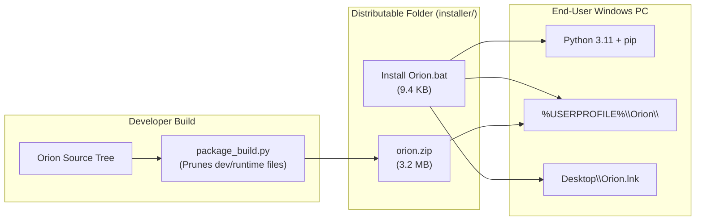
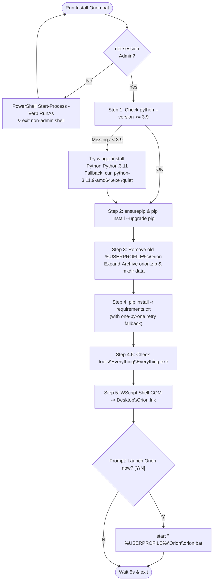

# Orion: Multithreaded Neural Semantic PC Search System (v1.0)
## Document 4 of 4 — Installer, Packaging, Assets & Appendix

| Metadata | Details |
| :--- | :--- |
| **Project Title** | Orion: Multithreaded Neural Semantic PC Search System (Version 1 — Core Engine) |
| **Document Number** | Document 4 of 4 |
| **Document Title** | Installer, Packaging, Assets & Appendix |
| **Team** | Devansh Bhargav (BTCS24O1038) & Divyansh S. Thakur (BTCS24O1044) |
| **Institution** | Madhav Institute of Technology & Science (MITS), Gwalior |
| **Faculty Mentor** | Ms. Manisha Pathak |
| **Source of Truth** | Orion v1.0 Source Tree (`orion1_src`), `package_build.py`, and `installer\Install Orion.bat` |

> **How to Read This Document:**
> This document is the fourth and final part of the engineering documentation series for **Orion v1.0**. **Document 1 (*Architecture & Technology Overview*)** introduced the system architecture and technology choices; **Document 2 (*System Internals*)** detailed the SQLite + FTS5 schema, indexing pipeline, search ranking, HTTP API, and UI flows; and **Document 3 (*Code Deep Dive*)** walked through every Python and JavaScript function line by line. **Document 4 (*Installer, Packaging, Assets & Appendix*)** covers how Orion is packaged, distributed, installed, operated, troubleshot, and audited. It examines `package_build.py`, the self-elevating Windows batch installer (`Install Orion.bat`), the launcher scripts (`orion.bat`, `setup.bat`, `start.bat`), `requirements.txt`, the bundled Voidtools Everything engine (`tools\Everything\`), visual assets, runtime SQLite WAL data, operational troubleshooting, and a complete audit of leftover/reserved code and security boundaries, concluding with a glossary and master file index.

---

## Table of Contents

1. [Distribution Model & Build Packaging (`package_build.py`)](#1-distribution-model--build-packaging-package_buildpy)
2. [`Install Orion.bat` — Step-by-Step Walkthrough](#2-install-orionbat--step-by-step-walkthrough)
3. [Launcher Scripts Compared: `orion.bat`, `setup.bat`, and `start.bat`](#3-launcher-scripts-compared-orionbat-setupbat-and-startbat)
4. [Python Dependencies (`requirements.txt`)](#4-python-dependencies-requirementstxt)
5. [Bundled Voidtools Everything (`tools\Everything\`)](#5-bundled-voidtools-everything-toolseverything)
6. [Visual Assets & Icon Generation Pipeline (`assets\`)](#6-visual-assets--icon-generation-pipeline-assets)
7. [Runtime Data & Persistence (`data\` and `orion.db`)](#7-runtime-data--persistence-data-and-oriondb)
8. [Operations, Troubleshooting & Uninstallation](#8-operations-troubleshooting--uninstallation)
9. [Codebase Audit: Leftovers, Known Limitations & Security Analysis](#9-codebase-audit-leftovers-known-limitations--security-analysis)
10. [Glossary & Master File Index](#10-glossary--master-file-index)

---

## 1. Distribution Model & Build Packaging (`package_build.py`)

### 1.1 Two-File Distribution Architecture

Deploying a Python desktop application on Windows often forces a trade-off between requiring end users to manually configure Python virtual environments or bundling a 100+ MB frozen executable (e.g., via PyInstaller) that triggers false-positive heuristics in Windows Defender.

Orion v1.0 instead uses a transparent **two-file installer folder** (`installer\`) produced by [`package_build.py`](file:///C:/Users/devan/OneDrive/Desktop/Windows%20Google%20Project/package_build.py#L1-L34):
1. **[`Install Orion.bat`](file:///C:/Users/devan/OneDrive/Desktop/Windows%20Google%20Project/installer/Install%20Orion.bat#L1-L263)** (9,402 bytes): A self-elevating Windows batch bootstrapper that checks/installs Python 3.11, upgrades `pip`, extracts the application archive, installs dependencies with per-package retry, verifies Everything, and creates a Desktop shortcut.
2. **`orion.zip`** (3,345,197 bytes / ~3.19 MB): A DEFLATE-compressed archive of the clean Orion v1.0 source tree, icons, and portable Voidtools Everything binaries.



### 1.2 Inside `package_build.py`

[`package_build.py`](file:///C:/Users/devan/OneDrive/Desktop/Windows%20Google%20Project/package_build.py#L1-L34) is a 34-line script at the project root:

```python
PROJECT = os.path.dirname(os.path.abspath(__file__))
OUT_ZIP  = os.path.join(PROJECT, 'installer', 'orion.zip')

EXCLUDE_DIRS  = {'.git', '.vs', '__pycache__', 'node_modules', 'installer', 'data', '.agents'}
EXCLUDE_FILES = {'.gitignore', 'package.bat', 'package_build.py'}
EXCLUDE_EXTS  = {'.pyc', '.pyo', '.log', '.db'}

os.makedirs(os.path.join(PROJECT, 'installer'), exist_ok=True)
if os.path.exists(OUT_ZIP):
    os.remove(OUT_ZIP)

with zipfile.ZipFile(OUT_ZIP, 'w', zipfile.ZIP_DEFLATED, compresslevel=6) as zf:
    for root, dirs, files in os.walk(PROJECT):
        dirs[:] = [d for d in dirs if d not in EXCLUDE_DIRS]
        for fname in files:
            if fname in EXCLUDE_FILES:
                continue
            if os.path.splitext(fname)[1].lower() in EXCLUDE_EXTS:
                continue
            full = os.path.join(root, fname)
            rel  = os.path.relpath(full, PROJECT)
            zf.write(full, rel)
```

Key mechanisms in [`package_build.py`](file:///C:/Users/devan/OneDrive/Desktop/Windows%20Google%20Project/package_build.py#L7-L28):
- **In-Place Directory Pruning (`L18`):** Slice assignment `dirs[:] = [d for d in dirs if d not in EXCLUDE_DIRS]` mutates the list referenced by `os.walk` in-place, preventing `os.walk` from descending into excluded directories such as `.git` or `data`.
- **Preventing Self-Inclusion (`L7`, `L12–13`):** Excluding `'installer'` in `EXCLUDE_DIRS` and deleting any prior `OUT_ZIP` before opening `ZipFile` prevents `package_build.py` from recursively archiving `orion.zip` into itself.
- **DEFLATE Level 6 (`L15`):** `zipfile.ZIP_DEFLATED` with `compresslevel=6` compresses ~5.04 MB of raw source, icons, and Everything binaries down to **3.19 MB**.

| Filter Set | Excluded Items | Why Excluded |
| :--- | :--- | :--- |
| **`EXCLUDE_DIRS` (L7)** | `.git`, `.vs`, `.agents`, `node_modules`, `data`, `installer`, `__pycache__` | Strips VCS history, IDE caches, developer's personal `data\orion.db` index, output folder, and bytecode caches. |
| **`EXCLUDE_FILES` (L8)** | `.gitignore`, `package.bat`, `package_build.py` | Build tooling and Git metadata are not needed on target machines. |
| **`EXCLUDE_EXTS` (L9)** | `.pyc`, `.pyo`, `.log`, `.db` | Defense-in-depth guarantee that no stray SQLite databases, logs, or bytecode files enter `orion.zip`. |
| **Included (18 files)** | `orion.bat`, `setup.bat`, `start.bat`, `requirements.txt`, `assets\*`, `backend\*.py`, `frontend\*`, `tools\Everything\*` | Complete runtime application, icons, and portable Everything engine. |

---

## 2. `Install Orion.bat` — Step-by-Step Walkthrough

[`Install Orion.bat`](file:///C:/Users/devan/OneDrive/Desktop/Windows%20Google%20Project/installer/Install%20Orion.bat#L1-L263) (263 lines) automates end-to-end installation into `%USERPROFILE%\Orion`.

### 2.1 Windows Batch Concepts Used

1. **`setlocal EnableDelayedExpansion` and `!VAR!` vs. `%VAR%` (L2):**
   `cmd.exe` expands `%VAR%` variables **once at parse time** when reading an entire `if (...)` or `for (...)` block. Any variable mutated inside a block (`set "PY_VER=%%v"`, L50; `set "PYTHON_OK=1"`, L55) would evaluate to its old value if read via `%VAR%` inside the same block. `EnableDelayedExpansion` enables execution-time lookup via `!VAR!` (`!PY_VER!`, `!PYTHON_OK!`, `!INSTALL_DIR!`).
2. **Parameter Modifiers `%~f0` and `%~dp0` (L8, L134):**
   `%~f0` expands `%0` to the script's fully qualified file path, while `%~dp0` expands to its drive and directory path with trailing backslash (allowing `set "ZIP_FILE=%~dp0orion.zip"` at L134 to locate `orion.zip` regardless of current directory).
3. **`errorlevel` Semantics (L7, L49, L66, L93):**
   `if errorlevel 1` means *"exit code >= 1 (failure)"*; `if not errorlevel 1` means *"exit code < 1 (i.e., 0, success)"*.
4. **Caret (`^`) Escaping (L44, L50, L68, L151, L220):**
   In `cmd.exe`, `^` escapes special operator characters (`^|` to print literal pipes in ASCII boxes at L44, or `2^>^&1` inside `for /f` at L50) and acts as a line-continuation character at the end of a line.
5. **`for /f` Parsing (L50, L53, L180):**
   Used to capture command stdout (`'python --version 2^>^&1'`, splitting on space via `tokens=2 delims= `), split version numbers (`"tokens=1,2 delims=."` on `"!PY_VER!"`), and iterate lines of a quoted file path (`"usebackq delims="` on `"!INSTALL_DIR!\requirements.txt"`).
6. **Labels and `goto` (L70, L91):**
   `if not errorlevel 1 goto :python_done` jumps past the `curl` fallback block once `winget` succeeds.

### 2.2 Design Lesson: Pure ASCII vs. Unicode Box Characters

Early versions of Orion's batch scripts used UTF-8 box-drawing characters (`╔═══╗`, `──`). When run on another PC, `cmd.exe` crashed with syntax errors. Because Windows `cmd.exe` defaults to legacy OEM code pages (e.g., CP437/CP850) rather than UTF-8 (`65001`), multi-byte UTF-8 box characters are misread as high-ASCII characters or command tokens. Consequently, [`Install Orion.bat`](file:///C:/Users/devan/OneDrive/Desktop/Windows%20Google%20Project/installer/Install%20Orion.bat#L43-L45) and [`orion.bat`](file:///C:/Users/devan/.gemini/antigravity/brain/deffb706-24d2-4162-affe-2fa1deb41668/scratch/orion1_src/orion.bat#L58-L63) were rewritten using **100% 7-bit ASCII** (`+---+` and `^|`). *(A single UTF-8 comment `:: ── Self-elevate...` remains on [`start.bat`](file:///C:/Users/devan/.gemini/antigravity/brain/deffb706-24d2-4162-affe-2fa1deb41668/scratch/orion1_src/start.bat#L4) L4, which is harmless only because `::` comments out the line.)*

### 2.3 Step-by-Step Execution Trace



1. **Self-Elevation (L5–10):**
   ```bat
   net session >nul 2>&1
   if errorlevel 1 (
       powershell -Command "Start-Process -FilePath '%~f0' -Verb RunAs -WorkingDirectory '%~dp0'"
       exit /b
   )
   ```
   `net session` succeeds only when elevated. If unprivileged (`errorlevel 1`), PowerShell's `Start-Process -Verb RunAs` triggers the UAC prompt and restarts `%~f0` as Administrator while preserving `%~dp0`.
2. **Step 1 — Python Detection & Installation (L39–105):**
   - Runs `python --version >nul 2>&1` (L48), extracts `PY_VER` (`tokens=2`), splits major/minor on `.`, and checks `if %%a GEQ 3 ( if %%b GEQ 9 set "PYTHON_OK=1" )` (L53–57).
   - If `PYTHON_OK` is `0`, it first tries **Windows Package Manager** (L65–71):
     ```bat
     winget install -e --id Python.Python.3.11 --silent ^
         --accept-package-agreements --accept-source-agreements
     ```
   - If `winget` is unavailable or fails, it falls back to **`curl.exe`** (L75–77), downloading `https://www.python.org/ftp/python/3.11.9/python-3.11.9-amd64.exe` to `%TEMP%\python_setup.exe` and running it headless (L80–85):
     - `/quiet`: Headless install with no GUI prompts.
     - `InstallAllUsers=0`: Per-user install into `%LOCALAPPDATA%\Programs\Python\Python311`.
     - `PrependPath=1`: Adds Python and `Scripts\` to the user's persistent `PATH`.
     - `Include_pip=1 Include_test=0 Include_launcher=1`: Includes `pip` and `py.exe`, skips the test suite.
   - Line 89 explicitly prepends `%LOCALAPPDATA%\Programs\Python\Python311` and `...\Scripts` to `%PATH%` so the current `cmd.exe` session can immediately invoke `python` at L92.
3. **Step 2 — `pip` Bootstrap & Upgrade (L107–124):**
   Checks `python -m pip --version`. If missing, runs `python -m ensurepip --upgrade >nul 2>&1` (L118), then upgrades `pip` via `python -m pip install --upgrade pip --quiet` (L122).
4. **Step 3 — Archive Extraction (L125–165):**
   Verifies `%~dp0orion.zip` exists (L136), removes any existing `%USERPROFILE%\Orion` (`rmdir /s /q "!INSTALL_DIR!"`, L148), and extracts via PowerShell (L151–153):
   ```bat
   powershell -NoProfile -Command ^
       "Expand-Archive -LiteralPath '!ZIP_FILE!' -DestinationPath '!INSTALL_DIR!' -Force" ^
       >nul 2>&1
   ```
   Verifies `!INSTALL_DIR!\orion.bat` exists (L155) and creates `!INSTALL_DIR!\data` (L162).
5. **Step 4 & 4.5 — Package Installation & Everything Check (L166–208):**
   Runs `python -m pip install -r "!INSTALL_DIR!\requirements.txt" --quiet --disable-pip-version-check` (L177). If `errorlevel 1` occurs (e.g., transient network failure on one package), lines 180–183 iterate over `requirements.txt` line by line (`for /f "usebackq delims=" %%p`) to install each package individually. If `requirements.txt` itself is missing, lines 187–190 loop over the hardcoded package names. Lines 199–205 check for `!INSTALL_DIR!\tools\Everything\Everything.exe`.
6. **Step 5 — Desktop Shortcut via `WScript.Shell` COM (L209–235):**
   Instantiates the Windows Script Host COM object `WScript.Shell` (L220–228) to create `%USERPROFILE%\Desktop\Orion.lnk` with `TargetPath = '!INSTALL_DIR!\orion.bat'`, `WorkingDirectory = '!INSTALL_DIR!'`, `IconLocation = '!INSTALL_DIR!\assets\orion_icon.ico'`, and `WindowStyle = 1` (normal window).
7. **Launch Prompt (L236–263):**
   Prompts `set /p "LAUNCH=   Launch Orion now? [Y/N]: "` (L253). If `Y` (`if /i "!LAUNCH!"=="Y"`), executes `start "" "!INSTALL_DIR!\orion.bat"`, waits 5 seconds (`timeout /t 5 /nobreak >nul`), and exits.

---

## 3. Launcher Scripts Compared: `orion.bat`, `setup.bat`, and `start.bat`

| Dimension | `Install Orion.bat` (`installer\`) | `orion.bat` (Root — Production) | `start.bat` (Root — Dev Runner) | `setup.bat` (Root — Legacy Setup) |
| :--- | :--- | :--- | :--- | :--- |
| **Target User** | End user (first-time install from zip) | End user (daily launch via Desktop shortcut) | Developer (live console logs & `Ctrl+C`) | Developer with unpacked folder |
| **Self-Elevates?** | Yes (`net session`, L6–10) | Yes (`net session`, L6–10) | Yes (`net session`, L5–9) | No |
| **Checks/Installs Python?** | Installs Python 3.11 via `winget`/`curl` (L60–102) | Checks `python --version`; exits if missing (L33–38) | Probes `python -c "import fastapi"`; calls `setup.bat` on fail (L14–18) | Checks `python --version`; exits if missing (L12–19) |
| **Everything Startup** | Checks `tools\Everything\Everything.exe` exists (L199) | Starts bundled `Everything.exe -startup` minimized (L41–48) | Starts bundled or `C:\Program Files\Everything\Everything.exe` (L21–33) | Checks `Program Files`; downloads Everything 1.4.1.1024 setup if absent (L39–63) |
| **Backend Launch Mode** | Optionally spawns `orion.bat` (L255) | Detached minimized (`start "" /min python backend\main.py`, L52) | Foreground blocking (`python backend\main.py`, L52) | Does not start backend |
| **Terminal Lifecycle** | Closes 5s after prompt (L261–262) | Auto-closes 4s after spawning backend (L66–67) | Remains open until `Ctrl+C` | Pauses at end (`pause`, L89) |
| **Shortcut Created** | `Desktop\Orion.lnk` → `orion.bat` with `.ico` (L217–228) | None | None | Attempts `Desktop\Orion Search.lnk` → `start.bat` (L72–79; see §9.4) |

- **When to use [`orion.bat`](file:///C:/Users/devan/.gemini/antigravity/brain/deffb706-24d2-4162-affe-2fa1deb41668/scratch/orion1_src/orion.bat#L1-L68):** This is the **production launcher** that users should run (or double-click via the `Orion` Desktop shortcut). It elevates once, starts bundled `Everything.exe -startup` in the background if not already running in `tasklist` (L43–47), starts `python backend\main.py` minimized (L52), displays the URL (`http://127.0.0.1:8472`) and hotkey (`Ctrl+Space`), and closes its console window after 4 seconds.
- **When to use [`start.bat`](file:///C:/Users/devan/.gemini/antigravity/brain/deffb706-24d2-4162-affe-2fa1deb41668/scratch/orion1_src/start.bat#L1-L53):** Ideal for **developers** who want `python backend\main.py` attached to the foreground console to inspect live logs or stop the server with `Ctrl+C`.
- **When to use [`setup.bat`](file:///C:/Users/devan/.gemini/antigravity/brain/deffb706-24d2-4162-affe-2fa1deb41668/scratch/orion1_src/setup.bat#L1-L90):** Retained as a standalone dependency installer if someone clones the source folder directly without `Install Orion.bat`.

---

## 4. Python Dependencies (`requirements.txt`)

[`requirements.txt`](file:///C:/Users/devan/.gemini/antigravity/brain/deffb706-24d2-4162-affe-2fa1deb41668/scratch/orion1_src/requirements.txt#L1-L8) lists 8 packages:

| Package | Internal Mechanism & Purpose | Why Chosen for Orion | Exact Usage in Orion v1.0 |
| :--- | :--- | :--- | :--- |
| **`fastapi>=0.104.0`** | ASGI web framework built on Starlette and Pydantic v2 (`pydantic-core`). | Declarative routing, automatic query/JSON validation (`PathRequest`, `ExcludePath`), CORS, and static file serving. | [`backend/main.py`](file:///C:/Users/devan/.gemini/antigravity/brain/deffb706-24d2-4162-affe-2fa1deb41668/scratch/orion1_src/backend/main.py#L18-L374) (L62 app init, L64–74 middleware/mounts, L100–374 routes). |
| **`uvicorn[standard]>=0.24.0`** | High-speed ASGI HTTP server over `asyncio` and C-accelerated HTTP parsers (`httptools`). | Serves the FastAPI backend locally on `127.0.0.1:8472`. | [`backend/main.py`](file:///C:/Users/devan/.gemini/antigravity/brain/deffb706-24d2-4162-affe-2fa1deb41668/scratch/orion1_src/backend/main.py#L378-L385) (`uvicorn.run("main:app", ...)`). |
| **`pystray>=0.19.5`** | Wraps Win32 `Shell_NotifyIconW` and a background Win32 message pump for tray icons. | Keeps Orion accessible in the Windows system tray (*"🔭 Open Orion"*, *"Quit Orion"*) when running headless. | [`backend/tray.py`](file:///C:/Users/devan/.gemini/antigravity/brain/deffb706-24d2-4162-affe-2fa1deb41668/scratch/orion1_src/backend/tray.py#L18-L98) (`run_tray()`, L79–98). |
| **`keyboard>=0.13.5`** | Registers a low-level Win32 keyboard hook (`SetWindowsHookEx` / `WH_KEYBOARD_LL`) via `ctypes`. | Captures the global `Ctrl+Space` hotkey across all applications to open Orion in the browser. | [`backend/tray.py`](file:///C:/Users/devan/.gemini/antigravity/brain/deffb706-24d2-4162-affe-2fa1deb41668/scratch/orion1_src/backend/tray.py#L27-L110) (`register_hotkey()`, L101–110). |
| **`Pillow>=10.0.0`** | C-accelerated imaging library (`PIL`) for image decoding, Lanczos resizing, EXIF tag lookup, and raster drawing. | Extracts image dimensions/EXIF, creates base64 JPEG thumbnails, resizes the tray icon, and draws fallback icons. | [`media_meta.py`](file:///C:/Users/devan/.gemini/antigravity/brain/deffb706-24d2-4162-affe-2fa1deb41668/scratch/orion1_src/backend/media_meta.py#L11-L73) (L11–73); [`main.py`](file:///C:/Users/devan/.gemini/antigravity/brain/deffb706-24d2-4162-affe-2fa1deb41668/scratch/orion1_src/backend/main.py#L80-L96) (`_copy_icon`); [`tray.py`](file:///C:/Users/devan/.gemini/antigravity/brain/deffb706-24d2-4162-affe-2fa1deb41668/scratch/orion1_src/backend/tray.py#L51-L64) (`_load_tray_icon`). |
| **`mutagen>=1.47.0`** | Pure-Python parser for ID3 (MP3), FLAC, Ogg, and MP4/M4A audio/video container headers. | Reads audio tags (artist, album, title, genre, bitrate, duration), album art flags, and video duration/bitrate. | [`backend/media_meta.py`](file:///C:/Users/devan/.gemini/antigravity/brain/deffb706-24d2-4162-affe-2fa1deb41668/scratch/orion1_src/backend/media_meta.py#L77-L187) (`get_audio_meta`, `get_audio_albumart_b64`, `get_video_meta`). |
| **`python-multipart>=0.0.6`** | Streaming multipart/form-data parser for Starlette/FastAPI. | Standard FastAPI companion dependency for form data. | *Installed, not directly imported in v1.0* (all POST endpoints use JSON). |
| **`aiofiles>=23.2.1`** | Thread-pooled async file I/O library for `asyncio`. | Standard FastAPI companion dependency (historically used by `StaticFiles`). | *Installed, not directly imported in v1.0* (Starlette uses `anyio` internally). |

---

## 5. Bundled Voidtools Everything (`tools\Everything\`)

### 5.1 Inventory & Role of `tools\Everything\`

Instead of relying solely on `os.walk` (which takes 20–45 minutes on a 1 TB drive by issuing `FindFirstFileW` per directory), Orion bundles a portable build of **Voidtools Everything**, which reads the raw NTFS **Master File Table (`$MFT`)** and **USN Change Journal (`$UsnJrnl`)** to enumerate all files on a drive in **~1–5 seconds**.

| File | Size | Description |
| :--- | :--- | :--- |
| **`Everything.exe`** | 2,265,096 B | Core 64-bit NTFS MFT/USN indexing daemon, Win32 IPC server, and embedded HTTP JSON server. |
| **`es.exe`** | 154,128 B | Official CLI client (v1.1.0.27) that queries `Everything.exe` over Win32 `WM_COPYDATA` IPC (`indexer.py` L157–180). |
| **[`Everything.ini`](file:///C:/Users/devan/.gemini/antigravity/brain/deffb706-24d2-4162-affe-2fa1deb41668/scratch/orion1_src/tools/Everything/Everything.ini#L1-L741)** | 20,717 B (741 lines) | Portable configuration file read by `Everything.exe` on startup. |
| **`Everything.lng`** | 934,469 B | Localization string table for `Everything.exe`. |
| **[`cli.c`](file:///C:/Users/devan/.gemini/antigravity/brain/deffb706-24d2-4162-affe-2fa1deb41668/scratch/orion1_src/tools/Everything/cli.c#L1-L6284)** | 152,787 B (6,284 lines) | Complete C source code and MIT license header for `es.exe` (`#define ES_VERSION L"1.1.0.27"`, L109). |

### 5.2 Key Settings in `Everything.ini`

| Line(s) | Setting in `tools\Everything\Everything.ini` | Why It Matters to Orion |
| :--- | :--- | :--- |
| **L3** | `run_as_admin=1` | Allows `Everything.exe` to open raw NTFS volume handles (`\\.\C:`) without installing a system service. |
| **L4, L385** | `allow_http_server=1` / `http_server_enabled=1` | Enables Everything's built-in HTTP server so Orion can query all paths as JSON (`&json=1`). |
| **L386, L388** | `http_server_bindings=127.0.0.1:8481`<br/>`http_server_port=8481` | Restricts the HTTP server to localhost on port **8481**, matching `EVERYTHING_HTTP_PORT = 8481` in [`indexer.py`](file:///C:/Users/devan/.gemini/antigravity/brain/deffb706-24d2-4162-affe-2fa1deb41668/scratch/orion1_src/backend/indexer.py#L71). |
| **L389–390** | `http_server_username=` / `http_server_password=` | Disables HTTP Basic Auth so `urllib.request.urlopen()` can query port 8481 directly. |
| **L34, L41** | `run_in_background=1` / `check_for_updates_on_startup=0` | Runs silently in the background when started with `-startup` and suppresses update popups. |
| **L69, L71, L73** | `auto_include_fixed_volumes=1`<br/>`auto_remove_offline_ntfs_volumes=1`<br/>`auto_include_fixed_refs_volumes=1` | Automatically replaces the build PC's cached `ntfs_volume_guids` (L445) with all fixed NTFS/ReFS drives on the user's machine. |
| **L110** | `ipc=1` | Enables the Win32 IPC window required by the `es.exe` fallback (`_index_with_everything_es`). |
| **L230, L234** | `index_size=1` / `index_date_modified=1` | Indexes file sizes and modification timestamps directly from the MFT. |

### 5.3 Startup, Communication & Licensing

1. **Startup (`orion.bat` L41–48 & `indexer.py` L86–119):** `orion.bat` starts `Everything.exe -startup` if not already in `tasklist`. Inside [`indexer.py`](file:///C:/Users/devan/.gemini/antigravity/brain/deffb706-24d2-4162-affe-2fa1deb41668/scratch/orion1_src/backend/indexer.py#L86-L119), `_ensure_everything_running()` checks `tasklist`; if not running, it spawns `Everything.exe -startup -http-server -http-port 8481` with `DETACHED_PROCESS` (`0x00000008`) and sleeps 5 seconds for MFT scan completion.
2. **HTTP JSON Query (`_index_with_everything_http`, L122–155):** Queries `http://localhost:8481/?search=!folder:&count=9999999&path_column=1&json=1&sort=path_ascending`. Using TCP loopback HTTP avoids Windows **User Interface Privilege Isolation (UIPI)**, which blocks `es.exe`'s `WM_COPYDATA` IPC messages (`ES_ERROR_IPC = 8`, `cli.c` L126) if Python and `Everything.exe` run at different integrity levels. If HTTP fails, `_index_with_everything()` (L183–204) tries `_index_with_everything_es()` (L157–180) and finally falls back to `_index_with_walk()` (L255–275).
3. **Licensing (`cli.c` L1–25):** Voidtools Everything and `es.exe` are copyright **David Carpenter** and licensed under the **MIT License**, permitting free redistribution alongside `cli.c`'s preserved copyright notice.

---

## 6. Visual Assets & Icon Generation Pipeline (`assets\`)

| Asset File | Size | Where Used in Orion |
| :--- | :--- | :--- |
| **`assets\orion_icon.ico`** | 822 B | Bound to `%USERPROFILE%\Desktop\Orion.lnk` via `$s.IconLocation` in [`Install Orion.bat`](file:///C:/Users/devan/OneDrive/Desktop/Windows%20Google%20Project/installer/Install%20Orion.bat#L218-L225) (Windows `.lnk` shortcuts require `.ico` format). |
| **`assets\orion_icon.png`** | 1,389,866 B | Loaded and resized to `64×64` by Pillow in [`backend/tray.py`](file:///C:/Users/devan/.gemini/antigravity/brain/deffb706-24d2-4162-affe-2fa1deb41668/scratch/orion1_src/backend/tray.py#L34-L56) (`_load_tray_icon()`) for the system tray icon; also referenced as the favicon in [`frontend/index.html`](file:///C:/Users/devan/.gemini/antigravity/brain/deffb706-24d2-4162-affe-2fa1deb41668/scratch/orion1_src/frontend/index.html#L9) (see quirk in §9.4). |

### Programmatic Fallback Generators
If `assets\orion_icon.png` is missing on startup, Orion has two fallback layers:
1. **`main.py` → `_copy_icon()` (L80–96):** Invoked during FastAPI `lifespan` startup (L53). If `assets/orion_icon.png` does not exist, it uses `PIL.ImageDraw` to create a `256×256` dark canvas (`RGB(10, 10, 15)`) and draws a violet (`RGB(124, 58, 237)`, width `8`) magnifying glass (`draw.ellipse([30, 30, 180, 180])` and `draw.line([160, 160, 220, 220])`), saving it to `assets/orion_icon.png`.
2. **`tray.py` → `_load_tray_icon()` (L51–64):** If opening `orion_icon.png` still fails, it generates an in-memory `64×64` solid purple square (`PILImage.new("RGB", (64, 64), color=(124, 58, 237))`) so the system tray icon always initializes.

---

## 7. Runtime Data & Persistence (`data\` and `orion.db`)

1. **First-Run Creation:**
   - `Install Orion.bat` (L162) and [`backend/config.py`](file:///C:/Users/devan/.gemini/antigravity/brain/deffb706-24d2-4162-affe-2fa1deb41668/scratch/orion1_src/backend/config.py#L18) (`DATA_DIR.mkdir(exist_ok=True)`) create the `data\` directory automatically.
   - On server startup, [`init_db()`](file:///C:/Users/devan/.gemini/antigravity/brain/deffb706-24d2-4162-affe-2fa1deb41668/scratch/orion1_src/backend/config.py#L108-L202) creates `data\orion.db` with the 5 tables (`files`, `files_fts` FTS5 virtual table, `search_history`, `excluded_paths`, `settings`), 3 FTS5 sync triggers (`files_ai`, `files_ad`, `files_au`), 6 B-tree indexes, and seeds `excluded_paths` with the 11 entries in `DEFAULT_EXCLUDED` (L30–42).
2. **SQLite WAL Files on Disk (`config.py` L102–104):**
   Because `get_db()` sets `PRAGMA journal_mode=WAL`, `PRAGMA synchronous=NORMAL`, and `PRAGMA cache_size=-64000` (64 MB cache), three files exist inside `data\` while Orion is running:
   - `orion.db`: Primary database file (~80–250 MB for 300k–800k files).
   - `orion.db-wal`: Write-Ahead Log where 5,000-row indexer batches (`_insert_batch`) are appended without blocking concurrent search reads.
   - `orion.db-shm`: Shared-memory WAL index mapped by SQLite connections.
3. **Browser vs. SQLite Settings (`app.js` L19–20 vs. `main.py` L360–373):**
   The frontend caches `orion-view` (`'list'`/`'grid'`) and `orion-theme` (`'dark'`/`'light'`) in `window.localStorage` (`app.js` L19–20, L47, L473), while also persisting `theme` and `gemini_api_key` to the SQLite `settings` table via `POST /api/settings`.
4. **How to Reset Orion:**
   Right-click the Orion system tray icon → **Quit Orion**, delete `%USERPROFILE%\Orion\data\` (removing `orion.db`, `-wal`, and `-shm`), and start Orion again to trigger a clean schema build and full re-index.

---

## 8. Operations, Troubleshooting & Uninstallation

### 8.1 First-Run Expectations & Stopping Orion

- **First-Run Indexing:** On first startup (`indexed_count == 0` in [`_scheduler_loop()`](file:///C:/Users/devan/.gemini/antigravity/brain/deffb706-24d2-4162-affe-2fa1deb41668/scratch/orion1_src/backend/indexer.py#L421-L453)), Orion runs a full scan. With bundled `Everything.exe`, Phase 1 (`scanning`) takes **~3–10 seconds** and Phase 2 (`inserting`, 8-thread `os.stat` + batch SQLite upserts) takes **~2–8 minutes**. Without Everything (`os.walk` fallback), Phase 1 takes **~20–45 minutes** on a 1 TB drive.
- **Instant Subsequent Startups:** On later launches, if the index is less than `REINDEX_INTERVAL_HOURS = 4` hours old (`indexer.py` L439–447), Orion skips the startup scan and is ready in **< 1 second**, refreshing silently every 4 hours in the background.
- **How to Stop Orion:** Closing the browser tab leaves the backend running so `Ctrl+Space` works anytime. To exit completely, right-click the **Orion Search** icon in the Windows system tray and click **Quit Orion** (which calls `icon.stop()` and `os._exit(0)` in [`tray.py`](file:///C:/Users/devan/.gemini/antigravity/brain/deffb706-24d2-4162-affe-2fa1deb41668/scratch/orion1_src/backend/tray.py#L67-L72)).

### 8.2 Troubleshooting Table

| Problem / Symptom | Root Cause | Solution |
| :--- | :--- | :--- |
| **Port `8472` busy (`Errno 10048` on startup)** | An existing Orion instance is already bound to `127.0.0.1:8472`. | Press `Ctrl+Space` or visit `http://127.0.0.1:8472`. To force-stop a hung process, quit from the tray or run `netstat -ano \| findstr :8472` and `taskkill /F /PID <PID>`. |
| **`Python not found` / not on `PATH`** | Python was not installed or *"Add Python to PATH"* was unchecked. | Run `installer\Install Orion.bat` (which sets `PrependPath=1`), or add `%LOCALAPPDATA%\Programs\Python\Python311` to `PATH`. |
| **Script exits immediately after UAC prompt** | User clicked **No** on the UAC dialog triggered by `Start-Process -Verb RunAs`. | Re-run `Install Orion.bat` or `orion.bat` and accept the UAC elevation prompt. |
| **Phase 1 (`scanning`) takes 30+ min instead of 5 sec** | Another `Everything.exe` instance is already running without HTTP server enabled on port `8481`, causing `_ensure_everything_running()` (`indexer.py` L105) to skip launching the bundled one and fall back to `os.walk`. | Right-click the existing Everything tray icon → **Exit**, then click **🔄 Re-index Now** in Orion so it launches `tools\Everything\Everything.exe` with `Everything.ini` (`http_server_port=8481`). |
| **`Ctrl+Space` hotkey does not respond** | Focused window is running as Admin while Orion was started unprivileged (blocked by UIPI), or an IDE/IME captures `Ctrl+Space`. | Launch Orion via `orion.bat` (runs elevated). To change the keybinding, edit `"ctrl+space"` in [`backend/tray.py`](file:///C:/Users/devan/.gemini/antigravity/brain/deffb706-24d2-4162-affe-2fa1deb41668/scratch/orion1_src/backend/tray.py#L107). |
| **Antivirus / Windows SmartScreen blocks `.bat`** | Downloaded `.bat` files carry a `Zone.Identifier` NTFS stream (`ZoneId=3`). | Click **More info** → **Run anyway**, or right-click `.bat` → **Properties** → check **Unblock**. |
| **`sqlite3.OperationalError: database is locked`** | Running Duplicate MD5 scan (`compute_hashes` in `duplicates.py`) simultaneously with heavy initial index batch inserts (`_insert_batch`). | Wait for the initial index scan (`⚡ Scan Progress` → `Complete`) to finish before clicking **Scan for Duplicates**. |

### 8.3 Uninstallation Steps

1. Right-click the **Orion Search** tray icon → **Quit Orion** (and right-click the **Everything** tray icon → **Exit**).
2. Delete the installation directory: `rmdir /s /q "%USERPROFILE%\Orion"`.
3. Delete the Desktop shortcut: `del "%USERPROFILE%\Desktop\Orion.lnk"`.
4. *(Optional)* If Python 3.11 is no longer needed, run `winget uninstall Python.Python.3.11`.

---

## 9. Codebase Audit: Leftovers, Known Limitations & Security Analysis

This section catalogs all reserved/unused fields, unapplied parser filters, minor bugs, and security considerations discovered across the Orion v1.0 codebase.

### 9.1 Reserved / Leftover AI Scaffolding
Orion v1.0 contains no AI/ML models or dependencies, but retains two reserved hooks for future versions:
1. **`files.ai_description` Column (`config.py` L126):** Created in the `files` schema (`TEXT DEFAULT NULL`), selected in [`search.py`](file:///C:/Users/devan/.gemini/antigravity/brain/deffb706-24d2-4162-affe-2fa1deb41668/scratch/orion1_src/backend/search.py#L144) (L144, L163, L196, L220, L292), and checked in [`app.js`](file:///C:/Users/devan/.gemini/antigravity/brain/deffb706-24d2-4162-affe-2fa1deb41668/scratch/orion1_src/frontend/app.js#L404-L407). Never written to in v1.0 (always `NULL`) and not included in `files_fts`.
2. **`gemini_api_key` Setting (`index.html` L352–362, `app.js` L785–794, `main.py` L365):** The Settings page provides a *"Gemini API Key (for Document AI)"* input saved via `POST /api/settings` and masked as `"***"` by `GET /api/settings`, but no v1.0 backend module ever reads `get_setting("gemini_api_key")`.

### 9.2 Parsed-but-Unapplied NLP Filters & Unused Symbols

| Item | Location | Audit Finding |
| :--- | :--- | :--- |
| **`duration_min` / `duration_max`** | [`nlp_parser.py`](file:///C:/Users/devan/.gemini/antigravity/brain/deffb706-24d2-4162-affe-2fa1deb41668/scratch/orion1_src/backend/nlp_parser.py#L134-L197) (L134–135, L183–197) | Extracted from queries like `"longer than 10 minutes"`, but ignored by `_build_sql_filters()` (`search.py` L69–112) because the `files` table does not store media duration. |
| **`resolution`** | [`nlp_parser.py`](file:///C:/Users/devan/.gemini/antigravity/brain/deffb706-24d2-4162-affe-2fa1deb41668/scratch/orion1_src/backend/nlp_parser.py#L136-L203) (L136, L200–203) & [`main.py`](file:///C:/Users/devan/.gemini/antigravity/brain/deffb706-24d2-4162-affe-2fa1deb41668/scratch/orion1_src/backend/main.py#L118) (L118) | Extracted from queries like `"4k"`/`"1080p"` and accepted by `GET /api/search`, but ignored by `_build_sql_filters()` because `files` does not store image/video dimensions. |
| **`get_audio_albumart_b64()`** | [`media_meta.py`](file:///C:/Users/devan/.gemini/antigravity/brain/deffb706-24d2-4162-affe-2fa1deb41668/scratch/orion1_src/backend/media_meta.py#L123-L151) | Extracts base64 cover art from FLAC/MP3/M4A files, but is never called by `main.py`. |
| **`format_duration()`** | [`media_meta.py`](file:///C:/Users/devan/.gemini/antigravity/brain/deffb706-24d2-4162-affe-2fa1deb41668/scratch/orion1_src/backend/media_meta.py#L211-L220) & [`search.py`](file:///C:/Users/devan/.gemini/antigravity/brain/deffb706-24d2-4162-affe-2fa1deb41668/scratch/orion1_src/backend/search.py#L12) | Imported in `search.py` L12 but unused; the frontend uses its own `formatDuration()` in `app.js` L822. |
| **`POST /api/open-file`** | [`main.py`](file:///C:/Users/devan/.gemini/antigravity/brain/deffb706-24d2-4162-affe-2fa1deb41668/scratch/orion1_src/backend/main.py#L240-L249) | Opens a file in its default Windows app via `os.startfile()`, but is never called by `app.js`. |
| **`openFolderDirect()`** | [`app.js`](file:///C:/Users/devan/.gemini/antigravity/brain/deffb706-24d2-4162-affe-2fa1deb41668/scratch/orion1_src/frontend/app.js#L499-L513) | Sends `is_folder: true` to `/api/open-folder`, but folder cards call `openFolder()` (`app.js` L362) instead. |
| **`stop_background_indexer()`** | [`indexer.py`](file:///C:/Users/devan/.gemini/antigravity/brain/deffb706-24d2-4162-affe-2fa1deb41668/scratch/orion1_src/backend/indexer.py#L468-L470) | Sets `_stop_event.set()`, but is never called during `main.py` shutdown. |
| **`THUMBNAIL_SIZE` & `_browser_open`** | [`config.py`](file:///C:/Users/devan/.gemini/antigravity/brain/deffb706-24d2-4162-affe-2fa1deb41668/scratch/orion1_src/backend/config.py#L27) L27 & [`tray.py`](file:///C:/Users/devan/.gemini/antigravity/brain/deffb706-24d2-4162-affe-2fa1deb41668/scratch/orion1_src/backend/tray.py#L36-L42) L36 | `THUMBNAIL_SIZE = (320, 240)` is unused (`get_thumbnail_b64` defaults to `(400, 300)`); `_browser_open` is set but never read. |

### 9.3 Minor Bugs & Quirks Identified in Code

1. **Result Card `` Expects Image Bytes, Receives JSON (`app.js` L344 vs. `main.py` L274):**
   `buildResultCard()` sets ``, but `GET /api/thumbnail` returns JSON `{"thumbnail": "<base64>"}` instead of `image/jpeg` binary bytes. The browser's `` tag fails to decode the JSON response and fires `onerror="this.parentElement.textContent='${r.icon}'"`, falling back to the `🖼️` emoji on result cards (whereas the Preview Panel decodes `meta.thumbnail` as a `data:image/jpeg;base64,...` URI at `app.js` L430 and displays the image properly).
2. **Favicon Path 404 (`index.html` L9 vs. `main.py` L74):**
   `main.py` mounts `/static` to `frontend/`. Thus `<link rel="icon" href="/static/assets/orion_icon.png"/>` looks for `frontend/assets/orion_icon.png` (404) instead of root `assets/orion_icon.png`.
3. **Exclusion `.startswith()` on Relative Folder Names (`indexer.py` L147, L175, L228):**
   `DEFAULT_EXCLUDED` (`config.py` L37–41) includes relative names like `"node_modules"` and `".git"`, but `indexer.py` filters paths with `p.lower().startswith(ex)`. Full paths like `c:\repo\node_modules\pkg.json` do not *start with* `"node_modules"`, so only full drive prefixes (like `C:\Windows`) are pruned during Everything indexing.
4. **Legacy Batch Quirks (`setup.bat` L73, `start.bat` L41, `Install Orion.bat` L207):**
   `setup.bat` L73–78 escapes PowerShell variables with backslashes (`\$ws`), causing shortcut creation in `setup.bat` to fail silently (`2>nul`). `start.bat` L41 checks a developer-local path `..\..\.gemini\antigravity\brain\*orion_icon*.jpg`. `Install Orion.bat` prints `echo         Orion extracted - OK` twice (L164 and L207).

### 9.4 Security Considerations & Future Work

- **Localhost Isolation (`127.0.0.1`):** Both Uvicorn (`127.0.0.1:8472`, `config.py` L21) and Everything's HTTP server (`127.0.0.1:8481`, `Everything.ini` L386) bind strictly to loopback, preventing LAN access even though `http_server_allow_file_download=1` is set in `Everything.ini` (L397).
- **CORS Wildcard (`main.py` L64–69):** `allow_origins=["*"]` allows any website open in the user's browser to issue cross-origin `fetch()` calls to `http://127.0.0.1:8472/api/*`. Restricting `allow_origins` to `["http://127.0.0.1:8472"]` is recommended to prevent malicious web pages from querying local filenames or invoking `/api/open-file`.
- **Single-Quote Escaping in `/api/copy-path` (`main.py` L257):** `powershell -command "Set-Clipboard -Value '{req.path}'"` fails if a file path contains an apostrophe (`'`) and represents a command-injection surface if untrusted input reaches `/api/copy-path`. Doubling single quotes (`req.path.replace("'", "''")`) resolves both issues.
- **SQL Injection Safety:** All database queries use parameterized `?` / `:name` bindings.

---

## 10. Glossary & Master File Index

### 10.1 Glossary of Terms

| Term | Definition |
| :--- | :--- |
| **ASGI** | *Asynchronous Server Gateway Interface* — Python async web server protocol connecting Uvicorn and FastAPI. |
| **COM (`WScript.Shell`)** | *Component Object Model* interface used in `Install Orion.bat` (L221) to generate the binary `Orion.lnk` shortcut. |
| **Delayed Expansion** | `cmd.exe` mode (`setlocal EnableDelayedExpansion`) evaluating `!VAR!` at execution time rather than parse time. |
| **EXIF** | *Exchangeable Image File Format* — camera/date metadata embedded in JPEG/TIFF files, read via Pillow (`media_meta.py`). |
| **FTS5** | SQLite's virtual full-text search engine powering `files_fts` (`config.py` L132–139). |
| **IPC (`WM_COPYDATA`)** | Win32 inter-process window message used by `es.exe` (`cli.c`) to query `Everything.exe`. |
| **MFT (`$MFT`)** | *Master File Table* — NTFS volume metadata table read directly by `Everything.exe` for 5-second full-drive indexing. |
| **PIDL** | *Pointer to an Item Identifier List* — Win32 Shell structure passed to `SHOpenFolderAndSelectItems` (`main.py` L223–226). |
| **tkhd Atom** | Binary Track Header box in MP4/MOV containers unpacked via `struct.unpack(">I", ...)` (`media_meta.py` L190–208) for video resolution. |
| **UAC & UIPI** | *User Account Control* (privilege elevation prompt) and *User Interface Privilege Isolation* (Win32 boundary blocking lower-integrity `WM_COPYDATA` and keyboard hooks). |
| **USN Journal** | *Update Sequence Number Change Journal* (`$UsnJrnl`) — NTFS log monitored by `Everything.exe` for real-time file changes. |
| **WAL Mode** | SQLite *Write-Ahead Logging* (`PRAGMA journal_mode=WAL`) enabling concurrent search reads while indexing writes to `orion.db-wal`. |

### 10.2 Complete File Index & Cross-Document Reference

| File Path | Size / Lines | One-Line Description | Primary Coverage |
| :--- | :--- | :--- | :--- |
| **[`package_build.py`](file:///C:/Users/devan/OneDrive/Desktop/Windows%20Google%20Project/package_build.py)** | 1,302 B (34 L) | Prunes dev/runtime folders and builds `installer\orion.zip` using DEFLATE level 6. | **Doc 4, §1** |
| **[`installer\Install Orion.bat`](file:///C:/Users/devan/OneDrive/Desktop/Windows%20Google%20Project/installer/Install%20Orion.bat)** | 9,402 B (263 L) | Self-elevating end-user installer provisioning Python 3.11, `pip`, packages, `%USERPROFILE%\Orion`, and Desktop shortcut. | **Doc 4, §2** |
| **`installer\orion.zip`** | 3,345,197 B | Distributable zip archive containing the 18 application and tool files below. | **Doc 4, §1** |
| **[`orion.bat`](file:///C:/Users/devan/.gemini/antigravity/brain/deffb706-24d2-4162-affe-2fa1deb41668/scratch/orion1_src/orion.bat)** | 2,053 B (68 L) | Production launcher; self-elevates, starts `Everything.exe` and `main.py` minimized, and auto-closes. | **Doc 1, §2; Doc 4, §3** |
| **[`setup.bat`](file:///C:/Users/devan/.gemini/antigravity/brain/deffb706-24d2-4162-affe-2fa1deb41668/scratch/orion1_src/setup.bat)** | 2,768 B (90 L) | Standalone developer setup script installing `requirements.txt` and optional Everything download. | **Doc 4, §3 & §9.3** |
| **[`start.bat`](file:///C:/Users/devan/.gemini/antigravity/brain/deffb706-24d2-4162-affe-2fa1deb41668/scratch/orion1_src/start.bat)** | 1,645 B (53 L) | Foreground developer launcher running `python backend\main.py` in the active console. | **Doc 4, §3 & §9.3** |
| **[`requirements.txt`](file:///C:/Users/devan/.gemini/antigravity/brain/deffb706-24d2-4162-affe-2fa1deb41668/scratch/orion1_src/requirements.txt)** | 148 B (9 L) | Python dependency manifest (`fastapi`, `uvicorn[standard]`, `pystray`, `keyboard`, `Pillow`, `mutagen`, `python-multipart`, `aiofiles`). | **Doc 1, §3; Doc 4, §4** |
| **`assets\orion_icon.ico`** | 822 B | Windows ICO icon bound to the Desktop `Orion.lnk` shortcut. | **Doc 4, §6** |
| **`assets\orion_icon.png`** | 1,389,866 B | High-res PNG icon downscaled to `64×64` by `pystray` for the system tray. | **Doc 4, §6** |
| **[`backend\config.py`](file:///C:/Users/devan/.gemini/antigravity/brain/deffb706-24d2-4162-affe-2fa1deb41668/scratch/orion1_src/backend/config.py)** | 8,202 B (232 L) | Constants, `EXTENSION_MAP`, SQLite WAL connection factory, FTS5 schema/triggers, and settings CRUD. | **Doc 2, §1; Doc 3, §1; Doc 4, §7** |
| **[`backend\main.py`](file:///C:/Users/devan/.gemini/antigravity/brain/deffb706-24d2-4162-affe-2fa1deb41668/scratch/orion1_src/backend/main.py)** | 14,775 B (386 L) | FastAPI app, `lifespan` startup, `_copy_icon()`, 17 HTTP endpoints, and 3-stage Explorer launcher. | **Doc 2, §4; Doc 3, §2; Doc 4, §6 & §9** |
| **[`backend\indexer.py`](file:///C:/Users/devan/.gemini/antigravity/brain/deffb706-24d2-4162-affe-2fa1deb41668/scratch/orion1_src/backend/indexer.py)** | 16,633 B (477 L) | 3-tier indexing engine (Everything HTTP → `es.exe` IPC → multithreaded `os.walk`), batch SQLite inserts, and 4h scheduler. | **Doc 2, §2; Doc 3, §3; Doc 4, §5 & §8** |
| **[`backend\search.py`](file:///C:/Users/devan/.gemini/antigravity/brain/deffb706-24d2-4162-affe-2fa1deb41668/scratch/orion1_src/backend/search.py)** | 15,644 B (420 L) | FTS5 search, `LIKE` fallback, dynamic folder search (`_search_folders`), heuristic scoring (`_score_result`), stats, and history. | **Doc 2, §3; Doc 3, §4; Doc 4, §9** |
| **[`backend\nlp_parser.py`](file:///C:/Users/devan/.gemini/antigravity/brain/deffb706-24d2-4162-affe-2fa1deb41668/scratch/orion1_src/backend/nlp_parser.py)** | 10,123 B (255 L) | Regex natural-language query parser extracting type, extension, size, date, year, duration, and resolution filters. | **Doc 2, §3.1; Doc 3, §5; Doc 4, §9.2** |
| **[`backend\media_meta.py`](file:///C:/Users/devan/.gemini/antigravity/brain/deffb706-24d2-4162-affe-2fa1deb41668/scratch/orion1_src/backend/media_meta.py)** | 8,061 B (232 L) | Extracts Pillow image EXIF/thumbnails, Mutagen audio tags/cover art, and MP4 `tkhd` video dimensions. | **Doc 2, §4.2; Doc 3, §6; Doc 4, §9.2** |
| **[`backend\duplicates.py`](file:///C:/Users/devan/.gemini/antigravity/brain/deffb706-24d2-4162-affe-2fa1deb41668/scratch/orion1_src/backend/duplicates.py)** | 3,567 B (139 L) | 4-thread chunked MD5 file hasher and SQLite duplicate group query engine. | **Doc 2, §4.3; Doc 3, §7** |
| **[`backend\tray.py`](file:///C:/Users/devan/.gemini/antigravity/brain/deffb706-24d2-4162-affe-2fa1deb41668/scratch/orion1_src/backend/tray.py)** | 2,999 B (124 L) | System tray icon (`pystray`) and global `Ctrl+Space` hotkey (`keyboard`) background threads. | **Doc 1, §3; Doc 3, §8; Doc 4, §6 & §8** |
| **[`frontend\index.html`](file:///C:/Users/devan/.gemini/antigravity/brain/deffb706-24d2-4162-affe-2fa1deb41668/scratch/orion1_src/frontend/index.html)** | 17,853 B (396 L) | SPA HTML layout containing header, sidebar filters, and 6 view containers (Home, Results, Scan, Stats, Dupes, Settings). | **Doc 2, §5; Doc 3, §9; Doc 4, §9** |
| **[`frontend\style.css`](file:///C:/Users/devan/.gemini/antigravity/brain/deffb706-24d2-4162-affe-2fa1deb41668/scratch/orion1_src/frontend/style.css)** | 30,979 B (787 L) | Dark/light theme variables, responsive grid/list cards, preview drawer, and timeline styles. | **Doc 2, §5; Doc 3, §9** |
| **[`frontend\app.js`](file:///C:/Users/devan/.gemini/antigravity/brain/deffb706-24d2-4162-affe-2fa1deb41668/scratch/orion1_src/frontend/app.js)** | 39,952 B (979 L) | Frontend state machine, search/filter fetch logic, autocomplete, live scan polling, preview panel, and settings. | **Doc 2, §5; Doc 3, §10; Doc 4, §7 & §9** |
| **`tools\Everything\*`** | 3,527,197 B (5 files) | Bundled Voidtools `Everything.exe`, `es.exe`, [`Everything.ini`](file:///C:/Users/devan/.gemini/antigravity/brain/deffb706-24d2-4162-affe-2fa1deb41668/scratch/orion1_src/tools/Everything/Everything.ini), `Everything.lng`, and [`cli.c`](file:///C:/Users/devan/.gemini/antigravity/brain/deffb706-24d2-4162-affe-2fa1deb41668/scratch/orion1_src/tools/Everything/cli.c). | **Doc 1, §3; Doc 2, §2.1; Doc 4, §5** |
