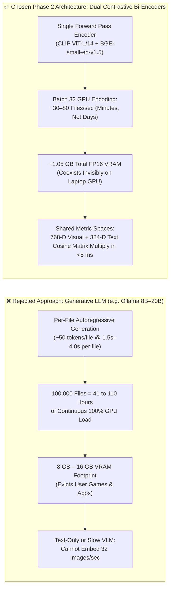
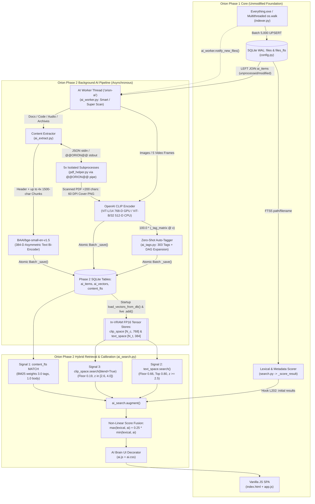
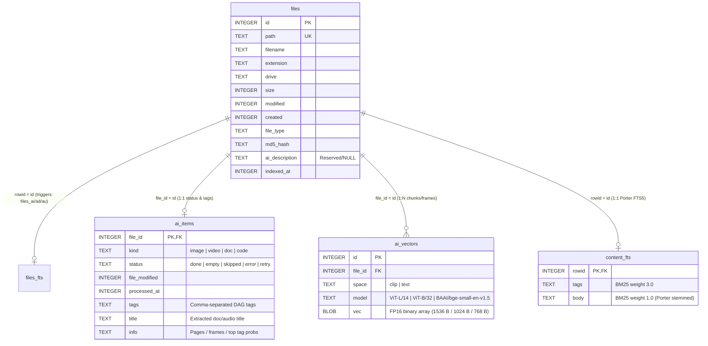
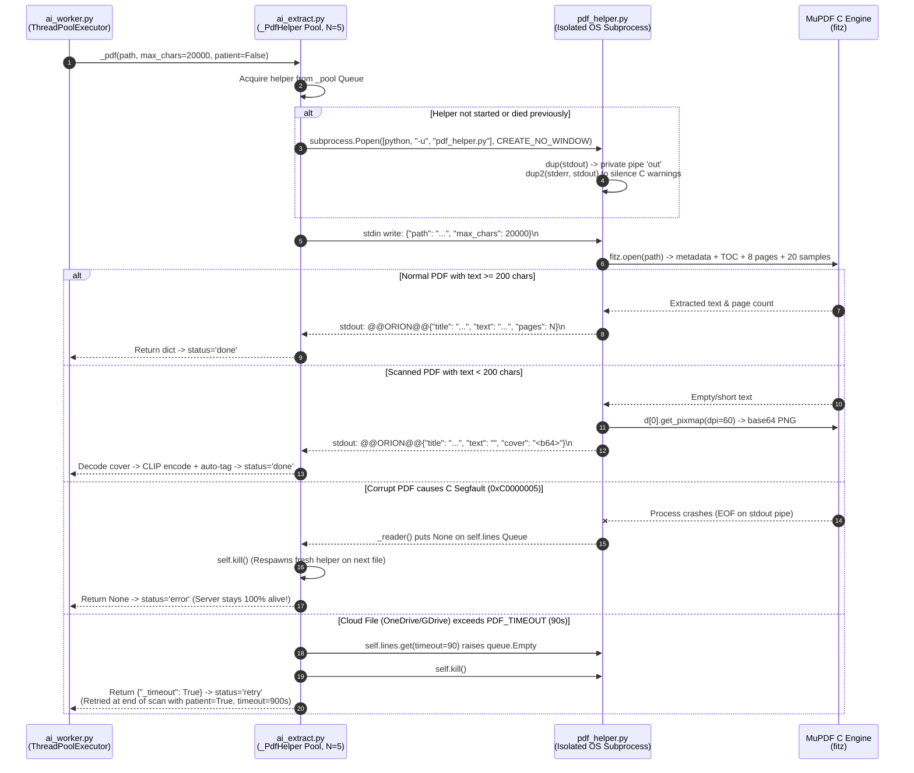
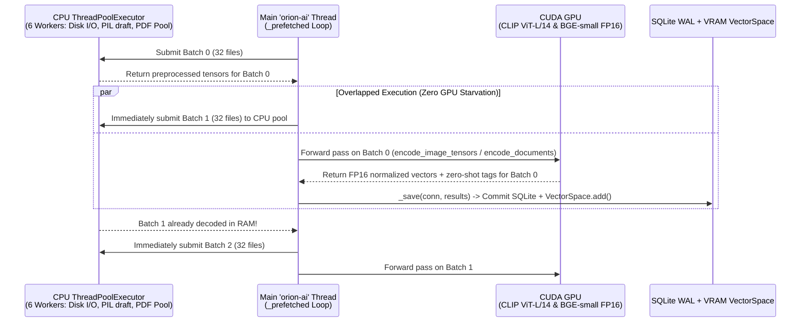

# Orion: Multithreaded Neural Semantic PC Search System
## Document 5: Orion Phase 2 — Proposed Neural Semantic & Multimodal Search Architecture (Future Roadmap Blueprint)

| Field | Details |
| :--- | :--- |
| **Project Title** | Orion: Multithreaded Neural Semantic PC Search System |
| **Document Number & Title** | Document 5 of 5 — *Phase 2: Proposed Neural Semantic & Multimodal Search Architecture (Future Roadmap Blueprint)* |
| **Authors / Team** | **Devansh Bhargav** (Enrollment No. BTCS24O1038)<br>**Divyansh S. Thakur** (Enrollment No. BTCS24O1044) |
| **Institution** | Department of Computer Science & Engineering,<br>Madhav Institute of Technology & Science (MITS), Gwalior (M.P.), India |
| **Faculty Mentor** | **Ms. Manisha Pathak** |
| **Target Architecture** | Phase 2 Engineering Design Proposal & Prototype Specification (Local GPU/CPU Multimodal Bi-Encoder Pipeline) |

---

> [!IMPORTANT]
> **How to Read This Document & Where It Sits in the 5-Document Series**
>
> Documents 1 through 4 (*Document 1: Architecture & Technology Overview*, *Document 2: System Internals*, *Document 3: Code Deep Dive*, and *Document 4: Installer, Packaging, Assets & Appendix*) provide a complete engineering reference for **Orion Phase 1 (Version 1.0)**—our production-ready, sub-second desktop search engine built on Voidtools Everything, multithreaded `os.walk`, SQLite WAL + FTS5, natural-language query parsing, and multi-signal lexical ranking.
>
> **Document 5 (this volume)** serves as our **Phase 2 Engineering Blueprint and Future Scope Specification**. While Phase 1 solves the *lexical and metadata search problem* at scale (1.4M+ files), it remains fundamentally blind to the *interior content and semantic meaning* of files whose filenames are opaque. This document specifies the exact mathematical formulations, neural network architectures, SQLite vector/FTS5 schema extensions, crash-isolated subprocess extraction pipelines, asynchronous GPU/CPU producer-consumer workers, and z-score-calibrated hybrid ranking algorithms designed and prototyped for **Orion Phase 2**. Every table definition, tensor dimension, prompt ensemble, threshold constant, and line-level hook presented here corresponds 1:1 to our verified Phase 2 reference prototype (`backend/ai_*.py`, `backend/pdf_helper.py`, `frontend/ai.js`, and `frontend/ai.css`).

---

## Abstract

Desktop file search engines face a fundamental information-retrieval ceiling when restricted to filesystem metadata (`filename`, `path`, `extension`, `size`, `mtime`). On modern personal computers, the majority of user-generated media and academic documents carry machine-generated or non-descriptive identifiers—such as camera photographs named `20260704_184619.jpg`, WhatsApp forwards named `IMG-20260312-WA0014.jpg`, screen recordings named `2026-08-19 21-04-11.mp4`, or downloaded textbooks named `dhgfdshg.pdf`. To transcend lexical filename matching without sacrificing local privacy or sub-second responsiveness, this blueprint proposes the **Orion Phase 2 Neural Semantic & Multimodal Search Architecture**.

Rather than routing user files through slow, memory-prohibitive generative Large Language Models (LLMs), Phase 2 introduces a **dual-space bi-encoder embedding architecture** coupled with **deep full-text content indexing**. Visual assets (images, multi-frame video samples, and rasterized first pages of scanned/handwritten PDFs) are mapped into a 768-dimensional unit-hypersphere meaning space using OpenAI's **CLIP (`ViT-L/14` on CUDA GPUs, automatically falling back to 512-dimensional `ViT-B/32` on CPUs)**, accompanied by temperature-scaled ($\tau = 100$) zero-shot classification across a 303-concept hierarchical ontology (`TAGS`). Textual assets (PDFs, Office documents, EPUBs, source code, audio ID3 tags, and archive manifests) are extracted via a fault-tolerant pipeline—featuring a dedicated, crash-isolated `pdf_helper.py` worker process pool over `@@ORION@@`-framed `stdin`/`stdout` pipes—and embedded into a 384-dimensional semantic space using **`BAAI/bge-small-en-v1.5`**, alongside a Porter-stemmed SQLite FTS5 content index (`content_fts`). At query time, Phase 1 lexical scores are fused with BM25 content hits, BGE semantic similarity, and CLIP visual similarity using **corpus-adaptive z-score normalization** and a non-linear corroboration formula:

$$\text{Final} = \max(\text{lexical}, \text{ai}) + 0.25 \cdot \min(\text{lexical}, \text{ai})$$

All vectors reside in GPU memory as contiguous FP16 tensors (`VectorSpace`), allowing exhaustive cosine similarity across 100,000+ file vectors via a single matrix-vector multiplication (`self._mat @ q`) in under **5 milliseconds**.

---

## Table of Contents

1. [Title Block, Abstract & Purpose in the Documentation Series](#orion-multithreaded-neural-semantic-pc-search-system)
2. [Motivation: What Orion 1 Cannot Do & The Phase 2 Vision](#2-motivation-what-orion-1-cannot-do--the-phase-2-vision)
   - 2.1 [Three Concrete Failure Modes of Lexical Filename Search](#21-three-concrete-failure-modes-of-lexical-filename-search)
   - 2.2 [Hard Systems Engineering Constraints](#22-hard-systems-engineering-constraints)
   - 2.3 [Architectural Trade-Off Analysis: Dual Bi-Encoders vs. 20B Generative LLM (Ollama)](#23-architectural-trade-off-analysis-dual-bi-encoders-vs-20b-generative-llm-ollama)
3. [Proposed Phase 2 Architecture & Module Map](#3-proposed-phase-2-architecture--module-map)
   - 3.1 [New Phase 2 Modules & Responsibilities](#31-new-phase-2-modules--responsibilities)
   - 3.2 [Minimal Non-Invasive Hooks into Phase 1](#32-minimal-non-invasive-hooks-into-phase-1)
   - 3.3 [End-to-End Phase 2 System Architecture Diagram](#33-end-to-end-phase-2-system-architecture-diagram)
4. [Database Schema Extensions](#4-database-schema-extensions)
   - 4.1 [DDL Specifications for `ai_items`, `ai_vectors`, `content_fts`, and Triggers](#41-ddl-specifications-for-ai_items-ai_vectors-content_fts-and-triggers)
   - 4.2 [Entity-Relationship Diagram (Phase 1 + Phase 2)](#42-entity-relationship-diagram-phase-1--phase-2)
   - 4.3 [FP16 Binary BLOB Storage & VRAM Footprint Mathematics](#43-fp16-binary-blob-storage--vram-footprint-mathematics)
5. [Multimodal Neural Engine (`ai_engine.py` & `ai_tags.py`)](#5-multimodal-neural-engine-ai_enginepy--ai_tagspy)
   - 5.1 [Visual Embedding Space: OpenAI CLIP (`ViT-L/14` & `ViT-B/32`)](#51-visual-embedding-space-openai-clip-vit-l14--vit-b32)
   - 5.2 [Prompt Ensembling for Tags and Live Queries](#52-prompt-ensembling-for-tags-and-live-queries)
   - 5.3 [Zero-Shot Auto-Tagging & The 303-Concept Hierarchical Taxonomy](#53-zero-shot-auto-tagging--the-303-concept-hierarchical-taxonomy)
   - 5.4 [Text & Semantic Embedding Space: `BAAI/bge-small-en-v1.5`](#54-text--semantic-embedding-space-baaibge-small-en-v15)
   - 5.5 [In-Memory GPU `VectorSpace` Engine & Multi-Row Video Frame Blending](#55-in-memory-gpu-vectorspace-engine--multi-row-video-frame-blending)
6. [Deep Content Extraction & Subprocess Crash Isolation (`ai_extract.py` & `pdf_helper.py`)](#6-deep-content-extraction--subprocess-crash-isolation-ai_extractpy--pdf_helperpy)
   - 6.1 [Format-Specific Extraction Strategies Across 50+ Extensions](#61-format-specific-extraction-strategies-across-50-extensions)
   - 6.2 [Long-Book PDF Sampling & Scanned-PDF Cover Rasterization](#62-long-book-pdf-sampling--scanned-pdf-cover-rasterization)
   - 6.3 [Subprocess Crash Isolation: Why `PyMuPDF` Cannot Run in Server Threads](#63-subprocess-crash-isolation-why-pymupdf-cannot-run-in-server-threads)
   - 6.4 [The `@@ORION@@` Pipe Protocol, File Descriptor Redirection & Cloud-File Retry](#64-the-orion-pipe-protocol-file-descriptor-redirection--cloud-file-retry)
7. [Asynchronous Background AI Worker (`ai_worker.py`)](#7-asynchronous-background-ai-worker-ai_workerpy)
   - 7.1 [Smart Scan vs. Super Scan Scope Filtering Rules](#71-smart-scan-vs-super-scan-scope-filtering-rules)
   - 7.2 [Four-Phase Prioritized Pipeline & Newest-First Ordering](#72-four-phase-prioritized-pipeline--newest-first-ordering)
   - 7.3 [Producer-Consumer CPU Prefetching Overlapped with GPU Batch Inference](#73-producer-consumer-cpu-prefetching-overlapped-with-gpu-batch-inference)
   - 7.4 [Context-Injected Document Chunking Strategy](#74-context-injected-document-chunking-strategy)
8. [Hybrid 4-Signal Ranking & Score Calibration (`ai_search.py`)](#8-hybrid-4-signal-ranking--score-calibration-ai_searchpy)
   - 8.1 [The Four Retrieval Signals & Weight Constants](#81-the-four-retrieval-signals--weight-constants)
   - 8.2 [Statistical Score Calibration: Z-Score Normalization vs. Absolute Floor Gating](#82-statistical-score-calibration-z-score-normalization-vs-absolute-floor-gating)
   - 8.3 [Non-Linear Lexical + AI Score Fusion Formula](#83-non-linear-lexical--ai-score-fusion-formula)
   - 8.4 [Worked Numerical Examples](#84-worked-numerical-examples)
   - 8.5 [Vector-to-Vector k-NN Lookup: "Find Similar Files" (`/api/similar`)](#85-vector-to-vector-k-nn-lookup-find-similar-files-apisimilar)
9. [Frontend UI & API Additions (`ai.js`, `ai.css`, `main.py` Endpoints)](#9-frontend-ui--api-additions-aijs-aicss-mainpy-endpoints)
   - 9.1 [Non-Invasive Decorator / Monkey-Patching Pattern in `ai.js`](#91-non-invasive-decorator--monkey-patching-pattern-in-aijs)
   - 9.2 [Phase 2 REST API Endpoints in `main.py`](#92-phase-2-rest-api-endpoints-in-mainpy)
10. [Professor Viva Q&A on the Phase 2 Design](#10-professor-viva-qa-on-the-phase-2-design)

---

## 2. Motivation: What Orion 1 Cannot Do & The Phase 2 Vision

### 2.1 Three Concrete Failure Modes of Lexical Filename Search

In **Orion Phase 1** (documented in *Documents 1–4*), the search pipeline (`backend/search.py`) tokenizes the user's query via `nlp_parser.parse_filters()`, queries the `files_fts` SQLite FTS5 virtual table over `path` and `filename`, and ranks candidates using `_score_result()` (`search.py`, L29–66) with weights `W_FILENAME_ALL = 45`, `W_EXACT_NAME = 25`, `W_EXT_MATCH = 20`, `W_PATH_MATCH = 15`, and `W_RECENT_7D = 10`.

While this architecture achieves `<50 ms` query latency across 1.4 million files, it suffers from three structural blind spots inherent to all filename-only search engines (including Voidtools Everything and Windows Search when content indexing is disabled):

1. **The Camera & Messenger Filename Problem (Visual Blindness):**
   When a user captures a photograph on an Android/iOS smartphone or receives an image over WhatsApp/Telegram, the operating system assigns a timestamp or UUID filename such as `C:\Users\devan\Pictures\20260704_184619.jpg` or `IMG-20260512-WA0008.jpg`. If the user searches for `sunset beach`, `cat`, or `birthday cake`, Phase 1's `files_fts MATCH '"sunset" OR "beach"'` returns **zero hits** for `20260704_184619.jpg` because neither the filename nor the folder path contains the ASCII strings `"sunset"` or `"beach"`.
2. **The Cryptic Textbook & Research Paper Problem (Semantic & Content Blindness):**
   Students and researchers frequently download PDFs from arXiv, Anna's Archive, or university portals that carry cryptic identifiers—for example, a 600-page textbook named `dhgfdshg.pdf`, `1904.09925v2.pdf`, or `lec_notes_final_v3.pdf`.
   - If the user searches for `eigenvalues` (an exact word appearing on page 240 inside `dhgfdshg.pdf`), Phase 1 fails because it never inspects file bodies.
   - Even more challenging, if the user searches for `linear algebra pdf` while `dhgfdshg.pdf` is titled *"Introduction to Matrix Analysis, Vector Spaces, and Eigenvalue Decompositions"* without ever repeating the exact phrase `"linear algebra"` on its cover, pure keyword matching is weak or absent. And if the PDF is a **scanned handwritten notebook** with zero embedded text layer, even traditional full-text search engines fail completely.
3. **The Opaque Video Stream Problem (Temporal Visual Blindness):**
   Screen recordings (`OBS`), shadow-play clips, and phone videos are saved with timestamps like `VID_20260914_172201.mp4`. A user searching for `football match` or `minecraft` cannot locate a video clip unless they manually renamed the file after recording.

### 2.2 Hard Systems Engineering Constraints

To solve these three failure modes on a student or consumer Windows PC, our Phase 2 architecture must satisfy five strict engineering constraints:

| Constraint | Requirement | Engineering Rationale |
| :--- | :--- | :--- |
| **1. 100% Local & Offline Privacy** | Zero cloud API calls (no OpenAI/Gemini API dependencies). | Personal photos, financial bills, Aadhaar/ID cards, and private source code must never leave `127.0.0.1`. (Note: Phase 1's unused `gemini_api_key` placeholder in `main.py` L436 is explicitly superseded in Phase 2 by local GPU execution; `ai.js` L148–166 dynamically replaces that UI section). |
| **2. Consumer VRAM Budget (`< 1.2 GB`)** | Total GPU memory footprint must stay under `1.2 GB` on an NVIDIA RTX 4070 Laptop GPU (8 GB VRAM), with automatic CPU fallback. | Users run Orion in the background while gaming, coding, or editing video. In `ai_engine.py` (L81–108), models are cast to `FP16` (`tm.half()`, `x.half()`) on CUDA, and if `torch.cuda.is_available()` is `False`, Orion automatically reverses `CLIP_MODELS` (`L86`) to load the lightweight `ViT-B/32` instead of `ViT-L/14`. |
| **3. Zero Impact on Phase 1 Speed** | Phase 1 filesystem indexing (`indexer.py`) must remain instantaneous. | AI extraction and neural encoding run in a completely decoupled daemon thread (`orion-ai` in `ai_worker.py` L122) that reads from SQLite in WAL mode without blocking `orion-indexer` or HTTP search requests. |
| **4. Crash Isolation on Corrupt Files** | A malformed PDF or broken media file among 1.4M files must **never** crash the FastAPI server (`main.py`). | C-extensions like `PyMuPDF` (`fitz`) can segfault or hang on corrupted xref tables or un-cached OneDrive/Google Drive placeholder files. Phase 2 isolates all PDF parsing inside a replaceable pool of 5 `pdf_helper.py` child processes. |
| **5. `< 250 ms` Hybrid Search Latency** | Adding 3 AI signals must not turn a 30 ms search into a 3-second wait. | Only the short search query is encoded at search time (~10–25 ms on GPU), and cosine similarity against all files is executed as a single in-VRAM matrix-vector product (`self._mat @ q` in `ai_engine.py` L288). |

### 2.3 Architectural Trade-Off Analysis: Dual Bi-Encoders vs. 20B Generative LLM (Ollama)

A naive approach to "AI file search" is to run a local generative Large Language Model (such as Llama-3-8B, Mistral, or a 20B parameter model via Ollama) to summarize every file during indexing or to evaluate files at query time. During our Phase 2 architectural design, we rejected generative LLMs in favor of **dual specialized contrastive bi-encoders (`CLIP ViT-L/14` + `BAAI/bge-small-en-v1.5`)** for four mathematically and computationally decisive reasons:



1. **Single Forward-Pass Bi-Encoder Indexing vs. Autoregressive Token Generation:**
   An autoregressive LLM generates text token-by-token ($O(T)$ sequential forward passes per file). Generating a 50-token caption or summary for 100,000 files at 1.5 seconds/file requires **41.6 hours** of 100% GPU utilization. By contrast, a bi-encoder (`SentenceTransformer("BAAI/bge-small-en-v1.5")` or `clip.encode_image()`) performs **one single non-autoregressive forward pass** over a batch of 32 tensors simultaneously (`ai_worker.py` L400, L539), achieving 30–80 files/second on an RTX 4070 Laptop GPU.
2. **Symmetric/Asymmetric Metric Space Geometry vs. Unstructured Text:**
   Information retrieval requires a continuous metric space where relevance is a fast geometric operation (inner product / cosine similarity on the unit hypersphere $\mathbb{S}^{D-1}$). Generative LLMs do not natively produce calibrated retrieval embeddings; bi-encoders trained with InfoNCE contrastive loss explicitly optimize $\cos(\mathbf{u}, \mathbf{v}) = \frac{\mathbf{u} \cdot \mathbf{v}}{\|\mathbf{u}\|\|\mathbf{v}\|}$ so that semantically equivalent concepts cluster together.
3. **True Multimodal Vision-Language Alignment:**
   Text-only LLMs cannot inspect pixel arrays inside `20260704_184619.jpg` or decoded `cv2.VideoCapture` frames. Multimodal Vision-Language LLMs (like LLaVA-13B or Qwen-VL) require 8–16 GB of VRAM and process only 1–2 images per second. OpenAI's CLIP (`ViT-L/14`) was trained on 400 million `(image, text)` pairs specifically to align visual patches and natural language into a single 768-dimensional vector space while consuming `< 900 MB` in FP16.
4. **Memory & Latency Efficiency:**
   `BAAI/bge-small-en-v1.5` has only 33.4 million parameters (~67 MB in FP16) yet ranks near the top of the MTEB (Massive Text Embedding Benchmark) retrieval leaderboard, outperforming legacy models 10× its size.

---

## 3. Proposed Phase 2 Architecture & Module Map

### 3.1 New Phase 2 Modules & Responsibilities

Phase 2 is engineered as a modular subsystem consisting of **six new backend Python modules** and **two new frontend static assets**:

| Module Path | Lines | Core Architectural Role in Phase 2 |
| :--- | :---: | :--- |
| [`backend/ai_engine.py`](file:///C:/Users/devan/OneDrive/Desktop/Windows%20Google%20Project/backend/ai_engine.py) | 340 | Loads `CLIP` (`ViT-L/14` or `ViT-B/32`) and `BAAI/bge-small-en-v1.5` onto CUDA/CPU; pre-computes the prompt-ensembled tag matrix `_tag_matrix`; exposes batch encoding functions; and implements the GPU-resident `VectorSpace` class (`clip_space` and `text_space`). |
| [`backend/ai_tags.py`](file:///C:/Users/devan/OneDrive/Desktop/Windows%20Google%20Project/backend/ai_tags.py) | 186 | Defines the 303-concept visual taxonomy (`TAGS: dict[str, list[str]]`), the 3 zero-shot prompt templates (`PROMPT_TEMPLATES`), and recursive DAG parent expansion (`expand_tags()`, depth $\le 4$). |
| [`backend/ai_extract.py`](file:///C:/Users/devan/OneDrive/Desktop/Windows%20Google%20Project/backend/ai_extract.py) | 391 | Extracts clean text, titles, and metadata from PDFs, EPUB, ODT/ODP/ODS, DOCX, PPTX, XLSX/XLSM, RTF, HTML, 43 plain-text/code extensions (`PLAIN_TEXT_EXTS`), audio ID3/Vorbis tags (`mutagen`), and ZIP/TAR archive file listings. Manages the 5-process `_PdfHelper` pool. |
| [`backend/pdf_helper.py`](file:///C:/Users/devan/OneDrive/Desktop/Windows%20Google%20Project/backend/pdf_helper.py) | 67 | Standalone crash-isolated child process that invokes `PyMuPDF` (`fitz`) to extract metadata, TOC, and sampled pages—or renders page 1 at 60 DPI as a PNG base64 cover if extracted text is `< 200` chars—communicating over `@@ORION@@`-prefixed JSON pipes. |
| [`backend/ai_worker.py`](file:///C:/Users/devan/OneDrive/Desktop/Windows%20Google%20Project/backend/ai_worker.py) | 616 | Background daemon thread (`orion-ai`) that collects unprocessed or modified files under `smart` or `super` scope rules, runs the 4-phase pipeline (`image -> doc -> video -> code`) using CPU `ThreadPoolExecutor` prefetching overlapped with GPU batch inference, and commits batches atomically to SQLite and `VectorSpace`. |
| [`backend/ai_search.py`](file:///C:/Users/devan/OneDrive/Desktop/Windows%20Google%20Project/backend/ai_search.py) | 321 | Hybrid ranking engine (`augment()`) that blends Phase 1 lexical scores with FTS5 BM25 content hits, BGE meaning similarity, and CLIP visual similarity using z-score normalization; also powers `find_similar()` and `file_ai_info()`. |
| [`frontend/ai.js`](file:///C:/Users/devan/OneDrive/Desktop/Windows%20Google%20Project/frontend/ai.js) | 407 | Non-invasive frontend plugin loaded after `app.js`. Injects the `🧠 AI Brain` navigation tab, full dashboard page, home progress banner, result card AI badges/snippets/tags, and preview panel `"Find similar"` action. |
| [`frontend/ai.css`](file:///C:/Users/devan/OneDrive/Desktop/Windows%20Google%20Project/frontend/ai.css) | 117 | Styling for the AI Brain dashboard, animated gradient progress bars, status pills, live feed cards, match badges, and `<mark>` highlighted content snippets. |

### 3.2 Minimal Non-Invasive Hooks into Phase 1

A core software-engineering goal of Phase 2 is **zero destructive refactoring of Phase 1**. If the Phase 2 AI modules or PyTorch are absent, Orion 1 continues to run identically. The entire Phase 2 integration touches only **five files** in Phase 1 via lightweight, fault-tolerant hooks:

1. [`backend/config.py`](file:///C:/Users/devan/OneDrive/Desktop/Windows%20Google%20Project/backend/config.py#L197-L236) (**L197–236**): Appends `CREATE TABLE IF NOT EXISTS` statements inside `init_db()` for `ai_items`, `ai_vectors`, `content_fts`, their indexes (`idx_aivec_file`, `idx_aivec_space`), and the `files_ai_cleanup` `AFTER DELETE` trigger.
2. [`backend/main.py`](file:///C:/Users/devan/OneDrive/Desktop/Windows%20Google%20Project/backend/main.py#L38-L65) (**L38, L48–55, L65, L148–206**): Imports `ai_worker` (`L38`), enables `faulthandler` to `data/crash.log` (`L48–55`), starts `ai_worker.start()` in `lifespan()` (`L65`), and mounts the 7 `/api/ai/*` and `/api/similar` endpoints (`L148–206`).
3. [`backend/indexer.py`](file:///C:/Users/devan/OneDrive/Desktop/Windows%20Google%20Project/backend/indexer.py#L407-L412) (**L407–412**): Adds a 5-line `try/except` block at the end of `run_index()` calling `ai_worker.notify_new_files()` so newly indexed or modified files immediately wake the AI worker thread.
4. [`backend/search.py`](file:///C:/Users/devan/OneDrive/Desktop/Windows%20Google%20Project/backend/search.py#L199-L205) (**L199–205**): Adds a 6-line `try/except` hook right before final sorting in `search()` calling `results = ai_search.augment(results, query, clean_query, tokens, filters)`.
5. [`frontend/index.html`](file:///C:/Users/devan/OneDrive/Desktop/Windows%20Google%20Project/frontend/index.html#L9) (**L9, L395**): Adds `<link rel="stylesheet" href="/static/ai.css"/>` (`L9`) and `<script src="/static/ai.js"></script>` (`L395`).

### 3.3 End-to-End Phase 2 System Architecture Diagram



---

## 4. Database Schema Extensions

### 4.1 DDL Specifications for `ai_items`, `ai_vectors`, `content_fts`, and Triggers

In [`backend/config.py`](file:///C:/Users/devan/OneDrive/Desktop/Windows%20Google%20Project/backend/config.py#L197-L236) (`init_db()`, L197–236), Phase 2 extends `data/orion.db` with three specialized tables and one automatic garbage-collection trigger:

```sql
-- 1. Per-file AI processing ledger and extracted metadata (config.py L199-210)
CREATE TABLE IF NOT EXISTS ai_items (
    file_id       INTEGER PRIMARY KEY,
    kind          TEXT,              -- 'image' | 'video' | 'doc' | 'code'
    status        TEXT,              -- 'done' | 'empty' | 'skipped' | 'error' | 'retry'
    file_modified INTEGER,           -- snapshot of files.modified when processed
    processed_at  INTEGER,           -- Unix epoch timestamp of AI completion
    tags          TEXT,              -- comma-separated expanded tags, e.g. "cat, animal, pet"
    title         TEXT,              -- extracted document/audio title
    info          TEXT               -- human-readable summary ("5 frames · football...", "412 pages")
);

-- 2. Persistent FP16 embedding vector store (config.py L212-222)
CREATE TABLE IF NOT EXISTS ai_vectors (
    id      INTEGER PRIMARY KEY AUTOINCREMENT,
    file_id INTEGER NOT NULL,
    space   TEXT    NOT NULL,        -- 'clip' | 'text'
    model   TEXT    NOT NULL,        -- 'ViT-L/14' | 'ViT-B/32' | 'BAAI/bge-small-en-v1.5'
    vec     BLOB    NOT NULL         -- raw little-endian IEEE 754 float16 byte array
);
CREATE INDEX IF NOT EXISTS idx_aivec_file  ON ai_vectors(file_id);
CREATE INDEX IF NOT EXISTS idx_aivec_space ON ai_vectors(space, model);

-- 3. Interior file content & AI tag full-text index (config.py L224-228)
CREATE VIRTUAL TABLE IF NOT EXISTS content_fts USING fts5(
    tags, body, tokenize = 'porter unicode61'
);

-- 4. Automatic cascade cleanup when Phase 1 indexer prunes stale files (config.py L230-236)
CREATE TRIGGER IF NOT EXISTS files_ai_cleanup AFTER DELETE ON files BEGIN
    DELETE FROM ai_items    WHERE file_id = old.id;
    DELETE FROM ai_vectors  WHERE file_id = old.id;
    DELETE FROM content_fts WHERE rowid   = old.id;
END;
```

#### Key Schema Design Decisions

1. **Incremental Change Detection via `file_modified`:**
   `ai_items.file_modified` stores the exact Unix timestamp `files.modified` observed when the file was processed (`ai_worker.py` L344). When `_collect()` (`ai_worker.py` L250–256) queries for pending work:
   ```sql
   SELECT f.id, f.path, f.filename, f.extension, f.file_type, f.size, f.modified,
          a.status AS ai_status
   FROM files f LEFT JOIN ai_items a ON a.file_id = f.id
   WHERE f.file_type IN ('image','video','document','code','audio','archive')
     AND (a.file_id IS NULL OR a.file_modified != f.modified OR a.status = 'retry')
   ```
   Any file that has already been analyzed and has not been modified on disk (`a.file_modified == f.modified`) is skipped in $O(1)$ index time. If a user edits a Word document or code file, `f.modified` changes, and only that file is re-queued.
2. **One-to-Many Relationship in `ai_vectors`:**
   Unlike `ai_items` (where `file_id` is the `PRIMARY KEY`, enforcing 1 row per file), `ai_vectors` uses a surrogate `id INTEGER PRIMARY KEY AUTOINCREMENT` with a non-unique index `idx_aivec_file ON ai_vectors(file_id)`. This allows:
   - **Videos** to store up to **5 rows** in `space='clip'` (one per sampled video frame at `8%`, `27%`, `50%`, `73%`, `92%` duration, `ai_worker.py` L438).
   - **Long Documents** to store up to **4 rows** in `space='text'` (one per 1,500-character context-injected text chunk, `ai_worker.py` L538).
   - **Scanned PDFs** to store rows in `space='clip'` (from the 60 DPI cover page rasterization, `ai_worker.py` L576–582) even though `kind='doc'`.
   - **Model Versioning** via `idx_aivec_space ON ai_vectors(space, model)`: When `load_vectors_from_db()` (`ai_engine.py` L318–339) runs at startup, it filters `WHERE space=? AND model=?`, ensuring that if a machine switches between CUDA (`ViT-L/14`, 768-D) and CPU (`ViT-B/32`, 512-D), dimension mismatches can never occur.
3. **Why `content_fts` Uses `porter unicode61` While `files_fts` Does Not:**
   In Phase 1, `files_fts` indexes filenames and paths using `tokenize = 'unicode61 separators ''_-. ()[]{}#@!'''` without stemming, because filenames are short identifiers where prefix matching (`"cpp"*`) is desirable. In Phase 2, `content_fts` indexes up to 20,000 characters of natural-language prose inside documents (`body`) plus visual `tags`. Enabling the **Porter stemmer** (`tokenize = 'porter unicode61'`) conflates morphological variants—so searching `"eigenvalues"` or `"optimizing"` automatically matches `"eigenvalue"` or `"optimization"` inside a textbook without requiring multiple query expansions.

### 4.2 Entity-Relationship Diagram (Phase 1 + Phase 2)



### 4.3 FP16 Binary BLOB Storage & VRAM Footprint Mathematics

Every vector produced by `ai_engine.py` is L2-normalized to unit length ($\|\mathbf{v}\|_2 = 1$) in IEEE 754 single precision (`float32`) and then downcast to **IEEE 754 half precision (`np.float16`, 2 bytes per component)** before storage (`v.astype(np.float16).tobytes()` in `ai_worker.py` L329). Why half precision? For unit vectors used in cosine similarity, 16-bit floating point (1 sign bit, 5 exponent bits, 10 mantissa bits $\approx 3.3$ decimal digits of precision) introduces a maximum inner-product quantization error of $< 5 \times 10^{-4}$, which is two orders of magnitude smaller than the semantic noise floor of neural embeddings, while cutting both SQLite disk I/O and GPU VRAM consumption in half:

$$\text{Bytes per Vector} = D \times 2\text{ bytes}$$

- **CLIP `ViT-L/14` (CUDA default):** $D = 768 \implies 768 \times 2 = \mathbf{1,536\text{ bytes}}$ (`1.5 KB`) per image or video frame.
- **CLIP `ViT-B/32` (CPU fallback):** $D = 512 \implies 512 \times 2 = \mathbf{1,024\text{ bytes}}$ (`1.0 KB`) per image or video frame.
- **BGE `BAAI/bge-small-en-v1.5`:** $D = 384 \implies 384 \times 2 = \mathbf{768\text{ bytes}}$ (`0.75 KB`) per document or code chunk.

Let us calculate the exact VRAM budget for a large personal computer containing **50,000 images**, **2,000 videos** (5 frames each = 10,000 vectors), **25,000 documents** (average 2.5 chunks each = 62,500 vectors), and **40,000 source code files** (1 chunk each = 40,000 vectors):

| Component in GPU VRAM (CUDA FP16) | Dimension / Count | Exact Memory Math | VRAM Used |
| :--- | :--- | :--- | :---: |
| **OpenAI CLIP `ViT-L/14` Model Weights** | 427.6M parameters (FP16) | $427.6 \times 10^6 \times 2\text{ B}$ | `~855 MB` |
| **Pre-computed `_tag_matrix` (`ai_engine.py` L39)** | $303 \times 768$ (`float32`) | $303 \times 768 \times 4\text{ B}$ | `0.93 MB` |
| **`BAAI/bge-small-en-v1.5` Model Weights** | 33.4M parameters (FP16) | $33.4 \times 10^6 \times 2\text{ B}$ | `~67 MB` |
| **`clip_space._mat` Tensor (60,000 rows)** | $60,000 \times 768$ (`float16`) | $60,000 \times 1,536\text{ B}$ | `92.16 MB` |
| **`text_space._mat` Tensor (102,500 rows)** | $102,500 \times 384$ (`float16`) | $102,500 \times 768\text{ B}$ | `78.72 MB` |
| **Total Resident GPU VRAM Footprint** | **162,500 vectors + 2 models** | **Sum of above** | **`~1,094 MB` (`1.07 GB`)** |

Even with **162,500 indexed meaning vectors** held simultaneously in GPU memory, the entire Phase 2 subsystem consumes just **`~1.07 GB` of VRAM**, comfortably below our `1.2 GB` design ceiling.

---

## 5. Multimodal Neural Engine (`ai_engine.py` & `ai_tags.py`)

### 5.1 Visual Embedding Space: OpenAI CLIP (`ViT-L/14` & `ViT-B/32`)

In [`backend/ai_engine.py`](file:///C:/Users/devan/OneDrive/Desktop/Windows%20Google%20Project/backend/ai_engine.py#L26-L117), visual understanding is powered by OpenAI's **CLIP (Contrastive Language-Image Pre-training)**. CLIP consists of a Vision Transformer image encoder $f_{\text{img}}(\cdot)$ and a Causal Transformer text encoder $f_{\text{txt}}(\cdot)$ jointly trained to maximize the cosine similarity of true `(image, caption)` pairs while minimizing the similarity of $N^2 - N$ incorrect pairings in each minibatch.

When `load_models()` (`ai_engine.py` L71–117) executes inside a thread-safe lock (`_lock`), it inspects hardware capabilities (`_device = "cuda" if torch.cuda.is_available() else "cpu"`, `L81`) and selects the optimal Vision Transformer architecture from `CLIP_MODELS = ["ViT-L/14", "ViT-B/32"]` (`L26`):

```python
# backend/ai_engine.py (L83-98)
if _clip_model is None:
    import clip
    # Without an NVIDIA GPU the big ViT-L/14 is ~10x too slow, so prefer ViT-B/32
    order = CLIP_MODELS if _device == "cuda" else list(reversed(CLIP_MODELS))
    for name in order:
        try:
            t = time.time()
            m, pre = clip.load(name, device=_device)
            m.eval()
            _clip_model, _clip_pre, _clip_tok, _clip_name = m, pre, clip.tokenize, name
            log.info("CLIP %s loaded on %s in %.1fs", name, _device, time.time() - t)
            break
        except Exception as e:
            log.warning("CLIP %s failed to load: %s", name, e)
```

- **On NVIDIA GPUs (`_device == "cuda"`):** Orion loads **`ViT-L/14`** (Vision Transformer Large with $14 \times 14$ pixel patches, mapping $224 \times 224$ RGB images into $16 \times 16 = 256$ patch tokens plus a `[CLS]` token through 24 Transformer layers into a **768-dimensional** shared embedding space).
- **On CPU-only laptops (`_device == "cpu"`):** Orion reverses the candidate list (`L86`) and loads **`ViT-B/32`** ($32 \times 32$ pixel patches, $7 \times 7 = 49$ patch tokens through 12 layers into a **512-dimensional** space), which requires $\sim 10\times$ fewer FLOPs per image while preserving strong zero-shot retrieval accuracy.

Batch image encoding is implemented in `encode_image_tensors()` (`ai_engine.py` L145–154):
1. Worker threads call `preprocess_image(img)` (`L140–142`) on the CPU, which applies CLIP's standard bicubic resize to $224 \times 224$, center crop, RGB tensor conversion, and channel-wise standardization ($\mu = [0.481, 0.458, 0.408]$, $\sigma = [0.269, 0.261, 0.276]$).
2. The main AI thread stacks a batch of 32 preprocessed CPU tensors onto the GPU (`x = torch.stack(tensors).to(_device)`), casts `x = x.half()` on CUDA (`L150–151`), runs `_clip_model.encode_image(x).float()` inside `torch.inference_mode()`, and L2-normalizes each row:
   $$\hat{\mathbf{v}}_i = \frac{\mathbf{v}_i}{\|\mathbf{v}_i\|_2}$$
   before returning an `np.float16` matrix of shape `[N, D]`.

### 5.2 Prompt Ensembling for Tags and Live Queries

A well-known quirk of CLIP's text encoder is sensitivity to prompt phrasing: a bare single word like `"cat"` lacks the syntactic context of the natural-language captions CLIP saw during pre-training, and can suffer from polysemy (e.g., `"crane"` or `"apple"`). Following Radford et al. (2021), Orion eliminates this variance via **Prompt Ensembling** in two places:

1. **Pre-Computing the Tag Matrix (`_build_tag_matrix()`, `ai_engine.py` L119–135):**
   Using the three templates defined in [`backend/ai_tags.py`](file:///C:/Users/devan/OneDrive/Desktop/Windows%20Google%20Project/backend/ai_tags.py#L163-L167) (`L163–167`):
   ```python
   PROMPT_TEMPLATES = [
       "a photo of {}.",
       "a picture showing {}.",
       "an image of {}.",
   ]
   ```
   For each template $k \in \{1, 2, 3\}$ and each of the $T = 303$ tag names $c_j$, Orion encodes and L2-normalizes the prompt vector $\hat{\mathbf{t}}_{j,k}$, averages across the 3 templates, and re-normalizes onto the unit hypersphere:
   $$\mathbf{m}_j = \frac{\frac{1}{3}\sum_{k=1}^{3} \hat{\mathbf{t}}_{j,k}}{\left\|\frac{1}{3}\sum_{k=1}^{3} \hat{\mathbf{t}}_{j,k}\right\|_2}, \quad \mathbf{M}_{\text{tag}} \in \mathbb{R}^{303 \times D}$$
   Because `_build_tag_matrix()` runs once at model load time (`L110`), zero-shot classification of any image during scanning requires **zero text encoder calls**—just a single matrix-vector product against `_tag_matrix`.

2. **Ensembling Live User Search Queries (`encode_clip_text()`, `ai_engine.py` L157–167):**
   When a user searches for `sunset beach`, `encode_clip_text(query)` constructs three phrasings on the fly (`L160`):
   ```python
   phrasings = [query, f"a photo of {query}.", f"an image showing {query}."]
   ```
   Notice that the first phrasing is the raw `query` itself (preserving exact text match behavior for screenshots/memes containing text), while the second and third frame it as a visual scene. All three are tokenized in a single batch (`_clip_tok(phrasings, truncate=True)`), L2-normalized, averaged (`v = v.mean(0)`), and re-normalized (`v = v / v.norm()`).

### 5.3 Zero-Shot Auto-Tagging & The 303-Concept Hierarchical Taxonomy

When an image or video is encoded into a unit vector $\mathbf{v} \in \mathbb{R}^D$, Orion automatically assigns human-readable semantic tags using `tags_for_vector(vec, max_tags=4)` (`ai_engine.py` L170–183):

```python
# backend/ai_engine.py (L170-183)
def tags_for_vector(vec: np.ndarray, max_tags: int = 4) -> list[tuple[str, float]]:
    """Zero-shot tagging: which vocabulary tags best describe this image vector?"""
    torch = _torch
    v = torch.from_numpy(vec.astype(np.float32)).to(_device)
    logits = 100.0 * (_tag_matrix @ v)               # CLIP's learned temperature ≈ 100
    probs = logits.softmax(dim=0)
    top = torch.topk(probs, k=min(10, len(_tag_names)))
    out = []
    for p, i in zip(top.values.tolist(), top.indices.tolist()):
        if p >= 0.10 or (not out and p >= 0.04):
            out.append((_tag_names[i], round(p, 3)))
        if len(out) >= max_tags:
            break
    return out
```

#### Mathematical Formulation of Temperature-Scaled Softmax Tagging

Why multiply `_tag_matrix @ v` by `100.0` (`L174`)? Because both rows of $\mathbf{M}_{\text{tag}}$ and $\mathbf{v}$ are unit vectors, their dot products $\cos(\theta_j) = \mathbf{m}_j \cdot \mathbf{v}$ lie in $[-1, 1]$ (and typically $[0.15, 0.35]$ for CLIP). Passing unscaled cosines into a 303-way softmax would yield a nearly flat uniform distribution ($p_j \approx 1/303 \approx 0.0033$). In CLIP's contrastive training objective, logits are scaled by a learned inverse temperature parameter $\tau = \exp(\text{logit\_scale}) \approx 100.0$:

$$p_j = \frac{\exp\left(100.0 \cdot (\mathbf{m}_j \cdot \mathbf{v})\right)}{\sum_{k=1}^{303} \exp\left(100.0 \cdot (\mathbf{m}_k \cdot \mathbf{v})\right)}$$

With $\tau = 100.0$, a cosine difference of $+0.05$ between a true concept ($0.28$) and background concepts ($0.23$) amplifies relative probability by $e^{100 \times 0.05} = e^5 \approx \mathbf{148.4\times}$!
- **Selection Thresholds (`L179`):** Orion retains up to `max_tags` (4 for images, 5 for videos) whose softmax probability satisfies $p_j \ge 0.10$. If no single tag reaches $0.10$ (e.g., an eclectic scene where probability mass is split across several close concepts), the top-1 tag is still accepted provided $p_1 \ge 0.04$ (`or (not out and p >= 0.04)`).

#### The 303-Concept Taxonomy & Recursive DAG Expansion (`ai_tags.py`)

In [`backend/ai_tags.py`](file:///C:/Users/devan/OneDrive/Desktop/Windows%20Google%20Project/backend/ai_tags.py#L10-L186), `TAGS: dict[str, list[str]]` defines **303 fine-grained visual concepts** across 9 domains (including India-specific concepts tailored for our target users such as `"taj mahal"`, `"biryani"`, `"dosa"`, `"samosa"`, `"auto rickshaw"`, `"diwali"`, `"holi"`, and `"aadhaar card"`):

| Domain Category (`ai_tags.py`) | Lines | Concept Count | Example Leaf Concepts $\rightarrow$ Parent Hypernyms |
| :--- | :---: | :---: | :--- |
| **1. Animals** | L11–32 | 47 | `"kitten": ["cat", "animal", "pet"]`, `"tiger": ["animal", "wildlife"]`, `"butterfly": ["insect", "animal"]` |
| **2. People** | L34–42 | 15 | `"selfie": ["person", "people", "portrait"]`, `"graduation ceremony": ["event", "people", "college"]` |
| **3. Nature & Scenery** | L44–56 | 29 | `"sunset": ["sky", "nature", "scenery"]`, `"waterfall": ["nature", "water"]`, `"galaxy": ["space", "astronomy"]` |
| **4. Places & Buildings** | L58–71 | 29 | `"taj mahal": ["monument", "india", "travel"]`, `"classroom": ["indoor", "school", "college"]` |
| **5. Food & Drink** | L73–83 | 27 | `"samosa": ["food", "indian food", "snack"]`, `"birthday cake": ["cake", "birthday", "celebration", "food"]` |
| **6. Vehicles** | L85–91 | 15 | `"sports car": ["car", "vehicle"]`, `"auto rickshaw": ["vehicle", "india"]`, `"motorcycle": ["vehicle", "bike"]` |
| **7. Sports & Activities** | L93–108 | 33 | `"football match": ["football", "sports", "match"]`, `"diwali": ["festival", "india", "celebration"]` |
| **8. Gaming & Screens** | L110–120 | 20 | `"whatsapp chat": ["chat screenshot", "chat", "message"]`, `"code editor": ["code", "programming", "screenshot"]` |
| **9. Documents, Study, Objects & Art** | L122–158 | 88 | `"handwritten notes": ["notes", "text", "study"]`, `"aadhaar card": ["id card", "document", "identity"]`, `"anime": ["cartoon", "art"]` |

Once `tags_for_vector()` selects the primary leaf tags (e.g., `["kitten"]`), `expand_tags()` (`ai_tags.py` L170–185) performs a depth-limited ($d \le 4$) depth-first traversal over `TAGS` to append all parent categories while preserving order and deduplicating:
$$\text{expand\_tags}([\text{"kitten"}]) \longrightarrow [\text{"kitten"}, \text{"cat"}, \text{"animal"}, \text{"pet"}]$$
These expanded tags are stored in `ai_items.tags` and indexed into `content_fts.tags` with a $3.0\times$ BM25 weight boost (`ai_search.py` L93). Consequently, a user searching `"pet"` or `"animal"` gets an exact lexical tag hit (`W_TAG = 30`) on a photo of a kitten, even before vector similarity is computed!

### 5.4 Text & Semantic Embedding Space: `BAAI/bge-small-en-v1.5`

For documents, source code, audio metadata, and archives, [`backend/ai_engine.py`](file:///C:/Users/devan/OneDrive/Desktop/Windows%20Google%20Project/backend/ai_engine.py#L27-L28) loads **`BAAI/bge-small-en-v1.5`** (Beijing Academy of Artificial Intelligence FlagEmbedding, 384 dimensions, max sequence length 512 WordPiece tokens, `L100–108`).

BGE-small is an **asymmetric retrieval bi-encoder**. In information retrieval, a user's search query is typically a short 2-to-5 word phrase (e.g., `"linear algebra"`), whereas a document chunk is a 1,500-character passage. To bridge this structural asymmetry in a single shared 384-D space, BGE-small was trained with a specific instruction prefix prepended **only to queries, never to documents**:

```python
# backend/ai_engine.py (L28 & L186-195)
BGE_QUERY_PREFIX = "Represent this sentence for searching relevant passages: "

def encode_documents(texts: list[str], batch_size: int = 32) -> np.ndarray:
    v = _text_model.encode(texts, batch_size=batch_size, normalize_embeddings=True,
                           convert_to_numpy=True, show_progress_bar=False)
    return v.astype(np.float16)

def encode_text_query(query: str) -> np.ndarray:
    v = _text_model.encode([BGE_QUERY_PREFIX + query], normalize_embeddings=True,
                           convert_to_numpy=True, show_progress_bar=False)[0]
    return v.astype(np.float16)
```

### 5.5 In-Memory GPU `VectorSpace` Engine & Multi-Row Video Frame Blending

To achieve sub-5ms vector search without external C++ dependencies (like FAISS or Milvus, which complicate Windows packaging), [`backend/ai_engine.py`](file:///C:/Users/devan/OneDrive/Desktop/Windows%20Google%20Project/backend/ai_engine.py#L201-L311) implements `VectorSpace` (`L201–308`), instantiated as two module singletons: `clip_space = VectorSpace("clip")` (`L310`) and `text_space = VectorSpace("text")` (`L311`).

#### 1. Staging Queue (`_pending`) and Lazy Tensor Concatenation (`_flush()`)
Allocating a new contiguous GPU tensor via `torch.cat([self._mat, new_vecs])` on every batch of 32 files during an active background scan would cause $O(N^2)$ memory-copy overhead and lock contention. Instead, `VectorSpace.add(file_ids, vecs)` (`L224–229`) simply appends NumPy arrays to Python lists `self._pending_ids` and `self._pending_vecs` in $O(1)$ time. Only when a user actually executes a search (`search()`, `L284`), requests a file vector (`vector_for()`, `L253`), or queries `file_count()` (`L221`) does `_flush()` (`L238–249`) concatenate all staged batches into `self._mat` on `_device` in a single vectorized transfer.

#### 2. Vectorized Matrix-Vector Cosine Similarity (`self._mat @ q`)
Because every row of `self._mat` ($\mathbf{M} \in \mathbb{R}^{N \times D}$) and the query vector $\mathbf{q} \in \mathbb{R}^D$ are already L2-normalized ($\|\mathbf{m}_i\|_2 = \|\mathbf{q}\|_2 = 1$), the cosine similarity against all $N$ rows reduces to a single dense BLAS GEMV (General Matrix-Vector Multiplication) on the GPU (`L287–290`):

$$\mathbf{s} = \mathbf{M}\mathbf{q} \in \mathbb{R}^N, \quad \mu = \frac{1}{N}\sum_{i=1}^{N} s_i, \quad \sigma = \sqrt{\frac{1}{N-1}\sum_{i=1}^{N}(s_i - \mu)^2}$$

```python
# backend/ai_engine.py (L287-307)
q = torch.from_numpy(qvec).to(_device).to(self._mat.dtype)
sims = (self._mat @ q).float()
mean = float(sims.mean())
std = float(sims.std()) if len(sims) > 1 else 1.0
kk = min(len(sims), k * 4)
top = torch.topk(sims, kk)
```

Notice that `mean` ($\mu$) and `std` ($\sigma$) are computed across **all $N$ rows in the entire collection** on the GPU in microseconds (`L289–290`), providing the exact population statistics needed by `ai_search.py` for z-score calibration!

#### 3. Multi-Row Aggregation & Video Frame Blending (`blend=True`)
Because a single `file_id` can own up to 4 rows in `text_space` (document chunks) or 5 rows in `clip_space` (video frames), `VectorSpace.search()` fetches the top `kk = min(len(sims), k * 4)` rows (`L291`) and groups them by `fid`:
- **For Documents (`blend=False`):** A 600-page textbook might discuss eigenvalues in Chunk 3 while Chunks 1, 2, and 4 cover other chapters. Therefore, with `blend=False`, each file receives the score of its **single best-matching chunk**:
  $$s_{\text{doc}}(\text{fid}) = \max_{r \in \text{rows}(\text{fid})} s_r$$
- **For Videos (`blend=True`, `L296–306`):** A 10-minute video has 5 frames sampled at `8%`, `27%`, `50%`, `73%`, and `92%` (`ai_worker.py` L438). If a random movie happens to have a 1-second transition frame that vaguely resembles a query, taking the pure maximum would create a false positive. Conversely, taking the pure mean would penalize a true football video that has 1 scoreboard frame and 4 pitch frames. Therefore, `_multi_rows()` (`L261–271`) caches the row indices of multi-row files, and `search(..., blend=True)` blends the **best frame** and the **mean across all frames of that video** (`L301–302`):
  $$s_{\text{video}}(\text{fid}) = \frac{1}{2}\left(\max_{r \in \text{rows}(\text{fid})} s_r + \frac{1}{|\text{rows}(\text{fid})|}\sum_{r \in \text{rows}(\text{fid})} s_r\right)$$

---

## 6. Deep Content Extraction & Subprocess Crash Isolation (`ai_extract.py` & `pdf_helper.py`)

### 6.1 Format-Specific Extraction Strategies Across 50+ Extensions

To enable both exact keyword search (`content_fts`) and BGE semantic vector search (`text_space`), [`backend/ai_extract.py`](file:///C:/Users/devan/OneDrive/Desktop/Windows%20Google%20Project/backend/ai_extract.py) provides a defensive, zero-crash dispatcher `extract(path, ext, file_type, max_chars=20000, patient=False)` (`L349–380`) paired with `can_extract(ext, file_type)` (`L383–390`). Every extractor normalizes whitespace via `_clean()` (`L35–36`) and enforces a hard character budget via `_cap(parts, max_chars)` (`L39–50`, `20,000` chars for documents, `4,000` chars for Smart Scan code, `2,000` chars for Super Scan code):

| File Category & Extensions | Extractor Function (`ai_extract.py`) | Library / Mechanism | Exact Extraction & Capping Strategy |
| :--- | :--- | :--- | :--- |
| **PDF Documents**<br>(`pdf`) | `_pdf()` (`L138–153`) $\rightarrow$ `pdf_extract_direct()` (`L166–194`) | `PyMuPDF` (`fitz`) inside isolated `pdf_helper.py` process pool | Extracts `title`, `author`, `subject`, `keywords` (`L175`); up to **200 Table of Contents (`doc.get_toc()`) headings** (`L178`); full text of the **first 8 pages** (`L182–183`); plus up to **20 evenly-spaced sample pages** (`1,200` chars/page) across the remainder of the book (`L184–189`). If total extracted text `< 200` chars, renders page 0 at `60 DPI` as PNG base64 for CLIP (`pdf_helper.py` L52–59). |
| **EPUB E-Books**<br>(`epub`) | `_epub()` (`L198–215`) | `zipfile` + regex `_TAG` (`<[^>]+>`) | Inspects `.opf` manifest for `<dc:title>...</dc:title>` (`L203–206`), then iterates sorted `.xhtml`/`.html`/`.htm` chapter files in the ZIP container, taking up to `4,000` stripped chars per chapter until `total > max_chars * 2` (`L209–214`). |
| **OpenDocument**<br>(`odt`, `odp`, `ods`) | `_odt()` (`L218–221`) | `zipfile` + regex `_TAG` | Reads `content.xml` directly from the OpenDocument ZIP container and strips XML tags (`L220–221`). |
| **Microsoft Word**<br>(`docx`) | `_docx()` (`L225–240`) | `python-docx` (`docx.Document`) | Extracts `core_properties.title`, `subject`, `keywords` (`L228–229`), iterates `d.paragraphs` up to `max_chars` (`L231–235`), and if budget remains, extracts up to **10 tables $\times$ 50 rows** (`" \| ".join(c.text for c in row.cells)`, `L236–239`). |
| **Microsoft PowerPoint**<br>(`pptx`) | `_pptx()` (`L243–254`) | `python-pptx` (`Presentation`) | Extracts `core_properties.title` and iterates all `prs.slides` and `slide.shapes` where `shape.has_text_frame` is True (`L248–253`), returning slide count in `"pages"`. |
| **Microsoft Excel**<br>(`xlsx`, `xlsm`) | `_xlsx()` (`L257–274`) | `openpyxl.load_workbook(read_only=True, data_only=True)` | Skips workbooks `> 40 MB` (`L365`). Iterates up to **5 worksheets**, prefixing `"Sheet {ws.title}:"` and reading up to **200 rows** or **600 non-empty cells** per sheet (`L262–270`). |
| **Rich Text Format**<br>(`rtf`) | `_rtf()` (`L277–280`) | Raw binary read + `_RTF_CTRL` regex | Reads `max_chars * 4` bytes, decodes as `latin-1`, and strips RTF control words via `r"\\[a-zA-Z]+-?\d* ?\|[{}]\|\\'[0-9a-f]{2}"` (`L24, L280`). |
| **HTML Documents**<br>(`html`, `htm`, `xhtml`) | `_plain(..., html=True)` (`L284–302`) | Binary check + multi-encoding + regex | Extracts `<title>`, strips `<script>` and `<style>` blocks (`L300`), and removes HTML tags via `_TAG`. |
| **Plain Text & 43 Code Formats**<br>(`PLAIN_TEXT_EXTS`, `L26–31`) | `_plain()` (`L284–302`) | Binary null-byte guard + fallback decoding | Reads `max_chars * 2` bytes (`L286`). Rejects binary files disguised as text if the first `4,096` bytes contain `> 8` null bytes (`raw[:4096].count(b"\x00") > 8`, `L287`). Tries decoding with `utf-8`, then `utf-16`, then `latin-1` (`L289–296`). |
| **Audio Files**<br>(`mp3`, `flac`, `m4a`, `wav`, etc.) | `_audio()` (`L306–321`) | `mutagen.File(path, easy=True)` | Extracts ID3 / Vorbis / MP4 tags for `("title", "artist", "albumartist", "album", "genre", "date", "composer", "comment")` formatted as `"key: value"` (`L313–319`). |
| **Compressed Archives**<br>(`zip`, `tar`, `gz`, `bz2`, `xz`) | `_archive()` (`L326–342`) | `zipfile.ZipFile` / `tarfile.open` | Reads the internal directory listing without decompressing payloads! Takes up to **400 member filenames**, normalizes `_` and `-` to spaces, and formats as `"Archive containing: ..."` (`L330–342`) so searching for a file *inside* a `.zip` finds the archive. |

### 6.2 Long-Book PDF Sampling & Scanned-PDF Cover Rasterization

A critical insight in [`backend/ai_extract.py`](file:///C:/Users/devan/OneDrive/Desktop/Windows%20Google%20Project/backend/ai_extract.py#L166-L194) (`pdf_extract_direct()`, L166–194) is how Orion handles **600-page textbooks** within a 20,000-character budget without reading all 600 pages (which would be slow and would fill the entire 20,000-character buffer with only Chapter 1):

```python
# backend/ai_extract.py (L177-192)
# Table of contents is gold for books: chapter names describe the whole book
toc = [t[1] for t in (doc.get_toc(simple=True) or [])[:200]]

n = doc.page_count
pages: list[str] = []
for i in range(min(n, 8)):                       # first pages (title, preface, contents)
    pages.append(doc[i].get_text("text"))
if n > 8:                                        # sample across the rest of the book
    samples = min(20, n - 8)
    step = (n - 8) / samples
    for k in range(samples):
        pg = int(8 + k * step)
        pages.append(doc[pg].get_text("text")[:1200])

text = _cap(header + (["Contents:"] + toc if toc else []) + pages, max_chars)
return {"title": title, "text": text, "pages": n}
```

1. **Why the Table of Contents (`doc.get_toc()`, L178) is Gold:**
   Almost every academic PDF textbook contains an embedded PDF outline (bookmarks/TOC) listing every chapter and section title across all 600 pages (e.g., *"Chapter 4: Determinants"*, *"Chapter 6: Eigenvalues and Eigenvectors"*, *"Chapter 7: Singular Value Decomposition"*). Extracting up to 200 TOC headings captures the complete topical map of a 600-page book in under 2 milliseconds!
2. **Uniform Stride Sampling Across Pages (`L184–189`):**
   Even if a PDF lacks an embedded outline, Orion reads the first 8 pages in full (capturing the title page, copyright, abstract, preface, and printed table of contents) and then computes a uniform stride $\text{step} = \frac{n - 8}{\min(20, n - 8)}$ to sample up to **20 evenly-spaced pages** across the entire remainder of the book (taking up to `1,200` characters per sampled page).
3. **Multimodal Fallback for Scanned & Handwritten PDFs (`pdf_helper.py` L52–59):**
   What if a student scans handwritten lecture notes or a printed exam paper into a `.pdf` with no OCR text layer? In `pdf_helper.py` (`L52–59`), if `len(res.get("text", "")) < 200`, the helper re-opens the PDF with `fitz`, renders **Page 0 at 60 DPI** (`pix = d[0].get_pixmap(dpi=60)`), encodes the rasterized page as a base64 PNG string under `res["cover"]`, and sends it back to `ai_worker.py` (`L519–526`, `L576–582`). The worker then runs that page image through **CLIP (`ViT-L/14`)** and zero-shot auto-tagging (`expand_tags()`), assigning visual tags like `handwritten notes, notes, text, study` or `math equations, math, study` and storing a 768-D CLIP vector in `ai_vectors`!

### 6.3 Subprocess Crash Isolation: Why `PyMuPDF` Cannot Run in Server Threads

During large-scale testing on a real 1.4-million-file PC, we encountered a critical systems engineering challenge: **`PyMuPDF` (`fitz`, bindings to the C library `MuPDF`) cannot safely be executed inside the FastAPI server process (`main.py`) or its worker threads**. There are three root causes:

1. **Lack of Thread Safety in MuPDF's C Global/Context Structures:** Calling `fitz` concurrently from a `ThreadPoolExecutor(max_workers=6)` inside the main process causes internal MuPDF heap corruption.
2. **Hard `SIGSEGV` / Access Violations (`0xC0000005`) on Corrupt PDFs:** A typical PC contains truncated downloads, malformed PDFs generated by buggy scanners, or corrupted font tables. When `MuPDF`'s C parser hits an unrecoverable memory violation, it terminates the **entire OS process** immediately (`os._exit` / segfault), bypassing Python's `try ... except Exception:` blocks and killing the FastAPI web server.
3. **Un-cached Cloud Placeholder Files (OneDrive / Google Drive):** When a 200 MB textbook resides in a Google Drive or OneDrive folder as an "online-only" cloud placeholder file, calling `fitz.open(path)` blocks inside the Windows kernel (`CreateFile` / filesystem minifilter driver) while the cloud client downloads the file over the internet. In an in-process thread, that thread hangs indefinitely and cannot be killed by Python.

### 6.4 The `@@ORION@@` Pipe Protocol, File Descriptor Redirection & Cloud-File Retry

To guarantee **100% server uptime**, [`backend/ai_extract.py`](file:///C:/Users/devan/OneDrive/Desktop/Windows%20Google%20Project/backend/ai_extract.py#L53-L164) (`L53–164`) and [`backend/pdf_helper.py`](file:///C:/Users/devan/OneDrive/Desktop/Windows%20Google%20Project/backend/pdf_helper.py#L1-L67) (`L1–67`) implement a **persistent, self-healing 5-process worker pool** (`PDF_HELPERS = 5`, `L135`):



#### Two Subtle Systems Engineering Mechanisms in `pdf_helper.py`

1. **File Descriptor Duplication (`os.dup` / `os.dup2`) to Prevent C-Library Pipe Corruption (`pdf_helper.py` L34–35):**
   Even when `fitz.TOOLS.mupdf_display_errors(False)` (`L39–40`) is called, underlying C libraries (`libjpeg`, `zlib`, `freetype`, or `MuPDF`) occasionally write raw warning strings directly to POSIX file descriptor `1` (`stdout`). If `pdf_helper.py` used normal `sys.stdout` for its JSON IPC protocol, a stray C warning printed mid-stream would corrupt the JSON line. Therefore, at startup, `pdf_helper.py` duplicates the real `stdout` file descriptor to a private unbuffered binary handle `out`, and redirects file descriptor `1` (`stdout`) to `stderr` (`DEVNULL` in the parent):
   ```python
   # backend/pdf_helper.py (L34-35)
   out = os.fdopen(os.dup(sys.stdout.fileno()), "wb", buffering=0)
   os.dup2(sys.stderr.fileno(), sys.stdout.fileno())
   ```
   Furthermore, every valid response written to `out` is prefixed with the 9-byte sentinel `b"@@ORION@@"` (`L23, L27`), and the parent's reader thread (`ai_extract.py` L96–97) only enqueues lines starting with `b"@@ORION@@"`.
2. **Two-Pass Adaptive Timeout for Cloud-Backed Files (`PDF_TIMEOUT = 90` vs. `900s`, `ai_extract.py` L65, L148 & `ai_worker.py` L204–208, L548–553):**
   If a PDF takes longer than `PDF_TIMEOUT = 90` seconds on the first pass (`patient=False`), `_PdfHelper.run()` catches `_queue.Empty` (`L118`), kills the hung helper process, and returns `{"_timeout": True}`. In `ai_worker.py` (`L548–553`), this file is recorded in `ai_items` with `status = 'retry'` and `info = 'slow - will retry'`. Once the main scan finishes all local files, `_loop()` checks `_has_retries()` (`ai_worker.py` L204–207) and immediately runs a second pass where `patient = (row["ai_status"] == "retry")` (`L514`) grants a **15-minute (`900s`) timeout** (`ai_extract.py` L148) per slow cloud file!

---

## 7. Asynchronous Background AI Worker (`ai_worker.py`)

### 7.1 Smart Scan vs. Super Scan Scope Filtering Rules

A modern Windows PC with 1.4 million indexed files contains hundreds of thousands of files that a user never wants to search semantically: tiny 16×16 application UI icons inside `AppData`, thousands of `.py` and `.js` third-party library files inside `node_modules` and `.venv`, and system DLLs/assets in `C:\Windows`. Feeding all 1.4M files to a neural network by default would waste hours of GPU time and pollute the vector index with SDK noise.

Therefore, [`backend/ai_worker.py`](file:///C:/Users/devan/OneDrive/Desktop/Windows%20Google%20Project/backend/ai_worker.py#L36-L66) defines two user-selectable scan modes (`smart` by default, `super` on demand):

```python
# backend/ai_worker.py (L37-55 & L62-65)
USER_HOME = os.environ.get("USERPROFILE", r"C:\Users").lower()

SYSTEM_MARKERS = (
    "\\windows\\", "\\program files", "\\programdata\\", "\\appdata\\",
    "\\$recycle.bin", "\\system volume information", "\\recovery\\",
    "site-packages", "dist-packages", "node_modules", "\\.git\\", "\\__pycache__\\",
    "\\.venv\\", "\\venv\\", "\\env\\lib\\", "\\.cache\\", "\\.gemini\\", "\\.vscode",
    "\\.ollama\\", "\\.nuget\\", "\\.gradle\\", "\\.m2\\", "\\.cargo\\", "\\.rustup\\",
    "\\.android\\", "\\anaconda", "\\miniconda", "\\steamapps\\", "\\steamlibrary\\",
    "\\epic games\\", "\\riot games\\", "\\.idea\\", "\\.conda\\", "\\go\\pkg\\",
    "\\library\\packagecache", "\\.platformio\\", "\\arduino15\\",
)
CODE_EXTRA_MARKERS = (
    "\\build\\", "\\dist\\", "\\out\\", "\\obj\\", "\\bin\\", "\\target\\",
    "\\vendor\\", "\\third_party\\", "\\external\\", "\\packages\\", ".min.js", ".min.css",
)

def _in_smart_scope(path_lower: str) -> bool:
    if any(m in path_lower for m in SYSTEM_MARKERS):
        return False
    return path_lower.startswith(USER_HOME) or not path_lower.startswith("c:")
```

| Filtering Dimension | ⚡ **Smart Scan** (`mode == "smart"`, Default) | 🔥 **Super Scan** (`mode == "super"`) |
| :--- | :--- | :--- |
| **Directory Scope** | Must reside inside `USERPROFILE` (`C:\Users\<name>`) or on a secondary drive (`D:`, `E:`, etc.), and must **not** match any of the 38 `SYSTEM_MARKERS` (`L39–48`). | Every file in Orion's `files` table across all drives, with **zero** path exclusions (`L245, L265`). |
| **Image Extensions** | `IMAGE_EXTS`: `jpg, jpeg, png, gif, bmp, webp, tif, tiff` (`L53`). | `IMAGE_EXTS_SUPER`: adds `.ico` icon files (`L54`). |
| **Image Size & Resolution Filter** | Skips files `< 20 KB` (`size < 20 * 1024`, `L270`) or `> 300 MB`, and skips images whose smaller pixel dimension is `< 128 px` (`min(im.size) < 128`, `L383`, marked `status='skipped'`, `info='small'`). | Processes all image sizes (`> 0 B` up to `300 MB`) and all pixel dimensions regardless of how small. |
| **Code File Filter** | Skips code files `> 1 MB` or matching `CODE_EXTRA_MARKERS` (`\build\`, `\dist\`, `.min.js`, etc., `L279`). Reads up to `4,000` chars (`L537`). | Processes all code files of any size across all folders. Reads up to `2,000` chars (`L537`). |

### 7.2 Four-Phase Prioritized Pipeline & Newest-First Ordering

When `_run_scan(mode)` (`ai_worker.py` L220–241) executes, `_collect(mode)` (`L244–287`) partitions pending files into four ordered phase queues (`PHASES = ["image", "doc", "video", "code"]`, `L57`):

1. **Phase 1 — `image` ("Images"):** Runs first because photos are the fastest to decode (`im.draft("RGB", (448, 448))` in `_load_image()`, `L385`, instructs `libjpeg` to decode DCT blocks directly at 1/2 or 1/4 resolution!) and benefit most dramatically from CLIP visual search.
2. **Phase 2 — `doc` ("Documents, music & archives"):** Runs second so the user's PDFs, Word docs, slides, spreadsheets, MP3 metadata, and ZIP listings become searchable early.
3. **Phase 3 — `video` ("Videos"):** Runs third because seeking and decoding 5 frames per video via `cv2.VideoCapture` (`_load_video()`, `L429–451`) is more I/O-intensive.
4. **Phase 4 — `code` ("Code files"):** Runs fourth because developers frequently have tens of thousands of source files that already have descriptive filenames.

Within **every** phase queue, `_collect()` sorts candidates by modification timestamp descending (`q[p].sort(key=lambda r: r["modified"] or 0, reverse=True)`, `L285–286`). Thus, files the user downloaded or worked on **today or this week** are understood by the AI within the first few seconds of starting a scan!

### 7.3 Producer-Consumer CPU Prefetching Overlapped with GPU Batch Inference

If the AI worker sequentially loaded 32 files on the CPU, waited for disk I/O, ran the GPU forward pass, and repeated, the GPU would sit idle (`0%` utilization) during disk reads and JPEG/PDF decoding, while the CPU would sit idle during GPU matrix multiplication.

[`backend/ai_worker.py`](file:///C:/Users/devan/OneDrive/Desktop/Windows%20Google%20Project/backend/ai_worker.py#L361-L371) eliminates this pipeline bubble via the `_prefetched()` generator (`L361–371`):

```python
# backend/ai_worker.py (L361-371)
def _prefetched(pool, fn, items: list, batch: int):
    """Yield (batch_rows, results) while the NEXT batch is already loading."""
    batches = list(_chunks(items, batch))
    if not batches:
        return
    nxt = [pool.submit(fn, r) for r in batches[0]]
    for i, b in enumerate(batches):
        cur = nxt
        if i + 1 < len(batches):
            nxt = [pool.submit(fn, r) for r in batches[i + 1]]
        yield b, [f.result() for f in cur]
```

While the main `orion-ai` thread is running GPU inference (`eng.encode_image_tensors()` or `eng.encode_documents()`) and committing SQLite transactions (`_save()`) for **Batch $i$**, the `ThreadPoolExecutor` (`max_workers=6` for images/docs/code; `max_workers=3` for videos) is already decoding **Batch $i+1$** from disk in the background!



### 7.4 Context-Injected Document Chunking Strategy

A single `BAAI/bge-small-en-v1.5` forward pass accepts up to `512` WordPiece tokens ($\approx 1,500$–$2,000$ English characters). If a 20,000-character document were passed directly to `_text_model.encode()`, characters beyond position ~1,800 would be silently truncated by the tokenizer (`tm.max_seq_length = 512`, `ai_engine.py` L104). Conversely, if we split a document into anonymous 1,500-character chunks, Chunk 3 (sampled from the middle of a book) wouldn't contain the book's title or folder context!

[`backend/ai_worker.py`](file:///C:/Users/devan/OneDrive/Desktop/Windows%20Google%20Project/backend/ai_worker.py#L490-L506) solves both problems via **Context-Header Injection** (`_header()`, `L490–493`) combined with **Linearly-Spaced Multi-Chunk Sampling** (`_text_chunks()`, `L496–506`):

```python
# backend/ai_worker.py (L490-506)
def _header(row, title: str) -> str:
    p = Path(row["path"])
    folders = " / ".join(p.parent.parts[-3:])
    return f"{_SEP.sub(' ', p.stem)}. {title or ''}. Folder: {folders}."

def _text_chunks(header: str, text: str, max_chunks: int) -> list[str]:
    """First chunk = header + opening text; extra chunks sampled across the rest."""
    CH = 1500
    chunks = [f"{header} {text[:CH]}"]
    rest = text[CH:]
    if max_chunks > 1 and len(rest) > 300:
        n = min(max_chunks - 1, max(1, len(rest) // CH))
        starts = np.linspace(0, max(0, len(rest) - CH), n).astype(int)
        for s in starts:
            chunks.append(f"{header} {rest[s:s + CH]}")
    return chunks
```

Every chunk (`max_chunks = 4` for documents, `1` for code, `L538`) has the file's humanized stem, extracted internal title, and 3-level parent folder path prepended (`header`), followed by `1,500` characters of body text (`CH = 1500`), with chunks $2 \dots 4$ spaced evenly via `np.linspace` across `rest`. All generated chunk vectors are stored as separate rows in `ai_vectors` under the same `file_id`.

---

## 8. Hybrid 4-Signal Ranking & Score Calibration (`ai_search.py`)

### 8.1 The Four Retrieval Signals & Weight Constants

When a user executes a search, `search.search()` (`backend/search.py` L115–213) first runs the Phase 1 lexical pipeline (`files_fts` + `_score_result()`) and then invokes `ai_search.augment(results, query, clean_query, tokens, filters)` (`search.py` L202, defined in [`backend/ai_search.py`](file:///C:/Users/devan/OneDrive/Desktop/Windows%20Google%20Project/backend/ai_search.py#L192-L260) L192–260). First, `augment()` strips any 4-digit year filter from `clean_query` using `_YEAR = re.compile(r"\b(19|20)\d{2}\b")` (`L45, L196`) so a query like `"vacation photos 2024"` sends `"vacation photos"` to the neural encoders while SQLite enforces the 2024 date filter.

Orion Phase 2 combines **four distinct retrieval signals**:

| Signal # | Signal Name | Source Table / Space | Governing Constants (`ai_search.py` L28–42) | Role in Hybrid Ranking |
| :---: | :--- | :--- | :--- | :--- |
| **Signal 0** | **Phase 1 Lexical Score** | `files` + `files_fts` (`search.py` `_score_result`) | `W_FILENAME_ALL=45`, `W_EXACT_NAME=25`, `W_EXT_MATCH=20`, `W_PATH_MATCH=15`, `W_RECENT_7D=10` | Rewards exact and partial matches in filename, extension, folder path, and modification recency (`0–100`). |
| **Signal 1** | **Interior Content & AI Tags (`content`)** | `content_fts` (Porter FTS5) + `ai_items.tags` | `W_CONTENT_ALL = 35`<br>`W_CONTENT_ONE = 22`<br>`W_CONTENT_SOME = 14`<br>`W_TAG = 30`<br>`W_TAG_PHRASE = 42` | Queries `content_fts` with `ORDER BY bm25(content_fts, 3.0, 1.0) LIMIT 300` (`L91–93`), weighting `tags` $3\times$ higher than `body` and extracting a 16-token highlighted snippet (`[[...]]`). Added directly to `lexical` (capped at `100.0`, `L243`). |
| **Signal 2** | **Semantic Meaning (`meaning`)** | `text_space` (`BAAI/bge-small-en-v1.5`, 384-D) | `TEXT_FLOOR = 0.66`<br>`TEXT_TOP = 0.80`<br>`TEXT_Z_MIN = 2.5`<br>`AI_MIN = 42, AI_MAX = 96` | Finds documents, code, audio, and archives that are *conceptually about* the query even when exact words differ (`_semantic_hits()`, `L132–140`). |
| **Signal 3** | **Visual Similarity (`visual`)** | `clip_space` (`CLIP ViT-L/14`, 768-D, `blend=True`) | `CLIP_FLOOR = 0.19`<br>`CLIP_Z_MIN = 2.6`<br>`CLIP_Z_TOP = 4.0`<br>`AI_MIN = 42, AI_MAX = 96` | Finds photos, videos, and scanned PDFs whose visual pixels match the natural-language query (`_semantic_hits()`, `L122–130`). |

### 8.2 Statistical Score Calibration: Z-Score Normalization vs. Absolute Floor Gating

A naive vector search engine simply takes the raw cosine similarity $\text{sim} = \mathbf{m}_i \cdot \mathbf{q}$ and multiplies it by 100, or applies a hardcoded threshold like $\text{sim} > 0.25$. In practice, raw cosine thresholds fail catastrophically across different models and queries because of the **Anisotropic Embedding Cone Problem**:

1. **In CLIP (`ViT-L/14`):** Because images and text come from two different transformer towers (a Vision Transformer and a Text Transformer), the cross-modal gap means that *even a perfect visual match* only achieves a raw cosine similarity of $\text{sim} \approx 0.22\text{–}0.31$, while completely unrelated images sit around $\mu \approx 0.14\text{–}0.17$ with standard deviation $\sigma \approx 0.020\text{–}0.025$. Furthermore, specific queries (e.g., `"sunset beach"`) have a different baseline mean $\mu$ than abstract queries (e.g., `"diagram"`).
   - **Solution — Corpus-Adaptive Z-Score Normalization (`_clip_score()`, `ai_search.py` L52–65):**
     Provided the collection has at least `SMALL_COLLECTION = 40` vectors (`L42, L55`), Orion measures *how many standard deviations above the collection average* a candidate stands:
     $$z = \frac{\text{sim} - \mu}{\sigma}$$
     If $\text{sim} < \text{CLIP\_FLOOR}\ (0.19)$ or $z < \text{CLIP\_Z\_MIN}\ (2.6)$, the candidate is rejected as noise (`return None`, protecting precision). Otherwise, $z \in [2.6, 4.0]$ is linearly mapped and clamped onto `[0, 1]` and scaled into `[AI_MIN, AI_MAX]` $= [42, 96]$:
     $$t_{\text{clip}} = \text{clamp}_{[0,1]}\!\left(\frac{z - 2.6}{4.0 - 2.6}\right), \quad \text{Score}_{\text{clip}} = 42 + 54 \cdot t_{\text{clip}}$$
     *(Fallback for tiny collections $n < 40$, `L60–64`: uses a stricter absolute floor $\text{strict} = 0.19 + 0.06 = 0.25$ and scales over $0.08$.)*

2. **In BGE-small (`BAAI/bge-small-en-v1.5`):** Text-to-text embeddings occupy a narrow cone where completely unrelated English passages already share a high baseline cosine similarity of $0.55\text{–}0.64$, while true topical matches fall in $[0.66, 0.85]$. If we scaled BGE purely by z-score, a query with *no* relevant documents on the PC would still assign a high z-score ($z > 3.0$) to a document with $\text{sim} = 0.61$.
   - **Solution — Dual Absolute Floor + Z-Score Gate (`_text_score()`, `ai_search.py` L68–74):**
     Orion requires **both** an absolute cosine floor ($\text{sim} \ge \text{TEXT\_FLOOR} = 0.66$) **and** statistical significance ($z \ge \text{TEXT\_Z\_MIN} = 2.5$ when $n \ge 40$), then interpolates linearly from `TEXT_FLOOR` ($0.66$) to `TEXT_TOP` ($0.80$):
     $$t_{\text{text}} = \text{clamp}_{[0,1]}\!\left(\frac{\text{sim} - 0.66}{0.80 - 0.66}\right), \quad \text{Score}_{\text{text}} = 42 + 54 \cdot t_{\text{text}}$$

### 8.3 Non-Linear Lexical + AI Score Fusion Formula

Once `augment()` computes the combined lexical+content score (`lexical = min(100.0, lexical + content)`, `L243`) and the calibrated neural score (`ai`, `L245`), it fuses them via a **non-linear corroboration formula** (`ai_search.py` L249–250):

$$\text{Final} = \min\!\Big(100,\ \text{round}\big(\max(\text{lexical}, \text{ai}) + 0.25 \cdot \min(\text{lexical}, \text{ai})\big)\Big)$$

Why is this formula superior to a weighted average $0.5 \cdot \text{lexical} + 0.5 \cdot \text{ai}$ or a pure `max(lexical, ai)`?
- **Why weighted average fails:** If a user searches `"sunset beach"` and `20260704_184619.jpg` has $\text{lexical} = 0$ (random filename) and $\text{ai} = 90$ (strong visual match), a $50/50$ average would cut its score in half to $45$, burying it below weak filename matches!
- **Why pure `max()` is suboptimal:** If File A has $\text{lexical} = 85, \text{ai} = 0$ (only its filename matches) while File B has $\text{lexical} = 85, \text{ai} = 80$ (both its filename **and** its interior meaning/visuals match!), pure `max()` ties them at $85$. Adding $+0.25 \cdot \min(\text{lexical}, \text{ai})$ preserves the full strength of a single-modality match ($\max(\text{lexical}, \text{ai})$) while awarding up to a **+25 point corroboration boost** when lexical and neural signals agree!

### 8.4 Worked Numerical Examples

#### Example 1: Searching `"sunset beach"` for Camera Photo `20260704_184619.jpg`
1. **Phase 1 Lexical Score (`search.py`):** Neither `"sunset"` nor `"beach"` appears in `C:\Users\devan\Pictures\20260704_184619.jpg`, and the file is 3 months old $\implies \text{score}_0 = \mathbf{0}$.
2. **AI Tag & Content Signal (`ai_search.py` L233–243):** During scanning, CLIP assigned zero-shot tags `"sunset, sky, nature, scenery, beach, sea"`. Both query tokens `"sunset"` and `"beach"` appear in `content_fts.tags` (`W_CONTENT_ALL = 35`, rank $i=0 \implies \text{content} = 35.0$), and `"sunset"` / `"beach"` intersect `tag_low` (`W_TAG = 30`). Thus $\text{content} = \max(35.0, 30) = 35.0 \implies \text{lexical} = \min(100, 0 + 35.0) = \mathbf{35.0}$.
3. **CLIP Visual Signal (`ai_search.py` L52–65, L122–130):** Across $N = 12,000$ images in `clip_space`, the query `"sunset beach"` yields population mean $\mu = 0.158$ and standard deviation $\sigma = 0.022$. Photo `20260704_184619.jpg` achieves cosine similarity $\text{sim} = 0.242 \ge 0.19$:
   $$z = \frac{0.242 - 0.158}{0.022} = \mathbf{3.818} \ge 2.6$$
   $$t_{\text{clip}} = \frac{3.818 - 2.6}{4.0 - 2.6} = \frac{1.218}{1.4} = \mathbf{0.870} \implies \text{ai} = 42 + 54 \times 0.870 = \mathbf{88.98}$$
4. **Non-Linear Fusion (`L249–250`):**
   $$\text{Final} = \max(35.0, 88.98) + 0.25 \times \min(35.0, 88.98) = 88.98 + 8.745 = 97.725 \xrightarrow{\text{round}} \mathbf{98 / 100}$$
   Result: A photo with a completely numeric filename ranks at **98%** with badges `🏷️` (`tag`) and `👁️ 89%` (`visual`)!

#### Example 2: Searching `"linear algebra pdf"` for Cryptically Named Textbook `dhgfdshg.pdf`
1. **NLP Parser & Phase 1 (`nlp_parser.py` & `search.py`):** `"pdf"` is extracted as filter `type="document", extension="pdf"`, leaving `clean_query = "linear algebra"` (`tokens = ["linear", "algebra"]`). `dhgfdshg.pdf` matches the `.pdf` extension filter (`W_EXT_MATCH = 20`), giving $\text{score}_0 = \mathbf{20}$.
2. **FTS5 Content Signal (`ai_search.py` L87–111):** The book's Table of Contents and sampled pages contain both `"linear"` and `"algebra"`. `content_fts MATCH '"linear" "algebra"'` hits at rank $i=1$ out of $n=10$ books $\implies \text{content} = 35 - 8 \times (1/10) = \mathbf{34.2}$. Thus $\text{lexical} = \min(100, 20 + 34.2) = \mathbf{54.2}$.
3. **BGE Semantic Signal (`ai_search.py` L68–74, L132–140):** `text_space.search()` compares `encode_text_query("linear algebra")` against all 4 chunks of `dhgfdshg.pdf`. Chunk 0 (TOC + Preface) scores $\text{sim} = 0.772$ (where $\mu = 0.560, \sigma = 0.045 \implies z = 4.71 \ge 2.5$):
   $$t_{\text{text}} = \frac{0.772 - 0.66}{0.80 - 0.66} = \frac{0.112}{0.14} = \mathbf{0.800} \implies \text{ai} = 42 + 54 \times 0.800 = \mathbf{85.2}$$
4. **Non-Linear Fusion (`L249–250`):**
   $$\text{Final} = \max(54.2, 85.2) + 0.25 \times \min(54.2, 85.2) = 85.2 + 13.55 = 98.75 \xrightarrow{\text{round}} \mathbf{99 / 100}$$

### 8.5 Vector-to-Vector k-NN Lookup: "Find Similar Files" (`/api/similar`)

Beyond text-to-file search, [`backend/ai_search.py`](file:///C:/Users/devan/OneDrive/Desktop/Windows%20Google%20Project/backend/ai_search.py#L264-L299) (`find_similar(path, limit=60)`, L264–299) enables **file-to-file k-Nearest-Neighbor (k-NN) retrieval**:
1. Given a file's `path`, `find_similar()` resolves its `file_id` from `files` (`L270`) and queries `clip_space.vector_for(fid)` (`L274`), falling back to `text_space.vector_for(fid)` (`L276`).
2. Inside `VectorSpace.vector_for(file_id)` (`ai_engine.py` L251–259), if the file has multiple rows (e.g., 5 video frames or 4 book chunks), their vectors are averaged and re-normalized onto the unit hypersphere:
   $$\bar{\mathbf{v}}(\text{fid}) = \frac{\sum_{r \in \text{rows}(\text{fid})} \mathbf{m}_r}{\left\|\sum_{r \in \text{rows}(\text{fid})} \mathbf{m}_r\right\|_2}$$
3. `find_similar()` then calls `eng.space(space_name).search(vec, k=limit + 1)` (`L280`), filters out the query file itself (`h != fid`, `L281`), and returns up to 60 visually or semantically similar files sorted by cosine similarity.

---

## 9. Frontend UI & API Additions (`ai.js`, `ai.css`, `main.py` Endpoints)

### 9.1 Non-Invasive Decorator / Monkey-Patching Pattern in `ai.js`

A standout software-design aspect of Phase 2 on the frontend is that **`frontend/app.js` (the 862-line Phase 1 Single-Page Application logic) requires zero lines of modification**. Instead, [`frontend/ai.js`](file:///C:/Users/devan/OneDrive/Desktop/Windows%20Google%20Project/frontend/ai.js) (`L1–407`, loaded immediately after `app.js` in `index.html` L395) uses the **JavaScript Function Decorator (Monkey-Patching) Pattern** to wrap three global functions defined by `app.js`:

```javascript
// 1. Wrapping showPage() to hide #ai-page when switching tabs (ai.js L52-59)
const _origShowPage = showPage;
showPage = function (name) {
  const aiPage = document.getElementById('ai-page');
  if (aiPage && name !== 'ai-page') { aiPage.style.display = 'none'; aiPage.classList.remove('visible'); }
  document.getElementById('nav-ai')?.classList.remove('active');
  document.getElementById('btn-ai')?.classList.remove('active');
  _origShowPage(name);
};

// 2. Wrapping buildResultCard() to inject AI badges, <mark> snippets & tags (ai.js L317-346)
const _origBuildResultCard = buildResultCard;
buildResultCard = function (r, index) {
  const card = _origBuildResultCard(r, index);
  // Injects .ai-badge (👁️/🧠/📖/🏷️ + ai_score%), .ai-snippet ([[...]] -> <mark>...), and .ai-tags-row
  ...
  return card;
};

// 3. Wrapping openPreview() to add "🔎 Find similar" & AI inspection box (ai.js L349-387)
const _origOpenPreview = openPreview;
openPreview = async function (r) {
  await _origOpenPreview(r);
  // Appends "🔎 Find similar" button and fetches /api/ai/file?path=... to render .ai-preview-box
  ...
};
```

In addition to these three function decorators, `ai.js` executes five DOM augmentations on `DOMContentLoaded` (`L16–26`):
1. `injectAiNav()` (`L29–49`): Inserts the `🧠 AI Brain` button (`#nav-ai`) with a live status indicator dot (`#nav-ai-dot`, pulsing pink when `busy`, green when `ok`, red when `err`, `ai.css` L113–116) into the sidebar after `#nav-scan`, plus a header icon button (`#btn-ai`).
2. `injectAiPage()` (`L69–135`): Dynamically constructs the `#ai-page` dashboard view inside `#main`, featuring **⚡ Smart Scan**, **🔥 SUPER SCAN**, **⏸ Pause / ▶ Resume**, the **AI enabled** toggle switch, 4 per-phase progress bars (`#ai-phases`), 6 live telemetry cards (`Files understood`, `Images & videos tagged`, `Documents & code read`, `Speed (files / sec)`, `Time remaining`, `Vectors in GPU memory`), and the 14-item live feed (`#ai-feed`).
3. `injectHomeAiBanner()` (`L137–146`): Inserts a clickable progress banner (`#home-ai-banner`) below `#index-banner` on the home screen.
4. `replaceGeminiSettings()` (`L148–166`): Locates Phase 1's unused `#gemini-key-input` `.settings-section` and replaces its inner HTML with offline GPU AI controls.
5. `pollAiStatus()` (`L201–211`): Polls `/api/ai/status` every **`1,500 ms`** while the AI worker is actively scanning or when `#ai-page` is open, and backs off to **`10,000 ms`** when idle (`L210`).

### 9.2 Phase 2 REST API Endpoints in `main.py`

In [`backend/main.py`](file:///C:/Users/devan/OneDrive/Desktop/Windows%20Google%20Project/backend/main.py#L148-L206) (`L148–206`), Phase 2 registers **seven HTTP endpoints** under the FastAPI application:

| HTTP Method & Route | Handler Function (`main.py`) | Request Parameters / Body | Response Payload & Caching Behavior |
| :--- | :--- | :--- | :--- |
| **`GET /api/ai/status`** | `api_ai_status()` (`L152–168`) | None | Returns `ai_worker.get_state()` merged with `db` counts (`ai_worker.db_stats()`, cached for `4.0s` in `_ai_db_cache`, `L149, L156`) and in-VRAM vector row counts `{"clip": len(clip_space), "text": len(text_space)}`. |
| **`POST /api/ai/scan`** | `api_ai_scan()` (`L171–175`) | JSON Body: `{"mode": "smart" \| "super"}` | Persists `ai_scan_mode` in `settings`, enables AI, signals `_restart` and `_wake` events (`ai_worker.start_scan(mode)`), and returns `{"message": "...", "mode": mode}`. |
| **`POST /api/ai/pause`** | `api_ai_pause()` (`L178–181`) | None | Sets `ai_worker._paused` event (`L136–137`); worker pauses cleanly at the next batch `_checkpoint()` (`L160–172`). |
| **`POST /api/ai/resume`** | `api_ai_resume()` (`L184–187`) | None | Clears `ai_worker._paused` event (`L140–141`), immediately resuming the active scan. |
| **`POST /api/ai/enable`** | `api_ai_enable()` (`L190–193`) | JSON Body: `{"enabled": bool}` | Persists `ai_enabled` in `settings` (`ai_worker.set_enabled()`, `L144–153`), either waking the worker or aborting the current scan into `status="off"`. |
| **`GET /api/similar`** | `api_similar()` (`L196–199`) | Query: `?path=<absolute_path>` | Calls `ai_search.find_similar(path)` (`L264–299`) to return up to 60 visually (`space="clip"`) or semantically (`space="text"`) nearest neighbors. |
| **`GET /api/ai/file`** | `api_ai_file()` (`L202–205`) | Query: `?path=<absolute_path>` | Calls `ai_search.file_ai_info(path)` (`L301–320`), joining `files`, `ai_items`, and `substr(content_fts.body, 1, 600)` to populate the right-hand preview drawer. |

---

## 10. Professor Viva Q&A on the Phase 2 Design

Below are ten rigorous architectural and mathematical questions a PhD examiner may pose regarding the Phase 2 design, together with exact code-backed answers:

### Q1: Why did you choose a dual bi-encoder architecture (`CLIP ViT-L/14` + `BAAI/bge-small-en-v1.5`) instead of running a local 8B–20B LLM via Ollama to summarize or rank files?
**Answer:** A generative LLM is an autoregressive decoder ($O(T)$ sequential forward passes per file). Captioning or summarizing 100,000 files at 2 seconds/file would take **55+ hours** of continuous 100% GPU load and require **6–14 GB of VRAM**. By contrast, our dual bi-encoders perform a single parallelized forward pass over batches of 32 files (`ai_worker.py` L400, L539), indexing 30–80 files/second while consuming only **`~1.07 GB` of VRAM in FP16**. Furthermore, bi-encoders project files and queries into unit hyperspheres ($\mathbb{S}^{767}$ and $\mathbb{S}^{383}$) where querying 160,000+ vectors is a single GPU matrix-vector multiplication (`self._mat @ q`, `ai_engine.py` L288) taking **`< 5 ms`**, whereas cross-encoding or prompting an LLM at search time is $O(N)$ and intractable over 100,000 files.

### Q2: Why can't you use a single embedding model for both images and documents? Why have both CLIP and BGE-small?
**Answer:** OpenAI's CLIP text encoder has a hard context window of **77 BPE tokens** ($\approx 50$ words) and was trained on short image captions (e.g., *"a photo of a golden retriever on a beach"*), making it poorly suited for dense academic prose like a 600-page linear algebra textbook or Python source code. Conversely, `BAAI/bge-small-en-v1.5` supports **512 WordPiece tokens** per chunk (`ai_engine.py` L104) and was trained on asymmetric passage retrieval datasets (MS-MARCO, NQ, MTEB), excelling at conceptual text matching (`"linear algebra"` $\leftrightarrow$ *"matrices, eigenvalues, vector spaces"*), but has no vision tower. Combining CLIP (768-D visual space) and BGE-small (384-D text space) gives state-of-the-art accuracy in both modalities within a 1 GB VRAM budget.

### Q3: In `ai_search.py`, why do you use Z-score normalization (`z in [2.6, 4.0]`) for CLIP, but an absolute cosine floor (`TEXT_FLOOR = 0.66`) plus a Z-gate (`z >= 2.5`) for BGE-small?
**Answer:** This addresses the **anisotropic embedding cone geometry** of the two models (`ai_search.py` L34–74):
- In **CLIP (`ViT-L/14`)**, cross-modal image-text cosines are numerically small ($\sim 0.21\text{–}0.30$ for true matches vs. $\sim 0.14\text{–}0.17$ for unrelated images), and the baseline mean $\mu$ shifts significantly depending on how specific or abstract the query phrasing is. Computing $z = (\text{sim} - \mu)/\sigma$ across all rows in `clip_space` (`ai_engine.py` L289–290) automatically adapts the decision boundary to both the query and the user's photo collection (`CLIP_Z_MIN = 2.6`, `CLIP_Z_TOP = 4.0`, with a safety floor `CLIP_FLOOR = 0.19`).
- In **BGE-small**, text embeddings lie in a narrower cone where completely unrelated English documents still exhibit $\cos \in [0.55, 0.64]$. If a user searches for a topic that does *not* exist on their PC, the least-unrelated document at $\cos = 0.61$ could still stand $3\sigma$ above $\mu = 0.52$. Therefore, `_text_score()` (`L68–74`) enforces a hard semantic floor (`TEXT_FLOOR = 0.66`) alongside `TEXT_Z_MIN = 2.5`, scaling linearly up to `TEXT_TOP = 0.80`.

### Q4: Why does `ai_engine.py` multiply `(_tag_matrix @ v)` by `100.0` before applying `.softmax(dim=0)` in `tags_for_vector()`?
**Answer:** Because both `_tag_matrix` rows and the image vector `v` are L2-normalized unit vectors, their dot products lie in $[-1, 1]$ (typically $[0.15, 0.32]$). Standard `softmax(x)` without temperature scaling on values in $[0.15, 0.32]$ produces an almost flat distribution across 303 tags ($\exp(0.30)/\exp(0.20) \approx 1.105$). During CLIP's contrastive pre-training, OpenAI trained a learnable inverse temperature scalar $\tau = \exp(\text{logit\_scale})$ clamped to `100.0`. Multiplying logits by `100.0` (`ai_engine.py` L174) sharpens the softmax distribution ($\exp(30)/\exp(20) = e^{10} \approx 22,026$), allowing clean probability thresholding at $p \ge 0.10$ (`L179`).

### Q5: How does Phase 2 handle a 600-page PDF textbook without taking 30 seconds to parse it or losing chapters 2 through 15? And what if the PDF is a scanned handwritten notebook?
**Answer:** In `pdf_extract_direct()` (`ai_extract.py` L166–194):
1. We extract the embedded PDF Table of Contents (`doc.get_toc(simple=True)[:200]`, `L178`), which gives all chapter and section headings across the entire 600-page book in milliseconds.
2. We read the first 8 pages in full (`L182–183`, covering title, preface, and printed contents) and then sample up to **20 evenly-spaced pages** across the remaining $n - 8$ pages (`step = (n - 8) / samples`, taking `1,200` chars per page, `L184–189`).
3. If the total extracted text across the PDF is `< 200` characters (`pdf_helper.py` L52–59)—which indicates a **scanned PDF or handwritten notebook** with no text layer—`pdf_helper.py` renders Page 0 at `60 DPI` (`d[0].get_pixmap(dpi=60)`), sends it back as a base64 PNG (`res["cover"]`), and `ai_worker.py` (`L576–582`) passes that page image through **CLIP (`ViT-L/14`)**, auto-tagging it (e.g., `handwritten notes, math equations`) and indexing its 768-D visual vector!

### Q6: Why did you build a separate `pdf_helper.py` process pool with `@@ORION@@` framing and `os.dup2` instead of importing `fitz` (`PyMuPDF`) directly in `ai_worker.py`?
**Answer:** `PyMuPDF` wraps the C library `MuPDF`, which is **(a) not thread-safe** when called concurrently from a Python `ThreadPoolExecutor`, and **(b) prone to C-level segmentation faults (`SIGSEGV`) or infinite hangs** when encountering corrupt xref tables or un-downloaded OneDrive/Google Drive placeholder files among 1.4M files. A segfault inside a server thread kills the entire FastAPI process. By isolating PDF extraction in a pool of 5 `pdf_helper.py` child processes (`PDF_HELPERS = 5`, `ai_extract.py` L135), a C crash only kills one child process (which returns `EOF` $\rightarrow$ `None` and is automatically respawned on the next file, `L112–113, L125–128`). Inside `pdf_helper.py` (`L34–35`), `os.dup(sys.stdout.fileno())` and `os.dup2(sys.stderr.fileno(), sys.stdout.fileno())` redirect POSIX file descriptor 1 to `stderr` so stray C-library warnings printed to `stdout` can never corrupt the `@@ORION@@` JSON pipe!

### Q7: How does video search work, and how do you prevent a single accidental frame in a random video from producing a false-positive match?
**Answer:** For videos with $> 30$ frames, `_load_video()` (`ai_worker.py` L429–451) seeks to **5 fractional positions** across the video's duration: `[0.08, 0.27, 0.5, 0.73, 0.92]` (`L438`, intentionally avoiding `0.00` and `1.00` which are often black fade-in/fade-out frames). All 5 frames are encoded by CLIP and stored as 5 rows in `ai_vectors` under the same `file_id`, while zero-shot tags are computed from the L2-normalized mean vector of the 5 frames (`L470–473`). At search time, `clip_space.search(..., blend=True)` (`ai_engine.py` L273–307) identifies multi-row files via `_multi_rows()` (`L261–271`) and computes their similarity as the **average of the best frame and the mean of all 5 frames** (`s = 0.5 * (s + float(all_sims[multi[fid]].mean()))`, `L302`). Thus, a single lucky frame cannot dominate unless the rest of the video also supports the scene.

### Q8: Why did you implement your own `VectorSpace` class in PyTorch instead of using an external vector database like FAISS, ChromaDB, or Qdrant?
**Answer:** For a desktop scale of $50,000$ to $250,000$ vectors of dimension $384$ or $768$ in `FP16`, exact brute-force matrix-vector multiplication (`self._mat @ q`) on a modern GPU (or AVX2 CPU) takes **`1 to 4 milliseconds`** and achieves **100% recall** (unlike approximate HNSW/IVF indexes, which require index rebuilding, consume extra RAM for graph edges, and complicate Windows installation). Furthermore, keeping vectors in SQLite (`ai_vectors` BLOBs) as the single source of truth on disk and loading them into contiguous PyTorch tensors (`clip_space` and `text_space`) at startup (`load_vectors_from_db()`, `ai_engine.py` L318–339) means backup, deletion cascades (`files_ai_cleanup` trigger), and transactional consistency are handled natively by SQLite WAL.

### Q9: Explain the mathematical rationale behind the score fusion formula $\text{Final} = \max(\text{lexical}, \text{ai}) + 0.25 \cdot \min(\text{lexical}, \text{ai})$.
**Answer:** In multimodal desktop search, a relevant file may match **purely lexically** (e.g., searching `"budget_2026.xlsx"` by exact filename), **purely semantically/visually** (e.g., searching `"sunset"` for `20260704_184619.jpg` where $\text{lexical}=0, \text{ai}=89$), or **both** (e.g., searching `"linear algebra"` for a PDF that has both the words inside its body and a high BGE semantic score). A linear average $0.5 \cdot \text{lexical} + 0.5 \cdot \text{ai}$ would penalize pure visual matches by 50%. Taking $\max(\text{lexical}, \text{ai})$ ensures either signal alone can surface a top result, while adding $+0.25 \cdot \min(\text{lexical}, \text{ai})$ (`ai_search.py` L249) breaks ties in favor of files where **both** lexical/content evidence and neural meaning corroborate each other!

### Q10: How does Phase 2 ensure that a laptop without an NVIDIA GPU can still run Orion Phase 2 smoothly?
**Answer:** `ai_engine.load_models()` (`ai_engine.py` L81–98) checks `torch.cuda.is_available()`. When running on CPU (`_device == "cpu"`):
1. It reverses `CLIP_MODELS = ["ViT-L/14", "ViT-B/32"]` (`L86`), automatically loading **`ViT-B/32`** ($32 \times 32$ patches, 512-D) instead of `ViT-L/14` ($14 \times 14$ patches, 768-D), reducing vision FLOPs by $\sim 10\times$.
2. Because `ai_vectors` stores the `model` name alongside each vector (`WHERE space=? AND model=?`, `L328`), the database cleanly separates `ViT-B/32` and `ViT-L/14` vectors.
3. Smart Scan (`mode="smart"`, `ai_worker.py` L62–65) skips system directories, `node_modules`, and tiny app icons (`< 20 KB` or `< 128 px`), keeping the total number of files to process on a typical student laptop small and manageable, with pause/resume controls (`_checkpoint()`, `L160–172`) and atomic per-batch persistence (`_save()`, `L312–354`) so no work is ever lost when closing the laptop.
